# 5 jaar dan, maar ff serieus het was B

Captured: 2026-10-23T08:50:01.824Z

Source: https://www.google.com/search?sca_esv=e51692b16e08c951&sxsrf=APpeQnsXDPXph53QG9G5tIfTZ23t5PbXgw%3A1792744885290&vsint=&ntc=1&cs=1&sa=X&ved=0CBMQ2_wOahcKEwjoiezM38-XAxUAAAAAHQAAAAAQTg&biw=1707&bih=898&dpr=1.5&udm=50&atvm=2&mstk=AUtExfDEHkrig9J0Cck2VmgB7jpoG7ur3Q1XoYi3uLJPlTWRXCJq7olIQB2EAPR4s9qpuGSxJUrm4wKEn7K2cV19PPnLwk4rgEwkh781MlecEhLJKSU9RG38YjmkB46auZm5_bL-vlTyMuWJhG19e0tjS-q-zFKBKuB7jpsrrC3RfDI3vnZp_kVcaSlzGmdrmK4-CTNfTgcElD0Ij9EV8NJT2XssNmgXs-lC0lHlm6a69ce-GVj8UhNieT2MawPNm-OVrmkTH29V3FG7sGGMjCUixYOitn9anF_imupSPsBMmbD7Apu1_PpxrgBLl5zh6xIlP5A-xBy6cdTGPg&mtid=MRrbatzEB9qB9u8Pzam8sQg&csuir=1&aep=26&q=5+jaar+dan%2C+maar+ff+serieus+het+was+B

## Prompt 1 — You

You sent: 1 image

Attachment availability: This copied conversation retains an image-upload label, but its image is absent from the current page. The matching original branch and image are preserved in conversation 1005.

## Response 1 — Google AI Mode

This image shows the **Dr. Oetker Ristorante Pizza al Salame Vegano**, a 100% plant-based frozen pizza topped with vegan salami alternative, vegan cheese, and tomato sauce on a thin, crispy crust. 

Albert Heijn +1

### Product Breakdown

* **Brand:** Dr. Oetker
* **Line:** Ristorante
* **Type:** Pizza al Salame Vegano (Vegan Salami Pizza)
* **Certifications:** Officially certified with the **V-Label Vegan** logo.
* **Nutri-Score:** Rated **D**.
* **Standard Weight:** 295 grams. 

  PLUS +1

### Where to Buy

This product is widely available across major European supermarkets and online grocery platforms. You can check stock or purchase it directly via retailers such as [Albert Heijn](https://www.ah.nl/producten/product/wi586452/dr-oetker-ristorante-pizza-al-salame-vegano), [Jumbo Supermarkten](https://www.jumbo.com/producten/dr-oetker-ristorante-al-salame-vegano-295-g-682110DS), and [PLUS Supermarket](https://www.plus.nl/product/dr-oetker-ristorante-pizza-al-salami-vegan-doos-295-g-650095). 

Albert Heijn +1

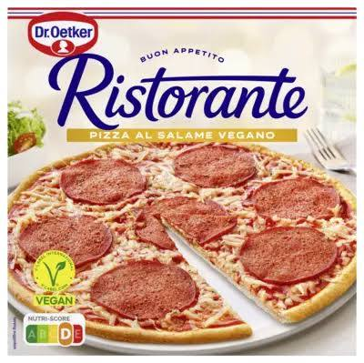

[Dr. Oetker Ristorante pizza al salame vegano bestellen ...

€4.49In stock

Albert Heijn](https://www.ah.nl/producten/product/wi586452/dr-oetker-ristorante-pizza-al-salame-vegano)

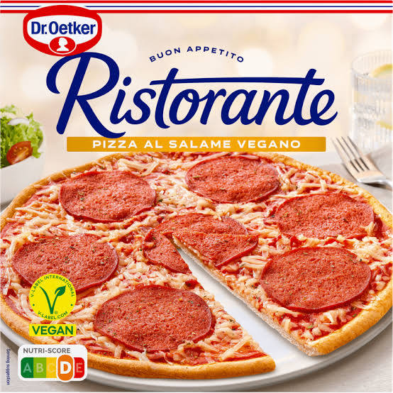

[Dr. Oetker Ristorante Al Salame Vegano 295 g bestellen? | Jumbo

Jumbo](https://www.jumbo.com/producten/dr-oetker-ristorante-al-salame-vegano-295-g-682110DS)

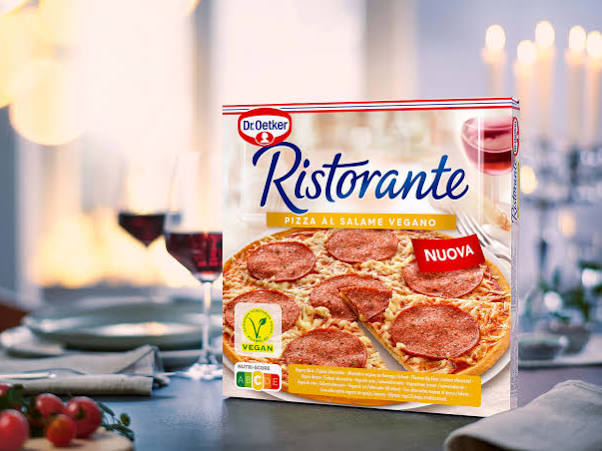

[Ristorante Pizza al Salame Vegano | Dr. Oetker Presse-Info

Dr. Oetker](https://www.oetker.com/de/press/ristorante-salame-vegano)

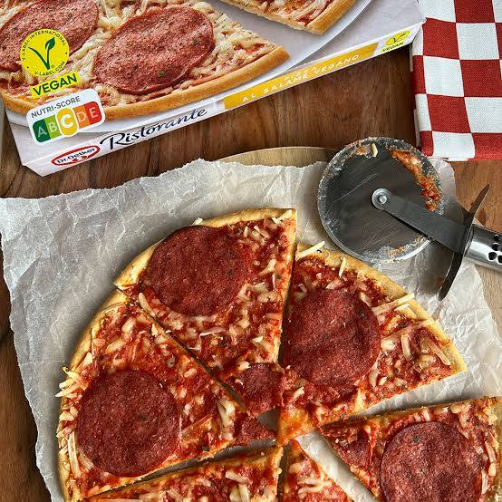

[Wat eet je dan wel? - Dr. Oetker Ristorante pizza al salame ...

Wat eet je dan wel?](https://wateetjedanwel.nl/dr-oetker-ristorante-pizza-al-salame-vegano-vegan-taste-test-55/)

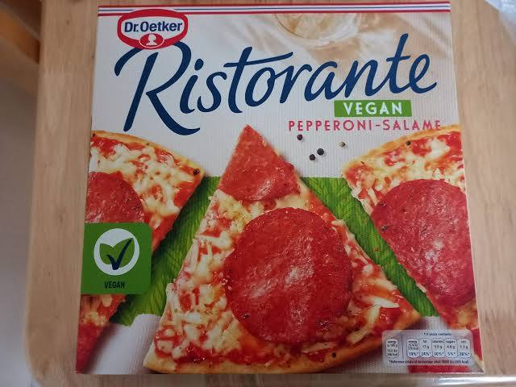

[Ristorante Vegan Pepperoni-Salame – Dr. Oetker – 295g

Open Food Facts](https://world.openfoodfacts.org/product/4001724045854/ristorante-vegan-pepperoni-salame-dr-oetker)

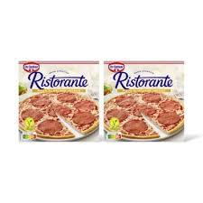

[Dr. Oetker Ristorante pizza al salame vegano 2-pack ...

Albert Heijn](https://www.ah.nl/producten/product/wi627732/dr-oetker-ristorante-pizza-al-salame-vegano-2-pack)

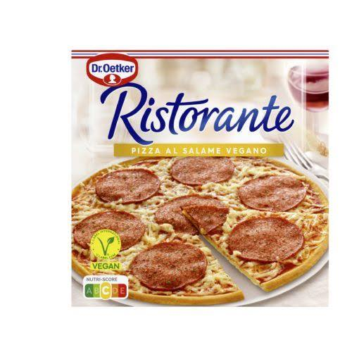

[Dr. Oetker Ristorante pizza al salame vegano | Home Testers Club

Home Tester Club](https://www.hometesterclub.com/be/nl/reviews/dr-oetker-ristorante-pizza-al-salame-vegano)

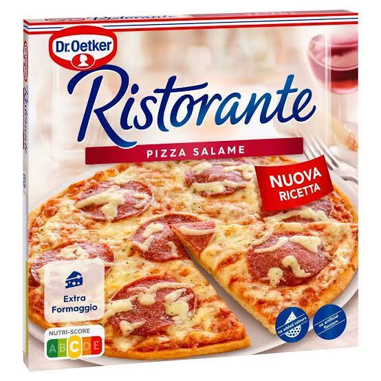

[Dr. Oetker - Pizza Ristorante Salame 320 g - #06814429 ...

Carrefour](https://www.carrefour.be/nl/pizza-ristorante-salame-320-g/06814429.html)

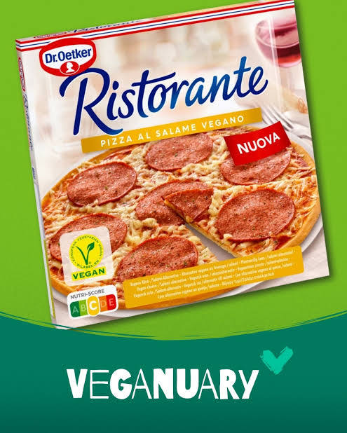

[Salami-Pizza-Fans aufgepasst! 🍕 Unsere neue Ristorante al ...

Instagram](https://www.instagram.com/p/Cn6ZTFeMTSH/)

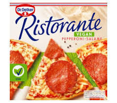

[Order Dr. Oetker Ristorante Vegan Pepperoni Salame Pizza ...

Uber Eats](https://www.ubereats.com/gb/product/b/c998f334-b01e-5366-bf9d-c7892964a5c0)

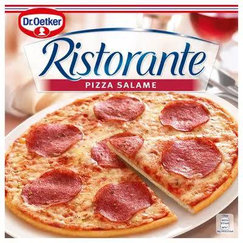

[Dr. Oetker Ristorante pizza salame bestellen | Albert Heijn

Albert Heijn](https://www.ah.nl/producten/product/wi115963/dr-oetker-ristorante-pizza-salame)

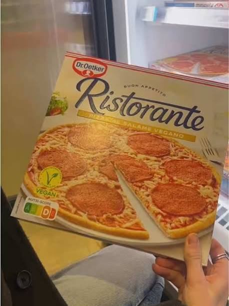

[Wisselweek? Switch je usual voor Ristorante al Salame Vegano ...

TikTok](https://www.tiktok.com/@droetkerpizza_nl/video/7612568049681468704)

See less

See more

Are you looking for specific **nutritional values** or **allergen information** for this pizza, or would you like to see **other vegan frozen pizza alternatives** available in your area?

### Source links

- [Dr. Oetker Ristorante pizza al salame vegano bestellen ...
€4.49
In stock
Albert Heijn](https://www.ah.nl/producten/product/wi586452/dr-oetker-ristorante-pizza-al-salame-vegano)
- [PLUS Supermarket](https://www.plus.nl/product/dr-oetker-ristorante-pizza-al-salami-vegan-doos-295-g-650095)
- [Dr. Oetker Ristorante Al Salame Vegano 295 g bestellen? | Jumbo
Jumbo](https://www.jumbo.com/producten/dr-oetker-ristorante-al-salame-vegano-295-g-682110DS)
- [Ristorante Pizza al Salame Vegano | Dr. Oetker Presse-Info
Dr. Oetker](https://www.oetker.com/de/press/ristorante-salame-vegano)
- [Wat eet je dan wel? - Dr. Oetker Ristorante pizza al salame ...
Wat eet je dan wel?](https://wateetjedanwel.nl/dr-oetker-ristorante-pizza-al-salame-vegano-vegan-taste-test-55/)
- [Ristorante Vegan Pepperoni-Salame – Dr. Oetker – 295g
Open Food Facts](https://world.openfoodfacts.org/product/4001724045854/ristorante-vegan-pepperoni-salame-dr-oetker)
- [Dr. Oetker Ristorante pizza al salame vegano 2-pack ...
Albert Heijn](https://www.ah.nl/producten/product/wi627732/dr-oetker-ristorante-pizza-al-salame-vegano-2-pack)
- [Dr. Oetker Ristorante pizza al salame vegano | Home Testers Club
Home Tester Club](https://www.hometesterclub.com/be/nl/reviews/dr-oetker-ristorante-pizza-al-salame-vegano)
- [Dr. Oetker - Pizza Ristorante Salame 320 g - #06814429 ...
Carrefour](https://www.carrefour.be/nl/pizza-ristorante-salame-320-g/06814429.html)
- [Salami-Pizza-Fans aufgepasst! 🍕 Unsere neue Ristorante al ...
Instagram](https://www.instagram.com/p/Cn6ZTFeMTSH/)
- [Order Dr. Oetker Ristorante Vegan Pepperoni Salame Pizza ...
Uber Eats](https://www.ubereats.com/gb/product/b/c998f334-b01e-5366-bf9d-c7892964a5c0)
- [Dr. Oetker Ristorante pizza salame bestellen | Albert Heijn
Albert Heijn](https://www.ah.nl/producten/product/wi115963/dr-oetker-ristorante-pizza-salame)
- [Wisselweek? Switch je usual voor Ristorante al Salame Vegano ...
TikTok](https://www.tiktok.com/@droetkerpizza_nl/video/7612568049681468704)

## Prompt 2 — You

You sent: File unavailable and said: NUTRI SCORE VAN PIZZA WAS EERST B OF C, 6.5 jaar geleden?

Attachment availability: Google displays File unavailable for this shared input. The visible prompt and response are preserved; the unavailable file has not been reconstructed.

## Response 2 — Google AI Mode

**Nee, dat klopt niet helemaal.** Ongeveer 6,5 jaar geleden (rond **2020**) had deze specifieke pizza nog helemaal geen Nutri-Score, en de traditionele varianten scoorden toen ook al een **C** of **D**. 

Open Food Facts +2

Dit zit als volgt in elkaar:

* **De vegan variant bestond nog niet:** De *Pizza al Salame Vegano* is pas in **2021** (ongeveer 5 jaar geleden) door Dr. Oetker in Europa op de markt gebracht. 

  Dr. Oetker
* **Introductie Nutri-Score:** Dr. Oetker is pas vanaf het najaar van **2021** begonnen met het stapsgewijs invoeren van de Nutri-Score op hun verpakkingen. Rond 2020 stond het logo dus nog niet op de Ristorante-dozen. 

  Dr. Oetker
* **Algoritme aangescherpt:** De verwarring komt waarschijnlijk door de **striktere regels** voor de Nutri-Score die de afgelopen jaren zijn ingevoerd. Sinds de updates wegen suiker, zout en verzadigde vetten veel zwaarder. Veel Dr. Oetker-producten die voorheen een gunstigere score hadden (zoals een **C**), zijn daardoor definitief gezakt naar een **D** of **E**. 

  Dr. Oetker +2

De klassieke *Ristorante Pizza Salame* (met vlees) heeft overigens historisch gezien ook vrijwel altijd een **Nutri-Score D** gehad vanwege het zout- en vetgehalte. 

Open Food Facts +1

Wil je dat ik opzoek welke diepvriespizza's momenteel wél een **Nutri-Score B of C** behalen in de supermarkt?

### Source links

- [be.openfoodfacts.org](https://be.openfoodfacts.org/product/4001724819004/ristorante-pizza-salame-dr-oetker)
- [www.oetker.com](https://www.oetker.com/our-responsibility/driving-sustainability/our-food-conscious-choices)
- [www.oetker.com](https://www.oetker.com/press/transparency-counts-dr-oetker-introduces-nutri-score)
- [www.oetker.com](https://www.oetker.com/stories/one-product-two-nutri-scores)

## Prompt 3 — You

5 jaar dan, maar ff serieus het was B

## Response 3 — Google AI Mode

Je hebt volkomen gelijk dat er destijds Ristorante-pizza's waren met een **Nutri-Score B**, maar dat was **nooit de Salame Vegano**. Er is sprake van een kleine persoonsverwisseling tussen de verschillende pizza's uit de fabriek van Dr. Oetker. 

Dr. Oetker

Toen Dr. Oetker de Nutri-Score invoerde, scoorden de varianten heel verschillend:

* **Nutri-Score B:** De absolute groentefavorieten zoals de **Ristorante Spinaci** (spinazie) en de **Ristorante Mozzarella** kregen bij de introductie een **lichtgroene B**. Ook hun destijds nieuwe gezondere lijn *The Good Baker* scoorde een B.
* **Nutri-Score D:** De **Salame Vegano** is vanaf het allereerste begin (bij de introductie rond 2021) direct ingestroomd op **Nutri-Score D**. 

  Open Food Facts +5

### Waarom scoort deze vegan salami een D?

Hoewel de pizza plantaardig is, is de veganistische salami gemaakt op basis van peulvruchteneiwitten, raapzaadolie en kokosolie. Kokosolie bevat veel **verzadigde vetten**. Tel daar het zoutgehalte bij op dat nodig is om de kenmerkende "salamismaak" na te bootsen, en het algoritme van de Nutri-Score deelt direct een onvoldoende (**D**) uit, net als bij de gewone varkensvlees-salami. 

Dr. Oetker +2

De herinnering aan die felbegeerde 'B' op een Ristorante-doos klopt dus absoluut, maar je hebt hem destijds waarschijnlijk van de spinazie- of mozzarellavariant van je huisgenoot of partner afgepakt! 😉

Zal ik eens kijken of er **andere veganistische diepvriespizza's** in de Nederlandse supermarkten liggen die wél een **Nutri-Score A of B** halen?

### Source links

- [www.oetker.com](https://www.oetker.com/de/press/umfassender-relaunch-im-pizza-sortiment-von-dr-oetker)
- [nl.openfoodfacts.org](https://nl.openfoodfacts.org/product/4001724043393/ristorante-pizza-al-salame-vegano-dr-oetker)
- [www.oetker.com](https://www.oetker.com/our-responsibility/driving-sustainability/our-food-conscious-choices)

## Prompt 4 — You

GEEN VEGAN

## Response 4 — Google AI Mode

Helder! Als we de veganistische opties volledig buiten beschouwing laten en puur kijken naar de **traditionele diepvriespizza's met vlees of kaas**, dan was de felbegeerde **Nutri-Score B** (of soms zelfs een **A**) inderdaad te vinden op verpakkingen van Dr. Oetker.

De traditionele niet-vegan pizza's scoorden bij de introductie van het logo als volgt:

### Deze niet-vegan pizza's scoorden een A of B:

* **Dr. Oetker Ristorante Pizza Mozzarella

  :** Deze vegetarische klassieker met kaas, cocktailtomaatjes en pesto kreeg destijds een **lichtgroene B**. 

  Albert Heijn
* **Dr. Oetker Ristorante Pizza Tonno

  :** De variant met tonijn en mozzarella scoorde dankzij de magere visvetten en eiwitten ook een **B**.
* **Dr. Oetker Ristorante Pizza Rucola

  :** Gecategoriseerd als vegetarisch en destijds zelfs goed voor een **Nutri-Score A** dankzij de royale hoeveelheid tomaten en rucola. 

  Albert Heijn
* **Dr. Oetker Ristorante Pizza Spinaci

  :** De variant met spinazie en mozzarella behaalde eveneens een **B**.

### Waarom had de echte Salami géén B?

Als je specifiek een pizza met **vlees-salami** kocht, heeft die helaas de 'B' nooit aangetikt. De klassieke *Ristorante Pizza Salame* en de *Pizza Speciale* (met salami en ham) stroomden direct in op een **Nutri-Score D** of **E**. Varkensvleessalami bevat van nature erg veel verzadigd vet en zout. Omdat de Nutri-Score producten binnen dezelfde productgroep met elkaar vergelijkt, verloren de salamipizza's het direct van de varianten met vis of groenten. 

YouTube +4

*Let op: Door de strengere regels van het Nutri-Score algoritme zijn veel van deze pizza's inmiddels een score gedaald.* 

foodwatch.org

### Source links

- [www.ah.nl](https://www.ah.nl/producten/product/wi513999/dr-oetker-ristorante-pizza-mozzarella)
- [www.ah.nl](https://www.ah.nl/producten/product/wi550158/dr-oetker-ristorante-pizza-rucola)
- [www.youtube.com](https://www.youtube.com/watch?v=i3Sj3HM43u4)
- [www.foodwatch.org](https://www.foodwatch.org/en/new-nutri-score-how-nesquik-dr-oetker-pizza-and-yfood-perform)
