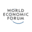

# Wilde Dier Afrikaans Gewond

Captured: 2026-10-23T21:06:08.878Z

Source: https://www.google.com/search?gs_lcrp=EgZjaHJvbWUyBggAEEUYOdIBCTExNzcwajBqN6gCALACAA&sourceid=chrome&ie=UTF-8&ntc=1&sxsrf=APpeQntXrI8Ofez3aT_Uiu8eVb0lliVSKg%3A1792783837624&cs=1&udm=50&atvm=2&mstk=AUtExfAas8DtpUi1tyXNsQvXS7YELEF8witxU42FtzH_lVdG1C_JhGAlxGXsHHxAmj8T5I03g66imXhFYDJ3Zzzke_8t_--Wp3-8v2AT3Ls4ndacYlbBGqCxD5ShMsX9csJR9Uh4oGXJoQ8L54OpDmugvuzTC_XCFsG-zkjY1IOjVi8umtdF3fw__32AY66NLbcFm9FENQWS8u6d8QEKS4JOSrJxztrxY0OUX_pDRknF89F3IxSI7r1atl7HpXIRjD7BMdw6dxBUEw277A&mtid=xLfbarfJKfmQi-gPo6m2gAQ&csuir=1&aep=26&q=wilde+dier+afrikaans+gewont&ved=0CAEQ2_wOahcKEwiY7MOC9dCXAxUAAAAAHQAAAAAQOw

## Prompt 1 — You

wilde dier afrikaans gewont

## Response 1 — Google AI Mode

Bedoel je dat er een **wilde dier in Afrika gewond** is geraakt, of zoek je informatie over hoe vaak mensen en wilde dieren gewond raken door onderlinge conflicten?

Omdat de zoekterm een beetje onduidelijk is ("wilde dier afrikaans gewont"), help ik je graag op weg op basis van de meest waarschijnlijke onderwerpen:

### 1. Conflicten tussen mensen en wilde dieren

In Afrika komen mens-dier-conflicten helaas vaak voor. Wanneer dorpen of landbouwgronden grenzen aan natuurparken, gebeurt het regelmatig dat olifanten oogsten vernielen, of dat roofdieren zoals leeuwen en nijlpaarden vee of mensen aanvallen. Hierbij raken regelmatig **mensen en dieren gewond of dodelijk getroffen**. Uit wraak of zelfverdediging worden wilde dieren daarna soms opgespoord en verwond of gedood. 

Out in Africa +1

### 2. Gevaarlijke dieren in Afrika

Als je wilt weten welke dieren de meeste verwondingen of slachtoffers veroorzaken, staat de **muskiet (mug)** stipt op nummer één vanwege het overbrengen van malaria. Kijken we puur naar grotere zoogdieren, dan zijn dit de gevaarlijkste: 

Out in Africa

* **Nijlpaard:** Zeer territoriaal en agressief, zowel in het water als op het land.
* **Kaapse buffel:** Onvoorspelbaar en krachtig; ze vallen snel aan als ze zich bedreigd voelen.
* **Nijlkrokodil:** Verantwoordelijk voor honderden gevaarlijke aanvallen per jaar op mensen die vissen of wassen in rivieren. 

  Travelnauts +2

### 3. Bedreigde of gewonde diersoorten

Het kan ook zijn dat je zoekt naar een specifiek dier dat er 'gehavend' of bijzonder uitziet, of een soort die ernstig in zijn voortbestaan wordt bedreigd door toedoen van stropers (zoals strikken waarin ze gewond raken): 

GaiaZOO

* **Afrikaanse wilde hond:** Dit is een van de meest bedreigde roofdieren van Afrika. Ze raken vaak ernstig gewond of overlijden door illegale valstrikken van stropers. 

  Van Verre Reizen +1
* **Stropersslachtoffers:** Grote zoogdieren zoals de **neushoorn en de olifant** worden vaak zwaar verwond of gedood door stropers die uit zijn op hun hoorns of slagtanden. 

  Charlie's Travels

Om je beter te kunnen helpen, hoor ik graag:

* Bedoel je een **specifiek nieuwsbericht** over een gewond dier in Afrika?
* Zoek je informatie over **eerste hulp bij een ontmoeting** met een wild dier?
* Wil je meer weten over **mens-dier-conflicten** of wildregulatie?

### Source links

- [www.outinafrica.com](https://www.outinafrica.com/blog/wat-zijn-de-10-gevaarlijkste-dieren-in-afrika/)
- [travelnauts.nl](https://travelnauts.nl/reisblogs/dieren-in-afrika-van-big-five-tot-shy-five/)
- [www.gaiazoo.nl](https://www.gaiazoo.nl/dier/afrikaanse-wilde-hond/)
- [www.vanverre.nl](https://www.vanverre.nl/zuid-afrika/informatie/dieren/overige-zoogdieren)
- [charlies-travels.com](https://charlies-travels.com/afrika-natuur-en-dieren/)

## Prompt 2 — You

muskiet Bill Gates en Melinda Gates Microsoft Tom Klootwijk

## Response 2 — Google AI Mode

Het lijkt erop dat je verschillende losse termen combineert die te maken hebben met **Bill Gates, Microsoft, muggenbestrijding** én mogelijk een specifieke persoon of grap.

Dit is hoe deze onderwerpen met elkaar samenhangen:

### 1. Bill & Melinda Gates, Microsoft en de 'Muskiet'

**Bill Gates** en zijn ex-vrouw **Melinda French Gates** zetten zich via hun liefdadigheidsinstelling, de [Bill & Melinda Gates Foundation](https://www.gatesfoundation.org/), al tientallen jaren intensief in voor het **uitroeien van malaria**. Omdat malaria wordt overgedragen door de anofeles-muskiet (mug), investeert de stichting miljarden in muggenbestrijding, genetisch gemodificeerde muggen en vaccins. 

People.com

* *Bekend moment:* Tijdens een TED-presentatie in 2009 liet Bill Gates live een zwerm (niet-besmette) muggen los in de zaal onder het motto: *"Niet alleen arme mensen zouden dit moeten ervaren."*

### 2. De link met Tom Klootwijk

Er is **geen publieke of officiële link** tussen de Microsoft-oprichter en iemand genaamd **Tom Klootwijk**. Online profielen laten zien dat Tom Klootwijk werkzaam is als *Creative Technologist* in de IT-sector in Amsterdam. 

LinkedIn +1

Als de naam "Tom Klootwijk" in één adem wordt genoemd met Bill Gates en de muskiet, kan dit duiden op:

* Een **binnenpretje, internetmeme of grap** binnen een specifiek (IT-)bedrijf of vriendengroep.
* Een fictief voorbeeld of 'placeholder'-naam die in een presentatie of discussie over Microsoft/technologie is gebruikt.

Wil je dat we uitzoeken of **Tom Klootwijk** aan een specifiek IT-project heeft gewerkt dat raakt aan Microsoft-technologie, of zocht je naar een specifieke **theorie of grap** rondom de Gates Foundation?

### Source links

- [Bill & Melinda Gates Foundation](https://www.gatesfoundation.org/)
- [people.com](https://people.com/bill-gates-admits-cheating-on-melinda-with-russian-women-apologizes-epstein-ties-11914022)
- [nl.linkedin.com](https://nl.linkedin.com/in/tom-klootwijk-8747848)

## Prompt 3 — You

dus Bill Gates houdt van de zwarte en siccle cell found in people with higher counts of melanine are naturally more resistant, so he is actually helping de witte en de zwarte

## Response 3 — Google AI Mode

**Nee, dat klopt medisch gezien niet helemaal.** Er is inderdaad een fascinerende biologische link tussen malaria en sikkelcelanemie, maar dit heeft niets te maken met melanine (huidpigment) en de impact van het werk van Bill Gates ligt anders.

De werkelijkheid zit zo in elkaar:

### 1. Wat is de echte link met sikkelcelanemie?

Sikkelcelanemie is een erfelijke bloedafwijking. Het klopt dat mensen die **drager zijn van één sikkelcel-gen** (de zogeheten *sickle cell trait*) van nature **beter beschermd zijn tegen de ernstige gevolgen van malaria**. Omdat de rode bloedcellen een afwijkende vorm hebben, kan de malariaparasiet zich er minder goed in vermenigvuldigen. 

Verywell Health +3

Dit is een puur evolutionair overlevingsmechanisme: in gebieden waar veel malaria heerst, overleefden mensen met dit gen vaker. 

Sickle Cell Disease News +3

### 2. Heeft het te maken met melanine of ras?

**Nee.** Melanine bepaalt hoe donker je huid is, maar heeft geen invloed op je bloedcellen of je immuniteit tegen malaria.  
Hoewel sikkelcelanemie veel voorkomt bij mensen van Afrikaanse afkomst, is het **geen "zwarte ziekte"**. Het komt puur door de *geografische herkomst* van iemands voorouders. Je vindt de sikkelcelanemie-mutatie daarom net zo goed bij grote bevolkingsgroepen in **India, het Midden-Oosten en Zuid-Europa (zoals Griekenland en Italië)**, omdat malaria daar historisch gezien ook veel voorkwam. 

National Institutes of Health (NIH) | (.gov) +5

### 3. Wie helpt de Gates Foundation hiermee?

Door miljarden te investeren in het uitroeien van malaria (via de [Gates Foundation](https://www.gatesfoundation.org/)), helpt Bill Gates **iedereen die in malariagebieden woont**, ongeacht hun huidskleur of genen. 

Facebook·Bill Gates +1

* Hoewel dragers van het sikkelcel-gen *iets* beter beschermd zijn tegen sterfte door malaria, kunnen ze de ziekte nog steeds krijgen en verspreiden. 

  Verywell Health +1
* Mensen die **twee kopieën van het gen** erven, hebben de daadwerkelijke, zeer ernstige en pijnlijke ziekte sikkelcelanemie. Juist voor deze groep is malaria extra gevaarlijk. Naast malaria-onderzoek investeert de Gates Foundation inmiddels ook miljoenen rechtstreeks in het vinden van betaalbare gentherapieën om sikkelcelanemie zelf te genezen. 

  Medium +3

De focus van deze gezondheidsprojecten ligt dus niet op huidskleur (melanine), maar op de geografie: het redden van levens in de regio's waar de malariamug de grootste tol eist, wat met name in sub-Sahara Afrika en delen van Azië is. 

World Economic Forum +1

Wil je meer weten over hoe de **genetische mutatie van sikkelcelanemie** precies werkt, of ben je benieuwd naar de **nieuwe technologieën (zoals genetisch aangepaste muggen)** die Gates financiert om malaria te stoppen? 

Gates Notes +1

### Source links

- [www.verywellhealth.com](https://www.verywellhealth.com/sickle-cell-and-malaria-5323165)
- [sicklecellanemianews.com](https://sicklecellanemianews.com/forums/forums/topic/the-sickle-cell-and-why-it-is-in-black-people-and-why-it-makes-them-pass-out/)
- [pmc.ncbi.nlm.nih.gov](https://pmc.ncbi.nlm.nih.gov/articles/PMC3116635/)
- [Gates Foundation](https://www.gatesfoundation.org/)
- [www.facebook.com](https://www.facebook.com/BillGates/videos/a-world-without-malaria-isnt-just-a-dream/1819338782812782/)
- [futurehuman.medium.com](https://futurehuman.medium.com/bill-gates-is-investing-millions-in-a-low-cost-cure-for-sickle-cell-56fb80834672)
- [www.weforum.org](https://www.weforum.org/stories/economic-growth/bill-gates-this-is-one-of-the-greatest-success-stories-in-the-history-of-global-health)
- [www.gatesnotes.com](https://www.gatesnotes.com/work/save-lives/reader/the-buzz-stops-here)
