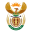
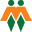
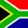
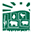
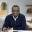

# Boeren in Afrika Gewelddadige Aanvallen

Captured: 2026-10-23T21:04:48.417Z

Source: https://www.google.com/search?q=boeren+in+afrika+aangevallen+door+zwarte+en+onteigend&gs_lcrp=EgZjaHJvbWUyBggAEEUYOdIBCTExNzcwajBqN6gCALACAA&sourceid=chrome&ie=UTF-8&fbs=ABfTbFVyMZGZf1hfvX9uKjN_-G8c4u0nXx4bEIpwm1lnNH832e5ZAsz7MVJugwShKFiA5wD7dBjItCcEQf6BM4bW_XSgKVIMAvoLi2rCqi09RmLFMwmnRWVBD63huOx5jY_HcOKMGfh74O-4scdStMhhgr2jxPQzCRYjp3CWQuZtoOhdjzJKgTfaj13bdGwntqbDctiHMoAV&aep=10&ntc=1&sxsrf=APpeQntXrI8Ofez3aT_Uiu8eVb0lliVSKg%3A1792783837624&mstk=AUtExfCIR3G-QDgFmNFNvAjKgmec-MayV8-Z-MdXUc2qagF3vIXHBU48uE6iFWuRcZQunBdOPvPxNLZV_mcHy4Pwkq8OTem12kYAyp7ax1ns1LQJGEVgX8iuIHz8qpy5oG58Fo0fDB7l-AlFD5ZiHnoq7xRLdMA6sPLnKhm2fHmOKY7DfHZaQAmnadjcdsxVX7GedfYNrRGln3qHKC3mq_6cLqwftjhfcrtuIdPg-UM_3DoTGqlkdZs9hqCaafiXieWl5jSfWpZ4edzfVw&aioh=3&csuir=1&cs=1&mtid=3rXbapSrBMaT9u8PkdvHyAY&udm=50&atvm=1

## Prompt 1 — You

boeren in afrika aangevallen door zwarte en onteigend

## Response 1 — Google AI Mode

De kwestie van de gewelddadige overvallen op boeren en de onteigening van landbouwgronden in Afrika speelt zich voornamelijk af in **Zuid-Afrika** en **Zimbabwe**. De situatie verschilt echter sterk per land wat betreft de wetgeving, historische context en de oorzaken van het geweld.

Hieronder vindt u een direct overzicht van hoe de situatie in beide landen in elkaar steekt.

### 1. Zuid-Afrika: 'Plaasmoorde' en politieke discussie

In Zuid-Afrika is er al jarenlang sprake van gewelddadige overvallen op boerderijen, lokaal bekend als **plaasmoorde**. 

NOS

* **Het geweld:** Er vinden jaarlijks tientallen dodelijke overvallen plaats op boerderijen. Omdat het merendeel van de commerciële boeren wit is, zijn de slachtoffers vaak wit. Criminologische en onafhankelijke onderzoeken wijzen uit dat de hoofdmoot van deze overvallen gemotiveerd is door **gewone criminaliteit en roof**. Boerderijen liggen vaak afgelegen en de eigenaren hebben relatief veel bezittingen, wat hen een kwetsbaar doelwit maakt. 

  Rijksuniversiteit Groningen +3
* **De genocide-discussie:** Soms beweren internationale politici of lokale actiegroepen dat er sprake is van een georganiseerde "witte genocide". Wetenschappers, mensenrechtenorganisaties en misdaadstatistieken spreken dit tegen. Hoewel het geweld buitengewoon wreed kan zijn, vormen de moorden op boeren statistisch gezien een fractie van het totale aantal moorden in het land, dat kampt met een algemeen zeer hoog misdaadcijfer. 

  NOS +6
* **Onteigening:** Sinds het einde van de Apartheid in 1994 is de verdeling van landbouwgrond een gevoelig punt; het grootste deel is nog steeds in handen van de witte minderheid. De Zuid-Afrikaanse overheid (geleid door het ANC) heeft gedebatteerd over grondwetswijzigingen om **onteigening zonder compensatie** mogelijk te maken voor een versnelde herverdeling. Tot op heden verloopt de landhervorming via wettelijke en parlementaire wegen, en is er geen sprake van grootschalige, gewelddadige staatsonteigeningen zoals destijds in Zimbabwe. 

  NOS +3

### 2. Zimbabwe: Historische landhervormingen onder Mugabe

In Zimbabwe heeft in het verleden wél een grootschalige en gewelddadige onteigening plaatsgevonden.

* **De onteigeningen (vanaf 2000):** Onder het regime van de voormalige president Robert Mugabe startte de overheid rond de eeuwwisseling met de **gewelddadige inname van boerderijen** van witte eigenaren. Duizenden witte boeren werden destijds gedwongen hun land te verlaten, vaak door militante groepen die door de staat werden gesteund. 

  Trouw +2
* **Gevolgen:** Dit leidde tot de ineenstorting van de Zimbabaanse landbouwsector en een enorme economische crisis. Inmiddels heeft de huidige regering van Zimbabwe geprobeerd de relaties te herstellen door compensaties aan te bieden aan onteigende boeren of hen uit te nodigen terug te keren. 

  AD.nl

### Directe vergelijking tussen de twee landen

| Aspect | Zuid-Afrika | Zimbabwe |
| --- | --- | --- |
| **Status van onteigening** | Politiek en juridisch debat over grondwetswijzigingen; overdracht verloopt (grotendeels) via compensatie. | Grootschalige, door de staat gesteunde onteigeningen vonden plaats rond het jaar 2000. |
| **Aard van het geweld** | Roofovervallen en zware criminaliteit op afgelegen locaties. | Politiek gestuurde landbezettingen en verdrijvingen. |
| **Huidige situatie** | Boerenorganisaties eisen betere beveiliging tegen bendes. | Overheid biedt (financiële) compensatie aan gedupeerde ex-boeren. |

Wilt u meer specifieke informatie over de **Zuid-Afrikaanse misdaadstatistieken** rondom boerderijovervallen, of bent u benieuwd naar de huidige status van de **landhervormingswetten** in Zuid-Afrika?

### Source links

- [nos.nl](https://nos.nl/artikel/2200541-witte-boeren-willen-hardere-aanpak-tegen-plaasmoorde-zuid-afrika)
- [www.rug.nl](https://www.rug.nl/rechten/recht-en-samenleving/blog/onteigening-zonder-compensatie-in-zuid-afrika-nederland-stel-je-constructief-op-19-12-2018)
- [nos.nl](https://nos.nl/artikel/2568316-trumps-witte-genocide-in-zuid-afrika-onderdeel-van-grotere-complottheorie)
- [nos.nl](https://nos.nl/video/2248064-strijd-om-land-van-boeren-in-zuid-afrika)
- [www.trouw.nl](https://www.trouw.nl/opinie/zwart-geweld-tegen-zwart-in-afrika~b9b50f4a/)
- [www.ad.nl](https://www.ad.nl/buitenland/zimbabwe-biedt-aan-onteigend-land-terug-te-geven-aan-buitenlandse-boeren~aa46957a/)

## Prompt 2 — You

hoe gevaarlijk daar in afrika?

## Response 2 — Google AI Mode

**Afrika is een enorm continent van 54 landen, waardoor de veiligheid per regio, land en zelfs per stad sterk verschilt.** Het is daarom niet mogelijk om te spreken over "hoe gevaarlijk het daar is" voor het hele continent. Sommige landen behoren tot de veiligste reisbestemmingen ter wereld, terwijl andere regio's door oorlogen of terrorisme extreem gevaarlijk zijn.

Als we specifiek kijken naar de landen uit het vorige antwoord (**Zuid-Afrika** en **Zimbabwe**), dan is de veiligheidssituatie als volgt:

### Zuid-Afrika: Hoog misdaadcijfer

Zuid-Afrika is een land met prachtige natuur en een sterke economie, maar het kampt met **zeer hoge misdaadcijfers**.

* **Risico's:** Gewelddadige criminaliteit zoals gewapende overvallen, autokapingen, diefstal en verkrachting komen helaas veel voor. Dit speelt zich met name af in de townships (arme buitenwijken) en specifieke delen van grote steden zoals Johannesburg en Kaapstad, maar ook op afgelegen boerderijen.
* **Toerisme en veiligheid:** Jaarlijks reizen miljoenen toeristen veilig door het land. Dit vereist wel constante alertheid. Reizigers moeten 's avonds niet over straat lopen, waardevolle spullen niet in het zicht dragen, en alleen gebruikmaken van veilige transportopties (zoals geregistreerde taxi's of Uber).

### Zimbabwe: Politiek stabieler, maar economisch kwetsbaar

Zimbabwe is qua gewelddadige criminaliteit over het algemeen **veiliger voor reizigers dan Zuid-Afrika**, maar kent andere uitdagingen.

* **Risico's:** De criminaliteitscijfers zijn relatief laag. Het grootste risico voor bezoekers is de instabiele economische situatie, wat kan leiden tot brandstoftekorten, stroomuitval of problemen met geldopnames. Soms zijn er politieke demonstraties in de hoofdstad Harare die onrustig kunnen verlopen.
* **Toerisme:** Grote toeristische trekpleisters, zoals de Victoriawatervallen, gelden als zeer veilig en goed gereguleerd.

---

### Veiligheid in de rest van Afrika

Om een breder beeld te geven, kan het continent grofweg in drie veiligheidscategorieën worden verdeeld:

* **Veilige en stabiele landen:** Landen als **Namibië, Botswana, Mauritius, Marokko en Rwanda** staan bekend als zeer veilig. Rwanda wordt bijvoorbeeld vaak genoemd als een van de veiligste landen ter wereld, ook voor soloreizigers. Hier is de politieke situatie stabiel en is zware misdaad zeldzaam.
* **Landen met verhoogde waakzaamheid:** Landen zoals **Kenia, Tanzania en Egypte**. Deze landen ontvangen miljoenen toeristen voor safari's en strandvakanties. De toeristische zones zijn streng beveiligd, maar in de grote steden moet je alert zijn op zakkenrollers en oplichting, en bepaalde grensregio's moeten worden vermeden.
* **Extreem gevaarlijke regio's (niet reizen):** Landen die te maken hebben met actieve burgeroorlogen, terrorisme of totale wetteloosheid. Voorbeelden hiervan zijn **Somalië, Zuid-Soedan, de Centraal-Afrikaanse Republiek, Libië en grote delen van de Sahel-regio (Mali, Niger, Burkina Faso)**. Overheden wereldwijd geven voor deze gebieden een rood reisadvies af.

Het actuele en officiële reisadvies per land is altijd te controleren via de [Reisadviezen van het Nederlandse Ministerie van Buitenlandse Zaken](https://www.nederlandwereldwijd.nl/reisadvies).

Bent u van plan om naar een **specifiek land of specifieke regio** in Afrika te reizen? Als u de bestemming deelt, kan ik u voorzien van het actuele veiligheidsadvies en praktische voorzorgsmaatregelen voor die plek.

### Source links

- [Reisadviezen van het Nederlandse Ministerie van Buitenlandse Zaken](https://www.nederlandwereldwijd.nl/reisadvies)

## Prompt 3 — You

nee ik bedoel boer vs zwarte kontras

## Response 3 — Google AI Mode

Wanneer we specifiek kijken naar het contrast tussen de (vaak witte) boeren en de zwarte bevolking in de context van het geweld in Zuid-Afrika, is er sprake van een **grote maatschappelijke en demografische complexiteit**. Het contrast tussen beide groepen uit zich voornamelijk op de volgende manieren:

### 1. Slachtoffers: Zowel zwart als wit

Hoewel de politieke aandacht in de media vaak uitgaat naar de witte boeren, tonen officiële misdaadstatistieken van de Zuid-Afrikaanse Politiedienst (SAPS) aan dat het geweld op boerderijen **geen eenzijdig raciaal conflict** is. 

DIRCO

* **Zwarte slachtoffers:** Een aanzienlijk deel van de slachtoffers bij boerderijovervallen is zwart. Dit betreft meestal zwarte landarbeiders, beveiligers of zwarte boeren zelf. In veel kwartalen zijn er zelfs statistisch meer zwarte dan witte slachtoffers te betreuren bij incidenten in landbouwgemeenschappen. 

  Geografie.nl +2
* **Witte slachtoffers:** Witte commerciële boeren lopen door hun geïsoleerde ligging en relatieve welvaart een statistisch verhoogd risico op een overval in vergelijking met het landelijk gemiddelde. 

  The Common Sense +1

### 2. De daders en de motivatie

De daders van boerderijovervallen zijn in de absolute meerderheid van de gevallen jonge, zwarte mannen uit nabijgelegen townships of informele nederzettingen. Dit scherpt het raciale contrast in de beleving van de criminaliteit sterk aan. 

Parliamentary Monitoring Group | South Africa +1

Criminologisch onderzoek van organisaties zoals het [Institute for Security Studies (ISS)](https://issafrica.org/) wijst echter uit dat de motivatie **vrijwel altijd financieel en crimineel** is, en niet ideologisch of racistisch gedreven. De daders zoeken naar contant geld, vuurwapens en elektronica op afgelegen plekken waar de politie traag reageert. 

Human Rights Watch +3

### 3. Economische ongelijkheid als katalysator

Het contrast tussen boer en arbeider is in Zuid-Afrika vaak nog steeds verdeeld langs raciale lijnen vanwege de erfenis van de Apartheid. 

Parliamentary Monitoring Group | South Africa

* Veel witte boeren bezitten grote, winstgevende commerciële bedrijven en wonen in goed beveiligde, relatief welvarende huizen.
* De zwarte landarbeiders en inwoners van de omliggende gebieden leven daarentegen vaak in extreme armoede met weinig economische vooruitzichten. 

  Parliamentary Monitoring Group | South Africa

Mensenrechtenorganisaties wijzen erop dat deze enorme **sociaaleconomische kloof** de criminaliteit in de hand werkt. Het contrast in rijkdom maakt de boerderijen een aantrekkelijk doelwit voor criminele bendes. 

Parliamentary Monitoring Group | South Africa

### 4. Het contrast in politieke beleving

Er is een scherp contrast in hoe beide groepen naar de situatie kijken:

* **Perspectief van boerenorganisaties:** Belangenorganisaties zoals [AfriForum](https://afriforum.co.za/en/) benadrukken de extreme wreedheid en martelingen die soms tijdens de overvallen plaatsvinden. Zij eisen dat de overheid 'plaasmoorde' classificeert als een prioriteitsmisdaad en pleiten voor betere zelfverdedigingsrechten en lokale burgerwachten. 

  AfriForum +3
* **Perspectief van de overheid en burgerrechtenactivisten:** De regering benadrukt dat *iedereen* in het land lijdt onder de extreem hoge misdaadcijfers (met jaarlijks meer dan 26.000 moorden landelijk, waarvan het overgrote deel in de zwarte townships plaatsvindt). Zij waarschuwen dat het focussen op slechts één raciale groep de rest van de rurale bevolking – die vaak nog kwetsbaarder is en minder geld heeft voor private beveiliging – tekortdoet. 

  Brand South Africa +3

### Source links

- [dirco.gov.za](https://dirco.gov.za/south-african-government-sets-record-straight-on-farm-crime/)
- [geografie.nl](https://geografie.nl/artikel/trump-en-de-vermeende-genocide-op-witte-boeren)
- [www.thecommonsense.co.za](https://www.thecommonsense.co.za/Politics/just-how-dangerous-south-african-farm-we-ran-numbers)
- [pmg.org.za](https://pmg.org.za/committee-meeting/11476/)
- [Institute for Security Studies (ISS)](https://issafrica.org/)
- [www.hrw.org](https://www.hrw.org/reports/2001/safrica2/Safarms7.htm)
- [AfriForum](https://afriforum.co.za/en/)
- [afriforum.co.za](https://afriforum.co.za/en/safety/neighbourhood-watches/farm-attacks/)
- [www.brandsouthafrica.com](https://www.brandsouthafrica.com/stay-updated/local-news/how-south-africa-is-strengthening-rural-safety/)

## Prompt 4 — You

hoe rijk zijn die boeren in afrika (witte) versus de rest van de wereld en wat produceren ze

## Response 4 — Google AI Mode

**Witte commerciële boeren in Afrika (vooral in Zuid-Afrika) zijn op papier vermogend door hun grond en kapitaalgoederen, maar qua liquide inkomsten en marges zijn ze vergelijkbaar met of lager gesitueerd dan westerse boeren.** In lokaal perspectief zijn ze extreem rijk ten opzichte van de omliggende bevolking, maar op wereldniveau vallen ze grotendeels in de internationale midden- tot hogere middenklasse van de agrarische sector. 

The Conversation +1

Zij beheren grootschalige, moderne landbouwbedrijven en zijn een cruciale motor voor zowel de binnenlandse voedselzekerheid als de wereldwijde export. 

International Trade Administration (.gov) +1

### 1. Hoe rijk zijn ze vergeleken met de rest van de wereld?

* **Rijkdom op papier (bezit):** Veel commerciële boerderijen in Zuid-Afrika zijn enorm in omvang—vaak honderden tot duizenden hectares. Het bezit van land, moderne machines (zoals combine-oogstmachines en geavanceerde irrigatie) en grote veestapels vertegenwoordigt aanzienlijke boekwaarde. 

  Kwanalu +2
* **Reëel inkomen en cashflow:** Ondanks de miljoenenwaarde van de grond is farming een risicovolle sector met smalle winstmarges. Veel boeren hebben te maken met aanzienlijke bankschulden, zware klimaatschommelingen (zoals aanhoudende droogtes) en hoge operationele kosten. 

  Quora +1
* **Vergelijking met westerse boeren (EU, VS, Australië):**
  + In West-Europa en de Verenigde Staten ontvangen boeren substantiële staatssubsidies (zoals via het [Europees Gemeenschappelijk Landbouwbeleid](https://agriculture.ec.europa.eu/common-agricultural-policy_nl)).
  + Zuid-Afrikaanse boeren krijgen vrijwel **geen overheidssubsidies** en moeten concurreren op de open wereldmarkt, waardoor hun financiële buffers vaak kwetsbaarder zijn dan die van gesubsidieerde Europese of Amerikaanse boeren.
  + Wel hebben ze aanzienlijk lagere arbeidskosten doordat lonen voor landarbeiders in zuidelijk Afrika veel lager liggen dan in het Westen. 

    TrustAfrica
* **Het lokale contrast:** Binnen Afrika zelf is het contrast gigantisch. Een witte commerciële boer heeft doorgaans een westers consumptiepatroon, privéchauffeurs of beveiliging, en kan kinderen naar privéscholen sturen, terwijl een gemiddelde lokale landarbeider of keuterboer vaak onder of rond de armoedegrens leeft. 

  SciELO SA +1

### 2. Wat produceren deze boeren?

De commerciële agrarische sector in Zuid-Afrika is buitengewoon divers en exportgericht, met een jaarlijkse exportwaarde van meer dan 13 miljard dollar. 

Wandile Sihlobo | Substack·AgriView +1

* **Fruit en exporttuinbouw:**
  + **Citrusvruchten:** Sinaasappels, citroenen en grapefruits (Zuid-Afrika behoort tot de grootste citrusexporteurs ter wereld).
  + **Zacht- en steenfruit:** Tafeldruiven, appels, peren, avocado's, bessen en kersen.
  + **Wijn:** De wijngaarden in de West-Kaap (o.a. rond Stellenbosch en Franschhoek) produceren internationaal gerenommeerde kwaliteitswijnen. 

    AgroLatam +3
* **Akkerbouw (graan en zaden):**
  + **Maïs:** Het belangrijkste basisvoedsel van de regio (witte en gele maïs).
  + **Overige granen en gewassen:** Sojabonen, zonnebloempitten, tarwe, suikerriet en katoen. 

    Agricultural Business Chamber of South Africa +2
* **Veeteelt:**
  + **Vlees en zuivel:** Grootschalige rundveehouderijen, melkveebedrijven, varkenshouderijen en pluimvee.
  + **Schapen en geiten:** Schapenvlees en de wereldwijd toonaangevende productie van wol en mohair (angorawol).
  + **Wildfokkerij:** Veel boeren zijn overgestapt op wildboerderijen (*game farms*) voor trofeejacht, vleesverkoop en ecotoerisme. 

    International Trade Administration (.gov) +1
* **Noten:**
  + Macadamianoten en pecannoten, waarvan Zuid-Afrika een van de grootste exporteurs wereldwijd is. 

    International Trade Administration (.gov) +1

Door deze hoge productiviteit voedt deze groep niet alleen Zuid-Afrika zelf, maar bevoorraadt ze buurlanden en supermarktschappen in Europa, Azië en het Midden-Oosten. 

National Agricultural Marketing Council (NAMC) +1

### Source links

- [theconversation.com](https://theconversation.com/land-reform-in-south-africa-5-myths-about-farming-debunked-195045)
- [www.trade.gov](https://www.trade.gov/country-commercial-guides/south-africa-agricultural-commodities)
- [www.kwanalu.co.za](https://www.kwanalu.co.za/is-south-african-agriculture-really-dominated-by-big-commercial-farms-evidence-suggests-not/)
- [www.quora.com](https://www.quora.com/Are-white-farmers-in-South-Africa-rich-How-much-do-they-make-as-profit-from-their-business)
- [Europees Gemeenschappelijk Landbouwbeleid](https://agriculture.ec.europa.eu/common-agricultural-policy_nl)
- [trustafrica.org](https://trustafrica.org/reclaiming-power-farmers-grow-wealth-but-who-gets-the-value/)
- [www.scielo.org.za](https://www.scielo.org.za/scielo.php?script=sci_arttext&pid=S0301-603X2019000200008)
- [wandile.substack.com](https://wandile.substack.com/p/how-south-africas-agriculture-has)
- [www.agrolatam.com](https://www.agrolatam.com/usa/news/south-african-cherries-china-us-trade-tensions/)
- [agbiz.co.za](https://agbiz.co.za/article/south-africas-agricultural-exports-reach-a-fresh-high-in-2025-971)
- [www.namc.co.za](https://www.namc.co.za/trade-performance-of-south-africas-agricultural-sector-in-quarter-1-of-2025/)
