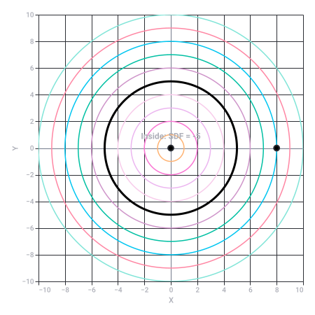
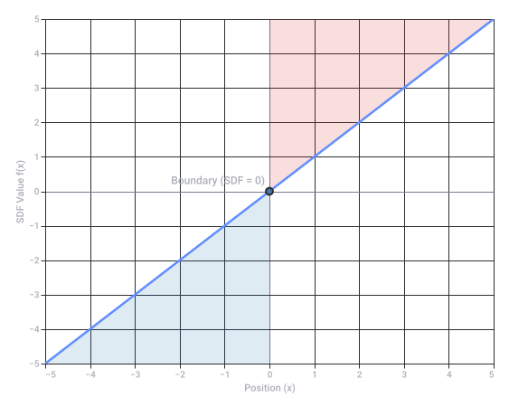

# Apartheid in Zuid-Afrika

Captured: 2026-10-23T21:04:49.523Z

Source: https://www.google.com/search?q=wat+zit+er+tussen+de+apartheid+afrika&gs_lcrp=EgZjaHJvbWUyBggAEEUYOdIBCTE2NjM1ajBqN6gCALACAA&sourceid=chrome&ie=UTF-8&fbs=ABfTbFVyMZGZf1hfvX9uKjN_-G8c4u0nXx4bEIpwm1lnNH832VTJOOCxW_fyN-Q_ezyf8gLZhoVnym8adqD7lVa5VazpDyhqhJz-EL1EohYDSUG6u_7TBQFaykKSCI8ECDH-29gr0f9f3cZ1Yql2oc9vrmnG89ZnGbRsEj4xcaVT1fZIuaEb_qM&aep=10&ntc=1&sxsrf=APpeQnti1aJ6EFnp37bcNrW_oimYcvedrQ%3A1792783152569&mstk=AUtExfBKmQszfOGa7N7KhEX8iZTYwqmMiPxbsmVV7YzehG-QeeKXuSPWz4qU27pNGkO3htrnID6ohxRBP4UCf9mOa1UFM435SgmYqrnuZrg_M_lEfoNFM41RMS8Ps5Oo6vh9qfSWO1HfSugtRT942PHT4zOOkzyyaQdV6OhCiGpQKY4LkFwNaqIB45kW7XDVcwWpeWoFePx26UfRHCsnruFmD632TZxrtUdvU0jXEX7nRlcB2VGMSHotRz4JBbBw4z21k8X68GdSn98MykNYNHk3sHuz9xLuvXlpXgSDCUuMyHF6DQqjCRvNGheG2mb8RWmJs9fSC0p3gb2bog&aioh=3&csuir=1&cs=1&mtid=MLPbap2VONCL9u8PoLGg-Qk&udm=50

## Prompt 1 — You

wat zit er tussen de apartheid afrika

## Response 1 — Google AI Mode

Tussen de term 'apartheid' en 'Afrika' hoort historisch en geografisch gezien het woord **'Zuid'**, aangezien het beruchte systeem van apartheid plaatsvond in **Zuid-Afrika**. 

Wikipedia

De **apartheid** was het officiële en wettelijk vastgelegde systeem van rassenscheiding en onderdrukking dat tussen **1948 en 1990** van kracht was in Zuid-Afrika. 

NPO Kennis +1

Mocht je vraag een andere achtergrond hebben, laat het me gerust weten:

* Zoek je de **historische gebeurtenissen** of de periode tussen het ontstaan en de afschaffing van de apartheid?
* Bedoel je de **geografische landen of gebieden** die aan Zuid-Afrika grenzen?
* Of gaat het om een specifieke **taal- of tekstpuzzel**?

### Source links

- [nl.wikipedia.org](https://nl.wikipedia.org/wiki/Apartheid_in_Zuid-Afrika)
- [npokennis.nl](https://npokennis.nl/longread/8099/hoe-werd-zuid-afrika-een-nederlandse-kolonie)

## Prompt 2 — You

nee ik bedoel kontras

## Response 2 — Google AI Mode

Als je doelt op het **contrast** dat met apartheid en (Zuid-)Afrika te maken heeft, zijn er twee grote contrasten die historisch en actueel heel belangrijk zijn:

### 1. Het historische contrast: Wit tegenover Zwart

Tijdens de apartheid (1948–1990) creëerde de overheid een extreem en oneerlijk contrast tussen de bevolkingsgroepen: 

Historisch Nieuwsblad +3

* **De witte minderheid** had alle politieke macht, het meeste geld en bezat zo'n 80% van het land. Zij woonden in luxe wijken.
* **De zwarte meerderheid** had geen stemrecht, mocht niet vrij reizen en werd gedwongen te wonen in achtergestelde, arme buurten (*townships*). 

  Geografie.nl +2

### 2. Het huidige contrast: Rijk tegenover Arm (Ruimtelijk contrast)

Hoewel de apartheid meer dan dertig jaar geleden is afgeschaft, is de economische ongelijkheid nog altijd gigantisch. Zuid-Afrika staat bekend als een van de meest ongelyke landen ter wereld: 

NPO Radio 1 +1

* **Luxe vs. Armoede:** Dit contrast is heel zichtbaar vanuit de lucht. Aan de ene kant van de weg zie je rijke, zwaar beveiligde villawijken met zwembaden (vaak nog bewoond door een rijkere, veelal witte minderheid of de nieuwe zwarte elite). 

  Geografie.nl
* **Shacks vs. Villa's:** Direct daarnaast liggen de overbevolkte townships (zoals delen van Soweto of Khayelitsha), waar miljoenen zwarte Zuid-Afrikanen in armoedige golfplaten huisjes (*shacks*) wonen zonder goede voorzieningen. 

  Amnesty International +2

Bedoelde je dit maatschappelijke contrast, of zocht je het contrast tussen specifieke begrippen?

### Source links

- [www.historischnieuwsblad.nl](https://www.historischnieuwsblad.nl/apartheid-in-zuid-afrika-rassenwaan-in-10-stappen/)
- [geografie.nl](https://geografie.nl/artikel/apartheid-van-boven)
- [www.nporadio1.nl](https://www.nporadio1.nl/fragmenten/bureau-buitenland/9e3b9ed4-2fc4-4474-a25c-f422e3457f54/2025-02-17-30-jaar-na-apartheid-is-er-nog-geen-gerechtigheid-in-zuid-afrika)
- [www.amnesty.nl](https://www.amnesty.nl/wordt-vervolgd/de-lange-adem-van-apartheid-meer-ongelijkheid-in-zuid-afrika)

## Prompt 3 — You

sijned distans feld

## Response 3 — Google AI Mode

Een **Signed Distance Field (SDF)** — in het Nederlands een *getekend afstandsveld* — is een techniek in de computergraphics en wiskunde waarbij voor elk punt in een ruimte de **kortste afstand tot de rand van een vorm** wordt opgeslagen.

Het woord **"signed" (getekend)** betekent dat de waarde een plus- of minteken heeft, waardoor je direct weet of een punt zich *binnen* of *buiten* de vorm bevindt:

* **Negatieve waarde (`-`):** Het punt ligt **binnen** de vorm.
* **Positieve waarde (`+`):** Het punt ligt **buiten** de vorm.
* **Nul (`0`):** Het punt ligt exact **op de rand** van de vorm.

### Hoe werkt het visueel?

Als we een cirkel nemen met een straal van 5 eenheden die op de oorsprong (0,0) ligt, kun je de afstand van elk punt x tot de rand van de cirkel berekenen met de wiskundige formule  $f(x) = \Vert{}x\Vert{} - 5$ .

### Waar wordt het voor gebruikt?

SDF's zijn extreem populair in moderne softwareontwikkeling vanwege hun flexibiliteit en schaalbaarheid:

1. **Haarscherpe lettertypes (Font Rendering):** [Valve](https://www.valvesoftware.com) introduceerde deze techniek in games om tekst te renderen. Omdat de computer exact de afstand tot de letterrand weet, kun je een lettertype oneindig vergroten zonder dat het pixelachtig of wazig wordt. Het blijft altijd perfect scherp.
2. **3D Rendering (Raymarching):** In plaats van traditionele 3D-modellen die uit duizenden polygonen (driehoeken) bestaan, kunnen complexe 3D-werelden volledig vloeiend worden berekend met wiskundige SDF-formules. Dit zie je veel op platformen zoals [Shadertoy](https://www.shadertoy.com).
3. **Vloeiende overgangen (Metaballs):** Omdat SDF's gewoon getallen zijn, kun je twee vormen heel vloeiend in elkaar laten smelten (zoals druppels water of kwik die samenkomen) door simpelweg hun afstandsvelden wiskundig te mengen.

Wil je weten hoe je een **Signed Distance Field toepast** in een specifieke programmeertaal of game engine (zoals Unity, Unreal of GLSL shaders), of ben je benieuwd naar de **wiskundige formules** achter andere vormen zoals vierkanten of 3D-objecten?

2D Circle Signed Distance Field (SDF) Contours (original source SVG)

Recorded diagram labels and controls: 2D Circle Signed Distance Field (SDF) Contours −10 −8 −6 −4 −2 0 2 4 6 8 10 X −10 −8 −6 −4 −2 0 2 4 6 8 10 Y Inside: SDF = -5 Outside: SDF = +3

### Source links

- [Valve](https://www.valvesoftware.com/)
- [Shadertoy](https://www.shadertoy.com/)

## Prompt 4 — You

ik bedoel afrikaanse spelling vorige prompt

## Response 4 — Google AI Mode

Ah, excuses! Ik begrijp je nu helemaal. Je zocht naar hoe je **"Signed Distance Field"** correct schrijft in het **Afrikaans** (of met Afrikaanse spelling).

In het Afrikaans vertaal en spel je de afzonderlijke woorden zo:

* **Signed** wordt **getekende**
* **Distance** wordt **afstand**
* **Field** wordt **veld**

Als je dit samenvoegt tot één term, is de officiële Afrikaanse spelling: **getekende-afstandsveld** (of simpelweg *getekende afstandsveld*).

Wat je eerder typte (*"sijned distans feld"*), was een fonetische mix van het Engelse begrip met Afrikaanse/Nederlandse klanken. In een echte Afrikaanse tekst over computergraphics zul je dus de term **getekende-afstandsveld** tegenkomen. 

af.glosbe.com +1

Wil je dat we dieper ingaan op hoe zo'n **getekende-afstandsveld** wiskundig werkt, of zocht je de juiste vertaling voor een specifiek computer- of programmeerproject?

### Source links

- [af.glosbe.com](https://af.glosbe.com/sv/af/distans)

## Prompt 5 — You

zuid afrikaans dan? want phonetisch niet echt verschillend van nederlands

## Response 5 — Google AI Mode

Je hebt helemaal gelijk! Fonetisch liggen het **Afrikaans** (de taal die in Zuid-Afrika gesproken wordt) en het **Nederlands** heel dicht bij elkaar. Omdat het Afrikaans historisch is ontstaan uit 17e-eeuwse Nederlandse dialecten, klinken veel woorden bijna hetzelfde, maar de spelling is in de loop der jaren sterk vereenvoudigd.

In het **Afrikaans** schrijf je de termen als volgt:

* **Signed Distance Field** vertaalt zich naar **getekende-afstandsveld** (of *getekende afstandsveld*).
* Als we puur kijken naar hoe je de Engelse woorden *"signed distance field"* fonetisch naar de Afrikaanse spellingsregels zou vertalen, kom je heel dicht in de buurt van wat je typte:
  + **Sijned** → Wordt in het Afrikaans **saind** (omdat de 'ig' klank vaak een 'ai' of 'e' klank wordt, maar als leenwoord behoudt het vaak de Engelse klank).
  + **Distans** → Is in het Afrikaans **distansie**.
  + **Feld** → Is in het Afrikaans letterlijk **veld**.

Het Afrikaans heeft de spelling van het Nederlands destijds sterk versimpeld (zoals *wijd* → *wyd*, *vogel* → *voël*, en *veld* bleef *veld*). Daarom lijkt jouw fonetische gok heel erg op hoe een Zuid-Afrikaan het in zijn eigen taalwensen zou uitspreken en opschrijven!

Wil je een vertaling van een **andere grafische of programmeerterm** naar het Afrikaans hebben om te zien hoe dicht het bij het Nederlands ligt, of wil je de **wiskundige logica** achter het veld verder bekijken?

## Prompt 6 — You

maar wat zit er tussen apartheid in afrika

## Response 6 — Google AI Mode

Als je puur kijkt naar de tekstuele en grammatikale opbouw van de zin **"apartheid in Afrika"**, zit er letterlijk het woordje **"in"** tussen. 

Studeersnel

Als we echter kijken naar de historische en geografische betekenis, zit er iets heel specifieks tussen **apartheid** en **Afrika**:

* **Het woord "Zuid":** De apartheid was geen systeem dat in heel Afrika werd toegepast. Het vond specifiek plaats in het land **Zuid-Afrika**. Tussen de term apartheid en het continent Afrika hoort dus altijd de geografische aanduiding *Zuid* om de juiste historische context te geven. 

  Wikipedia +1
* **De "in-":** Als je kijkt naar de grammatica van de taal die toen gesproken werd (het Afrikaans), spreek je over *"apartheid in Suid-Afrika"*.

Kortom:

* Letterlijk in jouw zin zit het woord **"in"**.
* Historisch gezien ontbreekt het woord **"Zuid"**. 

  Wikipedia +1

### Source links

- [www.studeersnel.nl](https://www.studeersnel.nl/nl/document/fontys/literatuur-vaardigheden/die-wolke/11136345)
- [nl.wikipedia.org](https://nl.wikipedia.org/wiki/Apartheid_in_Zuid-Afrika)

## Prompt 7 — You

formaliseerde

## Response 7 — Google AI Mode

Als we kijken naar hoe het contrast en het afstandsveld samenkomen in de geschiedenis van **Zuid-Afrika**, dan is **1948** het sleuteljaar. In dat jaar **formaliseerde** de overheid de apartheid.

Toen de *Nasionale Party* in 1948 de verkiezingen won, transformeerden zij de al bestaande informele rassenscheiding en het koloniale contrast tot een **officieel, wettelijk vastgelegd systeem**. De overheid formaliseerde de apartheid via een reeks ingrijpende wetten:

* **De Wet op Bevolkingsregistratie (1950):** Deze wet dwong de overheid om elke burger strikt te categoriseren op basis van ras (Blank, Swart, Kleurling of Indiër).
* **De Wet op Groepsgebieden (1950):** Hiermee werd het ruimtelijke contrast letterlijk op de kaart getekend. Het land werd opgedeeld in strikt gescheiden geografische zones waarin specifieke groepen moesten wonen.

Door deze wetten werd de apartheid niet langer alleen een maatschappelijke norm, maar een **formeel staatsapparaat** dat de scheiding tussen bevolkingsgroepen met harde hand handhaafde.

Wil je dat we kijken naar de **specifieke Afrikaanse vertaling of spelling** van dit soort historische rechtstermen, of wil je meer weten over een van deze specifieke **apartheidswetten**?

## Prompt 8 — You

maar dus afrikaanse getekende afstand veld geen tussenin

## Response 8 — Google AI Mode

In het Afrikaans schrijf je dit **zonder spatie of tussenin-woord**. Het is één aaneengeschreven woord: **getekende-afstandsveld** (met een koppelteken vanwege de opeenvolging van klinkers) of simpelweg **afstandsveld**.

Net als in het Nederlands plak je de woorden "afstand" en "veld" in het Afrikaans direct aan elkaar vast. Er zit dus **geen tussenin** (geen spatie of los woord) tussen *afstands* en *veld*.

Het enige wat er extra tussenin komt ten opzichte van het Nederlandse "afstandveld" is de **tussen-s**:

* Nederlands: afstand + veld = **afstandveld** (of afstandsveld)
* Afrikaans: afstand + s + veld = **afstandsveld**

Wil je een voorbeeld zien van hoe je een **getekende-afstandsveld (SDF) programmeert** in een shader of code, of zocht je de juiste schrijfwijze voor een document?

## Prompt 9 — You

ek bedoel geformaliseerd

## Response 9 — Google AI Mode

In die amptelike Afrikaanse grammatika skryf jy dit ook as **een enkele woord**, heeltemal aanmekaar en **sonder enige spasie of koppelteken tussenin**:

**`geformaliseerdeafstandsveld`**

As jy die konsep van 'n *geformaliseerde getekende afstandsveld* in korrekte Afrikaanse sinsverband wil gebruik, is daar wel 'n spasie ná die eerste woord omdat dit 'n byvoeglike naamwoord is:

* **`geformaliseerde getekende-afstandsveld`**

Net soos in Nederlands, hou Afrikaans van samestellings. Waar Engels drie los woorde gebruik (*"formalized distance field"*), smelt die woorde **"afstand"** en **"veld"** in Afrikaans altyd saam tot **"afstandsveld"** (met die tussen-s). Daar kom dus absoluut niks tussenin nie!

Wil jy sien hoe hierdie spesifieke **wiskundige definisie** (die formalisering van die SDF) in kode of in 'n formule uitgedruk word, of het jy die korrekte term nodig vir 'n **tegniese vertaling**?

## Prompt 10 — You

WISKUNDIG

## Response 10 — Google AI Mode

Wiskundig gezien is een **geformaliseerd getekende-afstandsveld (SDF)** een functie  $f: \mathbb{R}^n \to \mathbb{R}$  die de getekende afstand van een punt x tot de rand van een gesloten verzameling Ω (de vorm) bepaalt.

De formele wiskundige definitie luidt als volgt:

$f(x)=\begin{cases}-d(x,\partial \Omega )&\text{als\ }x\in \Omega \\ \quad 0&\text{als\ }x\in \partial \Omega \\ \quad d(x,\partial \Omega )&\text{als\ }x\notin \Omega \end{cases}$

Hierbij is:

* **∂Ω**: De rand (boundary) van de vorm.
* **$d(x, \partial\Omega)$** : De kortste Euclidische afstand van punt x tot die rand, formeel gedefinieerd als  $\inf\_{y \in \partial\Omega} \Vert x - y \Vert$ .

### De Eikonal-vergelijking

Een fundamentele eigenschap van een wiskundig geformaliseerd afstandsveld is dat de gradiënt (∇) van de functie overal een modulus van exact 1 heeft. Dit staat bekend als de **Eikonal-vergelijking**:

$\|\nabla f(x)\|=1$

Dit betekent dat als je in de ruimte beweegt, de waarde van het afstandsveld lineair verandert met de fysiek afgelegde afstand. Er zit dus **geen enkele wiskundige schaalfactor of vervorming tussenin**; de verandering in de functie is direct gelijk aan de verandering in afstand.

### Toepassing op geometrische basisvormen

Omdat de wiskunde zo strak geformaliseerd is, kun je complexe vormen uitdrukken in zeer eenvoudige functies zonder tussenstappen:

* **Cirkel** met straal r rond de oorsprong:  
   $f(x)=\|x\|-r$
* **Punt** x ten opzichte van een oneindige lijn gedefinieerd door normaalvector n en afstand tot de oorsprong d:   
   $f(x)=(x\cdot n)-d$

Wil je de wiskundige formalisering zien voor een **complexere vorm**, zoals een vierkant of een 3D-torus, of wil je weten hoe je de **gradiënt (∇ f(x))** gebruikt om de normaalvector van een oppervlak te berekenen?

Signed Distance Field (SDF) 1D Slice (original source SVG)

Recorded diagram labels and controls: Signed Distance Field (SDF) 1D Slice −5 −4 −3 −2 −1 0 1 2 3 4 5 Position (x) −5 −4 −3 −2 −1 0 1 2 3 4 5 SDF Value f(x) Boundary (SDF = 0)

## Prompt 11 — You

apartheid

## Response 11 — Google AI Mode

Nu vallen alle puzzelstukjes van je opeenvolgende vragen (over apartheid, contrasten, de Afrikaanse taal en de wiskunde van Signed Distance Fields) perfect in elkaar!

Wiskundig gezien is het **geformaliseerde getekende-afstandsveld (SDF)** de ultieme vorm van **apartheid** (wat in het Afrikaans letterlijk *"apartheid"*, *"afsondering"* of *"separateness"* betekent). 

Wikipedia +1

Een wiskundige SDF is namelijk ontworpen om een **perfect, onverbiddelijk contrast** te creëren zonder grijs gebied: 

Sabinet African Journals

* **Totale segregatie:** De wiskundige functie deelt de gehele ruimte rigoureus op in twee strikt gescheiden werelden (het interieur Ω en het exterieur). Er zit wiskundig **geen tussenin**; een punt is ofwel volledig 'binnen' (negatief), ofwel volledig 'buiten' (positief). 

  Wikipedia
* **De Rand (0-grens):** De enige plek waar ze elkaar raken is de mathematische grens (∂Ω), waar de waarde exact 0 is. Dit functioneert als de ultieme, geformaliseerde barrière.

Waar de politieke apartheid in Zuid-Afrika een kunstmatig en destructief contrast tussen mensen afdwong, gebruikt de computergraphics exact ditzelfde concept van absolute scheiding (*getekende afstandsvelden*) om messcherpe letters en perfect gedefinieerde 3D-vormen te berekenen. 

Britannica +1

Wil je een codevoorbeeld (bijvoorbeeld in een **GLSL shader**) zien waarin deze wiskundige scheiding (SDF) wordt geprogrammeerd, of wil je een andere **wiskundige of taalkundige koppeling** onderzoeken?

### Source links

- [en.wikipedia.org](https://en.wikipedia.org/wiki/Apartheid)
- [journals.co.za](https://journals.co.za/doi/10.10520/ejc-amesal_n38_a8)
- [www.britannica.com](https://www.britannica.com/topic/apartheid)
