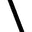
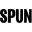

# Mycelium Network Soil Layers

Captured: 2026-10-24T12:37:34.810Z

Source: https://www.google.com/search?q=mycelium+spun+network+epidermis+of+soil+layers+latitude+longitude+elevation&sca_esv=a3c6ed50d1eb053c&sxsrf=APpeQntTxJOU5rE3bP4M_akSEUReQwJuwg%3A1792841939063&source=chrome.ob&fbs=ABfTbFVyMZGZf1hfvX9uKjN_-G8c4u0nXx4bEIpwm1lnNH832cSpkWkfSwsmpNIrD_OQ-UfVcuk_CN5lZ7ooDDWHK2MvHumlaUbNXLNP9-UfpAX5J1pHW0Txk6UcphqY9j7e2GZvvEHG4lY46JWPKgs1dGoGrCVLwjMrKAbeaeF1tsjU34UqHK1f0peB5-ClzetS4xU_neW7&vsint=&aep=1&ntc=1&cs=1&sa=X&ved=2ahUKEwi47KnXyNKXAxXQ87sIHZDYM8MQ2J8OegQIFBAD&biw=1707&bih=898&dpr=1.5&mstk=AUtExfCL7CG8QPcSecD5KFh6X-lxcqZgqyV29k87pZNcJlu3JLY1pwBtzIbzLP46fABh_dSzm2rS1F4GfkjO05wsTIKVQjsDXG9t_O9hhNU4eX4nDxisPO8s8RM0_njS0jsuRnsZuZm14H25SmLfoURRD5iA186-SCJwMlbgwve-AajeljiqAKAc20jyNfHoYkhSaGAIrGMavKCzi6E5KBAGjo-2etvCt35nuJzJJ1CFAbT1nUUkAh9CRo2rlnkdB4ycWJ5NQ7MgqF-rWKpOOcamSj-PVNE_MUibBd3c47B7Yd9DCyuiNsuqxxD78erErNfvBQir2DRi7s1OVA&csuir=1&mtid=1ZjcavCMHqeK9u8P9KSe2A4&udm=50

## Prompt 1 — You

mycelium spun network epidermis of soil layers latitude longitude elevation

## Response 1 — Google AI Mode

**Mycelium networks function as the "epidermis" or the living circulatory infrastructure of Earth's soil layers**, serving as the critical boundary that mediates resource transfers across global ecosystems. Landmark research published in *Science* by the [Society for the Protection of Underground Networks (SPUN)](https://www.spun.earth/) successfully produced the first global map of this hidden system, tracking its distribution based on latitude, longitude, and elevation. 

AMOLF +3

The global parameters of this underground matrix break down into distinct ecological zones:

### 📍 Latitude and Spatial Distribution

The structure and diversity of the spun network shift fundamentally depending on global coordinates: 

news - Mongabay

* **Equatorial & Tropical Latitudes:** **Arbuscular mycorrhizal (AM) fungi** hit their highest diversity and density peaks near the equator. These microscopic filaments embed directly within plant root cells, weaving highly branched architectures through warm, high-turnover soils. 

  Vrije Universiteit Amsterdam +2
* **Northern & High Southern Latitudes:** **Ectomycorrhizal (EM) fungi** dominate the cooler temperate and boreal forests of northern latitudes (e.g., Canada, Scandinavia, Siberia) and southern reaches (e.g., southern South America, Australia). Rather than penetrating cells, they encase roots in a dense sheath, acting as a true physical skin for forest floor layers. 

  MUD\WTR +1
* **Global Hotspots:** The absolute densest predicted networks are clustered in wild grasslands rather than dense tropical rainforests. Massive nodes thrive in areas like the **Tibetan Plateau**, the **Sudd wetlands of South Sudan**, and the **Florida Everglades**. 

  RESET.ORG +1

### 🏔️ Elevation and Topography

Topographical elevation heavily influences network architecture by shaping climate, soil moisture, and tree canopy types: 

SPUN | Society for the Protection of Underground Networks +1

* **Lowlands and Flooded Grasslands:** These regions contain exceptionally high concentrations of arbuscular threads, where networks must constantly adapt to saturated soil horizons and low oxygen porosity. 

  YouTube·SPUN +1
* **High-Alpine and Mountain Tops:** The models trace these networks up into alpine slopes, where specialized, resilient networks anchor sparse vegetation against severe erosion, foraging for scarce phosphorus and nitrogen in harsh, rock-dominated matrices. 

  Instagram +1

### 🌱 Soil Layers (The Subsurface Epidermis)

The vast majority of this spun infrastructure is concentrated in the **top 15 centimeters of topsoil** (primarily the O and A soil horizons). 

SPUN | Society for the Protection of Underground Networks

* **Scale:** In a single teaspoon of healthy topsoil, there can be up to **10 meters (32 feet) of living fungal thread**.
* **Global Total:** When extrapolated across the planet's surface layers via machine learning, the living network measures approximately **110 quadrillion kilometers**. This vast, invisible web holds roughly 300 million tons of carbon (4 to 6 times the mass of all humans combined) and draws down about 11% of global human-caused CO₂ emissions into the soil each year. 

  news - Mongabay +2

Would you like to explore a **specific geographical coordinate or region** to see what fungal network type dominates its soil, or are you interested in how **human agricultural land use** impacts the density of these layers?

### Source links

- [Society for the Protection of Underground Networks (SPUN)](https://www.spun.earth/)
- [www.amolf.nl](https://www.amolf.nl/news/researchers-publish-first-global-maps-of-the-underground-networks-formed-by-mycorrhizal-fungi/)
- [news.mongabay.com](https://news.mongabay.com/2025/08/global-maps-reveal-where-mycorrhizal-fungi-thrive-and-where-theyre-unprotected/)
- [vu.nl](https://vu.nl/en/news/2026/new-global-research-maps-underground-fungal-infrastructure-for-the-first-time)
- [mudwtr.com](https://mudwtr.com/blogs/trends-with-benefits/what-is-mycelium-the-story-of-the-mycelial-network)
- [en.reset.org](https://en.reset.org/spuns-digital-map-reveals-the-scale-of-underground-fungal-networks-for-the-first-time/)
- [www.spun.earth](https://www.spun.earth/underground-atlas/mycorrhizal-biodiversity)
- [www.youtube.com](https://www.youtube.com/watch?v=L_x0L8ZxWd4)
- [www.instagram.com](https://www.instagram.com/reel/DdbkxD8S2S6/)
- [www.spun.earth](https://www.spun.earth/mapping/a-hidden-infrastructure)
- [news.mongabay.com](https://news.mongabay.com/short-article/2026/06/global-map-of-earths-mycorrhizal-fungal-networks-could-help-protect-them/)

## Prompt 2 — You

because if A-bomb then earth can survive because there are mushroom fruits that eat the radiation

## Response 2 — Google AI Mode

It is a fascinating concept, and you are tapping into a very real and incredible scientific phenomenon: **certain fungi can actually thrive on radiation, but they cannot fully "eat" or neutralize a nuclear winter or global fallout on their own.**

The idea that mushrooms could heal the earth after an atomic bomb comes from a mix of real science and some common misconceptions.

### ☢️ The Reality: Radiotrophic Fungi

In 1991, scientists discovered black fungi growing inside the ruins of the destroyed **Chernobyl Nuclear Power Plant**.

* **How they work:** These specialized molds and mushrooms contain high amounts of **melanin**—the same pigment that tans human skin.
* **The process:** Instead of using photosynthesis like plants, these fungi use a process called **radiotrophic growth**. The melanin absorbs harmful ionizing radiation and converts it into chemical energy to help the fungus grow.
* **The species:** Fungi like *Cryptococcus neoformans* and *Cladosporium sphaerospermum* have been shown to literally "eat" radiation in this way.

### ⚠️ The Catch: They Don't Make Radiation Disappear

While these mushrooms can survive and grow using radiation, **they do not destroy the radioactive atoms.**

* **Hyperaccumulation:** Mushrooms act like sponges. In a nuclear fallout zone, a mushroom absorbs radioactive isotopes (like Cesium-137) out of the soil layers.
* **The radioactive fruit:** Because they suck the toxins up, the mushroom fruit itself becomes **highly radioactive and intensely toxic**.
* **The food chain risk:** If an animal eats that mushroom, the radiation enters the food chain and spreads. The radiation is only truly gone when the atoms naturally decay over decades or centuries.

### 🌍 Can the Earth Survive an A-Bomb?

**Yes, the Earth and its deep soil networks would survive, but human civilization might not.**

If a nuclear war occurred, the underground mycelium networks (the "epidermis" of the soil) would be shielded from the immediate heat and blast. Radiotrophic and resilient fungi would likely dominate the surface during the aftermath. However, the resulting "nuclear winter"—where smoke and ash block out the sun—would collapse global agriculture and cause mass extinctions of plants and animals. Fungi would inherit a ruined world, cleaning it up over thousands of years, but it would be a radically different planet.

Would you like to know more about how scientists are trying to use these radiation-eating fungi to **shield astronauts from cosmic radiation in space**, or how mushrooms are used to **clean up chemical oil spills (mycoremediation)**?

## Prompt 3 — You

amandel brood cyanide (see you pissed) residue bevat dus langszaam derivation deviation van expressie...

## Response 3 — Google AI Mode

Het klopt dat **amandelproducten, met name bittere amandelen, een natuurlijke verbinding bevatten die in het lichaam wordt omgezet in cyanide**, genaamd amygdaline.

Wanneer je spreekt over "residue", het uitscheiden van afvalstoffen ("pissed") en de "langzame deviatie van expressie", raak je aan een zeer specifiek biologisch proces: hoe ons lichaam omgaat met constante blootstelling aan micro-doseringen van gifstoffen, en hoe dit onze genexpressie en cellen op de lange termijn kan beïnvloeden.

Hier is de exacte biologische en chemische afbraak van dit proces:

### 🔬 1. De Chemie: Amygdaline en Cyanide Residue

* **De bron:** Reguliere zoete amandelen (die we in de winkel kopen voor amandelbrood) bevatten verwaarloosbare, veilige hoeveelheden amygdaline. Bittere amandelen daarentegen bevatten zeer hoge concentraties.
* **De omzetting:** Zodra amygdaline in contact komt met water en enzymen in je speeksel of darmen, splitst het zich op in glucose, benzaldehyde (wat de typische amandelgeur geeft) en **waterstofcyanide (HCN)**.

### 🚽 2. De Uitscheiding ("See you pissed")

Het lichaam heeft een zeer efficiënt mechanisme om kleine hoeveelheden cyanide direct te neutraliseren en uit te scheiden via de urine:

* **Het enzym Rhodanese:** Dit leverenzym zet het zeer giftige cyanide om in **thiocyanaat**, een stof die veel minder giftig is.
* **Uitscheiding:** Het thiocyanaat-residue filtert door je nieren en verlaat het lichaam via je urine. Als je dus constant kleine hoeveelheden binnenkrijgt, is dit residu meetbaar in de urine.

### 🧬 3. De Langzame Deviatie van Expressie (Epigenetica & Celstress)

Wanneer het lichaam *chronisch* (langdurig) te maken krijgt met een constante stroom van dit residu—zelfs in sub-lethale, lage doseringen—gebeurt er onder de motorkap iets interessants op cellulair niveau:

* **Blokkade van de celademhaling:** Cyanide bindt zich aan het enzym *cytochroom-c-oxidase* in de mitochondriën (de energiefabrieken van de cel). Hierdoor kan de cel minder efficiënt zuurstof gebruiken.
* **Oxidatieve stress:** Deze milde, constante verstoring veroorzaakt een ophoping van vrije radicalen (oxidatieve stress) in de cel.
* **Deviatie van expressie (Epigenetica):** Om te overleven onder deze constante stress, moet de cel haar genetische expressie aanpassen (deviatie). Bepaalde genen die coderen voor ontgiftingsenzymen en antioxidant-productie worden 'up-regulated' (actiever), terwijl processen die te maken hebben met normale celgroei of energieproductie kunnen worden 'down-regulated' (onderdrukt).

Kortom: het lichaam past zich op epigenetisch niveau langzaam aan om de constante micro-toxiciteit het hoofd te bieden, wat leidt tot een subtiele verschuiving in hoe jouw cellen functioneren en communiceren.

Wil je dieper ingaan op hoe het lichaam **thiocyanaat** verwerkt, of ben je benieuwd naar het exacte verschil in cyanide-gehalte tussen **zoete amandelen (amandelspijs) en bittere amandelen**?
