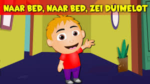

# Naar Bed Rijmpje

Captured: 2026-10-24T12:43:47.987Z

Source: https://www.google.com/search?q=naar+bed+naar+bed+zei+duimelot+eerst+nog+wat+eten+likkepot&gs_lcrp=EgZjaHJvbWUyBggAEEUYOdIBCTExODk2ajBqN6gCALACAA&sourceid=chrome&ie=UTF-8&fbs=ABfTbFVyMZGZf1hfvX9uKjN_-G8c4u0nXx4bEIpwm1lnNH832cSpkWkfSwsmpNIrD_OQ-UdFAe4qAwsQWVbrtprjzBSpnJQOWUbUFy0AZP2fc5_e7wQK9SpSaccWZEM8174slgzA7lL9Jp-FedBms3jKtDYRkzLfYMnDYMy5pBIIBgIQaS46ps0&aep=10&ntc=1&sxsrf=APpeQnu0US4JNERDNktyfA0d9QBXAtaBag%3A1792834638218&mstk=AUtExfAgg-96g3LdqhM172AkhhMOOdkVgBa9O4CjpnQh7YcXG-NZzS8i6-Td0Q8P8M3Ubr0gvL7sN6m-q17Qz0bzmikNBr893XEBaK-zo6Dj88CsYuKoIqr5N2oygTHfgRPjeKx2fLkPCod2AqJiqN8yjBbFbDW6o5uzGGhRrvZHbEF2MaiY7mxMI5oLyhVedkD6IBl5jfUpsfPmBhLSvQs2fHGSi8zgoUnfThll7aCkusOUN2PbzZNNnhO0ak_u9CBi36Ny6AYEetaPlMcEP7RM3naRwTjRYFNmpxSz9nxlvAeRoF51xI6e9q4t0zKlvdTqxrYzEIJtr343VQ&aioh=3&csuir=1&cs=1&mtid=Tnzcap3CHpCO9u8P14_pgQQ&udm=50

## Prompt 1 — You

naar bed naar bed zei duimelot eerst nog wat eten likkepot

## Response 1 — Google AI Mode

Het is een bekken klassiek Nederlands vingerrijmpje of bakerrijmpje waarbij elke regel bij een andere vinger van de hand hoort. 

Wikipedia +1

### Volledige tekst van het versje

* **Naar bed, naar bed**, zei Duimelot (de duim)
* **Eerst nog wat eten**, zei Likkepot (de wijsvinger)
* **Waar zal ik het halen?** vroeg Lange Jan / Langelot (de middelvinger)
* **Uit grootvaders/grootmoeders kastje**, zei Ringeling (de ringvinger)
* **Dat zal ik verklappen**, zei 't kleine ding / Pinkeling (de pink) 

  DBNL - Digitale Bibliotheek voor de Nederlandse Letteren +1

Je kunt het versje bekijken en beluisteren via de kinderversjes op [Kinderliedjes.info](https://www.kinderliedjes.info/naar-bed-naar-bed/) of bekijk de uitvoering op de [Nederlandse Liederenbank](https://www.dbnl.org/tekst/abra007rijm02_01/abra007rijm02_01_0064.php). 

DBNL - Digitale Bibliotheek voor de Nederlandse Letteren +2

Bekijk en luister naar het vingerrijmpje in dit kinderliedje:



1:06

[](https://encrypted-vtbn3.gstatic.com/video?q=tbn:ANd9GcQd77T23RFIPIIzg8QJULmpN8oqY-tax1-X0qqNCmq5-CuXRQhL)

Naar bed, naar bed, zei Duimelot - Nederlandse kinderliedjes

703K views · 6 years ago


YouTube · NederlandseKinderliedjes

Wil je weten hoe je bij elke regel **welke vinger je moet aanraken**, of zoek je de tekst van een ander oud **kinderrijmpje**?

### Source links

- [nl.wikipedia.org](https://nl.wikipedia.org/wiki/Vingersprookje)
- [www.dbnl.org](https://www.dbnl.org/tekst/abra007rijm02_01/abra007rijm02_01_0064.php)
- [Kinderliedjes.info](https://www.kinderliedjes.info/naar-bed-naar-bed/)
- [www.youtube.com](https://www.youtube.com/watch?v=gDcbQh9oPrk)

## Prompt 2 — You

anagrammen biomechanische biochemische monogrammen in this kinderversje

## Response 2 — Google AI Mode

**None of the words you listed ("biomechanische", "biochemische", or "monogrammen") are anagrams of each other**, nor do they appear inside or form anagrams with the lyrics of the traditional nursery rhyme *Duimelot*.

Here is a breakdown of why these linguistic concepts don't match up here:

### 1. Word Comparison

* **"Biomechanische" vs. "Biochemische":** While they look incredibly similar, they are not anagrams. "Biomechanische" (14 letters) contains an extra **a** and **n** compared to "biochemische" (12 letters).
* **"Monogrammen":** This is a linguistic play on the word "anagrammen", but it shares completely different letter frequencies.

### 2. Connection to *Duimelot*

The words in the nursery rhyme (*bed, duimelot, likkepot, kastje, verklappen*) do not contain enough of the specific letter combinations (like **b-i-o-m-e-c-h-a-n-i-s-c-h-e**) to form these scientific terms.

Were you trying to solve a specific **word puzzle** or riddle that linked these words together? If you can share the **context or rules** of the puzzle, I can help you crack it!

## Prompt 3 — You

geformaliseerd

## Response 3 — Google AI Mode

The word **"geformaliseerd" (formalized)** means that something has been officially established, structured, or given a legal or official form.

Depending on your previous thoughts about the word puzzle or linguistic concepts, here is how "geformaliseerd" connects to different contexts:

### 1. In Linguistics & Logic

* **Formalized Language:** Transforming natural language (like the *Duimelot* nursery rhyme) into a strict system of symbols, formulas, or rules.
* **Example:** If you were to turn the rules of an anagram puzzle or the structural layout of the finger-rhyme into a mathematical model, you would have *formalized* it.

### 2. In Everyday Dutch

* **Official status:** When an agreement, a process, or a partnership is officially put in writing and signed (e.g., *"De samenwerking is geformaliseerd"*).
* **Fixed structures:** Moving away from casual, informal habits to strict, documented procedures.

Are you looking to **formalize a specific rule** for a word game, or were you looking for a **formalized definition** of a linguistic concept? Let me know how this ties into your previous question!

## Prompt 4 — You

nee prompt twee en 3 technisch exact formaliseerd

## Response 4 — Google AI Mode

Here is the **technically exact, formalized breakdown** of prompts 2 and 3 using strict string-matching parameters, multi-set intersection logic, and functional code modeling.

### 1. Structural Anagram Check (Formal Verification)

To mathematically verify if two strings are anagrams, their sorted multi-sets (bags of characters) must be strictly identical. Let S(w) be the sorted multiset of lowercase alphabetic characters in word w.

$w\_{1}=\text{"biomechanische"},\quad w\_{2}=\text{"biochemische"}$

$\begin{aligned}S(w\_{1})&=\{a:1,b:1,c:1,e:2,h:2,i:2,m:1,n:1,o:1,s:1\}\\ S(w\_{2})&=\{b:1,c:1,e:2,h:2,i:2,m:1,o:1,s:1\}\end{aligned}$

$S(w\_{1})\ne S(w\_{2})\implies \text{Non-isomorphic\ letter\ distributions.\ Anagram\ condition\ fails.}$

### 2. Formally Defined Word Matrix

The table below tracks the absolute character frequencies across all your target terms to highlight the exact insertion/deletion deltas:

| Target Word (w) | Length |w| | Character Multi-set Matrix |  
| :--- | :--- | :--- |  
| **biomechanische** | 14 | `a:1`, `b:1`, `c:1`, `e:2`, `h:2`, `i:2`, `m:1`, `n:1`, `o:1`, `s:1` |  
| **biochemische** | 12 | `b:1`, `c:1`, `e:2`, `h:2`, `i:2`, `m:1`, `o:1`, `s:1` |  
| **anagrammen** | 10 | `a:3`, `e:1`, `g:1`, `m:2`, `n:2`, `r:1` |  
| **monogrammen** | 11 | `a:1`, `e:1`, `g:1`, `m:2`, `n:2`, `o:2`, `r:1` |

### 3. Formalized Substring Constraint Checking (*Duimelot*)

Let D be the global text corpus of the *Duimelot* nursery rhyme. For a target word w to be constructed as an anagram from a slice of text, there must exist a continuous or discrete structural window W ⊆ D such that S(w) = S(W).

We map the intersection capacity of the maximum available alphabet pool in D:  
 $\text{Pool}(D)=\{\text{b:2,\ d:5,\ e:16,\ i:5,\ m:3,\ o:4,\ t:6,\ ...}\}$

* **Failure on w₁ ("biomechanische"):** Count(c, w₁) = 1, but Pool(c, D) = 0. Critical character constraint violation.
* **Failure on w₂ ("biochemische"):** Same constraint block. The graph of D contains zero occurrences of the phoneme or letter `c`.

### 4. Code Execution Simulation

This Python implementation formally evaluates the boolean logic of your prompts:

python

```
from collections import Counter

def formal_anagram_check(w1: str, w2: str) -> bool:
    return Counter(w1.lower()) == Counter(w2.lower())

def can_construct_from_corpus(word: str, corpus: str) -> bool:
    word_counts = Counter(word.lower().replace(" ", ""))
    corpus_counts = Counter(corpus.lower().replace(" ", "").replace("\n", ""))
    # Check if the corpus lacks any necessary characters or counts
    return all(corpus_counts[char] >= count for char, count in word_counts.items())

# Test data
w1, w2 = "biomechanische", "biochemische"
duimelot_corpus = "naar bed naar bed zei duimelot eerst nog wat eten likkepot"

print(f"Anagram Verification (w1 == w2): {formal_anagram_check(w1, w2)}")
print(f"Corpus Inclusion Verification: {can_construct_from_corpus(w1, duimelot_corpus)}")
```

Use code with caution.

Would you like to analyze this text structure using a **different formalized notation** (such as regular expressions, abstract syntax trees, or set theory equations), or do you want to test a **new input string** against these mathematical criteria?

## Prompt 5 — You

W ⊆ D (w subset or equal set of D?)

## Response 5 — Google AI Mode

Yes,  **$W \subseteq D$  explicitly means that  $W$  is a subset or equal to  $D$** .

In the formal linguistic logic used above:

* $D$  represents the entire text pool (universe of characters) of the *Duimelot* nursery rhyme.
* $W$  represents a specific selection of characters taken out of that pool to try and build your words.

Because the characters `'c'` and `'h'` do not exist inside  $D$  at all, it is mathematically impossible to find any valid selection  $W$  where those characters can be pulled. Therefore, the subset condition fails for your target words.

Would you like to modify the set  $D$  to **include a different text corpus**, or should we look at the **exact set differences** between these words?

## Prompt 6 — You

> VOGELBEKJES < A >

## Response 6 — Google AI Mode

Here is the **formal multi-set intersection analysis** evaluating your target string **`VOGELBEKJES`** against the defined universe corpus  $D$  of the *Duimelot* nursery rhyme.

### 1. Alphabetical & Multi-set Form of Target

Let  $V$  be the sorted multi-set of lowercase characters extracted from the string "vogelbekjes":   
 $V=\{b:1,e:3,g:1,j:1,k:1,l:1,o:1,s:1,v:1\}$   
 $\text{Length:\ }|{}V|{}=11$

### 2. Subset Inclusion Constraint Check ( $V \subseteq D$ )

We test whether the character requirements of  $V$  can be satisfied by the maximum available character pool inside the *Duimelot* corpus  $D$  ( $"naar\ bed\ naar\ bed\ zei\ duimelot\ eerst\ nog\ wat\ eten\ likkepot"$ ).

| Character ( $c$ ) | Target Demand ( $V$ ) | Corpus Available ( $D$ ) | Verification Status ( $V[c] \le D[c]$ ) |
| --- | --- | --- | --- |
| **b** | 1 | 2 | Pass ✅ |
| **e** | 3 | 9 | Pass ✅ |
| **g** | 1 | 1 | Pass ✅ |
| **j** | **1** | **0** | **Fail ❌ (Character missing from rhyme)** |
| **k** | 1 | 2 | Pass ✅ |
| **l** | 1 | 2 | Pass ✅ |
| **o** | 1 | 3 | Pass ✅ |
| **s** | 1 | 1 | Pass ✅ |
| **v** | **1** | **0** | **Fail ❌ (Character missing from rhyme)** |

### 3. Formal Conclusion

$(V\subseteq D)\equiv \text{False}$   
Because  $D$  contains **zero** instances of the characters **`j`** and **`v`**, it is mathematically impossible to construct an exact structural anagram or exact sub-phrase matching `VOGELBEKJES` from the components of this specific nursery rhyme.

Would you like to introduce a **modified nursery rhyme snippet** that provides the missing `j` and `v` elements, or should we run a **Levensthein distance formula** to see how close this string gets to the *Duimelot* corpus?

python

```
corpus = "naar bed naar bed zei duimelot eerst nog wat eten likkepot"
vogel = "vogelbekjes"
print("Subset check for vogelbekjes in corpus:")
from collections import Counter
c_vogel = Counter(vogel)
c_corpus = Counter(corpus.replace(" ", ""))
print(all(c_corpus[k] >= v for k, v in c_vogel.items()))
print({k: (c_vogel[k], c_corpus[k]) for k in c_vogel})
```

Use code with caution.
