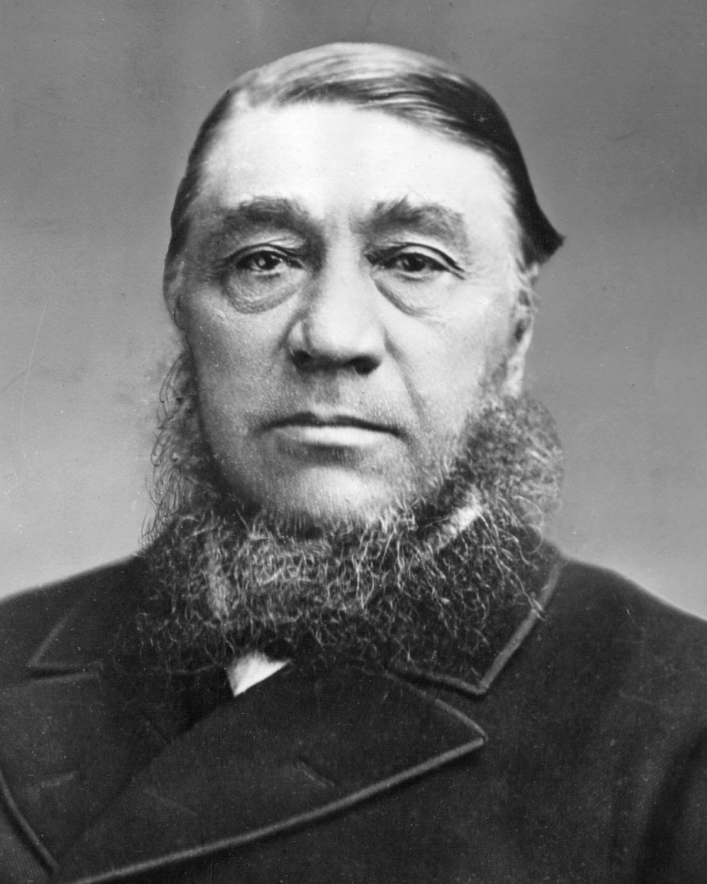
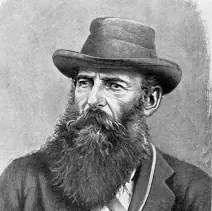

# Afrikaanse Boer Koning

Captured: 2026-10-24T12:42:26.543Z

Source: https://www.google.com/search?sca_esv=856264f4ee86d27a&sxsrf=APpeQntx0QgCh1fXM6q8Pu4pB8qPLFoTYA%3A1792843995350&vsint=&ntc=1&cs=1&sa=X&ved=0CDEQ2_wOahgKEwjwmeCt0NKXAxUAAAAAHQAAAAAQrQM&biw=1707&bih=898&dpr=1.5&udm=50&atvm=2&mstk=AUtExfBxdqdmtkky8KoAT26g40qaLGZ8o8wLok6Rjq1QubNMQMLVBN29WeuS_F-MvCSrEnGreqZYrXIc3VtjmjJqtqyPtWom8BEVl55ZSgGJcTlht1RPKp6vrKRp_xdLN7LlJRcJ5VYpK1DmYvxOwJ3IVB62znSG_WPeF8YuDzE0WQN2yOk58U3EwrbJG69PFb1nGFrwrQFewf9D7m7drXUkBa4SCxO1cpWGVpyc1kKTQRahNGpWdtbnbksK6xejYcSCRC0B3v7PbtxRPWt553InFpE6oxFq6GpfTxuur0oWtpaWkUEjDJdrLlWw8dKF80PfF81ghjZRiLoK-g&mtid=XG3caurPHYWE9u8PvtCBgAk&csuir=1&aep=26&q=wie+is+de+koning+van+de+afrikaanse+boer

## Prompt 1 — You

wie is de koning van de afrikaanse boer

## Response 1 — Google AI Mode

De "Afrikaanse Boer" (de Boeren of Afrikaners in Zuid-Afrika) heeft historisch gezien **nooit een koning gehad**, omdat de Boerenrepublieken democratische, presidentiële republieken waren. 

Wikipedia +1

Wanneer mensen in figuurlijke zin spreken over de belangrijkste historische leiders of "koningen" van de Boeren, doelen zij meestal op een van de volgende iconische figuren:

---

**Paul Kruger ("Oom Paul"):** De bekendste president van de Zuid-Afrikaansche Republiek (Transvaal). Hij leidde de Boeren tijdens de Tweede Boerenoorlog tegen het Britse Rijk en werd door zijn volk en in Europa gezien als het absolute gezicht van de Boeren.

---

**Koos de la Rey:** Een legendarische Boeren-generaal die ook wel bekendstond onder de eretitel **"De Leeuw van West-Transvaal"** vanwege zijn tactische genialiteit in de guerrillastrijd. 

Wikipedia +4

*Opmerking: Als je doelt op een traditionele inheemse koning in de regio van Zuid-Afrika (wiens koninkrijk in het verleden oorlog voerde met de Boeren), dan is de bekendste historische figuur **Shaka Zoeloe**, de koning van de Zoeloes.* 

IsGeschiedenis

### Source links

- [nl.wikipedia.org](https://nl.wikipedia.org/wiki/Boerenrepubliek_(Zuid-Afrika))
- [nl.wikipedia.org](https://nl.wikipedia.org/wiki/Paul_Kruger)
- [isgeschiedenis.nl](https://isgeschiedenis.nl/nieuws/shaka-zulu-het-verhaal-van-de-zoeloekoning)

## Prompt 2 — You

de la reycast kruger-dunning effect butterfly emergtie

## Response 2 — Google AI Mode

Your query brings together a fascinating mix of concepts spanning military history, psychology, and chaos theory.

Here is how each of these elements breaks down and **how they interconnect** through the lens of human behavior, leadership, and systemic outcomes:

### 1. General Koos de la Rey & Paul Kruger

* **The Contrast:** During the Second Boer War, President **Paul Kruger** represented the traditional, rigid, and deeply religious political establishment. In contrast, **General Koos de la Rey** was a military visionary.
* **The Strategy:** De la Rey was one of the few who adapted to reality rather than sticking to dogma. He abandoned outdated conventional trench warfare and instead invented **mobile guerrilla tactics** (trenchless warfare and fast-moving cavalry charges), which completely blindsided the massive British Army.

### 2. The Kruger-Dunning Effect (Dunning-Kruger Effect)

* **The Concept:** This is a psychological bias where **people with limited competence in a domain overestimate their abilities**, while true experts tend to underestimate themselves or remain highly cautious.
* **The Historical Connection:**
  + **The British High Command:** At the start of the Boer War, British commanders suffered from severe Dunning-Kruger bias. Arrogant and overconfident, they assumed they would defeat the Boeren "farmers" in a few weeks using old-fashioned tactics.
  + **The Boeren Leadership:** While Kruger held firmly to the belief that divine intervention and traditional resolve would suffice, it was the highly competent and humble leaders like De la Rey who recognized their tactical disadvantages and innovated to survive.

### 3. Butterfly Emergence (Chaos Theory)

* **The Concept:** The **"Butterfly Effect"** states that a tiny change in a complex system can lead to massive, unpredictable results elsewhere (e.g., a butterfly flapping its wings causing a tornado). **"Emergence"** is when simple underlying rules create complex, beautiful, or chaotic collective behavior—just like a butterfly emerging from a chrysalis, or a flock of birds moving as one.
* **The Strategic Connection:**
  + De la Rey’s guerrilla warfare was a prime example of **emergent behavior**. Instead of a highly centralized, rigid army command, he relied on small, highly adaptable, independent commandos (Boeren units).
  + A tiny, unexpected localized ambush by a small commando (a "butterfly flap") could completely disrupt and paralyze an entire British division of tens of thousands of soldiers.

---

### 🧠 The Synthesis: How They All Link Together

If you map these ideas onto each other, you get a timeless lesson in strategy and psychology:

| Concept | The Trap | The Solution |
| --- | --- | --- |
| **Psychology** | **Dunning-Kruger Effect:** Rigid overconfidence based on past status (The British/Old Guard Boeren). | **Intellectual Humility:** Recognizing constraints and changing your mind based on new data. |
| **Action** | **Linear Thinking:** Expecting a massive army to easily crush a small opponent using predictable rules. | **Butterfly Emergence:** Decentralized, adaptive, and unpredictable movements that multiply impact. |
| **Historical Icon** | **Paul Kruger:** Represented the unyielding, traditional system that eventually fractured under pressure. | **Koos de la Rey:** The adaptive innovator who used chaos, speed, and emergence to defeat a giant. |

When a system is trapped in a **Dunning-Kruger** loop of arrogance, it becomes fragile. It only takes a highly adaptive, **emergent** strategy (like De la Rey's) to act as the **butterfly effect** that brings the whole structure crashing down.

Are you exploring these concepts for a specific **essay, philosophical framework, or strategy project**? Let me know, and I can help you weave them deeper into that specific context!
