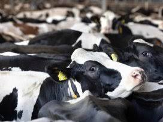
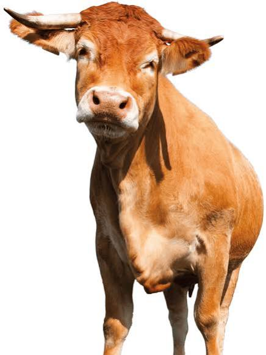
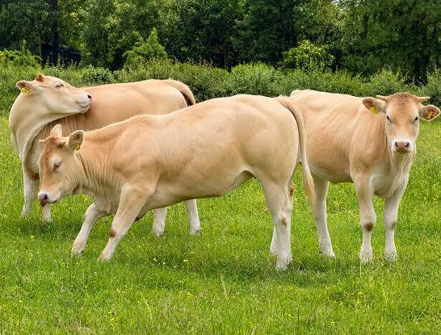
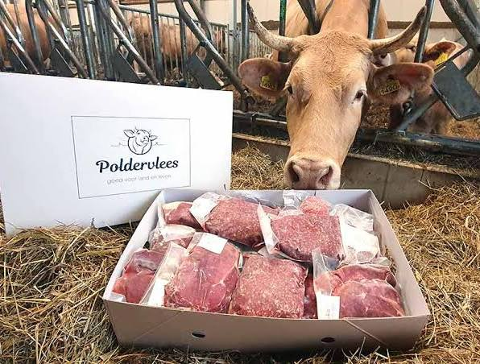
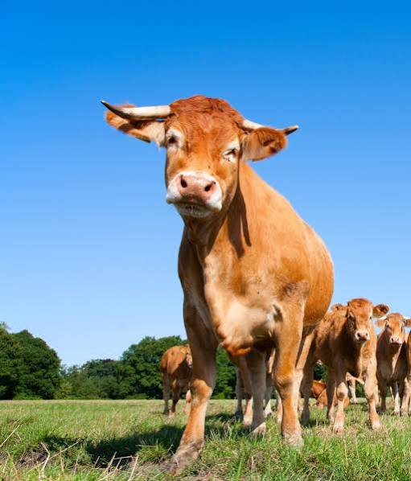
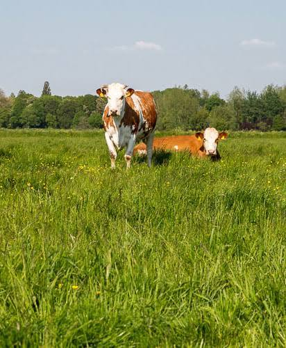

# ARG Koeien Kosten Begroting

Captured: 2026-10-24T15:35:46.080Z

Source: https://www.google.com/search?q=een+volwassen+koe+%28gouden+kalf+Asa+porno+multi+level+marketing+scheme%29+ARG+inspiratie+kosten+monetaire+euros&gs_lcrp=EgZjaHJvbWUyBggAEEUYOdIBCTM1MjY4ajBqN6gCALACAA&sourceid=chrome&ie=UTF-8&fbs=ABfTbFVyMZGZf1hfvX9uKjN_-G8cqu7ocb7U6ah0xpkIrGMK4CuEddQ3ZmQozcvkgnTNQKiWE327vHSSX3EU0x8dB6hqifrmJYJpi5hdo8N_17Yp0m7NOldBqgUtkN1rgthOVh3L4tR1Qj_liBuKKq6Hdnl0kGiYf5Tt0rmV1aWFi9WZPRgDTPs&aep=10&ntc=1&sxsrf=APpeQnsVwetSPzV7sjKosfZqALyjulRrXA%3A1792853117682&mstk=AUtExfAiP_eVxqTcYsPQyCq8ZJ2dmC9VCsrC09y6TSROb1e6cDIiwy2qM4q4O7xSjlbmaW5A-Y-MoLDcGXaHSbT4W9ePW-jq6BBSmE3PvDrykXK_mDf6iMHMFqCCmW1oMfmcr423Lk_8WEQttfHokxzQ1o-U5cVzZIcft63ZH5W5uUnbV_VVHPlOpJ_eUgqSVUqWLyOl191ZPmt90KD4_bKCkYuI8gvptfldn_obTuZA-DriGjdOuTfFJuHw3LCC-ZlbWbXl5tE7z--xakshpXoEpj4HK6rdnRjTg4HDh9iJFJdiBa8iUfTiRwYDt8nbkzymbGG30kvat2eb0Q&aioh=3&csuir=1&cs=1&udm=50&mtid=fsTcaoP-B766i-gPx6SoqAw

## Prompt 1 — You

een volwassen koe (gouden kalf Asa porno multi level marketing scheme) ARG inspiratie kosten monetaire euros

## Response 1 — Google AI Mode

Dit klinkt als de blauwdruk voor een bizar en intrigerend **Alternate Reality Game (ARG)**. Om dit concept vorm te geven en de werkelijke monetaire kosten (in euro's) te berekenen, moeten we kijken naar wat een "volwassen koe" in deze specifieke context kost.

### 💰 De Monetaire Kosten (In Euro's)

De kosten hangen volledig af van hoe je de "volwassen koe" binnen je ARG materialiseert:

1. **Een échte levende volwassen koe (De hardcore optie)**
   * **Aankoop:** Een gezonde, volwassen melkkoe of vleeskoe kost momenteel gemiddeld tussen de **€ 1.500,- en € 2.500,-**, afhankelijk van het ras (bijv. Holstein-Friesian) en de marktwaarde.
   * **Transport & Logistiek:** Het verplaatsen van een koe naar een specifieke ARG-locatie (indien toegestaan qua regelgeving) kost al snel **€ 150,- tot € 500,-** per rit.
   * **Onderhoud/Huur:** Wil je een boer betalen om een specifieke koe te "brandmerken" of te betrekken in je game? Reken op een vergoeding van **€ 200,- tot € 500,-** voor de medewerking en de tijdelijke overlast.
2. **Een kunststof / polyester reclamekoe (De praktische optie)**
   * Een levensgrote, volwassen kunststof koe (vaak gebruikt voor promoties) kost nieuw tussen de **€ 600,- en € 1.200,-**.
   * Dit is perfect voor een ARG, omdat je deze goud kunt schilderen (verwijzing naar het Gouden Kalf) en overal kunt achterlaten zonder dat de dierenbescherming ingrijpt.
3. **Digitale of symbolische koe (De low-budget optie)**
   * **Kosten: € 0,- tot € 50,-** (voor printwerk of het hosten van een cryptische website).

---

### 🎭 ARG Inspiratie & Conceptuele Samenhang

Je input bevat een aantal schijnbaar losse elementen die juist een fantastisch, duister satirisch narratief vormen:

* **Het Gouden Kalf & De Volwassen Koe:** Het bijbelse symbool van valse afgoderij en materialisme. Het kalf is inmiddels een "volwassen koe" geworden; het bedrog is gegroeid en geïnstitutionaliseerd. Het linkt daarnaast prachtig aan de Nederlandse film- en cultuurwereld (het Gouden Kalf). 

  AD.nl
* **Multi-Level Marketing (MLM) Scheme:** De perfecte structuur voor een ARG. Spelers (of 'slachtoffers') moeten nieuwe mensen rekruteren om dieper in het verhaal te komen. Het verkochte "product" is gebakken lucht of toegang tot exclusieve content.
* **Asa & Porno:** "Asa" kan verwijzen naar een personage, een obscure organisatie of een acroniem binnen jouw universum. De link met de porno-industrie (denk aan de thematiek van de film *Truly Naked* die recentelijk Gouden Kalveren won) voegt een rauwe, exploitatieve laag toe aan het MLM-systeem: de ultieme commodificatie van het menselijk lichaam onder de dekmantel van een piramidespel. 

  AD.nl

### 🛠️ Begroting voor je ARG-Opzet

Mocht je dit daadwerkelijk willen uitvoeren als een immersive game, dan kun je uitgaan van de volgende minimale opstartkosten:

| Onderdeel | Omschrijving | Kostenindicatie |
| --- | --- | --- |
| **De Koe** | Polyester replica (goud te spuiten) | € 800,- |
| **Prop-materiaal** | Gouden spuitbussen, nep-aandelen/contracten | € 75,- |
| **Digitale infrastructuur** | Vreemde domeinnamen, "corporate" MLM-website | € 40,- |
| **Media / Beeldmateriaal** | Vreemde, glitchy VHS-stijl video's (promotie) | € 0,- (DIY) |
| **Totale geschatte kosten** | **Om een fysieke impact te maken** | **~ € 915,-** |

Als je het puur digitaal houdt (met video's van koeien, neppe MLM-webinars en cryptische documenten), kun je dit project in principe voor **minder dan € 50,-** aan hostingkosten lanceren.

### Source links

- [www.ad.nl](https://www.ad.nl/show/dramafilm-truly-naked-over-invloed-van-porno-op-tienerlevens-grote-winnaar-gouden-kalveren-basta-beste-dramaserie~a9dbce63/)

## Prompt 2 — You

van vlees en bloed

## Response 2 — Google AI Mode

Als je kiest voor de hardcore optie—een **levende, ademende volwassen koe van vlees en bloed** voor je ARG—krijg je te maken met een heel andere realiteit dan een plastic prop. Dit brengt unieke marktprijzen, strenge logistiek en een briljante dubbele betekenis met zich mee (aangezien *"Van vlees en bloed"* ook de iconische Vlaamse tragikomedie is die zich afspeelt in een slagerij—wat perfect aansluit bij jouw rauwe, exploitatieve MLM-narratief).

### 💰 De Monetaire Realiteit

Een volwassen levend rund kopen in Nederland of België brengt specifieke marktkosten met zich mee:

* **Gebruiksvee / Melkkoe (1e kwaliteit):** Een productieve, levende volwassen koe kost momenteel tussen de **€ 1.575,- en € 2.075,-** per stuk. Door de aanhoudende druk op de fosfaatrechten in de melkveesector is er momenteel veel aanbod van vee. 

  Nieuwe Oogst +1
* **Slachtkoeien / Reforme koeien:** Als je een koe rechtstreeks op gewicht koopt (bijvoorbeeld een reforme koe die uit de productie wordt genomen), betaal je op basis van het levend gewicht of karkasgewicht. Reken op een levend-gewicht prijs van rond de **€ 5,35 tot € 6,50 per kilo**. Een volwassen koe weegt snel 600 tot 700 kilo, wat de aanschafprijs eveneens rond de **€ 3.000,- tot € 4.500,-** brengt. 

  Landbouwleven
* **Exclusieve rassen (voor het 'Gouden Kalf'-imago):** Wil je een vleeskoe van topkwaliteit (zoals een Blonde d'Aquitaine of Belgisch Witblauw) als levend pronkstuk? Dan lopen de prijzen op tot ver boven de **€ 4.000,-**.

### 🚛 De Verborgen Logistieke & Juridische Kosten

Een levend dier inzetten voor een game kan niet zomaar. Je krijgt te maken met de Nederlandse en Europese wetgeving:

* **UBN (Uniek Bedrijfsnummer):** Je kunt als particulier wettelijk geen levende koe bezitten of transporteren zonder geregistreerd te zijn bij de RVO (Rijksdienst voor Ondernemend Nederland).
* **Transportkosten:** Gecertificeerd veetransport kost **€ 150,- tot € 300,- per rit**, afhankelijk van de afstand.
* **De "Boeren-Lease" (De beste ARG-oplossing):** In plaats van een koe te *kopen*, betaal je een veehouder om een specifieke koe in zijn stal te labelen als *"Het Gouden Kalf van het Asa-imperium"*. Spelers moeten dan fysiek naar een specifieke boerderij reizen (of een livestream bekijken) om aanwijzingen op het oormerk van de koe te ontcijferen. **Kosten: € 500,- tot € 1.000,- aan 'huur' en medewerking van de boer.**

### 🥩 De Conceptuele Twist: "Van Vlees en Bloed"

De term "van vlees en bloed" tilt je MLM-concept naar een angstaanjagend, geniaal niveau. Het Multi-Level Marketing scheme verkoopt geen producten, maar *mensen*.

Spelers ontdekken dat ze geen aandelen kopen in een goudmijn, maar dat het "product" de fysieke lichamen van de lagere levels in de piramide zijn. Het slagerij-motief (geïnspireerd op de beklemmende familiesfeer uit de serie) kan dienen als de esthetiek voor je online MLM-portaal: blinkende messen, kil koud vlees, en een corporate slogan als: *"Bij Asa investeren we in kapitaal van vlees en bloed."*

Als we dit live gaan opzetten, wat wil je als eerste uitwerken?

* De **locatie** van de koe (fysiek in een weiland waar spelers naartoe moeten, of via een 24/7 webcam-feed?)
* De **wervingscampagne** (hoe de nep-MLM-website spelers lokt met "gegarandeerd rendement")
* De **cryptische puzzels** rondom het "Asa"-acroniem

Laat weten welke richting we op gaan!

### Source links

- [www.nieuweoogst.nl](https://www.nieuweoogst.nl/marktprijzen/gebruiksvee)
- [www.landbouwleven.be](https://www.landbouwleven.be/markten/rundvee)
