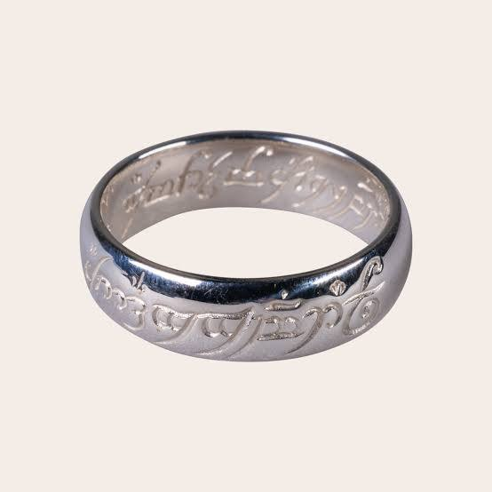
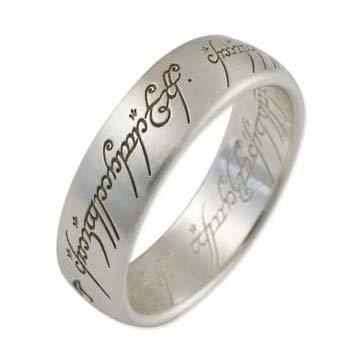
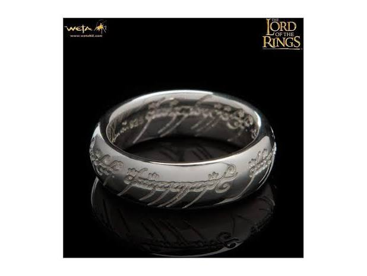
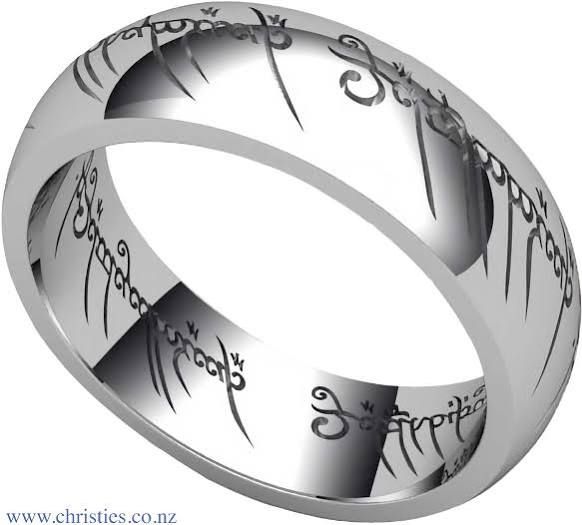
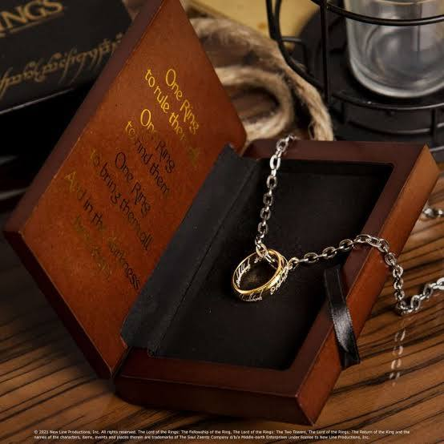

# Nazguls and Hobbits

Captured: 2026-10-25T06:36:52.169Z

Source: https://www.google.com/search?q=nazguls+lotr+and+hobbits+hiding+steam+deck&sca_esv=19ec17d16c31503a&sxsrf=APpeQnt4png9h9-g1QbEP5jAxXgpIvUeFQ%3A1792907729057&source=chrome.ob&fbs=ABfTbFVyMZGZf1hfvX9uKjN_-G8cqu7ocb7U6ah0xpkIrGMK4CuEddQ3ZmQozcvkgnTNQKj906-ORFIK2UR8msyEJBwjHvmTN5b2gK7JkDyhtCEwf4A5rP5EJLIkekQm3uTyUAGnOU1zkOGOmIx6qH8eEiFxgEzogpaArKINjyyxFk2SZZEwuCBZG_es2CnfGVx1xoNP30SS&vsint=&aep=1&ntc=1&cs=1&sa=X&ved=2ahUKEwigtbjivdSXAxVzg_0HHfEaIPUQ2J8OegQIFhAD&biw=1707&bih=898&dpr=1.5&mstk=AUtExfCRX8Fy0y97JPzLWrwoTl-UIKlmj3AHU5Y1S6M4FBgHM1ohOqgD2b6PpnUZg8JKSZM1C7MCQI6LsPm3-KR_iRJWRJoA-DM37mB88E5C3AeUnDRIgk1e1aUbXBjPvG3-VHTf5gJ9nC_kTUEh8DzZDwU_X7YxJZhQbYF7z3ry-WNgSivJLhrKNq6zyn6jmnCk__tQ86WGD1leBa7WGsAoA3SBgkjvH4rWx59gv5fDULmV1MeiRLG7yXEYjQhf71ir3KLfFDDcFN5DM2kyz4Ude_JcyKt_Q5oTDfh0tQbdSDQ58FXFXMoU9i4NYDl88JB7enfmkr9nZmkdPw&csuir=1&mtid=2pndap-GPIq69u8PlImwwQg&udm=50

## Prompt 1 — You

nazguls lotr and hobbits hiding steam deck

## Response 1 — Google AI Mode

The classic scene where **the Hobbits hide under the tree roots from the Nazgûl** is one of the most iconic moments in *The Lord of the Rings: The Fellowship of the Ring*. If you are looking to find this specific game scene or manage your uninstalled/hidden library on your **Steam Deck**, here is exactly how to navigate both requests. 

Reddit +2

---

### 1. How to Find or Manage Hidden Games on Steam Deck

If you accidentally hid a *Lord of the Rings* title (or any other game) on your device, you can easily reveal it: 

YouTube·YourSixTech

1. Press the **Steam button** on your Deck.
2. Go to **Settings** and scroll down to **Home** on the left-side menu.
3. Look for the **"Hidden Games"** option under the Home configuration panel.
4. Select **Manage** and then click **"Remove from hidden"** to return the game back to your main collection library. 

   YouTube·YourSixTech

*(Note: If you have no hidden games on your system, this menu option will not appear.)* 

YouTube·YourSixTech

---

### 2. Playing the "Hobbits vs. Nazgûl" Scene on Steam Deck

If you are looking for a Lord of the Rings video game that features this legendary encounter or the Shire invasion, multiple titles can be played smoothly on SteamOS: 

YouTube·DeckPower

| Game Title | Steam Deck Performance | Setup Tip |
| --- | --- | --- |
| **LEGO The Lord of the Rings** | Verified / Playable | A general consensus among players on Steam Community indicates you should use **Proton GE** via ProtonUp-Qt to ensure smooth first-time launching and fix minor environmental texture glitches. Includes a charming LEGO recreation of the hiding scene! |
| **LOTR: War in the North** | Excellent (60–100+ FPS) | Runs brilliantly at maximum settings on both LCD and OLED models. The plot directly kicks off with the **Nazgûl attacking Sarn Ford** to invade the Shire. |
| **Lord of the Rings: Conquest** | Smooth Retro Emulation | The PC version runs incredibly well via SteamOS desktop shortcuts or emulation, allowing you to play through massive campaign battles. |

Are you trying to find a **specific LOTR game** that you hid in your Steam library, or are you looking for **installation guides** to get one of these classic titles running on your Steam Deck?

### Source links

- [www.reddit.com](https://www.reddit.com/r/lotr/comments/6aeua7/when_the_nazgul_is_looking_for_the_four_hobbits/)
- [www.youtube.com](https://www.youtube.com/watch?v=CyHaPBD_Vyw)
- [www.youtube.com](https://www.youtube.com/watch?v=L417Vy_x4kw)

## Prompt 2 — You

silver ring the one ring

## Response 2 — Google AI Mode

While Sauron's original One Ring was forged from solid gold, many fans prefer the sleek, modern aesthetic of a **sterling silver replica of the One Ring**. Complete with the flowing Black Speech inscription written in Elvish Tengwar script, silver versions offer a distinct alternative to the classic golden bands.

### Popular Silver One Ring Options

* **Bilbo Ring: The One Ring - Sterling Silver**: Crafted by [Jens Hansen](https://www.jenshansen.com/products/the-lord-of-the-rings-the-one-ring-sterling-silver-with-elvish-runes), the original designers who forged the actual movie props for Peter Jackson's trilogy. This solid silver version offers movie-accurate dimensions and features highly precise Elvish runes.
* **The One Ring Sterling Silver Replica**: An officially licensed Lord of the Rings replica available directly from the [Hobbiton Movie Set Shop](https://shop.hobbitontours.com/products/sterling-silver-one-ring-pos-only). It features the full Elvish script cleanly laser-etched onto genuine sterling silver.
* **The One Ring - Etched Silver with Chain**: Produced by The Noble Collection UK, this variant gives you the look of a silver band while keeping the traditional gold aesthetic. It features a gold-plated sterling silver ring paired with a 24-inch stainless steel chain for wearing as a pendant.

### Key Buying Considerations

* **Script Styles:** Look closely at how the Elvish lettering is applied. Some versions utilize **fine laser-etching** for a subtle look, others use deep **heavy engraving**, and some emphasize contrast by applying a **black anodized script** so the language of Mordor stands out vibrantly against the silver.
* **Sizing Options:** Because most sterling silver replicas are solid bands, they cannot be easily resized later by a local jeweler without cutting through the Elvish script. Double-check your exact size before ordering.

Are you looking for a **movie-accurate prop replica** to collect, or are you looking for a **casual, everyday jewelry piece**? Let me know your **ring size** or if you prefer the script to be **engraved or colored black**, and I can find matching options.

### Source links

- [Jens Hansen](https://www.jenshansen.com/products/the-lord-of-the-rings-the-one-ring-sterling-silver-with-elvish-runes)
- [Hobbiton Movie Set Shop](https://shop.hobbitontours.com/products/sterling-silver-one-ring-pos-only)

## Prompt 3 — You

glow in the dark inscription

## Response 3 — Google AI Mode

To truly capture the cinematic effect of the fiery Black Speech appearing on the band, you can look for replicas featuring a **luminous, glow-in-the-dark inscription**. 

Merchoid +1

Because standard sterling silver cannot naturally emit light, creators use specialized luminescent gels, phosphorescent resins, or embedded strontium aluminate compounds to make the Elvish script light up after absorbing ambient or UV light. 

Silverfernz +1

### Top Luminous One Ring Choices

* **Official Fluorescent One Ring**: Crafted in New Zealand under license from New Line Cinema, this premium option is available in **solid sterling silver**. The Elvish runes are deeply engraved and filled with a **fluorescent red gel** that glows brightly when exposed to UV or black light, mimicking the exact fiery look from the films. 

  Silverfernz
* **Elvish Luminous Ring (Silver & Aquamarine)**: An affordable, daily-wear option available at boutiques like [TimJeweler](https://timjeweler.com/products/elvish-ring-glow-in-dark). The silver-finished band features embossed Elvish runes embedded with a high-grade phosphorescent compound. Once charged under normal sunlight or a smartphone flashlight, the inscription glows in a **vivid aquamarine blue**. 

  TimJeweler +1
* **Merchoid Glow in the Dark One Ring**: An officially licensed replica from [Merchoid](https://www.merchoid.com/eu/lord-of-the-rings-glow-in-the-dark-ring/) crafted out of ultra-lightweight titanium steel with a sleek silver aesthetic. It features a classic green-tinted phosphorescent script that charges effortlessly under indoor lighting or sunlight, perfect for collectors. 

  Merchoid +2

### How the Glow Works

* **Charging the Ring:** For the brightest glow, use a **UV blacklight keychain or direct sunlight**. A quick 10-second charge under UV light yields a much more intense, cinematic emission than hours spent under regular household LED light bulbs. 

  TimJeweler +1
* **Glow Durability:** High-quality phosphorescent resin mixes are water-resistant and designed not to fade or bleed out of the engraving over time, ensuring your ring safely retains its magical qualities during daily wear. 

  TimJeweler

Would you prefer a **premium sterling silver ring** that reacts primarily to **UV/blacklight** like the movie props, or a **stainless steel band** that charges under **regular sunlight**? Let me know if you have a specific **glow color** in mind (like fiery red or mystical blue)! 

Silverfernz +1

### Source links

- [www.merchoid.com](https://www.merchoid.com/eu/lord-of-the-rings-glow-in-the-dark-ring/)
- [silverfernz.com](https://silverfernz.com/products/official-lord-of-the-rings-fluorescent-one-ring)
- [timjeweler.com](https://timjeweler.com/products/elvish-ring-glow-in-dark)

## Prompt 4 — You

ecosteam steamdeck belgie united batterij

## Response 4 — Google AI Mode

It looks like you are searching for resources regarding **Steam Deck battery replacement, parts, or professional repair services in Belgium (België)**.

Whether you are looking to buy a replacement kit or want a local shop to handle the delicate process of ungluing and replacing the internal battery, here is where you can find parts and services.

### Professional Steam Deck Repair Services in Belgium

If you prefer not to open the device yourself—as the Steam Deck battery is heavily glued down and requires precision to replace—there are dedicated options locally: 

YouTube·iFixit

* **[FIXNOW Belgium](https://www.fixnow.be/en/repair/steam-deck/steam-deck-lcd/battery-replacement)**: Based in Belgium, they offer professional internal battery replacement services for the **Steam Deck LCD model** for approximately €139. You can either book an online appointment or use their mail-in service from anywhere in Belgium. 

  FIXNOW
* **[Volt Repair Shop (Leuven)](https://voltrepair.be/en/steam-deck-repair-leuven)**: Located on Diestsestraat in Leuven, they offer walk-in diagnostic checks and console repairs for issues like rapid battery drain and joystick drift on both LCD and OLED models. 

  Volt Repair Shop
* **[AA Repair (Gent)](https://www.aarepair.be/console/valve/steam-deck/)**: A local option in Ghent providing out-of-warranty console repairs with a standard 1-year warranty on replaced hardware components. 

  AA Repair

### DIY Battery Parts & Sourcing

If you are a hobbyist looking to buy an internal battery pack or an external power bank extension to fix the device yourself, keep these platforms in mind:

* **[iFixit Europe](https://www.ifixit.com/products/steam-deck-lcd-battery)**: The official repair partner for Valve. While there was initial confusion regarding stock limits for original LCD batteries, Valve continues to supply and support replacement components through iFixit's European storefront, including complete DIY kits with the necessary adhesive remover and tools.
* **Ubuy Belgium**: Sells third-party aftermarket replacement internal batteries compatible with the F7A and F7G model numbers. 

  YouTube·Blaze2K +4

Did you mean a specific repair shop or product line by **"ecosteam"** or **"united"**? If your battery is swelling or dying, let me know if you have the **LCD or OLED model** so I can find the exact part instructions!

### Source links

- [www.youtube.com](https://www.youtube.com/watch?v=rCGXIfbbnV4&t=25)
- [www.fixnow.be](https://www.fixnow.be/en/repair/steam-deck/steam-deck-lcd/battery-replacement)
- [voltrepair.be](https://voltrepair.be/en/steam-deck-repair-leuven)
- [www.aarepair.be](https://www.aarepair.be/console/valve/steam-deck/)
- [iFixit Europe](https://www.ifixit.com/products/steam-deck-lcd-battery)
- [www.youtube.com](https://www.youtube.com/watch?v=2Bk5ePpxmU8&t=206)

## Prompt 5 — You

swelling battery yes

## Response 5 — Google AI Mode

A **swelling battery is a severe safety hazard** that requires immediate attention. When a lithium-ion battery swells, it means hazardous gases have built up inside the cell due to degradation, overheating, or failure.

To protect yourself and your Steam Deck, **immediately follow these safety steps:**

### Immediate Safety Actions

* **Stop using the device immediately:** Turn off the Steam Deck completely. Do not put it in standby/sleep mode, and **do not turn it back on**.
* **Do not charge it:** Plugging the device into a charger adds thermal and electrical stress. This drastically increases the risk of a chemical fire or a sudden thermal runaway event.
* **Store it safely:** Place the Steam Deck on a **non-flammable, cool, and dry surface** (such as a concrete floor, a metal tray, or a ceramic surface). Keep it away from curtains, wood furniture, bedding, or carpet.
* **Do not puncture it:** Never attempt to squeeze, press down on, or pierce the screen or back shell to "relieve pressure." Puncturing a swollen lithium battery will expose reactive chemicals to oxygen, causing an immediate chemical fire.

### Next Steps for Repair or Safe Disposal

Because the battery is expanding, it is putting physical pressure on the Steam Deck's motherboard, case, and delicate screen. It needs to be removed safely by a professional.

* **Professional Mail-In/Drop-Off:** Because of the high risk of a fire if handled incorrectly, it is strongly recommended to let a local shop handle it. You can contact [FIXNOW Belgium](https://www.fixnow.be/en/repair/steam-deck/steam-deck-lcd/battery-replacement) or a nearby console specialist like [Volt Repair Shop Leuven](https://voltrepair.be/en/steam-deck-repair-leuven) to ask if they accept swollen batteries via drop-off.
* **If doing DIY extraction:** If you are an experienced hobbyist and choose to remove it yourself, use a guide from an official partner like [iFixit Europe](https://www.ifixit.com/products/steam-deck-lcd-battery). Ensure you wear protective safety glasses and work in a well-ventilated area or outdoors. Use an approved adhesive remover instead of prying hard against the swollen cell.
* **Safe Disposal:** Do not throw the damaged battery in your regular household trash. Take the extracted battery to a local **Recupel** collection point or a recycling park in Belgium that explicitly accepts damaged or swollen lithium-ion cells.

[Learn more](https://support.google.com/websearch?p=aimode)

Are you planning to **mail the device to a repair center**, or do you need help finding a **local physical drop-off location** near your specific city or region in Belgium?

### Source links

- [FIXNOW Belgium](https://www.fixnow.be/en/repair/steam-deck/steam-deck-lcd/battery-replacement)
- [Volt Repair Shop Leuven](https://voltrepair.be/en/steam-deck-repair-leuven)
- [iFixit Europe](https://www.ifixit.com/products/steam-deck-lcd-battery)
