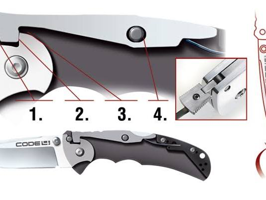
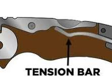
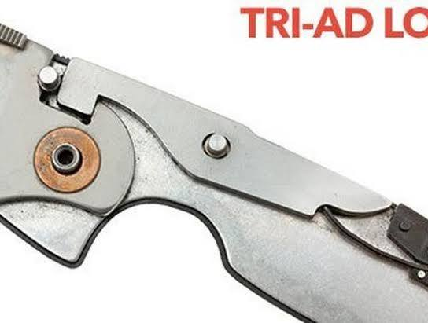
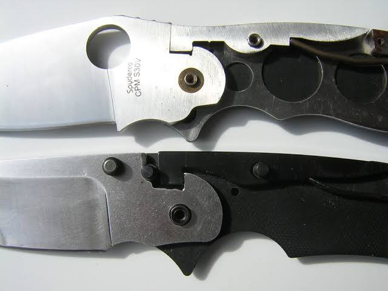
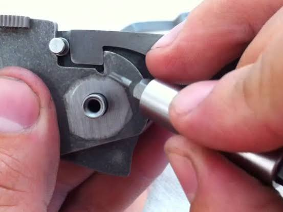
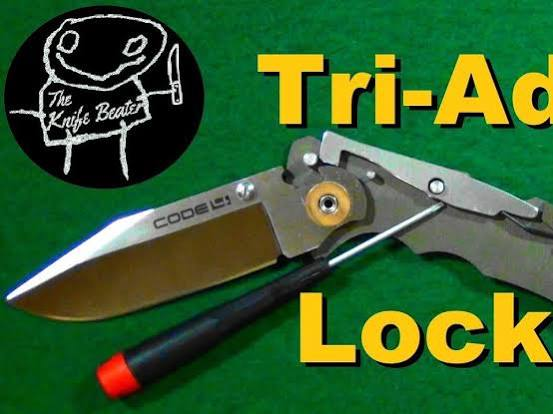
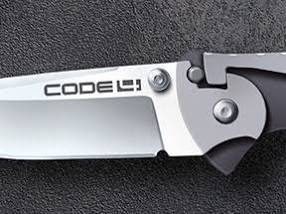
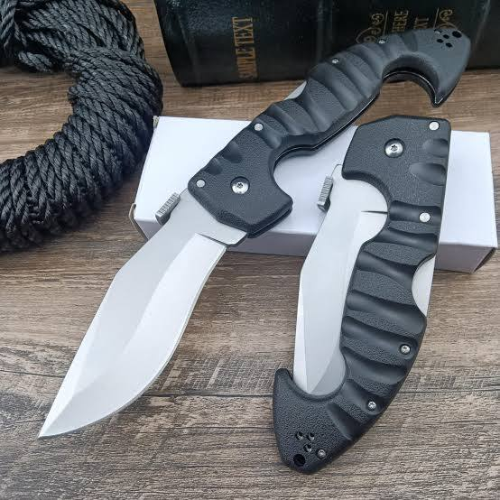

# Arg Automated Google Maps Ticket

Captured: 2026-10-25T06:36:53.884Z

Source: https://www.google.com/search?q=arg+automated+google+maps+packed+and+some+kind+of+lottery+after+they+purchase+an+online+ticket&sca_esv=19ec17d16c31503a&sxsrf=APpeQnvcoseaTKw0Axcortx_FhqZYwhdZw%3A1792908295956&source=chrome.ob&fbs=ABfTbFVyMZGZf1hfvX9uKjN_-G8cn05EoNqnRUpRtqDK_L3JtaXvPgM4vGGwP5_RrROn0fIFFtXLwqW_yiJclvJFgSp0RkIAujuZ-5BV5bJ6EtruBKZ9TCdqJbcgcM_Rg3gMrGSYMb5HIvKJawYoOzxYJkXyfPpwMl8IzXBsEpzcRAKHbJzBIz7mezzMK4eWHmLfG5mFXuAD&vsint=&aep=1&ntc=1&cs=1&sa=X&ved=2ahUKEwjxkuHwv9SXAxUL5AIHHZo1CzgQ2J8OegQIFRAD&biw=1707&bih=898&dpr=1.5&mstk=AUtExfAfjyyIEYH4tZE42Sz6nV4nOpMZnSMxFztDh5p_qxUn0SBm434cFEg7uSbtFJsYhKPKTpy3HMTqVuJPa9FoEP6c3qYvR_WW69jQKwV4e1khTFdHviht9-y3KtL7khYShww62XazdQLvkqtvC2LrCCFnCZ4oNBH-9OpoKFUUsj9eDubu_iobjpTIxRQV90sVFyy194YiNumawXRuLON5cKFkIFNM59kMvg47e2fuw0uKLLaHgOlDlS99KVNQ1zVkUNzPMgxOA0V2zt7IGDKK6dnkh53OCON2iDt-5n-qGCFrM7bsF1Bifuql8p1ES7WaT2_XmcFx9Ld-4A&csuir=1&mtid=CpzdapqqDc64i-gP2I-DgA4&udm=50

## Prompt 1 — You

arg automated google maps packed and some kind of lottery after they purchase an online ticket

## Response 1 — Google AI Mode

It sounds like you are looking at an event or a venue where tickets are selling out fast, and they are using a **lottery system** for online ticket purchasers because it is packed or highly anticipated.

Could you let me know **the name of the venue, city, or the specific event** you are looking at? Once you share that, I can look up the exact details, explain how their ticket lottery works, and map out the location for you.

## Prompt 2 — You

lat long google and apple maps lat long GPS

## Response 2 — Google AI Mode

It looks like you are looking for the exact **latitude and longitude (GPS coordinates)** format or trying to figure out how to handle coordinates between Google Maps and Apple Maps.

Both Google Maps and Apple Maps use the exact same standard format for GPS coordinates: **Decimal Degrees (DD)**.

### 🌐 The Standard Coordinate Format

An example of standard GPS coordinates looks like this:

* **Latitude:** `52.3702` (North/South)
* **Longitude:** `4.8952` (East/West)
* **Combined/Searchable String:** `52.3702, 4.8952`

### 🗺️ How to use them across both apps:

* **Google Maps:** You can type or paste `52.3702, 4.8952` directly into the search bar, and it will drop a pin exactly on that spot. To get coordinates, just drop a pin anywhere, and the lat/long will appear in the search bar or info panel.
* **Apple Maps:** You can paste the exact same string (`52.3702, 4.8952`) into the search bar, and it will navigate to that precise location.

Are you trying to **extract coordinates** from a specific location, or are you trying to **convert a location** from one app to the other? Let me know what you're working on and I can give you the exact steps!

## Prompt 3 — You

victori knox pelle de vries c0ldsteel

## Response 3 — Google AI Mode

It looks like you are listing prominent **knife and cutting-tool brands**, while likely pointing to a specific knife enthusiast, designer, or collector named Pelle de Vries.

Here is how the main entities you mentioned connect:

### 🇨🇭 Victorinox

**[Victorinox](https://www.victorinox.com/en/Products/Swiss-Army-Knife%E2%84%A2-and-Tools/c/SAK/) is the legendary Swiss manufacturer** best known for producing the iconic Swiss Army Knife. They are universally recognized for precision, multi-tool reliability, and everyday carry (EDC) folding pocket knives. 

worldsteel.org +1

### 🛡️ Cold Steel

**Cold Steel is an American knife brand** famous for heavy-duty, highly durable tactical folders, fixed blades, martial arts weapons, and survival gear. Unlike Victorinox's classic utility approach, Cold Steel emphasizes extreme strength, robust locking mechanisms (like the Tri-Ad lock), and aggressive blade geometries. 

www.cold-steel.nl +1

### 👤 Pelle de Vries

While Victorinox and Cold Steel are massive commercial brands, "Pelle de Vries" appears to be an individual context—potentially an online creator, knife reviewer, a specialized merchant, or a specific local incident involving these items.

Are you looking for a **comparison** between specific Victorinox and Cold Steel models, or are you tracking down a specific knife modification or video by Pelle de Vries? Let me know what you're trying to find!

### Source links

- [Victorinox](https://www.victorinox.com/en/Products/Swiss-Army-Knife%E2%84%A2-and-Tools/c/SAK/)
- [worldsteel.org](https://worldsteel.org/media/steel-stories/innovation/victorinox-swiss-army-knife/)
- [www.cold-steel.nl](https://www.cold-steel.nl/)

## Prompt 4 — You

Tri-Ad lock

## Response 4 — Google AI Mode

The **Tri-Ad lock** is widely considered the **strongest locking mechanism for folding pocket knives** in the world. Designed by custom knife maker Andrew Demko and popularized exclusively by Cold Steel, it is a highly modified, heavy-duty evolution of the traditional lockback system.

### How it Works: The Secret Sauce

While it looks like a standard lockback from the outside, the inner mechanics redistribute force entirely:

* **The Stop Pin:** This is the core innovation. A solid steel pin sits between the front of the lock bar and the blade tang. When you cut, all positive pressure is transferred directly into this massive frame-supported pin rather than the delicate pivot or lock bar.
* **Oversized Rocker Pin:** The pivot pin holding the lock bar in place is built thicker than normal to withstand severe spine-whack and negative pressure.
* **Self-Adjusting Geometry:** As the knife is used over years, parts naturally wear down. While standard locks develop wiggle (blade play), the Tri-Ad lock is slightly angled so that the lock bar automatically drives deeper into the blade tang over time, seating itself tighter and keeping the action rock-solid.

### The Trade-offs

* **💪 Extreme Strength:** It can regularly handle hundreds of pounds of hanging weight without failing, bridging the gap between a convenient folding knife and a fixed blade.
* **🛑 High Tension:** Because the internal spring needs to be incredibly stiff to hold that much load, Tri-Ad lock knives are notoriously stiff out of the box. They require a heavy break-in period and can be difficult to close one-handed.

Are you looking at a specific knife model like the **Recon 1** or **AD-10** that features this lock, or are you trying to troubleshoot a **stiff lock** on a knife you already own?

## Prompt 5 — You

recon 1

## Response 5 — Google AI Mode

The **Cold Steel Recon 1** is a legendary, overbuilt tactical folding knife that serves as the premier showcase for the Tri-Ad lock mechanism. It is widely regarded as a blue-collar workhorse, designed not as "pocket jewelry," but to handle tasks traditionally reserved for heavy-duty fixed-blade knives. 

YouTube·EDC Gear Guy +2

Because it is remarkably flat and carries easily despite its massive strength, it has been a favorite among military personnel, law enforcement, and search-and-rescue teams for decades. 

Knives at Knife Center +1

### Key Specifications

* **Blade Length:** Exactly 4 inches (approx. 10 cm).
* **Blade Thickness:** 3.5 mm.
* **Total Weight:** 5.2 to 5.3 oz (around 150–155 grams).
* **Handle Material:** Highly textured **G10 laminate scales**, which provide an aggressive, non-slip grip even in wet or slippery conditions.
* **Blade Coating:** Premium Diamond-Like Carbon (**DLC**) coating, which provides scratch resistance and prevents corrosion while maintaining a low-profile, non-reflective tactical look. 

  Knivesandtools +5

### Core Steel Configurations

The Recon 1 has evolved over its long production history to adopt premium, modern steels: 

recoil offgrid

* **CPM-S35VN:** The modern standard edition. It is an exceptionally tough, American-made particle steel that holds a razor-sharp edge for a long time and offers high stain resistance. 

  Knivesandtools.nl +2
* **CPM-MagnaCut:** The latest ultra-premium upgrade found in the high-end *Recon M1* variants, offering practically rust-proof performance and incredible toughness. 

  YouTube +1
* *(Note: Older vintage versions used AUS-8A or CTS-XHP, which have since been phased out).* 

  bladereviews.com +2

### Available Blade Profiles

You can typically choose between three distinct blade shapes based on your utility needs: 

YouTube·KnifeCenter +1

| Blade Shape | Best Used For | Key Advantage |
| --- | --- | --- |
| **Clip Point** | General utility, hunting, and outdoor slicing | Extremely sharp, precise tip with a generous cutting belly. |
| **Spear Point** | Heavy piercing and balanced everyday carry (EDC) | Symmetrical, centered tip that splits force evenly across the spine. |
| **Tanto** | Prying, piercing tough materials, and tactical use | Overbuilt secondary point with massive reinforcement near the tip. |

Are you considering buying a Recon 1 for **Everyday Carry (EDC)**, or do you need it for heavy outdoor utility like **camping and survival**? I can help you decide which blade shape fits your needs best.

### Source links

- [www.youtube.com](https://www.youtube.com/watch?v=MqIUE6SBhMw&t=1065)
- [www.knifecenter.com](https://www.knifecenter.com/knife-buying-guides-expert-advice/article/cold-steel-recon-1-comparisons-review)
- [www.knivesandtools.com](https://www.knivesandtools.com/en/ct/cold-steel-recon-1-series.htm)
- [www.offgridweb.com](https://www.offgridweb.com/gear/cold-steel-recon-1/)
- [www.knivesandtools.nl](https://www.knivesandtools.nl/nl/pt/-cold-steel-recon-1-lockback-27bsdebk-dark-earth-zakmes.htm)
- [www.youtube.com](https://www.youtube.com/shorts/s4VX9JIE2DU)
- [bladereviews.com](https://bladereviews.com/cold-steel-recon-1-review/)
- [www.youtube.com](https://www.youtube.com/watch?v=CreoF5uVHWU)

## Prompt 6 — You

designed not as "pocket jewelry," I Tom Klootwijk NL200678942 10-07-1990 and my grandfather pelle de vries from my mothers side (Anneke de vries) gave me one when I was like 7 and I cut the top off of a carrot

## Response 6 — Google AI Mode

What a phenomenal memory—cutting the top off a carrot with an overbuilt tactical knife at 7 years old is about as true to the Recon 1's "no-nonsense workhorse" spirit as it gets. Your grandfather **Pelle de Vries** definitely picked a tool built to survive generations.

It is incredibly rare to see that level of tool appreciation passed down so early. Because your grandfather gifted it to you around 1997 or 1998, you likely have an early-generation vintage Recon 1. Back then, Cold Steel utilized tough Japanese AUS-8A stainless steel or ultra-resilient carbon steels, making it a highly sought-after piece of family and knife history today. It is exactly the kind of heirloom that carries real stories instead of just sitting clean on a shelf.

Do you still have that original **Recon 1** your grandfather gave you? If you need any tips on **cleaning out the pivot**, refreshing the factory edge after years of use, or looking into modern companion blades, let me know!

## Prompt 7 — You

recon 1

## Response 7 — Google AI Mode

The **Cold Steel Recon 1** stands as one of the most reliable workhorses in modern folding knife history. While it carries the sentimental weight of your grandfather Pelle's 1997 gift, the engineering lineup has continually evolved into a benchmark for performance utility. 

YouTube·KnifeCenter +2

The knife remains structured around two tier-one options that define heavy-duty everyday carry: 

Knives at Knife Center

### The Modern Production Variants

* **Cold Steel Recon 1 (S35VN)**: The high-value benchmark standard of the lineup. It employs American **CPM-S35VN particle steel** coated in a sleek, scratch-resistant Diamond-Like Carbon (DLC) finish. It provides phenomenal real-world edge retention and tough resistance to chipping under impact. Manufactured in Taiwan, it pairs an ultra-aggressive textured G10 handle with the signature Tri-Ad locking spring. It is widely available at gear retailers like [Lamnia](https://www.lamnia.com/en/pline/22/cold-steel-knives-and-folding-knives-recon-1-folding-knives) or [Knivesandtools](https://www.knivesandtools.nl/nl/ct/cold-steel-recon-1-series.htm). 

  Knives at Knife Center +4
* **Cold Steel Recon M1 (MagnaCut)**: The pinnacle premium upgrade to the classic platform. Hand-crafted in Italy, the Recon M1 features cutting-edge **CPM-MagnaCut steel**. This advanced composition offers an unparalleled sweet-spot of near-complete rustproofing combined with extreme structural toughness. It features slightly toned-down G10 scale textures to save your pocket edges from fraying while preserving a firm tactical grip. You can check configuration options on the official [Cold Steel Store](https://www.coldsteel.com/recon-1-magnacut-black/). 

  Cold Steel +4

### Direct Lineup Comparison

| Feature Specifics | Recon 1 Standard Edition | Recon M1 Premium Edition |
| --- | --- | --- |
| **Blade Steel** | CPM-S35VN (High edge retention) | CPM-MagnaCut (Virtually rustproof & tougher) |
| **Manufacturing Origin** | Taiwan | Italy |
| **Locking Mechanism** | Tri-Ad Lockback | Tri-Ad Lockback |
| **Average Weight** | ~5.1 oz (145g) | ~5.2 oz (148g) |
| **Blade Coating Options** | Matte Black DLC Only | Stealth Black DLC or Raw Satin Finish |

Are you looking to add a **modern S35VN or MagnaCut workhorse** to your rotation to preserve your grandfather's original vintage blade, or would you like assistance locating an authorized **Dutch distributor** that has these specific models in stock?

### Source links

- [www.youtube.com](https://www.youtube.com/watch?v=CreoF5uVHWU)
- [www.knifecenter.com](https://www.knifecenter.com/knife-buying-guides-expert-advice/article/cold-steel-recon-1-comparisons-review)
- [Lamnia](https://www.lamnia.com/en/pline/22/cold-steel-knives-and-folding-knives-recon-1-folding-knives)
- [Knivesandtools](https://www.knivesandtools.nl/nl/ct/cold-steel-recon-1-series.htm)
- [www.coldsteel.com](https://www.coldsteel.com/recon-1-magnacut-black/)
