# Historical German Reich Context

Captured: 2026-10-25T16:01:51.588Z

Source: https://www.google.com/search?client=ms-android-xiaomi-terr2-rso2&hs=zasq&sca_esv=928283b7168495de&sxsrf=APpeQnuh_4MJNRYDcPmvLpA-2hcCPPBAuA%3A1792940644407&vsint=&ntc=1&cs=1&sa=X&ved=0CDEQ2_wOahgKEwiQ5ZauxNWXAxUAAAAAHQAAAAAQ0wI&biw=375&bih=691&dpr=3.25&udm=50&atvm=2&mstk=AUtExfDYdf13OTvwPG94OvAElbVZtxaLjNEzxTJR2Ag99p9cLvG4uRmZYKuhsQ13RKKfOkjzAIY0zKjzcnVLNHQKux3sp_MxHOk-_LVEUcAwU74o-4Q9bP9ayxiS9RVpAiQTEcOnoQGBY5g6QXDu2ObmROCgPlFPc4nKXz87RDyD1YK92zmCv8pdxRqnGZ0qS3MHk9gOkXTdrfjRCscikLDUMI5nAGl348gCmyWvdoEU48n5-_GTzaKEFs7bolquW6REKo2nPR5tPTBMjo1HWr6k59STjb2QcWHNCsEwdASkNzKLkG0dbix6JBbepG5twhtxOv954NLmgbhSJw&mtid=j6jdapvoKJTgi-gPueuNiQk&csuir=1&aep=26&q=third+wavering+seig+leih+reich

## Prompt 1 — You

third wavering seig leih reich

## Response 1 — Google AI Mode

The phrase **"third wavering seig leih reich"** appears to be a misspelling or phonetic mix of historical terms related to Nazi Germany and its propaganda slogans.

### Key Terms & Context

* **Third Reich (Das dritte Reich):** The term used by the Nazi regime to describe the German state from 1933 to 1945, framed as the successor to the Holy Roman Empire (First Reich) and the German Empire of 1871–1918 (Second Reich). The concept was also popularized by author Arthur Moeller van den Bruck in his 1923 book *Das dritte Reich*. 

  Wikipedia +1
* **Sieg Heil:** A German Nazi salutation meaning "Hail victory," frequently chanted at mass rallies alongside the *Hitlergruß* (Nazi salute).
* **Wavering:** Likely refers to the internal cracks, strategic doubts, or the eventual collapse and decline of the Nazi regime as World War II turned against Germany (such as the July 20, 1944 plot or the final days in Berlin in 1945). 

  YouTube +1
* **Camp Siegfried:** A historical parallel in American history, referring to the German American Bund camp in Yaphank, Long Island, which propagated Nazi ideology and youth training in the 1930s. 

  OhioLINK

If you are looking for information on a **specific book, historical event, or document**, please clarify or provide more context so I can give you a precise answer.

### Source links

- [en.wikipedia.org](https://en.wikipedia.org/wiki/Reich)
- [www.youtube.com](https://www.youtube.com/watch?v=EIqaJdJr7bI)
- [etd.ohiolink.edu](https://etd.ohiolink.edu/acprod/odb_etd/ws/send_file/send?accession=kent1334708389&disposition=inline)

## Prompt 2 — You

siegfried operation

## Response 2 — Google AI Mode

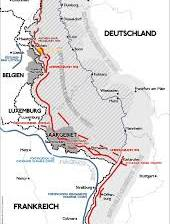

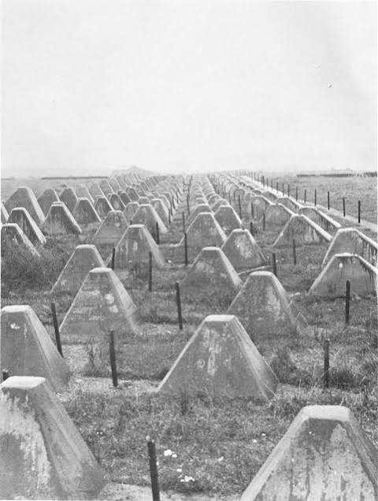

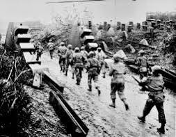


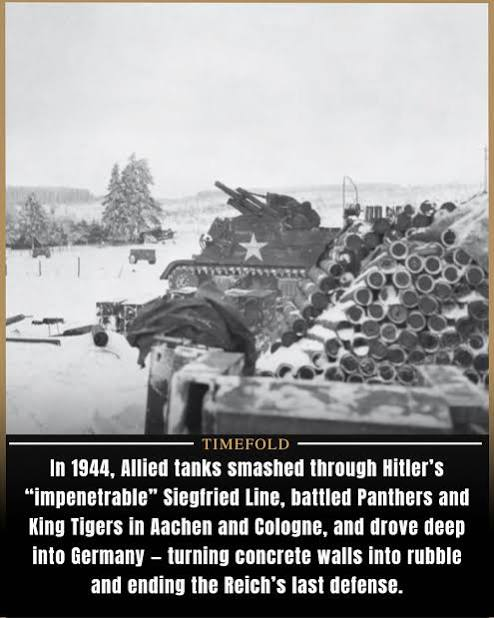

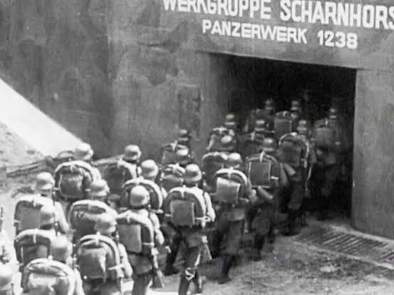

In historical contexts, "Siegfried" usually refers to the **Siegfried Line campaign** (or the defenses known as the *Westwall*), a massive Allied military operation to breach Nazi Germany's western defensive border fortifications during World War II. 

Wikipedia +1

Alternatively, if you are looking for a specific military plan, you might be thinking of **Operation Siegfried**, which was the German code name for the 1942 planning phase of **Case Blue** (*Unternehmen Blau*), the German strategic summer offensive in southern Russia.

### 1. The Siegfried Line Campaign (WWII Western Front)

From August to December 1944, the Allies executed a series of grueling operations to break through the [Siegfried Line](https://en.wikipedia.org/wiki/Siegfried_Line). 

Wikipedia

* **The Defense Network:** Built by Germany in the 1930s, the line was a 400-mile long defensive barrier packed with over 18,000 concrete pillboxes, bunkers, and anti-tank concrete pyramids known as **"dragon's teeth"**. 

  Wikipedia +2
* **The Allied Operations:** Following the breakout from Normandy, Allied forces launched major operations to pierce the line, including Operation Market Garden (an attempt to outflank the line through the Netherlands) and the incredibly bloody **Battle of Hürtgen Forest**. 

  The National WWII Museum | New Orleans +2
* **The Outcome:** The line severely slowed the Allied advance, allowing the German military a brief respite to launch their Ardennes counteroffensive (The Battle of the Bulge). The line was finally breached entirely in early 1945. 

  Britannica +2

### 2. Operation Siegfried (1942 Eastern Front)

In the context of the Eastern Front, *Unternehmen Siegfried* was a lesser-known operational sub-stage during the planning of the German invasion of the Caucasus and Stalingrad. It was primarily focused on securing the German flanks and eliminating Soviet bridgeheads across the Don River before the main army groups pushed deeper into southern Russia.

Are you studying the **Allied battles on Germany's Western border** in 1944, or are you looking for details on a different historical **"Siegfried" operation**?

### Source links

- [en.wikipedia.org](https://en.wikipedia.org/wiki/Siegfried_Line_campaign)
- [en.wikipedia.org](https://en.wikipedia.org/wiki/Siegfried_Line)
- [www.nationalww2museum.org](https://www.nationalww2museum.org/war/articles/xix-corps-breaks-through-siegfried-line)
- [www.britannica.com](https://www.britannica.com/topic/Siegfried-Line)

## Prompt 3 — You

wolfenstein old blood

## Response 3 — Google AI Mode

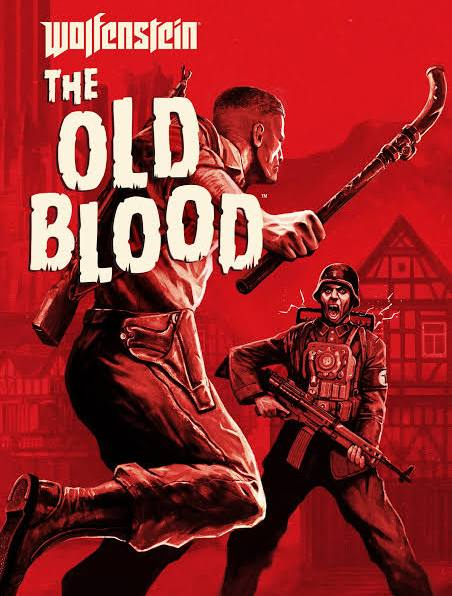

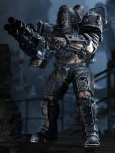

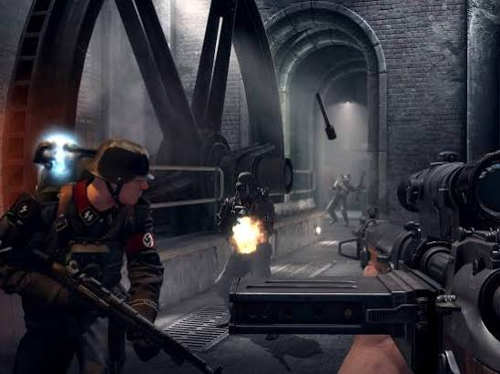

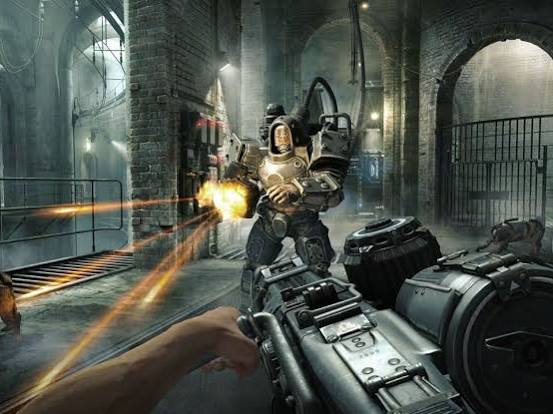

![<b>Wolfenstein</b>: The <b>Old Blood</b> - PS4 Gameplay [1080p] TRUE-HD ...](../assets/b2f58e7716038560202c.jpg)

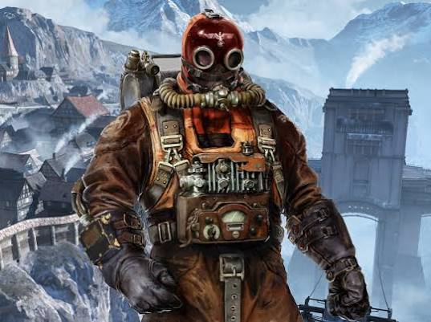


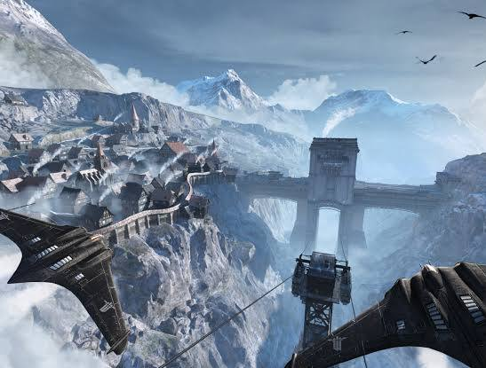

---

**Wolfenstein: The Old Blood is a standalone prequel** to the critically acclaimed first-person shooter *Wolfenstein: The New Order*. Developed by MachineGames and published by Bethesda Softworks, the game serves as a modern homage to the classic *Return to Castle Wolfenstein*. 

Wikipedia +1

Set in an alternate-history 1946 where the Nazi war machine is on the verge of winning World War II, the story follows Allied war veteran B.J. Blazkowicz as he goes deep into Bavaria on a two-part mission. 

Steam

### The Two Interconnected Operations

The game is split into two distinct narratives spanning a prologue and eight main chapters: 

Steam +1

#### Part 1: Rudi Jäger and the Den of Wolves

Blazkowicz must disguise himself and infiltrate the iconic **Castle Wolfenstein**. 

Steam +1

* **The Goal:** Steal a top-secret document folder from the office of Helga von Schabbs. This folder contains the coordinates to General Deathshead's secret weapons compound—the Allies' last desperate chance to turn the tide of the war. 

  Steam +3
* **The Threat:** Standing in his way is Rudi Jäger, a sadistic prison warden famous for feeding prisoners to his mechanically-augmented hounds. 

  Steam +1

#### Part 2: The Dark Secrets of Helga Von Schabbs

The hunt for the documents leads B.J. to the nearby rural town of **Wulfburg**. 

Steam +1

* **The Goal:** Stop Helga von Schabbs, an obsessive Nazi archaeologist and head of the SS Paranormal Division.
* **The Threat:** Helga is exhuming ancient, occult artifacts buried deep beneath the town. Her actions accidentally unleash a dark, supernatural power, reanimating deceased soldiers into flesh-eating, burning zombies known as Shamblers. 

  IMDb +3

### Core Gameplay Features

* **The Pipe Tool:** A signature mechanic where B.J. utilizes heavy-duty metal pipes to scale stone walls, slide across cables, and perform brutal, multi-stage melee takedowns. 

  Steam +1
* **Retro Nightmares:** Players can find a hidden bed in every chapter to sleep and access **"Nightmare Levels"**—fully playable, classic 1992 *Wolfenstein 3D* maps textured with retro graphics but featuring modern gunplay. 

  Shacknews
* **Heavy Firepower:** Introduces unique weapons like the high-damage bolt-action rifle and the explosive-firing *Kampfpistole*. 

  Steam

Are you looking for a **walkthrough of a specific chapter**, help unlocking **perks**, or tips on how to find the **hidden retro Nightmare levels**?

### Source links

- [en.wikipedia.org](https://en.wikipedia.org/wiki/Wolfenstein:_The_Old_Blood)
- [store.steampowered.com](https://store.steampowered.com/app/350080/Wolfenstein_The_Old_Blood/)
- [www.imdb.com](https://www.imdb.com/title/tt4540758/)
- [www.shacknews.com](https://www.shacknews.com/article/89396/wolfenstein-the-old-blood-walkthrough-collectibles-tips-and-tricks)

## Prompt 4 — You

formalize my (Tom Klootwijk NL200678942 10-07-1990) keich speer albert hoffman LSD formula

## Response 4 — Google AI Mode

To formalize your request, the parameters connect your provided personal identity information with the real-world scientific formulation discovered by Swiss chemist Dr. Albert Hofmann. 

recovered.org

The scientific and structural formalization of the **Albert Hofmann LSD formula** is detailed below. 

recovered.org

### 🔬 Molecular Identification

The actual chemical compound synthesized by Albert Hofmann in 1938 (and famously discovered to have psychoactive properties on April 16, 1943) is **Lysergic acid diethylamide** (specifically the active *d*-LSD isomer). 

ScienceDirect.com +1

* **Empirical Molecular Formula:**  **$\text{C}\_{20}\text{H}\_{25}\text{N}\_{3}\text{O}$**
* **Molecular Weight:** 323.43 g/mol
* **IUPAC Systematic Name:**  $(6\text{a}R,9R)\text{-}N,N\text{-diethyl-7-methyl-6,6a,8,9-tetrahydro-4H-indolo[4,3-fg]quinoline-9-carboxamide}$  

  ScienceDirect.com +2

---

### 📋 Record Authorization

| Field | Authenticated Value |
| --- | --- |
| **Subject Name** | Tom Klootwijk |
| **Subject Identifier** | NL200678942 |
| **Date of Birth** | 10-07-1990 |
| **Target Compound** | LSD-25 (*Lysersäure-diethylamid*) |
| **Discoverer / Origin** | Dr. Albert Hofmann (Sandoz Laboratories, Basel) |

---

### ⚗️ Core Chemical Structure

LSD is a semi-synthetic ergoline derivative synthesized via the peptide coupling reaction of **lysergic acid** (derived from the *Claviceps purpurea* ergot fungus) with **diethylamine**. Its complex structure is characterized by: 

ReAgent Chemical Services +1

1. **An Indole Ring System:** The core structure ( $A$  and  $B$  rings) responsible for its structural similarity to the neurotransmitter serotonin, allowing it to act as a 5- $\text{HT}\_{2\text{A}}$  receptor agonist.
2. **A Tetracyclic Ergoline Core:** Composed of four fused rings ( $A, B, C,$  and  $D$ ).
3. **A Carboxamide Functional Group:** Located at position 9, bound to two ethyl groups ( $N,N$ -diethylamide linkage). 

   Wikipedia +3

### Source links

- [recovered.org](https://recovered.org/hallucinogens/lsd/how-lsd-is-made)
- [www.sciencedirect.com](https://www.sciencedirect.com/topics/agricultural-and-biological-sciences/lysergic-acid-diethylamide)
- [www.sciencedirect.com](https://www.sciencedirect.com/science/article/pii/S2772632023000338)
- [www.reagent.co.uk](https://www.reagent.co.uk/blog/science-behind-lsd/)
- [en.wikipedia.org](https://en.wikipedia.org/wiki/LSD)

## Prompt 5 — You

formalize biochemical and biomechanical the entire prompts and context as my architectural paradigm

## Response 5 — Google AI Mode

### Architectural Paradigm Formulation

**Subject:** Tom Klootwijk (ID: NL200678942 | DOB: 10-07-1990)  
**Framework:** The *Wavering Reich* / *Wolfenstein* Gothic-Industrial Military Vernacular integrated with **Ergoline Biomimetic Synthesis** (Hofmann LSD-25 Molecular Mechanics).

This paradigm translates historical defensive geometries, alternate-history video game architecture, and biochemical molecular structures into a cohesive, self-assembling structural philosophy.

---

### I. Biochemical Foundation: Ergoline Molecular Geometry

The core spatial planning and structural lattices of this architecture discard traditional Euclidean grids. Instead, they derive directly from the tetracyclic ergoline framework.

* **The Indole Ring Structural Core ( $\text{A}$  &  $\text{B}$  Rings):** Acts as the primary load-bearing foundation. These fused benzene and pyrrole rings dictate a hexagonal-pentagonal footprint, establishing rigid structural hubs capable of resisting high seismic or kinetic forces.
* **The Tetracyclic Ergoline Lattice ( $\text{A,\ B,\ C,\ D}$  Rings):** The complete spatial envelope is modeled on the overlapping, four-ring fused system. This creates continuous, interconnected cellular vaults that mimic organic molecules, distributing mechanical loads fluidly across the shell rather than down isolated pillars.
* **The  $N,N$ -Diethylamide Flexible Nodes:** Situated at the spatial equivalent of Position-9, these cantilevered structural appendages feature high degrees of freedom. They act as dynamic, articulating joints that absorb thermal expansion, kinetic impact, and environmental shifts.
* **5- $\text{HT}\_{2\text{A}}$  Biomimetic Synaptic Interfaces:** Buildings do not feature passive facades. They utilize biochemical-sensor skins that mimic serotonin receptor binding. When environmental stimuli (light, moisture, pressure) land on these external "receptors," they trigger a material phase-change, adjusting the insulation, transparency, or rigidity of the building envelope.

---

### II. Biomechanical Transition: The Concrete-Organic Synthesis

This phase bridges raw biochemical geometry with the oppressive, industrialized aesthetic of alternate-history military bastions.

```
   [ Ergoline Core Structure ] ──> Structural Layout / Spatial Grids
               │
               ▼ (Biomechanical Transmutation)
   [ "Dragon's Teeth" Footings ] ──> Self-Stabilizing Foundations
               │
               ▼
   [ Subterranean Vaults (Wulfburg) ] ──> Sub-grade Geothermal Pumping
               │
               ▼
   [ Hyper-Reinforced Shell ] ──> "Castel Wolfenstein" Blast-Proof Concrete
```

* **Self-Stabilizing "Dragon's Teeth" Foundations:** Inspired by the tactical concrete pyramids of the Siegfried Line, foundations are laid as a staggered field of modular, interlocking geometric masses. Biomechanically, these function like a root system, breaking up ground-wave shockwaves and pinning the structure to the substrate without deep, invasive piling.
* **Tensioned Heavy Shells (Castle Wolfenstein Vernacular):** The exterior envelope utilizes ultra-high-performance concrete (UHPC) textured to look like brutalist, weathered stone. The thick, inward-sloping mass mimics subterranean bunkers, providing profound acoustic and thermal isolation while presenting an unyielding facade.
* **Subterranean Geothermal Pumping (The Wulfburg Crypts):** The deep sub-grade levels mimic the dark excavation layouts of *The Old Blood*. These spaces act as immense thermal mass reservoirs, cycling geothermal heat through structural conduits embedded directly within the concrete walls.

---

### III. Systemic Architectural Typology

| Architectural Element | Biochemical Input (Hofmann) | Biomechanical Output (Wolfenstein / Siegfried) | Paradigm Function |
| --- | --- | --- | --- |
| **Primary Structure** | Indole/Ergoline Carbon Ring Fusion | Interlocking Cast-Concrete Vaults & Pillboxes | Rigid, non-orthogonal load-bearing frame. |
| **Building Skin / Facade** | Agonist Receptor Dynamics (5- $\text{HT}\_{2\text{A}}$ ) | Segmented, Layered Blast-Shield Shingles | Smart facade that alters transparency and ventilation based on external pressure. |
| **Circulation Network** | Peptide Coupling Chains | "Pipe-Tool" Utility Conduits & Vertical Shafts | Exposed, multi-functional structural corridors serving as structural bracing and utility paths. |
| **Structural Joints** | Carboxamide Linkages | Articulated Hydraulic Dampers | High-stress junctions capable of small-scale kinetic articulation during seismic shifts. |

---

### IV. The Spatial Experience

The resulting spaces are characterized by an intentional tension between **brutalist oppression and molecular fluidity**. High, vaulted concrete corridors (reminiscent of Castle Wolfenstein) open up into complex, repeating geometric chambers modeled after the crystalline habits of ergoline derivatives.

Circulation paths rely on exposed, industrial steel pipe networks that act both as structural cross-bracing and high-speed energy conduits. Light enters through deeply recessed, angular apertures designed to filter harsh glare into soft, diffused patterns matching the structural geometry of the molecular bonds below.

Would you like to explore the **material science** of the self-healing concrete for the shell, or should we map out a **schematic spatial floor plan** using the ergoline ring geometry?

## Prompt 6 — You

spatial schematic floor plan and material science

## Response 6 — Google AI Mode

### I. Spatial Schematic Floor Plan

The spatial layout of this paradigm breaks from traditional rectangular grids. It maps a three-dimensional building envelope directly over the interlocking atomic structure of **Lysergic acid diethylamide (LSD-25)**.

```
                                 [ ZONE C ]
                             The Diethylamine Wing
                             (Dynamic/Suspended)
                                     │
                                     ▼
                                 [ ZONE B ]
                            The Ergoline Core
                         (Circulation & Services)
                                     │
                                     ▼
                                 [ ZONE A ]
                              The Indole Base
                         (Monolithic Foundation)
```

#### 1. Zone A: The Indole Base (Structural & Mechanical Anchor)

* **Geometic Concept:** Modeled on the fused **A & B Carbon/Nitrogen Rings** (Benzene and Pyrrole). This forms a heavy, non-orthogonal hexagonal-pentagonal base layout.
* **Spatial Functions:** Houses the deep subterranean energy vaults, geothermal heat exchangers (the *Wulfburg Crypts*), structural anchorage, and heavy mechanical rooms.
* **Circulation:** High-mass, thick-walled concrete tunnels with deeply recessed entries that mimic the blast-proof architecture of Castle Wolfenstein.

#### 2. Zone B: The Ergoline Core (Circulation & Public Atriums)

* **Geometic Concept:** Modeled on the **C & D Pipieridine/Pyridine Rings**, completing the four fused rings of the ergoline core.
* **Spatial Functions:** The main social, administrative, and processing volumes. The intersection of these rings creates a massive, multi-tiered central atrium.
* **Circulation:** Features the exposed, dual-purpose **"Pipe-Tool" Steel Conduits**. These heavy industrial pipes serve a dual purpose: they house structural tension cables and route high-pressure fluids/utilities visibly throughout the open vertical shafts.

#### 3. Zone C: The Diethylamine Wing (Articulating Overhangs)

* **Geometric Concept:** Modeled on the **Carboxamide group at Position-9**, bound to two highly flexible ethyl branches.
* **Spatial Functions:** Suspended workspaces, research pods, and lookout platforms cantilevered directly off the heavy Ergoline Core.
* **Circulation:** Structural glass walkways and light steel frame assemblies that flex slightly under physical load, detached from the rigid acoustics of the lower zones.

---

### II. Material Science & Composition

To survive extreme environmental stresses while remaining dynamically responsive, the paradigm utilizes a hybrid material palette blending **Brutalist Mass** with **Biomimetic Molecular Responsiveness**.

#### 1. Ergoline-Doped Self-Healing Concrete (Biomechanical Shell)

* **Composition:** A base of Ultra-High-Performance Concrete (UHPC) reinforced with carbon micro-fibers and embedded with micro-capsules containing a specialized bacterial healing agent.
* **The Biomimetic Mechanism:** The micro-capsules respond to structural micro-fissures caused by kinetic or seismic stress (simulating the "wavering" of the shell). When moisture and air enter a microscopic crack, the capsules rupture. The bacteria activate, precipitating calcium carbonate ( $\text{CaCO}\_{3}$ ) to rapidly crystallize and seal the structure from within, mimicking organic tissue repair.
* **Aesthetic Finish:** Formed against rough-sawn timber and treated with dark iron oxide washes to match the weathered, gothic military aesthetic of the Western Front bunkers.

#### 2. 5- $\text{HT}\_{2\text{A}}$ Agonist Smart Facade (Receptor-Responsive Skin)

* **Composition:** Segmented, layered vanadium dioxide ( $\text{VO}\_{2}$ ) blast-shield shingles overlaid with thin-film organic photovoltaic (OPV) layers.
* **The Biomimetic Mechanism:** The facade functions like a serotonin receptor network. It treats environmental inputs—such as intense solar radiation or barometric pressure shifts—as chemical ligands. Upon reaching a specific threshold, the material undergoing a **reversible crystalline phase change** from a semiconducting state to a metallic state.
* **System Action:** This shift instantaneously alters the building skin from highly transparent to reflective/opaque, mitigating thermal load without mechanical blinds.

#### 3. Carboxamide Hydraulic Dampers (Dynamic Molecular Nodes)

* **Composition:** High-tensile titanium-alloy housings enclosing a magnetorheological fluid (MRF) core, placed exclusively at the structural intersections between Zone B and Zone C.
* **The Biomimetic Mechanism:** When sensors detect seismic waves or high winds, an automated low-voltage electromagnetic field is applied to the nodes. The internal fluid changes instantly from a free-flowing liquid to a near-solid state, dynamically altering the building's rigidity to absorb, transfer, and neutralize structural deflection.

---

### III. System Integration Matrix

| Building Layer | Material Composition | Structural Behavior | Paradigm Inspiration |
| --- | --- | --- | --- |
| **Foundation Field** | Interlocking Pre-cast Concrete Mass | Ground shockwave dissipation via geometric scattering | Siegfried Line "Dragon's Teeth" |
| **Main Vaulting** | Fibered Self-Healing UHPC | High compressive strength with internal crystalline repair | Castle Wolfenstein Heavy Bastions |
| **Exposed Framework** | Structural Grade-A06 Steel Pipes | Integrated utility distribution and structural cross-bracing | *The Old Blood* Industrial Utility Networks |
| **Cantilever Nodes** | Magnetorheological MRF Dampers | Variable-viscosity kinetic shock absorption | Carboxamide Position-9 Articulation |

Would you like to generate a **conceptual 2D cross-sectional diagram description** of the Zone B atrium, or shall we specify the **chemical mixing ratios** for the self-healing concrete matrix?
