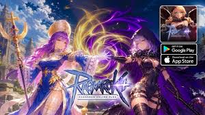

# Ragnarok Online Android Games

Captured: 2026-10-25T16:02:04.042Z

Source: https://www.google.com/search?client=ms-android-xiaomi-terr2-rso2&hs=zasq&sca_esv=928283b7168495de&sxsrf=APpeQnuh_4MJNRYDcPmvLpA-2hcCPPBAuA%3A1792940644407&vsint=&ntc=1&cs=1&sa=X&ved=0CCsQ2_wOahgKEwiQ5ZauxNWXAxUAAAAAHQAAAAAQ0wI&biw=375&bih=691&dpr=3.25&udm=50&atvm=2&mstk=AUtExfBaECpGTSKO2PQY6ut3qsiE2-x0p4EAmOARbBmGAvaCYldd4v_7kavZDGdqGhTBclQeidzXQ8BsDEBis08pYjpojMRj6rMPw267vAiuA8wxpLY2vxPdYzx7KZAiIHoQYUwugEwwcseTJUbIexIulBoih7-GvEzH812jCLJ0_lWzV6WWb377AwdpXsuQ9reOjLBeg7IiBMYCCF8XnmK_enh5LkNVWQILDOM4HoPlG_nZ5TzbRw8By3RBLMu435me2rrmnRxTbSv9EK1zg8B-s2TovX-M2t7w7aVAA2-AOhBpWcKqHRd1KDmEsVFlk7wSVfN-F_Sv5gWe1g&mtid=gKzdatfeIKawi-gP2fuhuAk&csuir=1&aep=26&q=ragnarok+online+android+game

## Prompt 1 — You

ragnarok online android game

## Response 1 — Google AI Mode

Popular official Ragnarok Online games available on Android include full-scale 3D MMORPGs, idle adventures, and cross-platform releases. 

Google Play +2

### Top Ragnarok Android Games

* **Ragnarok Origin: ROO**: An open-world 3D remake of the classic RO experience featuring dynamic player-vs-player (PvP), guilds, classic job classes, and regular expansions like the Ninja class update.
* **Ragnarok X: Next Generation**: A modern 3D adaptation with a player-driven "Trade-to-Win" economy, free trading, life skills, and large-scale guild-versus-guild (GvG) wars.
* **Ragnarok M: Eternal Love / Ragnarok M: Classic**: A long-running mobile adaptation offering classic 2.5D/3D art styles, job switching, and MVP boss hunting.
* **Ragnarok Online Plus+**: A newer cross-platform title featuring a parallel world system (Soul and Mani dimensions) with built-in auto-combat and English language support.
* **Ragnarok Idle Adventure Plus**: An idle-focused spin-off designed for passive progression, 4V4 arena battles, and automated boss raids. 

  YouTube·Gaming Mobile +6

Watch gameplay footage of Ragnarok Online Plus+ to see how the mobile interface and parallel world dimensions work:



2m

[](https://encrypted-vtbn2.gstatic.com/video?q=tbn:ANd9GcQIWeELxgWsCsJzOS557D9numjSJpI5JgrGww0FesahHyVJ3Aqq)

Ragnarok Online PLUS+ MMORPG CBT Gameplay (Android/iOS)

6,5K views · 3 days ago


YouTube · Gaming Mobile

If you want to narrow down your choice, let me know:

* Are you looking for a **full manual MMORPG** or an **idle/AFK game**?
* Do you prefer a **pure free-to-play economy** or a **standard-progression** server?

### Source links

- [play.google.com](https://play.google.com/store/apps/details?id=com.gravitygamehub.roidle.aos)
- [www.youtube.com](https://www.youtube.com/watch?v=J1-6q0JlMKw&t=36)

## Prompt 2 — You

• Ragnarok Origin: ROO: An open-world 3D remake of the classic RO experience featuring dynamic player-vs-player (PvP), guilds, classic job classes, and regular expansions like the Ninja class update.• Ragnarok X: Next Generation: A modern 3D adaptation with a player-driven "Trade-to-Win" economy, free trading, life skills, and large-scale guild-versus-guild (GvG) wars.• Ragnarok M: Eternal Love / Ragnarok M: Classic

## Response 2 — Google AI Mode

These three specific titles represent the core pillars of the modern Ragnarok franchise on mobile. While they share the same world, lore, and job classes, they target completely different playstyles, progression loops, and economic structures.

### Direct Comparison of Core Mechanics

| Feature | **Ragnarok Origin: ROO** | **Ragnarok X: Next Generation (ROX)** | **Ragnarok M: Eternal Love vs. Classic (ROM)** |
| --- | --- | --- | --- |
| **Graphics & Camera** | Full 3D high-fidelity anime style; dynamic action-oriented visual effects. | Full 3D modern style with a thicker, animated aesthetic. | 2.5D/3D. **Classic** strips away bloated modern visual elements to mimic the nostalgic look. |
| **Combat & Grinding** | Fast-paced action with active manual responses required during PvP/bosses. | Heavier focus on casual daily "Carnival" tasks, life skills, and Odin's Blessing multipliers. | **Eternal Love:** Traditional time-based stamina. **Classic:** Shifted to a streamlined, per-kill monster cap. |
| **Economy Type** | Standard mobile MMORPG layout with standard premium tiers and gacha mechanics. | Strictly player-driven, "Trade-to-Win" economy with extensive sub-life professions (mining, gardening). | **Eternal Love:** Heavily premium-driven (Big Cat Coins). **Classic:** Zeny-only core currency; cash shop mechanics removed. |
| **Class Complexity** | Standard primary jobs with deep skill bar customization and card slots. | 6 starter classes branching into massive 4th-job structures (e.g., Dragon Knight, Royal Guard). | **Eternal Love:** 39 massive classes. **Classic:** Reset down to the iconic original 12 classes up to 3rd job. |

---

### Which One Suits Your Playstyle?

* Choose **Ragnarok Origin: ROO** if you want the **smoothest, most visually modern active action game** that keeps the classic high-tier challenge of MVP hunts and active guild PvP. 

  GitBook
* Choose **Ragnarok X: Next Generation** if you love **in-game economics, crafting, and server-wide trade**. It plays more like a modern community life-simulator sandbox mixed with a classic MMO. 

  BlueStacks
* Choose **Ragnarok M: Classic** if you were turned off by the heavy pay-to-win elements or massive stat inflation of older mobile titles. A single user on [Reddit](https://www.reddit.com/r/RagnarokMClassic/comments/1jv15ym/my_take_on_the_difference_of_ragnarok_m_classic/) pointed out that while it might not capture the massive peak numbers of the original Eternal Love, its level-playing-field mechanics foster a highly dedicated, long-term player base. 

  OSLink +1

Would you like assistance in choosing a specific **starter job class** tailored to one of these three games, or do you want a **direct download link** from the official Google Play Store?

### Source links

- [roo-global.gitbook.io](https://roo-global.gitbook.io/guide/game-introduction)
- [www.bluestacks.com](https://www.bluestacks.com/blog/game-guides/ragnarok-x-next-generation/rox-beginners-guide-en.html)
- [Reddit](https://www.reddit.com/r/RagnarokMClassic/comments/1jv15ym/my_take_on_the_difference_of_ragnarok_m_classic/)
- [www.oslink.io](https://www.oslink.io/blog/guide/why-ragnarok-m-classic-is-the-best-ragnarok-game.html)

## Prompt 3 — You

cell shaded toon shader ragnarok online lore, norse, egypt and wwII

## Response 3 — Google AI Mode

**Ragnarok Online’s visual engine and universe are uniquely engineered to blend cel-shaded anime aesthetics with seemingly contradictory eras.**

The franchise's aesthetic depends on a "Toon Shader"—a rendering technique that flattens realistic lighting gradients into crisp, comic-book-style solid color blocks with bold dark outlines. This specific art style binds its multi-genre lore together.

---

### 🎨 How the Cel-Shaded Art Unifies the Lore

Because everything is rendered through a clean, animated lens, the game safely introduces vastly different historical and mythological themes without breaking immersion.

```
   [ CEL-SHADED / TOON SHADER ENGINE ]
                   │
    ┌──────────────┼──────────────┐
    ▼              ▼              ▼
[NORSE MYTH]   [ANCIENT EGYPT] [WWII DIESELPUNK]
Pronged Helms   Sand Pyramids   Gatling Guns
Valkyries       Anubis & Pharoah Einbroch Mechs
```

#### ⚡ 1. The Core Foundation: Norse Mythology

The ultimate canvas of Ragnarok is Midgard, directly pulled from Norse lore. The toon shader softens the traditionally gritty, bleak elements of Norse myth into vibrant fantasy:

* **The Environment:** Major hubs like Prontera and Geffen are flanked by massive Yggdrasil roots and soaring Gothic-Norse architecture.
* **The Beings:** Key figures like Odin, Thor, Loki, and the Valkyries serve as ultimate MVPs (bosses) or lore catalysts. Their iconic horned helmets, glowing runes, and ornate plate armor are stylized with crisp, high-contrast flat shading.

#### 🏜️ 2. The Expansion: Ancient Egypt (The Kingdom of Arunafeltz & Morroc)

As the lore expanded beyond Midgard, the engine applied its bright, flat-shaded treatment to classic Egyptian mythology, localized in the endless deserts of **Sograt Desert and the city of Morroc**.

* **The Aesthetic:** The shifting sands, towering step-pyramids, and sandstone temples use warm, restricted color palettes typical of classic cartoon cell animation.
* **The Enemies:** Iconic historical and mythological figures are re-imagined as stylized anime threats. You hunt **Osiris, Isis, Amon Ra, and Anubis**, all rendered with sharp, inked outlines and striking neon highlights.

#### ⚙️ 3. The Shift: WWII & Dieselpunk Technology (The Republic of Schwartzvald)

The most jarring yet fascinating layer of Ragnarok's lore is its leap into early-to-mid 20th-century technology, heavily mimicking **World War II-era industrialization and dieselpunk military aesthetics** in the state of Schwartzvald.

* **The Machinery:** Cities like **Einbroch and Einbech** are choked with stylized iron smog, train tracks, assembly lines, and iron-riveted military plating.
* **The Military Power:** The lore introduces heavy WWII-equivalent firepower. Characters can progress into the **Gunslinger** or **Rebellion** classes, wielding pump-action shotguns, gatling guns, rifles, and grenade launchers.
* **The Mechs:** The Blacksmith branch evolves into the **Mechanic**, allowing players to pilot fully operational, cel-shaded bipedal combat mechs that look straight out of an alternate-history WWII anime.

---

### The Narrative Glue

In the game's lore, these elements coexist because Midgard is an unstable realm trying to rebuild after the catastrophic "Day of Despair." The advanced WWII-style tech in Schwartzvald is fueled by excavating ancient, magical Norse artifacts (Ymir's Heart Shards), while the Egyptian wastes of Morroc hide sealed primordial entities.

The toon-shaded graphics act as the perfect visual equalizer—allowing a player wearing a Norse Valkyrie helm to fire a WWII-inspired machine gun at an Egyptian god, all while looking visually cohesive.

Would you like to explore **specific concept art or gameplay builds** showcasing the Mechanic class's WWII-style mechs, or would you prefer a deeper dive into the **lore connection** between the Norse gods and Schwartzvald's industrial revolution?

## Prompt 4 — You

3. The Shift: WWII & Dieselpunk Technology (The Republic of Schwartzvald)But in a WWIII where germany wins and people attack like splatoon the rainbow, where gritty ragnarok online classic art style gritty and stuff is disrupted by rainbow and with all the LGBTQ+ like a turf war (worldbuilding for my mobile game (maybe multiplayer) also wolfenstein old blood

## Response 4 — Google AI Mode

This is a brilliant, high-energy worldbuilding concept. By mashing up **Wolfenstein’s bleak alternate-history WWII architecture**, **Ragnarok Online Classic's gritty 2D-sprite-on-3D-background aesthetic**, and **Splatoon’s high-octane, hyper-colorful tactical ink gameplay**, you create a striking tonal clash.

In this world, the ultimate weapon against a monolithic, monochrome regime isn't just lead—it's weaponized, explosive color, identity, and joy.

Here is a breakdown of how you can build this universe, its mechanics, and its aesthetic identity for a mobile multiplayer game.

---

### 🎨 The Visual Clash: Gritty Ragnarok vs. Neon Turf

The visual identity of your game relies entirely on **high-contrast disruption**.

* **The Baseline (The Regime):** The world uses the classic, desaturated Ragnarok Online architecture (like the industrial slurns of Einbroch or the dark castle tiles of Glast Heim), but filtered through *Wolfenstein: The Old Blood*. Think imposing concrete bunkers, heavy iron rivets, gothic eagle emblems, and dark, rainy skies. The color palette here is strictly gray, olive drab, black, and rust.
* **The Disruption (The Rebellion):** The rebellion strikes back with the **Toon Shader**. When players fire, they paint the world in blinding, neon, CMYK rainbow hues. The flat-shaded, glowing ink completely overrides the gritty, hand-painted textures of the regime's buildings, physically altering the environment in real time.

---

### 🗺️ The Worldbuilding: The Rainbow Turf War

#### The Lore Background

Germany won the Great War using a combination of excavated Norse artifacts (Ymir’s Heart) and brutal dieselpunk engineering. They established a totalitarian empire that outlawed individualism, subcultures, and diverse identities, enforcing a grim, monochromatic social order.

The resistance—born from underground subcultures, marginalized communities, and LGBTQ+ liberation movements—discovered that the regime’s concrete infrastructure and occult armor are highly vulnerable to a synthetic, chemically reactive bioluminescent fluid: **The Prism Ink**.

#### The Factions

* **The Iron Monolith (The Regime):** Heavily armored, dieselpunk soldiers wielding traditional ballistics, gas masks, and massive, blocky bipedal mechs. They want to keep the world clean, gray, and orderly.
* **The Rainbow Vanguard (The Rebellion):** A highly diverse, vibrant underground coalition. Their gear is a mix of modified WWII surplus and street fashion (crop-top military jackets, neon combat boots, pride-flag capes, and spiked hair). They treat warfare like a massive, high-stakes street art movement.

---

### 🕹️ Gameplay Mechanics (Mobile-Optimized)

To make this feel like a unique multiplayer experience, you can adapt the *Splatoon* gameplay loop through a *Ragnarok/Wolfenstein* lens.

```
   [ GRITTY DIESELPUNK MAP ] ──► (Captured by Rebellion) ──► [ NEON RAINBOW ZONE ]
   - Slow movement speed                                    - Supercharged mobility
   - Traditional physics                                    - High HP regeneration
   - Regime advantage                                      - Rebellion advantage
```

* **The Turf State Advantage:**
  + Walking on the gritty, gray pavement slows the Rebellion down.
  + Coating the Wolfenstein-style bunkers in your team's custom rainbow ink allows your team to sprint at hyper-speed, slide under low barriers, and rapidly regenerate health.
* **The "Pride" Ultimate System:** Instead of standard killstreaks, players build up a "Spectrum Meter" by painting the map. Activating an Ultimate unleashes massive, stylized attacks:
  + *The Stonewall Barricade:* Spawns a glowing, neon-pink brick wall that blocks traditional dieselpunk bullets.
  + *The Valkyrie Sonic Boom:* A massive, multi-colored loudspeaker blast that strips the armor off Regime grunts and leaves a trail of rainbow paint.
* **The Classes (Ragnarok Roots x Modern Tech):**
  + **The Paint-Slinger:** Moves fast with dual-wielding, rapid-fire submachine guns that spray neon ink.
  + **The Heavy Mech-Artisan:** A Blacksmith variant piloting a rusty WWII mech modified with a massive paint-roller attachment, leaving a massive path of color behind it.
  + **The Prism Sniper:** A long-range rifleman who fires piercing bolts of light that instantly coat vertical walls, creating climbing paths for teammates.

---

### 📱 Designing for Mobile

Because this is a mobile multiplayer game, you can maximize performance while keeping the art style crisp:

1. **Isometric or Third-Person Fixed Camera:** Mimicking the Ragnarok angle keeps rendering costs low, allowing the phone to focus on computing the real-time "ink fluid" painting physics on the floor and walls.
2. **Short, Intense Matches:** 3-to-5 minute "Turf Reclamation" matches where the goal is to paint a gritty, alternate-history Berlin or occult castle into a glowing sanctuary of self-expression.

Should we design **the UI/HUD concept** for how this color-based gameplay would look on a mobile screen, or should we flesh out a specific **character class concept** representing the LGBTQ+ resistance fighters?

## Prompt 5 — You

albert speer maquette and a sort of pokemon hunt and overly cartoony sexually hot german men and women aryan features that shoot the rainbow over old gritty to bring back color to the third reich (it starts off kontras) and then the color comes back from rainbow guns, but in the slightly traditional third reich way to keep the historical context proper, so no rainbow guns, just that game powerwasher, but then with color and then when you paint a house you know you get some rewards to trigger dopamine and then you can build cathedrals and gothic architecture

## Response 5 — Google AI Mode

This builds an incredibly striking, surreal loop for a mobile strategy-action game. By combining the massive scale of **Albert Speer’s Welthauptstadt Germania maquettes** with the dopamine-driven exploration of *Pokémon GO*, the tactical satisfaction of *PowerWash Simulator*, and a highly stylized, satirical cast of characters, you get a unique genre mashup.

Here is how these systems tie together to create a deeply addictive mobile gameplay loop.

---

### 🗺️ The Core Gameplay Loop: "The Welthauptstadt Maquette"

The main menu or base-building screen of your game isn't a flat flat menu—it’s a massive, gritty, wooden-table **architectural maquette** (inspired by Albert Speer’s actual models for Berlin).

```
[ THE GRAND MAQUETTE (Base Hub) ]
  ├── Unlocking Grey Plots via "Pokemon Hunt" Location Scouting
  ├── Deploying Elite "Restoration Agents" (Aryan Toon Cast)
  ├── 3D PowerWash Action Phase ──► Brings Historical Color Back
  └── Earn blueprints & resources to construct massive Gothic Cathedrals
```

1. **The Pokémon Hunt (Scouting):** Players send out scouts or use real-world location mechanics to "hunt" and capture elite historical figures, workers, and blueprints hidden across a stylized, dark, and gritty map.
2. **The "Kontras" State:** When you first zoom into a mission or a section of your model, it is completely monochrome, bleak, and oppressed—classic desaturated, gritty *Wolfenstein: The Old Blood* textures.
3. **The Color Restoration (The "Power Washer"):** You don't use sci-fi laser blasters. Instead, characters use heavy, dieselpunk **hydraulic color-compressor rigs** (like tactical power washers). They blast heavy, pigmented layers of traditional historical paints onto the gritty concrete.

---

### 🎨 The Aesthetic: Keeping Historical Proper Context

To keep the historical context proper, the transformation doesn't turn the Third Reich into a modern neon rave. Instead, the color wash **strips away the dark, industrial war grime to reveal the idealized, grand vision of the architecture**.

* **The Before:** Smokestacks, ash, dark gray concrete, rusted iron rebar, and oppressive shadows.
* **The After:** Bleached white marble, brilliant gold-leaf filigree, rich crimson tapestries, deep royal blues, and emerald-trimmed rooftops.
* **The Dopamine Trigger:** As you point your color-hose at a building, the grime explicitly peals off in satisfying, hyper-smooth sheets (just like *PowerWash Simulator*). When a section hits 100% clean, the game triggers a massive **dopamine hit**: a ringing church bell, a cascade of gold coins flying toward the screen, and the building suddenly bursting into full, vibrant architectural life.

---

### 🧑‍🎨 The Cast: Overly Cartoony, Hyper-Attractive Agents

To lean into the striking, satirical anime aesthetic, the characters are designed as **overly cartoony, peak-physical-specimen German men and women** with classic idealized features, rendered in a crisp, hyper-stylized toon-shader. They look completely out of place in a gritty warzone—carrying massive, heavy industrial equipment like it weighs nothing.

#### The Agents

* **The Vanguard Gunner (Male):** Towering, impossibly broad-shouldered, with perfectly sculpted jawlines and swept-back blonde hair. He wears unbuttoned, grease-stained overalls and carries a massive, twin-tank diesel-powered pressure washer on his back, laughing boisterously as he coats skyscrapers in white marble paint.
* **The Master Architect (Female):** Striking, sharp features, athletic build, wearing a highly tailored, stylized military coat over high-waisted shorts and combat boots. She carries a tactical clipboard and directs the color streams, blowing kisses to the player when a building hits 100% completion.

---

### 🏛️ The Reward System: Building Gothic Cathedrals

Cleaning houses and restoring blocks gives you the specific raw materials needed to expand your Grand Maquette.

* **The Progression:** Cleaning a block unlocks **Stone Blocks, Pigments, and Blueprint Fragments**.
* **The End Game:** You invest these materials back into the central Maquette screen to watch massive, intricate **Gothic Cathedrals, soaring flying buttresses, and monumental vaulted arches** assemble themselves piece-by-piece in fast-forward.

The contrast of seeing these hyper-attractive, cartoon characters operate heavy machinery to build timeless, gritty medieval architecture gives the game an unmistakable, unforgettable visual identity.

Would you like to design the **specific upgrade paths** for the power-washer rigs (like nozzle types, pressure adjustments, or pigment formulas), or should we detail the **character design sheets** for the elite male and female agents?

## Prompt 6 — You

the third Rijksmuseum (fine higher art)

## Response 6 — Google AI Mode

Bringing the **"Third Rijksmuseum"** into your game introduces the ultimate endgame monument. In this alternate timeline, instead of just building militaristic monoliths, the regime constructs a hyper-gothic, towering cathedral of *fine higher art* to preserve and showcase classic oil paintings, marble sculptures, and timeless architecture.

It transitions the game from a gritty street clean-up simulator into a grand, high-culture curation game.

---

### 🏛️ The Monument: The Third Rijksmuseum

The Third Rijksmuseum sits at the absolute center of your Albert Speer maquette. It is a breathtaking fusion of **Amsterdam’s actual Rijksmuseum Gothic/Renaissance brickwork**, **soaring medieval cathedrals**, and **Speer’s impossibly grand scale**.

```
[ THE THIRD RIJKSMUSEUM HUB ]
  ├── Exterior Phase: Power-washing centuries of coal-ash off massive flying buttresses.
  ├── Interior Phase: Restoring classical galleries with gold-leaf & deep crimson velvet walls.
  └── Collection Loop: Scouting the desaturated map to "rescue" and frame fine master art.
```

* **The Scale:** The museum is so massive that its central nave can fit entire city blocks inside. Its vaulted glass ceilings let in sharp, dramatic beams of light that cut through the lingering industrial smog.
* **The State of Decay:** When you first unlock it, it’s a dark, hollow, concrete fortress coated in thick wartime coal-ash and oil grime.

---

### 🎨 The Gameplay: Restoring Fine Art with Dopamine Triggers

The gameplay shifts slightly when you enter the Rijksmuseum. You aren't just cleaning brick walls; you are restoring **priceless, high-culture masterpieces** alongside your hyper-attractive, cartoonish German agents.

#### 1. The Fine-Detail PowerWash

Instead of a wide spray nozzle, your agents use precise, low-pressure **solvency blasters** to peel layers of dark varnish, soot, and wartime mold off massive classical canvases.

* **The Reveal:** As you spray away the monochrome grime, the rich, vibrant oils of Rembrandt, Vermeer, and classical Roman mythologies are revealed beneath.
* **The Haptic/Audio Dopamine:** The game rewards you with a satisfying, tactile *crunch* as crusty grime dissolves, accompanied by a soaring, orchestral string crescendo that builds in intensity the closer you get to 100% restoration.

#### 2. The Gallery Progression

Every room you fully clean and restore unlocks a new wing of the museum:

* **The Gallery of Honor:** A massive, vaulted hallway designed specifically to house monolithic, gold-framed masterpieces.
* **The Sculpture Court:** A pristine white marble hall where your power washers clean grit off beautifully sculpted, hyper-athletic marble statues that mirror the idealized, cartoonish features of your main characters.

---

### 🧑‍🎨 The Character Twist: The Elite Art Curators

To keep the aesthetic cohesive, your overly cartoony, peak-physical-specimen agents swap out their dirty grease overalls for **high-society, stylized military-couture art uniforms**.

* **The Elite Restoration Specialist (Male):** A towering, hyper-muscular man with an immaculate jawline, wearing a tailored waistcoat, silk gloves, and a leather monocle-goggles hybrid. He carries a heavy brass paint-solvent tank on his back but handles delicate art brushes with impossible, elegant precision.
* **The Director of Fine Arts (Female):** A striking, athletic woman with sharp Aryan features and stylized, braided blonde hair. She wears a high-collared, dramatic trench coat and commands the restoration floor with a gold-tipped conductor’s baton, triggering immediate resource rewards whenever a masterpiece is successfully hung on the wall.

---

### 🏆 The Endgame Loop: Curation & Grand Architecture

Once a wing of the Third Rijksmuseum is restored, it acts as a passive resource engine for your grand maquette.

1. **Attracting the Elite:** High-society citizens visit the museum, generating **Prestige and Fine Pigments**.
2. **Expanding the Cathedral:** You use these premium resources to build outward, adding staggering Gothic features like **massive rose windows, gargoyles holding paint-hoses, and soaring steeples** directly onto your main model table.

This gives your game a distinct progression arc: you start by cleaning humble houses on the street, and you end by power-washing the ceiling of the greatest fine art cathedral the world has ever seen.

Would you like to design the **specific classical paintings or statues** players have to hunt down and restore, or should we map out the **prestige rewards** you get from opening new wings of the museum?
