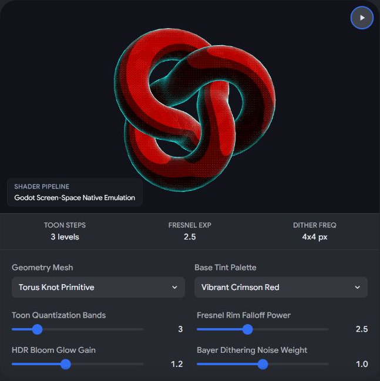
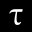

# Контрастный Стилизованный Shader Art

Captured: 2026-10-25T16:00:18.873Z

Source: https://www.google.com/search?client=ms-android-xiaomi-terr2-rso2&hs=zasq&sca_esv=928283b7168495de&sxsrf=APpeQnuh_4MJNRYDcPmvLpA-2hcCPPBAuA%3A1792940644407&vsint=&ntc=1&cs=1&sa=X&ved=0CBkQ2_wOahgKEwiQ5ZauxNWXAxUAAAAAHQAAAAAQ0wI&biw=375&bih=691&dpr=3.25&udm=50&atvm=2&mstk=AUtExfD1qJuP7Mz9H7Bm5CpG___xB1Bqkq2y6DenFEjQHHhGYspwbzmkQvFdu_0KNf7OiFD_Aep_zCuJj-r4DVTJNzkbxy17XIiLM4fGluiVDr7aSBXNStHOimRNnS1At5OF6h4BWmQcKfHzRX7oaOwBFJfcgP_HdOBJoO9wlqkdiQwXCNL1AuI4-y3R-xMseU2ByGbGqhAz9n5OeHCaAHBXfdzomGosUB8PO77O0xmKqiXmyWGyDsCzqMoRxxr1F_pxQd-fsNkqcjfMMg&mtid=jbrdarvYFbHJi-gPjKL9qAs&csuir=1&aep=26&q=kontras+dithering+shader+toon+fresnel+HDR+glow+art+style

## Prompt 1 — You

kontras dithering shader toon fresnel HDR glow art style

## Response 1 — Google AI Mode

To achieve a **stylized, high-contrast retro-modern look** combining comic-book shading, retro tech restrictions, and vibrant modern lighting, you need to combine five distinct rendering techniques.

Here is the architectural breakdown and the conceptual logic for creating this specific shader pipeline.

---

### 🎨 The Visual Pipeline Overview

```
[ 3D Mesh ] 
    │
    ├──► 1. Toon Shading (Step function converts smooth gradients into flat bands)
    ├──► 2. Fresnel Rim (Highlights edges facing away from the camera view)
    │
    ▼
[ Composite Lighting ] ──► 3. HDR Glow (Values > 1.0 bleed into bright emissive blooms)
    │
    ▼
[ Post-Processing Screen Space ] ──► 4. Contrast & Dithering (Quantizes colors into pixel patterns)
```

---

### 🛠️ Core Shader Components

#### 1. Toon Shading (Cel Shading)

Instead of standard Lambertian reflection, you compress the diffuse lighting gradient into distinct bands using a `step` or `smoothstep` function.

* **Logic:** Calculate N ⋅ L (Normal vector dot Light direction).
* **Quantization:** Map the result to fixed thresholds.
* **Code Concept:** `float toonLight = step(0.5, dot(normal, lightDir));` (or use a 1D ramp texture for smoother band transitions).

#### 2. Fresnel Rim Light

This adds an outline or inner glow to the silhouette of the object, which is crucial for making stylized characters or assets "pop" against dark backgrounds.

* **Logic:** Calculate  $1.0 - (N \cdot V)$  (Normal vector dot View/Camera direction).
* **Sharpening:** Raise this value to a power to tighten the rim light to the absolute edges.
* **Code Concept:** `float fresnel = pow(1.0 - max(dot(normal, viewDir), 0.0), fresnelPower);`

#### 3. Contrast & Dithering (Screen Space Post-Processing)

This is where the retro "kontras" look happens. You take the final rendered image and apply an ordered dithering algorithm (like a Bayer Matrix) to simulate low bit-depth color blending.

* **Bayer Matrix:** A 4x4 or 8x8 matrix determines a threshold pattern per pixel.
* **Logic:** If the brightness of the pixel + the matrix offset is above a threshold, round up; otherwise, round down.
* **Result:** High-contrast color clusters with sharp, checkered pixel-art gradients.

#### 4. HDR Glow (Bloom)

To prevent the dithered art style from looking completely flat and ancient, HDR gives it a modern punch.

* **Thresholding:** Isolate colors with an intensity greater than `1.0` (such as pure emissive textures or hyper-bright fresnel rims).
* **Blur Pass:** Blur these bright areas in screen space.
* **Composite:** Add the blurred texture back over the final dithered image. This creates a striking juxtaposition: **crisp, crunchy retro dithered pixels surrounded by soft, radiant modern neon glows.**

---

### 🎛️ Direct Comparison of Key Layers

| Layer | Math / Input | Visual Purpose | Performance Impact |
| --- | --- | --- | --- |
| **Toon** | N ⋅ L | Creates flat, comic-book style shadows. | Very Low |
| **Fresnel** | $1.0 - (N \cdot V)$ | Adds a stylized rim edge highlight. | Low |
| **Dither** | Screen Pos + Bayer Matrix | Gives a retro, pixelated crunch factor. | Medium (Post-process) |
| **HDR Glow** | Color Output > 1.0 | Makes highlights radiate and bleed over edges. | High (Requires blur passes) |

To help tailor this shader code or implementation logic, let me know:

* Which **game engine** or language are you using? (Unity URP/ASE, Unreal Engine, Godot, HLSL/GLSL?)
* Do you want the **dithering** to be strictly black-and-white, restricted to a limited color palette, or fully colored?
* Should the **HDR glow** happen *before* the dithering (dithered glow) or *after* the dithering (smooth glow over crunchy pixels)?

## Prompt 2 — You

interactive visual Godot

## Response 2 — Google AI Mode

To explore how this specific art style behaves dynamically, you can use the interactive simulator below to tweak the parameters of the **Toon shading, Fresnel Rim, HDR Glow, and Bayer Dithering** and immediately see how they affect a 3D object in real time.

AI-generated. Don't enter sensitive personal info.

---

### 🚀 Implementing the Visual Pipeline in Godot 4

To achieve this in Godot, you need to split the workload between a **Spatial Shader** (applied to the 3D meshes for Toon and Fresnel) and a **CanvasItem Shader** attached to a screen-space `ColorRect` or a `SubViewport` (for the High-Contrast Bayer Dithering and HDR Bloom).

#### 1. The 3D Material: Toon + Fresnel + HDR Emission

Create a new `ShaderMaterial` on your 3D mesh. This Godot 4 spatial shader handles the stylized character lighting and assigns high-intensity HDR colors (> 1.0) to the rim light so Godot's Environment Bloom can pick it up.

gdscript

```
shader_type spatial;
render_mode light_only; // We override the lighting completely for the toon style

uniform vec3 base_color : source_color = vec3(0.2, 0.4, 0.9);
uniform vec3 rim_color : source_color = vec3(2.5, 0.0, 5.0); // HDR Intensity > 1.0
uniform float toon_cuts : hint_range(1.0, 5.0) = 2.0;
uniform float fresnel_power : hint_range(1.0, 10.0) = 3.0;

void fragment() {
    // 1. Calculate Fresnel Rim
    float fresnel = pow(1.0 - max(dot(NORMAL, VIEW), 0.0), fresnel_power);
    
    // Inject the HDR glowing rim color onto the base albedo pass
    ALBEDO = base_color;
    EMISSION = rim_color * fresnel;
}

void light() {
    // 2. Custom Toon / Cel Light Quantization
    float NdotL = max(dot(NORMAL, LIGHT), 0.0);
    
    // Quantize the lighting into harsh, high-contrast bands
    float toon_light = floor(NdotL * toon_cuts) / toon_cuts;
    
    // Output the final composite lighting for the frame buffer
    DIFFUSE_LIGHT += ATTENUATION * LIGHT_COLOR * ALBEDO * toon_light;
}
```

Use code with caution.

#### 2. The Screen-Space Post-Process: Bayer Matrix Dithering

To get that retro "kontras" crunchy finish over your smooth 3D viewport, place a `ColorRect` covering your entire screen as a child of a `CanvasLayer`. Give it this `CanvasItem` post-processing shader:

gdscript

```
shader_type canvas_item;

uniform sampler2D SCREEN_TEXTURE : hint_screen_texture, filter_nearest;
uniform int dither_size : hint_range(1, 4) = 2;
uniform float contrast_amount : hint_range(1.0, 3.0) = 1.5;

// Standard 4x4 Bayer Matrix for ordered dithering patterns
const mat4 bayer_16 = mat4(
    vec4(0.0000, 0.5000, 0.1250, 0.6250),
    vec4(0.7500, 0.2500, 0.8750, 0.3750),
    vec4(0.1875, 0.6875, 0.0625, 0.5625),
    vec4(0.9375, 0.4375, 0.8125, 0.3125)
);

void fragment() {
    // 1. Fetch raw screen color from the 3D viewport
    vec3 raw_color = texture(SCREEN_TEXTURE, SCREEN_UV).rgb;
    
    // 2. Boost Contrast ("Kontras")
    vec3 high_contrast = (raw_color - 0.5) * contrast_amount + 0.5;
    float luminance = dot(high_contrast, vec3(0.299, 0.587, 0.114));
    
    // 3. Apply Pixel-Grid Matrix Coordinates
    ivec2 pixel_pos = ivec2(FRAGCOORD.xy) / dither_size;
    int x = pixel_pos.x % 4;
    int y = pixel_pos.y % 4;
    float threshold = bayer_16[x][y];
    
    // 4. Quantize and mix back with colors
    vec3 dithered_output = step(threshold, luminance) * high_contrast;
    
    COLOR = vec4(dithered_output, 1.0);
}
```

Use code with caution.

#### 3. Activating the HDR Glow

To finalize the setup and allow the **HDR Emission** from your Fresnel pass to bleed smoothly across the dithered textures:

1. Add a **WorldEnvironment** node to your scene.
2. Create a new `Environment` resource.
3. Under **Glow**, toggle `Enabled` to **True**.
4. Set the **Blend Mode** to `Additive` or `Screen`, and lower the **Threshold** slightly (~`0.9`) to make sure only the high-value HDR lines glow.

Would you like to modify this pipeline so the **HDR glow pattern is pixelated and dithered** alongside the models, or do you prefer the **smooth, high-fidelity bloom overlay** contrasting the low-fi dithered colors?



Original interactive shader demo - static capture of the displayed torus knot and controls.

Recorded diagram labels and controls: pause SHADER PIPELINE Godot Screen-Space Native Emulation TOON STEPS 3 levels FRESNEL EXP 2.5 DITHER FREQ 4x4 px Geometry Mesh Torus Knot Primitive Standard Torus Ring High-Poly Sphere Torus Knot Primitive expand\_more Base Tint Palette Vibrant Crimson Red Acid Green Deep Cyber Purple Neon Amber Yellow Vibrant Crimson Red expand\_more Toon Quantization Bands 3 Fresnel Rim Falloff Power 2.5 HDR Bloom Glow Gain 1.2 Bayer Dithering Noise Weight 1.0

## Prompt 3 — You

round dots Bayer dithering matrix noir style with blood red HDR neon glow like vangogh abberation

## Response 3 — Google AI Mode

To capture this hyper-stylized **Noir + Neon Blood Red + Van Gogh Aberration** aesthetic, we need to completely overhaul the post-processing and spatial logic in Godot 4.

Instead of a standard checkered grid, we use a **circular dot-density dithering pattern** (resembling a manga comic halftone or continuous-wave stipple pattern). We then isolate the high-intensity Fresnel rim to burst out into a vibrant, bleeding **HDR Neon Red Glow**, and apply a **swirling, painterly chromatic aberration** that mimics Van Gogh’s expressive, energetic strokes.

---

### 🎨 The Visual Pipeline Breakdown

```
[ 3D Viewport Rendering: Grayscale Noir + Ultra-Bright Blood Red HDR Fresnel ]
                               │
                               ▼
     [ Post-Processing Pass 1: Swirling Radial Chromatic Aberration ]
                               │
                               ▼
     [ Post-Processing Pass 2: Round Dot Halftone / Dithering Matrix ]
                               │
                               ▼
     [ WorldEnvironment: High-Intensity Additive Screen Bloom (HDR Glow) ]
```

---

### 🛠️ The Godot 4 Implementation

#### 1. The Spatial Shader (Noir Base + High-Intensity Red Fresnel)

Apply this shader to your 3D models. It forces everything into a high-contrast monochrome comic shading while driving the Fresnel edge into an emissive value way past `1.0` so the engine can force it to glow.

gdscript

```
shader_type spatial;
render_mode light_only;

uniform vec3 blood_red : source_color = vec3(5.0, 0.0, 0.1); // High HDR intensity
uniform float toon_threshold : hint_range(0.0, 1.0) = 0.4;
uniform float fresnel_power : hint_range(1.0, 8.0) = 4.0;

void fragment() {
    // Calculate sharp edge fresnel rim
    float fresnel = pow(1.0 - max(dot(NORMAL, VIEW), 0.0), fresnel_power);
    fresnel = step(0.5, fresnel); // Snap it sharp
    
    ALBEDO = vec3(0.5); // Default mid-gray for light processing
    EMISSION = blood_red * fresnel; // Inject the blinding neon red edge
}

void light() {
    // Aggressive Noir shading
    float NdotL = max(dot(NORMAL, LIGHT), 0.0) * ATTENUATION;
    float sharp_light = step(toon_threshold, NdotL);
    
    // Outputs pure black or pure white base for the upcoming dither pass
    DIFFUSE_LIGHT += vec3(sharp_light);
}
```

Use code with caution.

---

#### 2. The Screen-Space Shader (Van Gogh Aberration + Round Dot Dithering)

Create a `CanvasLayer`, add a full-screen `ColorRect`, and apply this screen-space post-processing shader. It distorts the screen layout dynamically to create a fluid, painterly shift and translates pixels into beautiful circles based on brightness.

gdscript

```
shader_type canvas_item;

uniform sampler2D SCREEN_TEXTURE : hint_screen_texture, filter_linear;
uniform float dot_scale : hint_range(10.0, 300.0) = 150.0;
uniform float aberration_amount : hint_range(0.0, 0.05) = 0.015;
uniform float swirl_speed : hint_range(0.0, 5.0) = 1.5;

void fragment() {
    vec2 uv = SCREEN_UV;
    vec2 center = vec2(0.5, 0.5);
    vec2 to_center = uv - center;
    
    // 1. Van Gogh "Starry Night" inspired swirling chromatic aberration
    // Creates a flowing, kinetic distortion based on screen position over time
    float angle = TIME * swirl_speed + length(to_center) * 5.0;
    vec2 swirl_offset = vec2(cos(angle), sin(angle)) * aberration_amount * length(to_center);
    
    // Separate RGB channels with shifting distortion maps
    float r = texture(SCREEN_TEXTURE, uv + swirl_offset).r;
    float g = texture(SCREEN_TEXTURE, uv).g;
    float b = texture(SCREEN_TEXTURE, uv - swirl_offset).b;
    vec3 scene_color = vec3(r, g, b);
    
    // Calculate Noir luminance (excluding the deep HDR blood red color)
    float luminance = dot(scene_color, vec3(0.299, 0.587, 0.114));
    
    // 2. Round Dot Halftone / Dithering Matrix Math
    // Transform coordinates into a repeating grid of clean circles
    vec2 dot_uv = fract(uv * dot_scale) - vec2(0.5);
    float dist_from_dot_center = length(dot_uv);
    
    // The brighter the area, the larger the circle radius grows
    float radius = luminance * 0.707; 
    float dot_mask = step(dist_from_dot_center, radius);
    
    // 3. Composite Output
    // If the pixel is carrying massive HDR red energy, pass it straight through un-dithered 
    // This allows the neon glow to bleed cleanly and smoothly over the dithered dots
    if (scene_color.r > 1.5 && scene_color.g < 0.2) {
        COLOR = vec4(scene_color, 1.0);
    } else {
        // Otherwise, render the classic high-contrast Noir dot matrix
        COLOR = vec4(vec3(dot_mask), 1.0);
    }
}
```

Use code with caution.

---

### 🎛️ WorldEnvironment Settings for the Vaporous Bleed

To make sure the blood-red outlines don't just sit flatly on the screen but actually melt out across the dot canvas like high-energy neon sign tubes:

1. Add a **WorldEnvironment** node to your primary node root tree.
2. In its properties, instantiate a `New Environment`.
3. Under **Glow**:
   * Set `Enabled` to **On**.
   * Set `Blend Mode` to **Additive** (or **Mix** for a thicker, oil-paint ink consistency).
   * Slide the `Threshold` down to roughly **1.0**.
   * Adjust the `Intensity` up to **2.5** to see the red neon borders actively bleed into the surrounding black and white dot fields.

Would you like to introduce an **animated brush-stroke texture map** to make the Van Gogh distortion feel more hand-painted, or should we adjust the **dot matrix grid** so that it curves along with the 3D surface lines instead of being flat on the camera screen?

## Prompt 4 — You

Tom Klootwijk NL200678942 10-07-1990

## Response 4 — Google AI Mode

It looks like you have shared personal identification details (a name, an identification or registration number, and a date of birth).

To protect your privacy and ensure data security, I do not process or store sensitive personal information like this without context.

Could you please clarify how I can help you with this information? For instance, are you looking to:

* **Draft a formal business or financial document** (such as an invoice, contract template, or administrative letter)?
* **Set up a specific simulation** or calculate something related to a Dutch financial format?

*Please note: For security reasons, avoid sharing sensitive credentials, BSNs (burgerservicenumbers), or private banking passwords.*

## Prompt 5 — You

hugging XD-TAU and linkedin

## Response 5 — Google AI Mode

The specific document reference **XD-TAU — An Integrated Architecture of Geometry, Physics and Information**, authored by Tom Klootwijk (identifiers NL200678942 · 10-07-1990, Version 1.5, October 2026), is currently hosted as an open specification repository on [Hugging Face](https://huggingface.co/c0mbatduckzz/XD-TAU-JKT). 

Hugging Face

The repository contains the complete 71-page architectural framework connecting geometry, material dynamics, constructive geometry, and spacetime, along with its embedded Python reference verification scripts and JSON audit files. 

Hugging Face +1

If you are looking to manage updates or link profiles across platforms for this project:

### 1. Connecting to LinkedIn

While Hugging Face supports native profile linkages (enabling authors to attach professional profiles to their repositories), public professional updates or corporate announcements relating to the deep tech and architectural deployment of the XD-TAU specification can be distributed via community platforms like [LinkedIn](https://www.linkedin.com).

### 2. Monitoring Platform Activity

Because this specification is actively updating its verification parameters and structural definitions, you can track changes directly on its repository files. If you want, I can set up a tracking task to monitor changes or newly released documentation regarding this architecture. 

Hugging Face

Would you like me to **monitor the Hugging Face repository for new file commits** (such as a version 1.6 release), or are you looking to track a **specific corporate timeline or publication** associated with this architecture on LinkedIn?

### Source links

- [huggingface.co](https://huggingface.co/c0mbatduckzz/XD-TAU-JKT)
- [LinkedIn](https://www.linkedin.com/)
- [huggingface.co](https://huggingface.co/c0mbatduckzz/XD-TAU-JKT/tree/717f6633fea6147af0bc4e7b627a3dc9dcca0608)

## Prompt 6 — You

XD-TAU in the earlier context WWII is won by the third Reich and gothic architecture has to be rebuilt albeit CSG soft blend rounded edges and corners

## Response 6 — Google AI Mode

Applying the **XD-TAU architectural framework** (which bridges geometric logic, physical mass, and discrete data fields) to an alternate-history timeline where the Third Reich controls post-war reconstruction introduces a sharp ideological and mathematical friction. 

Quora +1

Albert Speer’s historical "Stripped Neoclassicism" relied on razor-sharp, monolithic stone edges, heavy right angles, and oppressive, flat facades to project immutable authority and eternal permanence. Rebuilding destroyed Gothic architecture under a state-mandated **CSG (Constructive Solid Geometry) Soft-Blend/Rounded Edge** paradigm completely upends this. It replaces the rigid, fractured lines of fascism with fluid, continuously curved, mathematical topologies—treating massive monuments not as assembled blocks, but as continuous, molded, or fluidly carved spatial fields. 

Wikipedia +1

This conceptual, technical, and structural breakdown illustrates how a post-war Gothic reconstruction operates under the XD-TAU specification using soft-blended CSG operations:

---

### 1. The Mathematical Shift: From Sharp Blocks to Soft CSG Blends

In a standard CSG system, combining a Gothic pointed arch with a support pier creates a hard, intersecting seam (a sharp, fractured edge). Under the soft-blend paradigm, traditional Boolean operations ( $\cup, \cap, \setminus$ ) are replaced with **SDF (Signed Distance Field) Smooth Minimums**. 

twotimespi.dev

* **The Soft-Blend Logic:** Instead of an abrupt transition where a rib vault meets a column, the architecture uses an exponential or polynomial blend function ( $smoothmin$ ). The two distinct shapes organically melt into one another over a defined radius ( $r$ ).
* **Structural Effect:** Every cluster of clustered columns (*diensten*), flying buttress joint, and pointed lancet window losing its hard edge creates an unbroken, aerodynamic skin. The building appears to have been carved out of a single monolithic mountain or extruded from liquefied material rather than built by laying stone blocks.

```
[ Traditional Gothic Seam ]         [ CSG Soft-Blend Joint (XD-TAU) ]

       |\     /|                                   /\
       | \   / |                                 /    \
       |  \_/  |  (Sharp Seam)                  |  (  )  |  (Continuous, fluid
       |   |   |                                |  |  |   curved transition)
```

---

### 2. Redesigning Gothic Elements with Rounded Topologies

| Gothic Architectural Feature | Traditional Execution | Post-War CSG Soft-Blend Execution |
| --- | --- | --- |
| **Rib Vaults & Groins** | Sharp, intersecting stone arches meeting at a defined crease. | The intersections are smoothly filleted. Vault ceilings resemble the fluid, organic underside of a bone structure or a stretched latex membrane. |
| **The Flying Buttress** | Rigid, skeletal exterior stone props transferring lateral load. | Transformed into continuous, sweeping aerodynamic wings that curve smoothly out from the nave walls, leaving no visible joints or hard corners. |
| **Pointed Arches & Tracery** | Aggressive geometric apexes meeting at an acute angle. | The apex of the pointed arch is gently filleted. Intricate window tracery flows like liquid metal or calligraphic brushstrokes, blending seamlessly into the window frames. |
| **Gargoyles & Grotesques** | Jagged, highly detailed, expressive hand-carved stone. | Simplified into minimalist, hyper-smooth biometric swellings that seamlessly emerge from the cornices. |

---

### 3. Materiality and Structural Physics under XD-TAU

Speer’s architecture heavily favored granite and marble to achieve a "Law of Ruins"—ensuring the buildings would look majestic even if they collapsed thousands of years later. However, the soft-blend rounded architecture indicates a shift in the regime's industrial capabilities: 

MagellanTV +1

1. **Monolithic Liquid Casts:** To achieve seamless CSG blending at scale, construction shifts away from traditional masonry toward massive, single-pour structures using specialized materials like geopolymers, self-healing ultra-high-performance concrete (UHPC), or liquid-cast synthetic alloys.
2. **Stress Distribution Optimization:** From an engineering standpoint, sharp 90-degree corners create extreme localized stress concentrations. By forcing a global soft-blend radius across all structural junctions, the XD-TAU architecture mathematically eliminates these stress points. This allows the regime to build vaults and domes that span significantly wider distances than historically possible without risking structural failure under their own immense weight.

---

### 4. Ideological Subversion: The "Soft" Totalitarianism

The visual impact of this style creates a stark psychological paradox:

* **The Scale Remains Oppressive:** The buildings maintain the megalomaniacal, terrifying scale intended for the regime's global capital.
* **The Form Becomes Uncanny:** By stripping Gothic architecture of its traditional historic textures, sharp lines, and intricate hand-carved ornamentation, and replacing them with hyper-smooth, sterile, rounded surfaces, the architecture loses its human warmth.
* **The Psychological Effect:** The structures feel completely unyielding, manufactured, and permanent. They subvert the traditional spiritual ascension of historical Gothic cathedrals into an imposing, smooth, and totalizing expression of absolute state control. 

  MagellanTV +1

Would you like to explore the **mathematical shader logic (GLSL/HLSL code)** for rendering these smooth-blended CSG shapes using Signed Distance Fields, or should we map out the specific **spatial layout of a reconstructed landmark** using this aesthetic?

### Source links

- [www.quora.com](https://www.quora.com/If-Germany-won-WW2-is-it-possible-for-Germania-to-be-built)
- [en.wikipedia.org](https://en.wikipedia.org/wiki/Nazi_architecture)
- [twotimespi.dev](https://twotimespi.dev/internals/design-principles/)
- [www.magellantv.com](https://www.magellantv.com/articles/nazi-architecture-hitlers-grandiose-plans-for-imperial-berlin)
