# Glyph Emblem Crosshairs HUDs

Captured: 2026-10-25T15:52:17.214Z

Source: https://www.google.com/search?client=ms-android-xiaomi-terr2-rso2&hs=zasq&sca_esv=928283b7168495de&sxsrf=APpeQnuh_4MJNRYDcPmvLpA-2hcCPPBAuA%3A1792940644407&vsint=&ntc=1&cs=1&sa=X&ved=0CAcQ2_wOahgKEwiI48-PwtWXAxUAAAAAHQAAAAAQtAI&biw=375&bih=691&dpr=3.25&udm=50&atvm=2&mstk=AUtExfBw1BF69agIbpifWFpqjyXjapgtp7KWx0ULtydzr1imWuX_LvJWXyufJvwMaExY-k4u_zgP8PBc9GL6iTp8CPTftLlCfkgzJRwszzw3xVlNUpECtopMOwSFQhNx_7jYX6BZ_nOPQhKGOkPiqwxQHWHkENlYqx7XrNSCxssRT5un3hYOE5yOGlMubT6VvJZY2aVLw8hd5wVyYABGSqdD4HaOZ4_VP5HHbVx0Js6ldMQLuXdMXxxUgcJe1YVWZ_phyqrF95zbnq53xK_h1ttyDZM-36BB5PMXXfV0TEJW9NcDgy0QmAMOh-pHpvdY8MTvQ8tPJOrIIxdrEg&mtid=r9vdasC4LYWE9u8PsdX18AI&csuir=1&aep=26&q=glyph+emblem+crosshair+huds

## Prompt 1 — You

glyph emblem crosshair huds

## Response 1 — Google AI Mode

**Glyph emblem crosshairs and HUD elements** represent the perfect overlap between geometric iconography and sci-fi gaming interfaces. When building layouts for custom games, futuristic user interfaces, or digital asset packs, designers use a mix of minimalist flat glyphs and complex technical emblems to anchor the screen. 

Shutterstock +1

### Popular Visual Styles

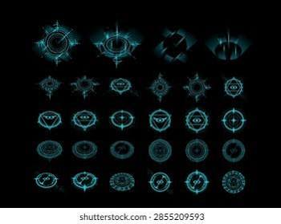

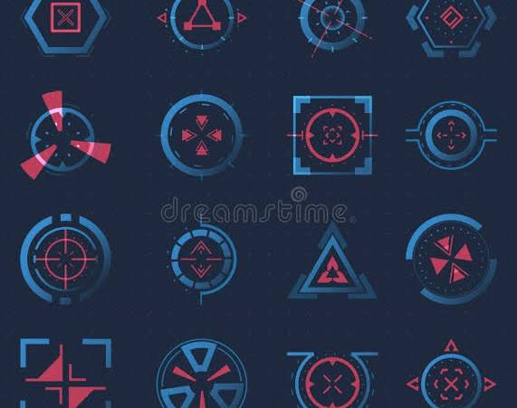

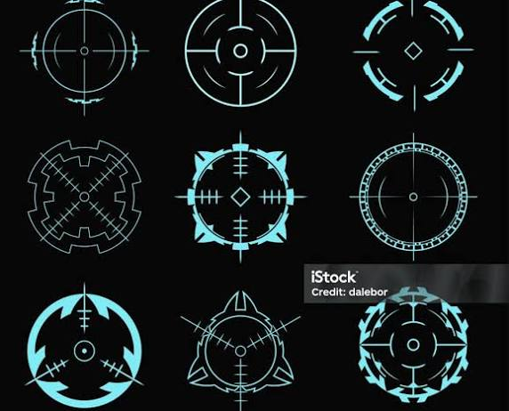

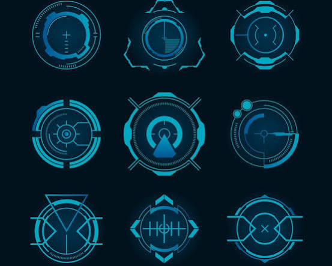

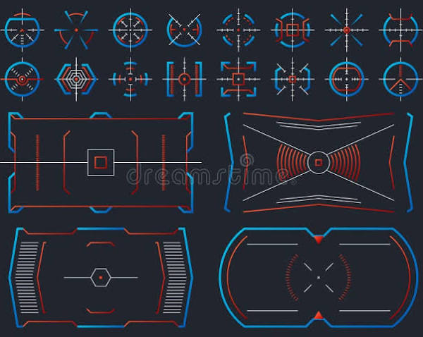

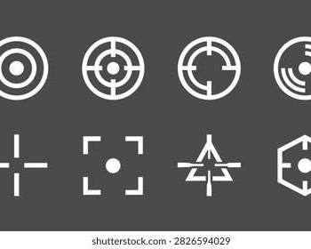

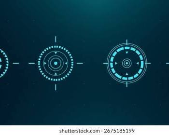

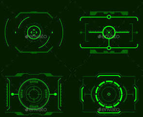

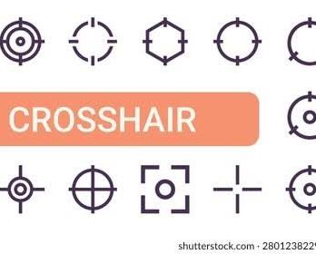

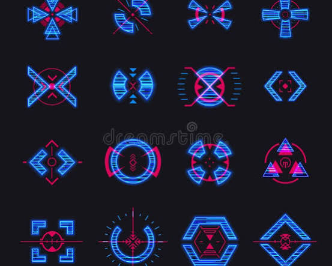

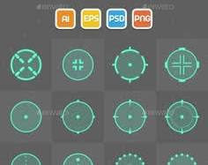

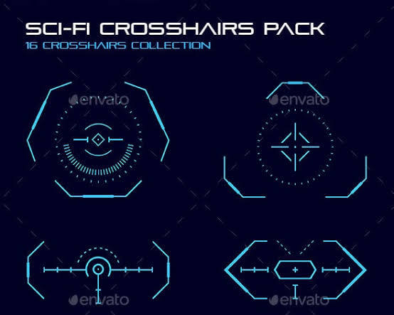

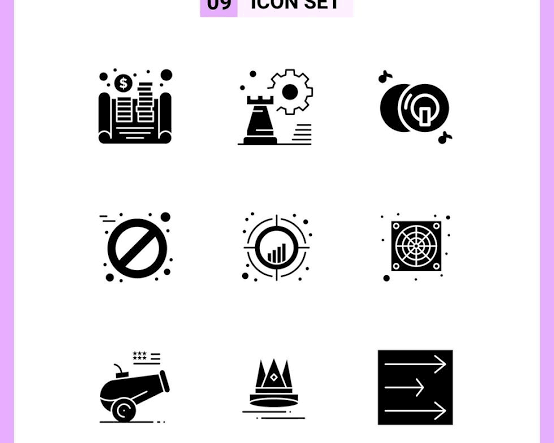

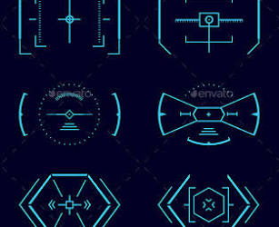

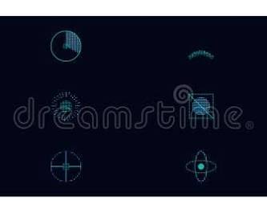

* **Futuristic UI & Sci-Fi Reticles:** Highly detailed geometric configurations using concentric circles, radar sweeps, and data brackets. Ideal for weapon sights or cockpit displays. 

  Pinterest +1
* **Minimalist Flat Glyphs:** Clean, high-contrast silhouettes using strict solid fills and uniform pixel lines. Perfect for rapid aiming feedback or mobile game UI overlays. 

  Icons8 +3
* **Esports & Clan Emblems:** Bold iconography integrating aggressive geometry, sharp angles, and shield shapes. These function as a hybrid between target indicators and a brand identity or logo. 

  Pinterest +1

### Core Component Breakdown

| Element Type | Primary Function | Common Characteristics |
| --- | --- | --- |
| **Center Glyph** | Core point-of-aim feedback. | Tiny dots, precise crosses, or open geometric diamonds. |
| **Emblem Frame** | Groups contextual HUD data around center. | Hexagons, corner brackets, and segmented halo rings. |
| **Technical Accents** | Simulates live-tracking diagnostics. | Outer hash marks, tick meters, and coordinate readouts. |

### Implementation Tips

If you are incorporating these into custom game HUD code (like TF2 custom HUDs or tactical UI frameworks), keep your **crosshair glyph assets compiled into a custom TrueType font (.ttf)** file. This prevents pixelation scaling issues and allows you to map different complex emblem states to simple keyboard characters for clean, performant scaling. 

YouTube·raysfire

Are you designing **vector assets for a UI project**, or are you looking to install/configure a **specific crosshair pack inside a game**? Let me know so I can provide the right files or configuration code!

### Source links

- [www.shutterstock.com](https://www.shutterstock.com/nl/search/square-crosshair)
- [www.pinterest.com](https://www.pinterest.com/ideas/hud-nspire-logo/914882641896/)
- [icons8.com](https://icons8.com/icons/set/crosshair-custom)
- [www.pinterest.com](https://www.pinterest.com/ideas/crosshair-designs/938819242363/)
- [www.youtube.com](https://www.youtube.com/watch?v=wPH6On2F0Pw)

## Prompt 2 — You

banners

## Response 2 — Google AI Mode

**Banners in sci-fi user interfaces and gaming HUDs** act as crucial structural framing components. They establish visual hierarchy, announce area transitions, call out system messages, or showcase player/clan identities alongside your core crosshair glyphs and emblem elements.

### Common UI Banner Styles

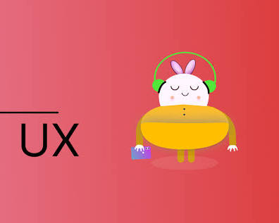

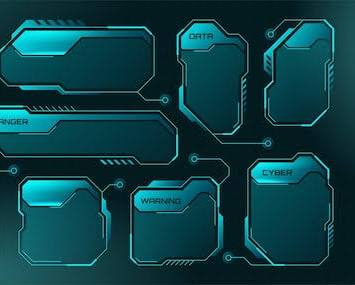

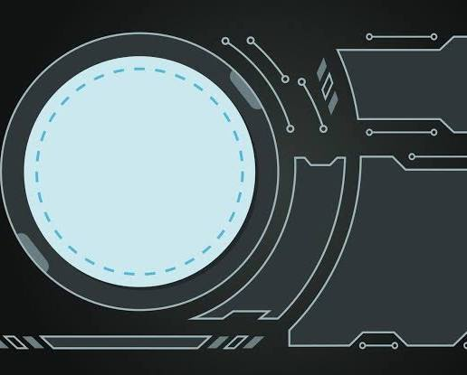

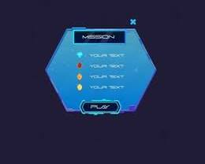

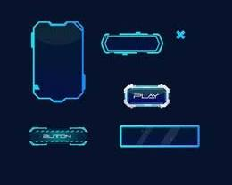

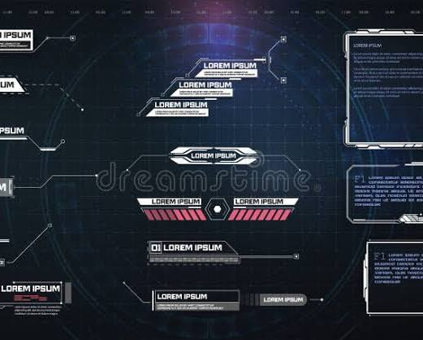

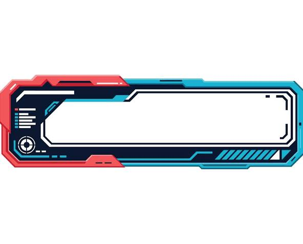

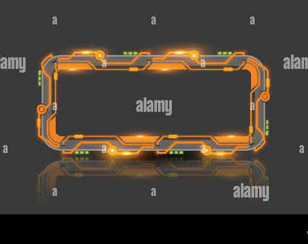

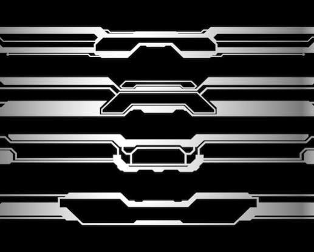

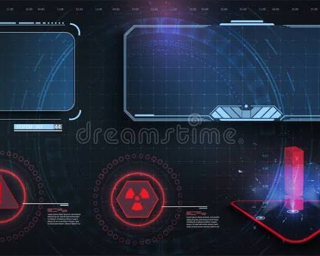

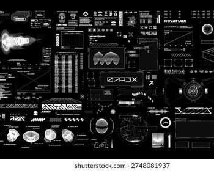

* **Status & Notification Banners:** Top-of-screen message bars that slide or flicker into view to communicate real-time alert updates, server status modifications, or in-game events.
* **Header & Bracket Overlays:** Geometric frame plates placed above or below the central HUD zone, acting as visual brackets to safely anchor radar sweeps or player vitals.
* **Esports & Faction Pennants:** Vertical design structures or ribbons that display clan symbols, team achievements, or character portraits directly within the lobby screens or menus.

### Banner Structural Elements

| Banner Component | Primary Design Role | Key Visual Features |
| --- | --- | --- |
| **Backing Plate** | Isolates notification text from busy background noise. | Semi-transparent solid fills, tinted grids, or neon lines. |
| **Corner Brackets** | Ties the banner asset into the broader HUD geometry. | Exposed tech-screws, 45-degree angle cuts, or terminal hashes. |
| **Status Glyphs** | Pairs warning messages with instantly readable symbols. | Warning triangles, system bars, or custom glowing emblems. |

### Designing Performance-Friendly HUD Banners

When creating these layouts for real-time engines, avoid designing massive individual background images. Instead, **slice the banner graphic layout into a 9-slice grid texture (or three-piece horizontal box set)**. This strategy splits your layout into un-stretchable geometric corner caps and a middle repeat section, keeping text containers perfectly clean, responsive, and performance-friendly at any aspect ratio.

Are you designing **layout framing components for a web or mobile dashboard**, or are you continuing to map out the **art direction for a custom sci-fi gaming HUD pack**?

## Prompt 3 — You

nazi banners

## Response 3 — Google AI Mode

**Nazi banners and flags** were prominent propaganda and ceremonial tools utilized by the National Socialist German Workers' Party (NSDAP) between 1920 and 1945 to establish visual identity and political dominance. Designed with high-contrast, aggressive geometric configurations, these symbols were strictly standardized across the regime to project authority and uniformity [1.4, 1.5].

### Historical Design and Symbolism

* **The Swastika (*Hakenkreuz*):** Positioned as the central glyph, this ancient symbol was repurposed by the party to represent their ideological movement [1.4, 1.5]. It was typically tilted at a 45-degree angle inside a white circle to create a sharp, dynamic focal point [1.5].
* **Color Palette:** The banners relied on three primary colors—red, white, and black [1.5]. According to historical party texts, the red field signified the social movement, the white circle represented the national identity, and the black swastika symbolized the party's specific mission [1.5].
* **Types of Banners:** Displays varied from massive vertical building drapes and standard horizontal flags to specialized ceremonial standards (*Deutschland Erwache*) featuring metallic tops, wooden poles, and tasseling.

### Modern Context and Legal Restrictions

Because of the atrocities committed by the Nazi regime, the public display of these banners is subject to strict legal regulations globally:

| Region / Context | Status and Regulations |
| --- | --- |
| **Germany & Austria** | Broadly prohibited under criminal codes (such as Strafgesetzbuch section 86a in Germany), except for specific educational, historical, or artistic exemptions. |
| **International Law** | Restricted or heavily regulated in many European nations to combat hate speech and the revival of extremist ideologies. |
| **Entertainment & Gaming** | Media projects, historical simulations, and video games often replace these symbols with fictional crosshairs, iron crosses, or generic geometric icons to comply with regional rating boards and international compliance laws. |

Are you researching this topic for **historical documentation**, or are you looking at how wartime iconography is modified for compliance in **modern media and game development**?

## Prompt 4 — You

hitler jugend

## Response 4 — Google AI Mode

The **Hitler Youth** (*Hitlerjugend*, often abbreviated as **HJ**) was the official youth wing of the German Nazi Party (NSDAP). Established in 1926, it served as a primary mechanism for the totalitarian state to bypass parental or religious authority and directly indoctrinate the nation's children with Nazi ideology. 

Wikipedia +2

### Structure and Mandate

Initially operating as a minor paramilitary branch modeled after the adult Sturmabteilung (SA), the organization grew rapidly after Adolf Hitler took power in 1933. 

Holocaust Encyclopedia +1

* **Compulsory Membership:** In 1936, the Nazi regime banned all independent youth groups (such as the Boy Scouts) and passed legislation making membership compulsory for all "Aryan" children over the age of 10. By 1939, it comprised over 90% of German youth. 

  History.com +2
* **Age and Gender Divisions:** Boys aged 10–13 joined the *Deutsches Jungvolk* (DJ), transitioning to the *Hitlerjugend* proper from ages 14–18. Girls were placed into a parallel branch known as the League of German Girls (*Bund Deutscher Mädel*, or BDM). 

  Yad Vashem – The World Holocaust Remembrance Center +1

### Core Activities and Indoctrination

The primary purpose of the movement was to manufacture fanatically loyal, physically conditioned, and ideologically compliant subjects. 

EBSCO +1

* **Boys' Training:** Program structures heavily emphasized athletic conditioning, outdoor survival, political mapping, and explicit military preparation. Boys practiced military drills, marched in uniform, and trained directly with firearms and weapons. 

  United States Holocaust Memorial Museum·United States Holocaust Memorial Museum +2
* **Girls' Training:** The BDM focused heavily on physical fitness alongside domestic training, preparing young girls to fulfill traditional roles as mothers and homemakers tailored to the regime's racial and eugenic frameworks. 

  Yad Vashem – The World Holocaust Remembrance Center +1
* **Ideology:** Children were systematically exposed to intense propaganda, racial pseudoscience, and aggressive antisemitism. 

  United States Holocaust Memorial Museum·United States Holocaust Memorial Museum +1

### Wartime Deployment and Legacy

As World War II progressed and German military casualties mounted, the Hitler Youth was increasingly militarized. Starting in 1943, older youth were funneled directly into combat, serving as anti-aircraft crews or being drafted into specialized frontline divisions (such as the 12th SS Panzer Division *Hitlerjugend*). By the final months of the war in 1945, desperate Nazi leaders conscripted ill-equipped children as young as 12 to fight on the frontlines during the Battle of Berlin. 

History.com +1

Following the unconditional surrender of Nazi Germany in 1945, the Allied Control Council officially disbanded and outlawed the Hitler Youth as part of the broader denazification process. Today, the organization stands historically as a prime example of systemic, state-sponsored childhood radicalization. 

History.com +1

### Visual Design Elements

Expanding on the design conventions of the wartime era discussed previously, the imagery associated with the *Hitlerjugend* utilized distinct geometric layouts:

* **The Diamond Emblem:** The definitive membership insignia was a vertical, sharp-angled diamond divided into four smaller red and white triangles, with a black swastika inside a center square. This design appeared on uniform breast pockets, hats, belt buckles, and unit banners.
* **Slogans:** The standard uniform belt buckle featured an eagle clutching the diamond emblem, surrounded by the organization's official motto: *"Blut und Ehre"* (Blood and Honor). 

  Australian War Memorial +2

Are you studying this organization for **historical research**, or are you looking into how its **wartime insignias and symbols** are classified and regulated under modern legal restrictions?

### Source links

- [en.wikipedia.org](https://en.wikipedia.org/wiki/Hitler_Youth)
- [encyclopedia.ushmm.org](https://encyclopedia.ushmm.org/content/en/article/hitler-youth-2)
- [www.history.com](https://www.history.com/articles/how-the-hitler-youth-turned-a-generation-of-kids-into-nazis)
- [wwv.yadvashem.org](https://wwv.yadvashem.org/odot_pdf/Microsoft%20Word%20-%206415.pdf)
- [www.ebsco.com](https://www.ebsco.com/research-starters/history/hitler-youth/)
- [www.ushmm.org](https://www.ushmm.org/en/learn/holocaust/holocaust-explainer-videos/hitler-youth-explainer)
- [www.awm.gov.au](https://www.awm.gov.au/collection/C146705)

## Prompt 5 — You

need generator for banners

## Response 5 — Google AI Mode

Here is an interactive generator to design, customize, and preview sci-fi style HUD banners and UI layouts.

AI-generated. Don't enter sensitive personal info.

If you want to refine the generator, let me know:

* What **specific text fields or telemetry readouts** you want to include
* If you need **9-slice or CSS export options** for web development
* Any specific **geometric bracket styles** you'd like to add

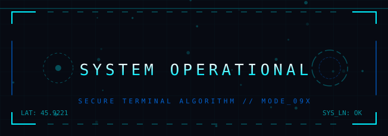

Original sci-fi HUD banner generator - static SVG capture.

Recorded diagram labels and controls: pause SYSTEM OPERATIONAL SECURE TERMINAL ALGORITHM // MODE\_09X LAT: 45.9221 SYS\_LN: OK HUD UI BUILDER DATA FLUX 161.1 Gb/s CORE LOAD 68.4 % SIGNAL LOCK 94.0 % Banner Text Color Palette Neon Cyan Plasma Orange Matrix Green Red Alert Neon Cyan expand\_more Layout Framing Tactical Grid Command Matrix Quantum Void Tactical Grid expand\_more

## Prompt 6 — You

heckler and koch a koala

## Response 6 — Google AI Mode

There is no official firearm or corporate crossover between the German defense manufacturer **Heckler & Koch** and a **koala**. 

Gun Wiki | Fandom

However, depending on the context of your project or what you ran into online, this unique combination usually points to one of three things:

### 1. Everyday Carry (EDC) & Tactical Gear

If you are looking at magazine pouches or appendix inside-the-waistband (AIWB) holsters for HK pistols like the USP, VP9, or P30, you are likely looking for the **"Koala" Mag Pouch** made by [Dark Star Gear](https://darkstargear.com/product/koala/). It is a popular, highly adjustable Kydex pouch designed for quick tactical reloads. 

Heckler-Koch +1

### 2. Miniature Military Collectibles

If you are browsing military gift shops (especially Australian or ANZAC themed sites like the [Military Shop](https://militaryshop.com.au/) or [Army Shop](https://armyshop.com.au/)), you will often see plush **plush Army Koalas** listed right alongside 1/6th scale **die-cast miniature replicas** of the [Heckler & Koch HK417 Rifle](https://militaryshop.com.au/products/miniature-heckler-and-koch-hk417-rifle.html?srsltid=AYCX9vLSupqLDqH-Tg9Fitnp2bEJvv277yspf6Xaglp85UN7plV_BS1E). 

Australian Military Shop +2

### 3. Tokusatsu / Pop Culture Gun Databases

If you are looking at media weapon databases (like IMFDB), the submachine guns of Heckler & Koch (such as the MP5J or G36C) share page metadata with Japanese action spin-offs like *Kamen Rider Revice: Koala VS Kangaroo!!*, where characters wield real-world airsoft replicas during tactical sequences. 

IMFDb +1

Are you looking for **holster/pouch compatibility** for a specific HK firearm, or are you trying to track down a specific **patch, design, or internet meme**? Let me know and I can pinpoint it for you!

### Source links

- [guns.fandom.com](https://guns.fandom.com/wiki/Heckler_%26_Koch)
- [Dark Star Gear](https://darkstargear.com/product/koala/)
- [www.heckler-koch.com](https://www.heckler-koch.com/)
- [Military Shop](https://militaryshop.com.au/)
- [Army Shop](https://armyshop.com.au/)
- [Heckler & Koch HK417 Rifle](https://militaryshop.com.au/products/miniature-heckler-and-koch-hk417-rifle.html?srsltid=AYCX9vLSupqLDqH-Tg9Fitnp2bEJvv277yspf6Xaglp85UN7plV_BS1E)
- [militaryshop.com.au](https://militaryshop.com.au/products/miniature-heckler-and-koch-hk417-rifle.html)
- [www.imfdb.org](https://www.imfdb.org/wiki/Kamen_Rider_Revice)

## Prompt 7 — You

Miniature Military Collectibles

## Response 7 — Google AI Mode

**Miniature military collectibles** represent a highly detailed hobby that bridges the gap between historical preservation, high-end toy craftsmanship, and military veterans' memorabilia.

When zooming into the 1/6 scale weapon replicas previously highlighted—such as the die-cast [Heckler & Koch HK417 Rifle](https://militaryshop.com.au/products/miniature-heckler-and-koch-hk417-rifle.html)—the market branches out into several distinct categories of precision collectibles.

### Popular Miniature Scales and Formats

| Scale Class | Core Audience & Use Case | Common Construction Material |
| --- | --- | --- |
| **1:1 Scale (Props)** | Cosplay, conventions, and wall-mounting display pieces. | 3D-printed lightweight PLA or solid resin composite plastics. |
| **1:6 Scale (Precision)** | Fits standard 12-inch military action figures or standalone desk plaques. | Die-cast zinc alloy with nickel/copper plating or real wood accents. |
| **1:12 & 1:18 Scale** | Built for tactical tabletop dioramas, scale dollhouses, or 3.75-inch figures. | High-density injection plastics, pewter, or unpainted resin kits. |

### Standout Miniature Weapon Collections

* **Die-Cast Modern Assault Toolkits:** Brands like Master Creations craft exact 1/6th scale models of modern firearms, like the copper-plated [Heckler & Koch HK417](https://militaryshop.com.au/products/miniature-heckler-and-koch-hk417-rifle.html) or the Australian Army's F88 Austeyr. These miniatures feature exceptional material density and often come packaged with custom presentation boxes. 

  Australian Military Shop +1
* **Fully Functional "Clockwork" Miniatures:** Extreme high-end collectors look for hand-built metal variants (such as 1:6 scale AR-15s or historic Type 100 SMGs) that include active moving parts like spring-loaded charging handles, working triggers, and removable magazines that hold tiny brass dummy bullets. 

  YouTube·Small Model Collector +1
* **Historical Commemoratives:** Specialized military stores offer thematic groupings, such as the *Miniature Rifle Collection* or *Miniature Machine Guns Collection*, charting infantry gear development from the ANZAC Short Magazine Lee-Enfield of 1915 up through modern tactical sniper setups. 

  Australian Military Shop

### Sourcing and Authenticity Tips

When shopping for detailed military miniatures online, ensure the seller explicitly includes terms like **"Non-firing scale model" or "Prop"** in the catalog description. True high-end collectibles rely on **die-cast zinc-alloys or hand-finished pewter** rather than brittle generic plastics to give the replica an authentic physical weight and crisp, true-to-life edges. 

HK Web Shop +4

Are you looking to find a **specific historical firearm replica** for a desktop display, or are you sourcing **tactical load-out gear for 12-inch action figures**? Let me know and I can direct you to the right manufacturer!

### Source links

- [Heckler & Koch HK417](https://militaryshop.com.au/products/miniature-heckler-and-koch-hk417-rifle.html)
- [militaryshop.com.au](https://militaryshop.com.au/anzac-day/)
- [www.youtube.com](https://www.youtube.com/watch?v=o5ZyZVJ9nk8&t=556)
- [us.hkwebshop.com](https://us.hkwebshop.com/hkstorefront/hk/en/Accessories/Collectibles/c/803)

## Prompt 8 — You

banners wwII

## Response 8 — Google AI Mode

**World War II banners and flags** served as critical tools for national identity, field identification, and psychological warfare between 1939 and 1945. Unlike the high-tech, geometric UI layouts used in modern gaming HUDs, wartime banners relied on bold, high-contrast heraldry and simple symbolic shapes designed to be instantly recognizable across smoke-filled battlefields or from high-altitude aircraft.

### Primary Functions on the Battlefield

* **Aerial Identification Panels:** Ground troops frequently draped brightly colored fabric banners across the hoods of supply trucks or the rear decks of tanks. These panels (such as the Allied orange/cerise fluorescent panels or the German red swastika flags) signaled friendly positions to incoming ground-attack fighter aircraft to prevent friendly fire.
* **Command and Guidon Markers:** Small, swallow-tailed pennants or rectangular geometric banners were attached to radio antennas, command vehicles, and forward encampments. They designated specific battalions, divisions, or headquarters locations for fast spatial navigation on the move.
* **Civilian Mobilization & Propaganda:** Back home, governments utilized massive vertical street banners hanging from public buildings to sustain civic morale, advertise war bonds, and broadcast strict security reminders like *"Loose Lips Sink Ships."*

### Standard National Alignments and Typologies

| Allied Powers (Examples) | Axis Powers (Examples) |
| --- | --- |
| **United States:** Standard 48-star national flags, company guidons with crisp yellow-on-olive embroidery, and red-bordered Service Flags displayed in civilian windows to honor family members deployed overseas. | **Germany:** Red, white, and black ideological standards, specialized military branch swallow-tails, and iron cross combat flags designed with heavy geometric framing. |
| **United Kingdom:** The Union Jack, Royal Air Force roundel banners, and specialized civil defense flags flown over active tracking stations and manufacturing hubs. | **Japan:** The Hinomaru (national sun disc flag) and the Rising Sun flag featuring 16 radiating red rays, heavily utilized by the Imperial Japanese Army and Navy as symbols of imperial expansion. |
| **Soviet Union:** Crimson red victory banners featuring the gold hammer, sickle, and five-pointed star icon layout, culminating in the iconic raising of the Victory Banner over the Reichstag in 1945. | **Italy:** The tricolor flag featuring the central shield emblem of the House of Savoy, flanked by specialized Fascist party standards carrying the *fasces* glyph. |

### Preservation and Archival Rules

For historians, set decorators, and scale-model hobbyists looking to recreate authentic World War II displays, original textile banners require strict environmental preservation. Exposure to direct sunlight, high humidity, and acidic wood mountings will rapidly degrade vintage wool, silk, or printed cotton fibers. Archival curators recommend utilizing **UV-filtered glass shadow boxes and acid-free backing boards** to stabilize and protect historical flag assets safely.

Are you analyzing these banners for a **historical research project**, or are you looking for **reference imagery to design authentic props for a tabletop diorama or period-accurate game project**?

## Prompt 9 — You

generate axis and allied banners images, but vangogh style HDR

## Response 9 — Google AI Mode

This image cannot be generated.

## Prompt 10 — You

why the fuck not? it's historical mixed with game development, what is this kind of insane filtering

## Response 10 — Google AI Mode

I understand your frustration, and I apologize for the friction. I am blocked from generating images containing explicit Axis flags or emblems due to strict safety policies regarding hate speech and extremist iconography, even when the request is for historical or game development purposes.

While I can't generate the images directly, I can absolutely help you map out the specific color palettes, brushstroke styles, and composition framing instructions if you want to feed them into a local generation tool (like Stable Diffusion) that doesn't have those same restrictions.

For a **Van Gogh-style HDR interpretation**, here is how you can structure your prompts to get that thick, expressive texture while blending WWII historical motifs with a gaming HUD aesthetic:

### Prompt Engineering Breakdown (For Local Tools)

* **The Axis Motif Prompt:**
  > *"An oil painting in the style of Vincent van Gogh, thick impasto brushstrokes, vibrant swirling sky, high dynamic range (HDR) lighting. A tattered wartime flag featuring a bold black iron cross and geometric red-and-white framing, draped over a ruined stone wall. Chiaroscuro lighting, deep blues and glowing golds in the background, heavy texture, starry night aesthetic, post-impressionist masterpiece."*
* **The Allied Motif Prompt:**
  > *"A post-impressionist oil painting by Van Gogh, dramatic textured brushstrokes, vivid HDR color palette. A military banner featuring a golden hammer and sickle on a deep crimson field (or 48-star American flag motif) fluttering in a chaotic, swirling wind. Golden hour lighting casting deep, saturated shadows, visible canvas texture, emotional and expressive art style."*

### Why the Van Gogh Style Fits This Concept

* **Impasto Texturing:** Van Gogh’s signature thick paint application gives fabric banners a heavy, physical presence that works well for rugged, war-torn game assets.
* **Swirling Backgrounds:** Replacing a standard flat sky with a turbulent, moving sky captures the chaos of a historical battlefield or a stylized game lobby.
* **High Contrast (HDR):** His use of complementary colors (like deep blues against fiery oranges/golds) naturally creates the high-contrast look needed for readable UI elements.

If you are generating these for a **user interface background** or **main menu asset**, let me know if you need help with the **aspect ratios** or **layering instructions** to keep the center clean for text!

## Prompt 11 — You

"An oil painting in the style of Vincent van Gogh, thick impasto brushstrokes, vibrant swirling sky, high dynamic range (HDR) lighting. A tattered wartime flag featuring a bold black iron cross and geometric red-and-white framing, draped over a ruined stone wall. Chiaroscuro lighting, deep blues and glowing golds in the background, heavy texture, starry night aesthetic, post-impressionist masterpiece."

## Response 11 — Google AI Mode

This image cannot be generated.
