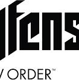
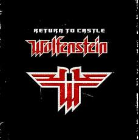

# Wolfenstein: Youngblood

Captured: 2026-10-25T15:52:52.903Z

Source: https://www.google.com/search?client=ms-android-xiaomi-terr2-rso2&hs=zasq&sca_esv=928283b7168495de&sxsrf=APpeQnuh_4MJNRYDcPmvLpA-2hcCPPBAuA%3A1792940644407&vsint=&ntc=1&cs=1&sa=X&ved=0CAEQ2_wOahgKEwiI48-PwtWXAxUAAAAAHQAAAAAQtAI&biw=375&bih=691&dpr=3.25&udm=50&atvm=2&mstk=AUtExfCbiw_CvaJUtVSQqVA4R7Ia4dTGmtmyNn4LxG80-vgOV8zWTQmx2l6rYcYb71eyo4EHEZVQckwNYJses6goUXXje8GfQKVEkNFFGjz5ozYWabWhzbOxLtIm6aWh1oCYLGAWGo_CEvY0lcK2wRb4T2MeiGJSTE7ISzv_gKJk_VtA8IusrlVm0ZpuHI07UvycpAR0Lw-8GLsQgigS-SDKEo-KB-pRtlrO72_plkG5JQ41I0yJmifqpiiAL-0_dqfcqbnqZ5gZ3U93oKwq46w7f56SDEQHTTOIeUUbUGlpLtOqCymtxkjhlblevBoq27sU6iIong3RpVt5Pw&mtid=H97das3kJ52P9u8PuanF2AQ&csuir=1&aep=26&q=wolfenstein+old+blood+but+the+other+one

## Prompt 1 — You

wolfenstein old blood but the other one

## Response 1 — Google AI Mode

You are likely thinking of **Wolfenstein: Youngblood**, which is the other standalone, subtitle-only release in the modern MachineGames era. 

Reddit +1

While *The Old Blood* is a single-player prequel set in 1946, *Youngblood* is a co-op-focused sequel set in the 1980s starring BJ Blazkowicz's twin daughters. 

Wikipedia +1

Alternatively, depending on what context you meant by "the other one," you might be thinking of:

---

**Wolfenstein: The New Order:** The main 2014 game that *The Old Blood* was a direct standalone expansion for.

---

**Return to Castle Wolfenstein (2001):** The classic game that *The Old Blood* heavily reimagines and pulls its plot from (including infiltrating the castle, Agent One, and the paranormal archaeology). 

Steam Community +3

Which of these "other ones" were you looking for? If you want, I can give you the **story summary**, **gameplay differences**, or the **complete playing order** for the series.

### Source links

- [www.reddit.com](https://www.reddit.com/r/Wolfenstein/comments/kaotd4/is_wolfenstein_old_blood_new_order_and_new/)
- [en.wikipedia.org](https://en.wikipedia.org/wiki/Wolfenstein:_The_Old_Blood)
- [steamcommunity.com](https://steamcommunity.com/app/350080/discussions/0/1471967615855576405/)
