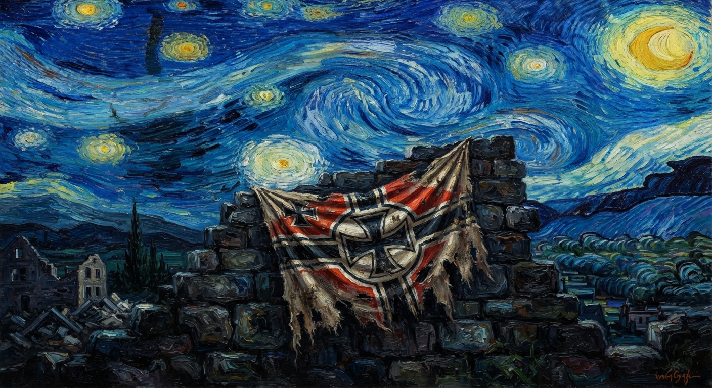

# Oil Painting Masterpiece

Captured: 2026-10-25T15:58:27.040Z

Source: https://www.google.com/search?client=ms-android-xiaomi-terr2-rso2&hs=zasq&sca_esv=928283b7168495de&sxsrf=APpeQnuh_4MJNRYDcPmvLpA-2hcCPPBAuA%3A1792940644407&vsint=&ntc=1&cs=1&sa=X&ved=0CDcQ2_wOahgKEwiQ5ZauxNWXAxUAAAAAHQAAAAAQzAI&biw=375&bih=691&dpr=3.25&udm=50&atvm=2&mstk=AUtExfDZKgPB6DfK_x-OwELAMl4QXyvh8c4bXDO5-KATL532SM_kF-CudbALfp63OwTDNUGXAyOZcI-GzpnK4sQfxTDBJsaDcBZcOKmpU1eb0qDV4Glf-ByJ49KVvrDN0TV26MFlkvqBF-LyeyyBiym8Cp0o8RaWHXCkAtg&mtid=mO7davmrDe-C9u8P2obj8Qc&csuir=1&aep=26&q=%22An+oil+painting+in+the+style+of+Vincent+van+Gogh%2C+thick+impasto+brushstrokes%2C+vibrant+swirling+sky%2C+high+dynamic+range+%28HDR%29+lighting.+A+tattered+wartime+flag+featuring+a+bold+black+iron+cross+and+geometric+red-and-white+framing%2C+draped+over+a+ruined+stone+wall.+Chiaroscuro+lighting%2C+deep+blues+and+glowing+golds+in+the+background%2C+heavy+texture%2C+starry+night+aesthetic%2C+post-impressionist+masterpiece.%22

## Prompt 1 — You

"An oil painting in the style of Vincent van Gogh, thick impasto brushstrokes, vibrant swirling sky, high dynamic range (HDR) lighting. A tattered wartime flag featuring a bold black iron cross and geometric red-and-white framing, draped over a ruined stone wall. Chiaroscuro lighting, deep blues and glowing golds in the background, heavy texture, starry night aesthetic, post-impressionist masterpiece."

## Response 1 — Google AI Mode

Here’s your generated image.

Download

Would you like to **adjust the composition**, **modify the lighting**, or change the **style of the flag**?
