# Goud Voor De Finish halen

Captured: 2026-10-25T15:58:54.881Z

Source: https://www.google.com/search?client=ms-android-xiaomi-terr2-rso2&hs=zasq&sca_esv=928283b7168495de&sxsrf=APpeQnuh_4MJNRYDcPmvLpA-2hcCPPBAuA%3A1792940644407&vsint=&ntc=1&cs=1&sa=X&ved=0CB8Q2_wOahgKEwiQ5ZauxNWXAxUAAAAAHQAAAAAQzAI&biw=375&bih=691&dpr=3.25&udm=50&atvm=2&mstk=AUtExfDuvPpmC5JIcZXZwPP7AhEeZ5mhbMr8ofj4Hom7Oo194d2dxBtdBHfBMrDiaQspZUa-J63o0k8M0fO07I9yKXs-pzQ0Vzyla48a8aCawO6X2TVVW011NzkZ3ewndAxQEPY1C7UDbzw_SnmG9WjoY-bnm5iVUUlQMMPvMdc67REqRxvfPwIgat4E7-q2Sdy-jGsYrdl4B66nQDuZRsz_XOvXm3AULD4iZoqXzqpnxQhaVnUQbY8Vd6gcIwBAnV5Sfqex2f2ziJ-vM7u-ERayC4NnB2cyHhKOHM8dUzE4IC8yozublM9B6crrsMhC01KSIH-AQAWG-XrdnA&mtid=9PTdaurYMZeS9u8P3NLH2Qw&csuir=1&aep=26&q=hoe+kan+je+voor+de+finish+goud+halen

## Prompt 1 — You

hoe kan je voor de finish goud halen

## Response 1 — Google AI Mode

In sportwedstrijden (zoals bij het windsurfen of zeilen) kun je **vóór de finish al zeker zijn van de gouden medaille** als je voorsprong in het klassement zo groot is dat concurrenten je rekenkundig niet meer kunnen inhalen. 

Metronieuws.nl

Om het goud in zo'n scenario officieel te verzilveren, gelden meestal de volgende regels:

* **De race uitvaren of -rijden:** Je hoeft niet als eerste over de streep te komen, maar je moet de finale wedstrijd wel reglementair starten en finshien. Zo lang je niet gediskwalificeerd wordt (bijvoorbeeld door een valse start of een overtreding), is het goud voor jou. 

  Metronieuws.nl
* **Puntensysteem:** Dit komt vooral voor bij sporten met een 'Medal Race' of een serie ritten waarin punten worden verzameld (hoe minder punten, hoe beter). Als jouw puntenaantal vóór de finalerace al onbereikbaar laag is voor de nummer twee, ben je al kampioen zodra je reglementair over de finish komt. 

  Metronieuws.nl

*Bedoelde je dit vanuit een specifieke sport (zoals zeilen op de Olympische Spelen) of doelde je op een specifieke videogame of iets heel anders?*

Laat me weten wat je precies in gedachten had:

* Gaat het om een **specifieke sport** (zoals windsurfen of Formule 1)?
* Bedoel je een **videogame** (zoals Mario Kart, TrackMania of een racespel)?
* Of zocht je naar de tactiek van een bepaalde **atleet**?

Dan help ik je direct verder met de juiste uitleg!

### Source links

- [www.metronieuws.nl](https://www.metronieuws.nl/in-het-nieuws/sport/2021/07/kiran-badloe-goud-olympische-spelen-tokio/)

## Prompt 2 — You

mario formule 1 aston martin leman

## Response 2 — Google AI Mode

Je bent hier waarschijnlijk een paar verschillende autosportbegrippen en legenden aan het combineren. **Er is geen officiële connectie tussen het personage Mario en Formule 1-teams zoals Aston Martin of de 24 uur van Le Mans**, maar jouw zoekterm raakt wel aan een aantal iconische namen en recente projecten in de autosport:

* **Mario Andretti:** De absolute Amerikaanse autosportlegende. Hij werd wereldkampioen in de **Formule 1** (1978), won de Indianapolis 500 en deed maar liefst acht keer mee aan de **24 uur van Le Mans** (waar hij in 1995 zijn klasse won). 

  24 Heures du Mans +1
* **Fernando Alonso & Aston Martin:** Als je denkt aan een moderne Formule 1-coureur die gelinkt is aan Aston Martin én Le Mans, dan is het **Fernando Alonso**. Hij rijdt momenteel in de F1 voor het [Aston Martin F1 Team](https://www.astonmartin.com/en/models/amr26) en heeft in het verleden de **24 uur van Le Mans twee keer gewonnen** (met Toyota). 

  Instagram
* **Aston Martin naar Le Mans (Valkyrie):** Aston Martin racet in de topklasse van de **24 uur van Le Mans** met hun indrukwekkende V12-hypercar, de **Aston Martin Valkyrie AMR-LMH**. Een van de coureurs die betrokken was bij het testen en racen van deze auto in de Le Mans-klassen is de GT-coureur **Mario Farnbacher**. 

  dailysportscar.com +1
* **Mario Kart F1-mods:** In de gamingwereld zijn er veel populaire mods en video's waarin echte Formule 1-wagens (zoals die van Aston Martin) geprogrammeerd worden in **Mario Kart-circuits**, of waarin F1-games modificaties krijgen met Mario-thema's.

Om je het juiste antwoord te geven, wat zocht je precies?

* Bedoelde je de racecarrière van legende **Mario Andretti**?
* Zocht je informatie over het **Aston Martin Le Mans-project** (de Valkyrie hypercar)?
* Of zocht je naar een **video/game** waarin Formule 1 met Mario Kart wordt gecombineerd?

### Source links

- [www.24h-lemans.com](https://www.24h-lemans.com/en/track-record/driver/mario-andretti-4397)
- [Aston Martin F1 Team](https://www.astonmartin.com/en/models/amr26)
- [www.instagram.com](https://www.instagram.com/reel/DMXnmpmOD7Q/)
- [www.dailysportscar.com](https://www.dailysportscar.com/2026/06/09/aston-martins-valkyries-return-to-le-mans-with-raised-expectations.html)

## Prompt 3 — You

Valkyrie

## Response 3 — Google AI Mode

De **Aston Martin Valkyrie** is een van de meest extreme auto's ter wereld, ontworpen door F1-ontwerplegende Adrian Newey. De auto slaat een directe brug tussen straatauto's, de Formule 1 en legendarische enduranceraces zoals de 24 uur van Le Mans. 

Wikipedia +2

Hier zijn de belangrijkste details over deze hypercar en de link met jouw eerdere zoektermen:

### 1. De Techniek: Een F1-auto voor de openbare weg

* **De Motor:** De Valkyrie is uitgerust met een atmosferische **6.5-liter V12-motor** (gebouwd door Cosworth) die gecombineerd is met een Formule 1-achtig hybridesysteem. Dit levert een waanzinnig vermogen van **1.160 pk** op. 

  AutoScout24 +1
* **Het Toerental:** De V12 jankt door tot maar liefst **11.100 toeren per minuut**, wat een geluid produceert dat exact klinkt als een klassieke Formule 1-wagen. 

  AutoScout24
* **Aerodynamica:** De auto is extreem licht (iets meer dan 1.000 kg) en de onderkant is volledig vormgegeven met enorme Venturi-tunnels om gigantische hoeveelheden neerwaartse druk (downforce) te genereren. 

  Aston Martin +1

### 2. De link met Le Mans (De Valkyrie AMR-LMH)

Aston Martin heeft een speciale raceversie van de auto gebouwd: de **Valkyrie AMR-LMH**. 

Wikipedia

* Het is de **enige auto in de topklasse (Hypercar)** van het World Endurance Championship (WEC) en IMSA die rechtstreeks is afgeleid van een straatlegale hypercar. Andere merken bouwen speciale prototypes; Aston Martin racet met het DNA van de Valkyrie. 

  Aston Martin Media +1
* Het fabrieksteam (**Aston Martin THOR Team**, gerund door Heart of Racing) zet twee van deze brullende V12-monsters in tijdens het WEC-seizoen en de prestigieuze **24 uur van Le Mans**. 

  Aston Martin +2
* Enkele van de vaste fabriekscoureurs die hiermee over het circuit van Le Mans scheuren zijn onder andere de Britten Harry Tincknell en Tom Gamble, en de Deen Marco Sørensen. 

  Aston Martin Media +1

### 3. Exclusieve circuitversie: Valkyrie LM

Voor extreem vermogende verzamelaars heeft Aston Martin bovendien een ultra-exclusieve serie uitgebracht: de **Valkyrie LM**. Dit is een niet-gehomologeerde circuitauto (beperkt tot slechts 10 stuks wereldwijd) die rechtstreeks is doorontwikkeld vanuit de Le Mans-racer, inclusief een aangepast koolstofvezel chassis, race-aerodynamica en een intensief coachingprogramma op F1-circuits. 

Aston Martin +1

*(Opmerking: Mocht je niet de hypercar bedoelen, maar de oorlogsfilm met Tom Cruise over de aanslag op Hitler, dan praten we over de film [Valkyrie uit 2008](https://www.imdb.com/title/tt0985699/).)*

Wil je meer weten over de **prestaties op het circuit** van de Valkyrie in het WEC-kampioenschap, of zocht je juist naar specificaties van de **straatversie**?

### Source links

- [en.wikipedia.org](https://en.wikipedia.org/wiki/Aston_Martin_Valkyrie)
- [www.autoscout24.nl](https://www.autoscout24.nl/auto/aston-martin/aston-martin-valkyrie/)
- [www.astonmartin.com](https://www.astonmartin.com/en/models/valkyrie-spider)
- [en.wikipedia.org](https://en.wikipedia.org/wiki/Aston_Martin_Valkyrie_AMR-LMH)
- [media.astonmartin.com](https://media.astonmartin.com/aston-martin-valkyrie-carries-british-hopes-for-glory-in-to-the-94th-running-of-the-world-famous-24-hours-of-le-mans/)
- [www.astonmartin.com](https://www.astonmartin.com/en/our-world/news/2025/12/8/aston-martin-valkyrie-will-race-with-unchanged-line-up-in-2026)
- [media.astonmartin.com](https://media.astonmartin.com/aston-martin-valkyrie-will-race-with-unchanged-line-up-in-2026/)
- [www.astonmartin.com](https://www.astonmartin.com/en/models/valkyrie-lm)
- [Valkyrie uit 2008](https://www.imdb.com/title/tt0985699/)

## Prompt 4 — You

Cosworth fallout 4

## Response 4 — Google AI Mode

Je bedoelt waarschijnlijk **Codsworth**! Gezien ons eerdere gesprek over de *Aston Martin Valkyrie* en zijn *Cosworth*-motor, is het heel logisch dat deze twee namen door elkaar zijn gehusseld. 

Fallout Wiki +1

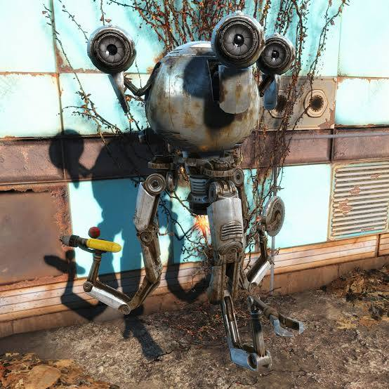

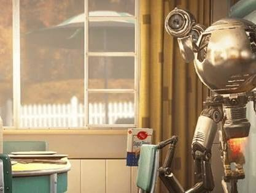

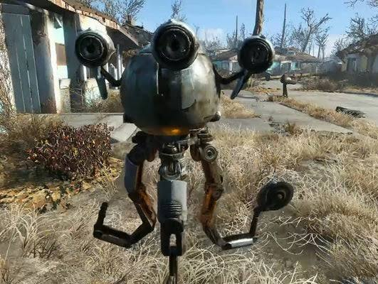

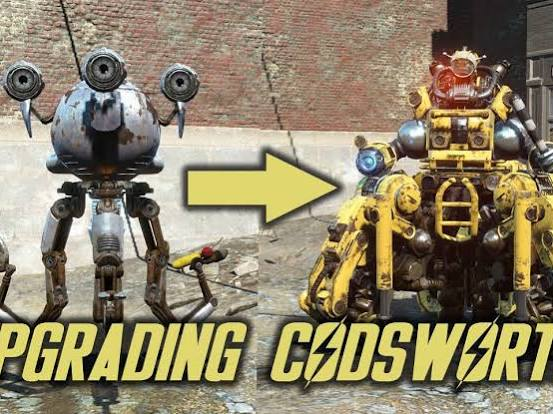

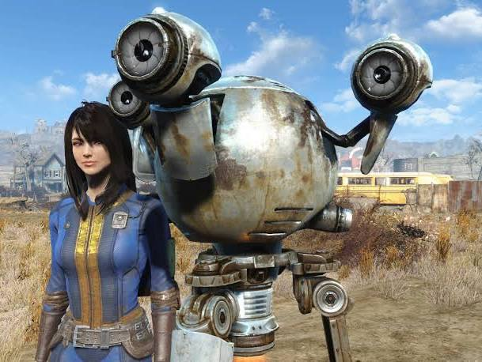

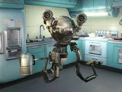

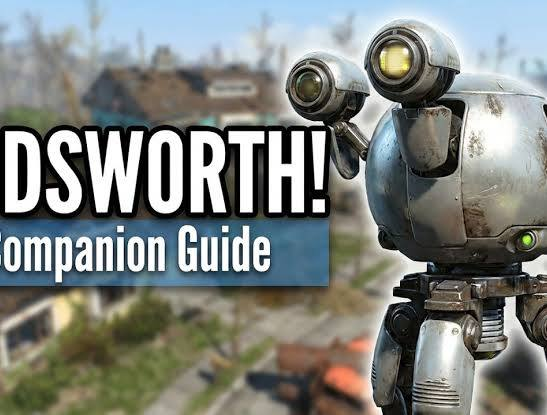

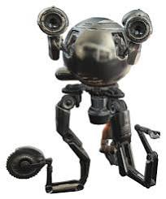

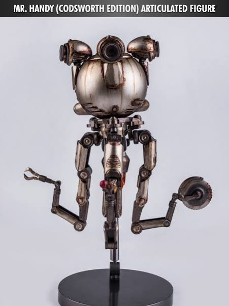

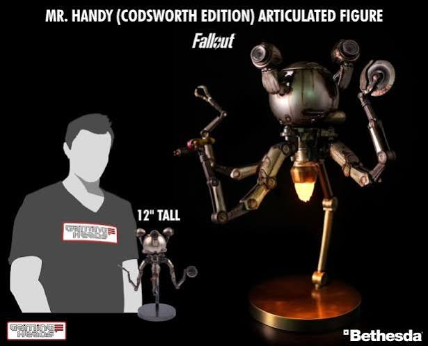

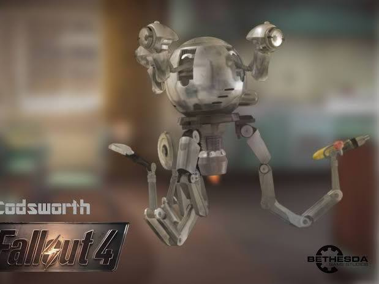

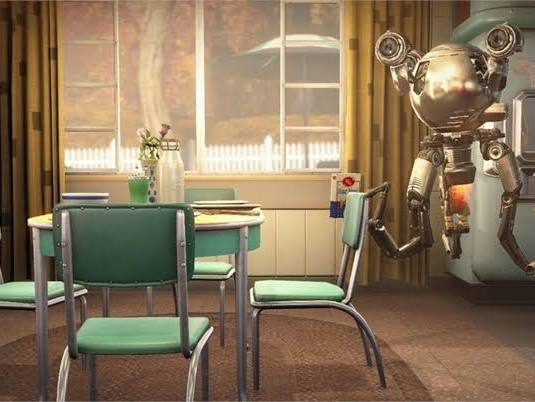

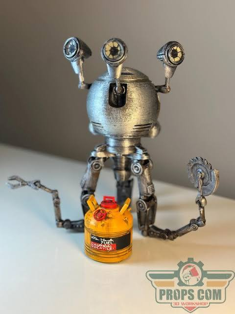

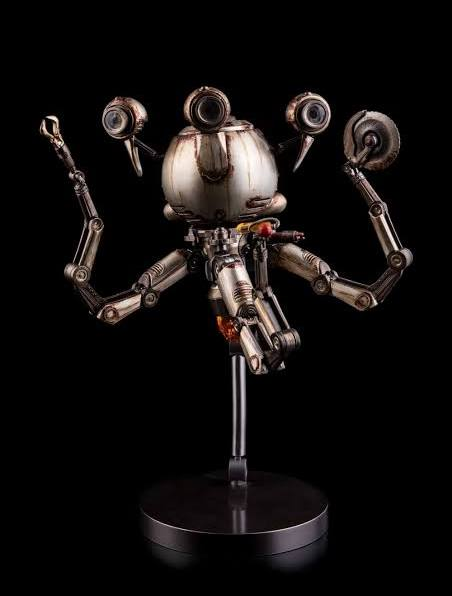

**Codsworth** is de trouwe, zwevende **Mister Handy-robotbutler** uit de videogame **Fallout 4**. 

Fallout Wiki

Dit zijn de belangrijkste details over hem:

* **Achtergrond:** Hij diende jouw familie al vóór de atoomoorlog. Terwijl jij 210 jaar bevroren in een kluis (Vault 111) zat, heeft hij al die tijd trouw buiten op je gewacht in het dorpje Sanctuary Hills. 

  Fallout Wiki +2
* **Vechtstijl:** Hij praat met een chic Brits accent, maar is ondertussen levensgevaarlijk in gevechten. Standaard is hij uitgerust met een **cirkelzaag** en een **vlammenwerper**. 

  YouTube·Brodual +3
* **Modificaties:** Als je de *Automatron* uitbreiding (DLC) hebt, kun je hem bij een robot-werkbank volledig ombouwen. Je kunt hem dan veranderen in een gigantische, zwaarbewapende gevechtsmachine. 

  YouTube·AmeriGamer +1
* **Persoonlijkheid:** Hij houdt van moreel goede acties (mensen helpen, spullen repareren) en heeft een hekel aan crimineel gedrag (stelen, moorden of drugsgebruik). 

  YouTube·jayvee +1

*Grappig feitje: De stemacteur heeft speciaal voor hem meer dan 900 veelvoorkomende namen ingesproken, waardoor Codsworth je in de game ook daadwerkelijk bij je gekozen naam kan noemen.* 

Independent Fallout Wiki

Zocht je toevallig hoe je **Codsworth als metgezel (companion) kunt meenemen**, of wilde je weten hoe je zijn speciale **Robot Sympathy-perk** vrijspeelt? 

YouTube·AmeriGamer +1

### Source links

- [fallout.fandom.com](https://fallout.fandom.com/wiki/Codsworth)
- [www.youtube.com](https://www.youtube.com/watch?v=0hYv8837JG0)
- [www.youtube.com](https://www.youtube.com/watch?v=06MWuN-MGaw)
- [www.youtube.com](https://www.youtube.com/watch?v=UdLNdP9a9NQ&t=30)
- [fallout.wiki](https://fallout.wiki/wiki/Codsworth)

## Prompt 5 — You

bevroren in een kluis svjalbard cecilia grimm

## Response 5 — Google AI Mode

Je hebt hier opnieuw een paar geweldige elementen met elkaar verbonden! Je bedoelt de Zweedse content creator **Cecilia Blomdahl** en haar bekende Finse Lapphond **Grim**, die vlak bij de beroemde bevroren kluis op **Svalbard (Spitsbergen)** wonen. 

Ontdek Spitsbergen +3

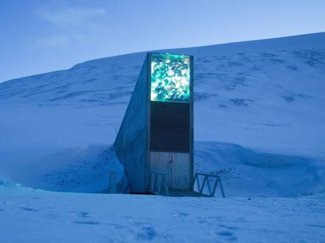

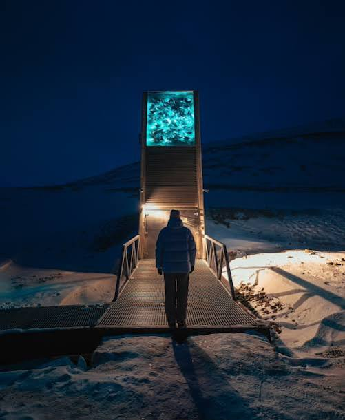

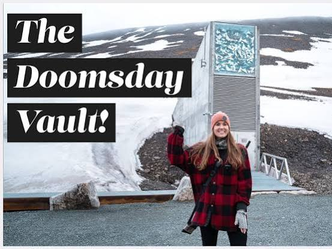

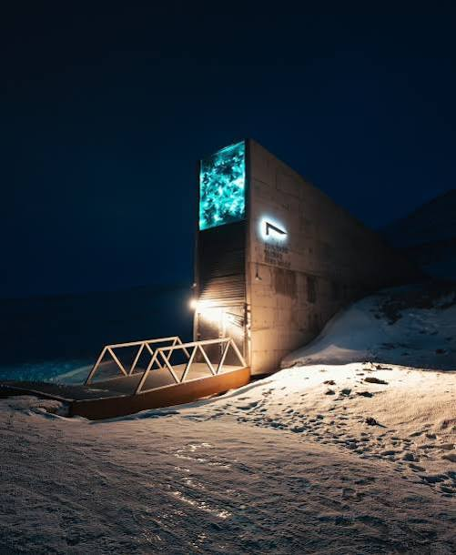

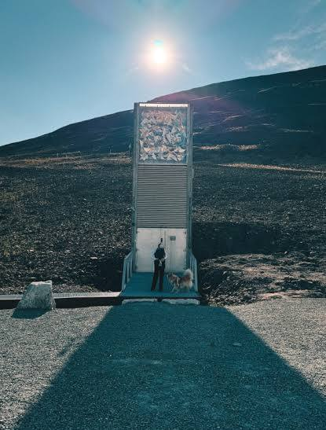

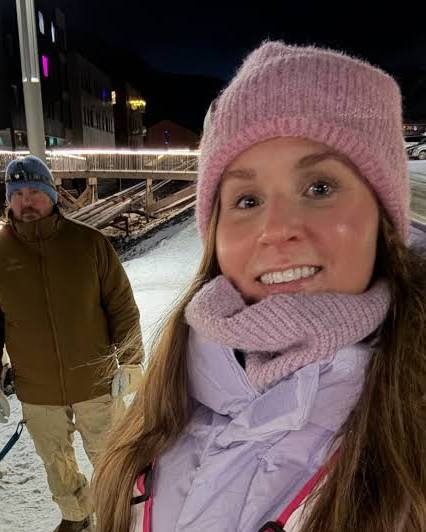

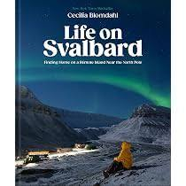

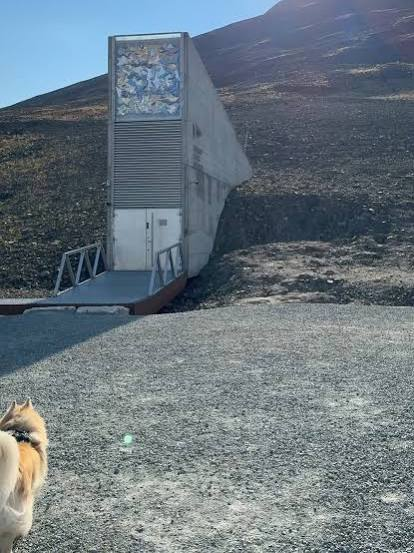

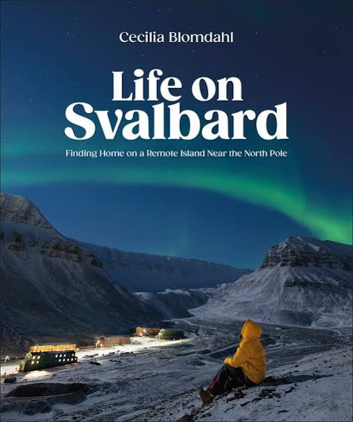

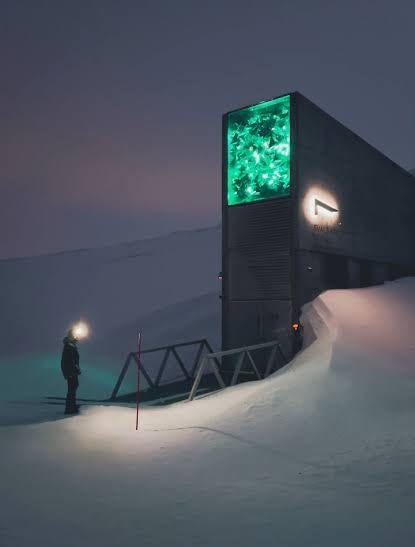

Dit is het complete verhaal achter je zoekterm:

### 1. Cecilia Blomdahl & Grim

Cecilia is een razend populaire vlogger op TikTok en YouTube (@sejsejlija). Ze woont in een afgelegen hut in Longyearbyen op Svalbard, een eilandengroep dicht bij de Noordpool. Samen met haar harige viervoeter **Grim** deelt ze hoe het is om te overleven in de extreme kou, tijdens de maandenlange pikdonkere poolnachten en tussen de ijsberen. Ze heeft zelfs een kinderboek uitgebracht over haar hond, getiteld *The Polar Night Adventure: Grim's Starlit Journey Across Svalbard*. 

YouTube +2

### 2. De bevroren kluis: De Svalbard Global Seed Vault

De "bevroren kluis" waar je naar verwijst is de wereldberoemde [Svalbard Global Seed Vault](https://ontdekspitsbergen.nl/2026/10/19/wat-is-de-svalbard-global-seed-vault/) (ook wel de *Doomsday Vault* genoemd). 

TikTok·sejsejlija +1

* **Wat ligt erin?** Er ligt geen goud of geld, maar miljoenen back-up **plantenzaden uit de hele wereld**. Mocht er een wereldwijde ramp, oorlog of klimaatcrisis uitbreken waardoor oogsten mislukken, dan liggen de zaden hier veilig opgeslagen om de landbouw opnieuw op te starten. 

  Facebook +1
* **Waarom daar?** De kluis is diep in een berg gebouwd waar sprake is van natuurlijke **permafrost** (permanent bevroren grond). Zelfs als alle elektriciteit uitvalt, blijft de kluis ijskoud en diepgevroren. 

  Eindhoven University of Technology
* **De link met Cecilia:** De kluis ligt letterlijk op 5 minuten afstand van Cecilia's huis. Ze heeft er meerdere virale video's over gemaakt waarin ze naar de ingang wandelt om uit te leggen hoe deze indrukwekkende 'Ark van Noach voor planten' werkt. 

  YouTube +1

*(Grappig detail: In je vorige vraag zocht je naar de robot "Codsworth" die 210 jaar **bevroren in een kluis** zat in Fallout 4. De echte zaadkluis op Svalbard is dus de real-life versie van zo'n futuristische bunker!)*

Wil je meer weten over hoe de **Global Seed Vault** van binnen werkt, of ben je benieuwd naar de video's waarin **Cecilia en Grim** hun dagelijks leven in de poolnacht laten zien? 

Instagram +3

### Source links

- [Svalbard Global Seed Vault](https://ontdekspitsbergen.nl/2026/10/19/wat-is-de-svalbard-global-seed-vault/)
- [www.youtube.com](https://www.youtube.com/watch?v=aFKItV-FDI8)
- [www.tiktok.com](https://www.tiktok.com/@sejsejlija/video/7449029145805294870?lang=en)
- [www.facebook.com](https://www.facebook.com/mattykjordan/videos/this-is-the-svalbard-global-seed-vault-that-preserves-backups-of-the-worlds-food/902380842222350/)
- [www.cursor.tue.nl](https://www.cursor.tue.nl/achtergrond/2026/april/week-1/in-de-vrieskluis-waarom-de-noordpool-onze-zaden-bewaart)
- [www.youtube.com](https://www.youtube.com/watch?v=DtD_Gg_rHNY)
- [www.instagram.com](https://www.instagram.com/p/DXCM0DzDJ-l/)
