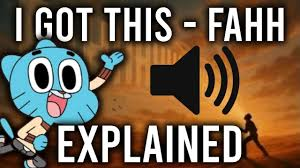

# I Got This

Captured: 2026-10-26T08:39:42.724Z

Source: https://www.google.com/search?q=I+got+this&sca_esv=4384285448d5361a&sxsrf=APpeQnv2Xy7melqGcKOJz3b47hRoJhYUow%3A1792994128837&source=chrome.ob&fbs=ABfTbFVyMZGZf1hfvX9uKjN_-G8c4u0nXx4bEIpwm1lnNH832cSpkWkfSwsmpNIrD_OQ-UfVcuk_CN5lZ7ooDDWHK2Mvzz3zSAVajbtoCgDcY4ClkqSY2KMHBVEZtzZXhvZhOAYOei-ZwZNbTP-zA17u6NI3tEs6cG6hn81aUxnDhSOjSjwakoJQVHh0SeQ8h1zJd7wJVl3n&vsint=&aep=1&ntc=1&cs=1&sa=X&ved=2ahUKEwi8uYjR_9aXAxX2gP0HHVpzOasQ2J8OegQIFBAD&biw=1707&bih=898&dpr=1.5&mstk=AUtExfAPLa4uJk9dA3qjBSkmoGDbGanWqHnjNWpkR6VVBaM_7Ip5m-c05H2S0GnmhgPS_R3nml82xzf33nrAKLACIL2hfdcytYJF4w90gVxScZKj0rqlVxukye20JIsoTtvtw9qlm2x03gcH68fllMF1DCntAsdI6WNc-6k0942qBtk58813HJW_j65Dcf9p6xvLhcEH47u4nZ2VfaTMnaf7wNiBHaWcHqN0qTe3K4-8nHlZURn5w9Q113zsTjzTEmtIAtMxzmr21CUTBlkJJ20SCHWWvVBg6kYsdL42nwd9wdhNBgYD0AHMTKati4UmCn1Nwp2mHfqOrdBbGQ&csuir=1&mtid=UuveasDIDKaM9u8PtejCoQU&lns_mode=cvst&udm=50

## Prompt 1 — You

I got this

## Response 1 — Google AI Mode

**"I got this"** is a highly versatile phrase that generally means **"I can handle this" or "I've got it under control."** It is widely used in everyday conversation to show self-confidence, reassure others, or accept a challenge. 

Power Thesaurus +1

However, depending on what context you are looking for, it can refer to several popular pop-culture trends, songs, and memes:

### 🎭 The Viral "I Got This / FAHH" Meme

If you are looking up the phrase because of a recent viral trend on TikTok or YouTube, you are likely thinking of the **"I Got This - Fahh" audio meme**. 

YouTube·MrToucan Explains Memes

* **The Origin:** The audio combines a line spoken by the character Gumball from the cartoon *The Amazing World of Gumball* (from an episode where he confidently says "I got this" right before the police break down a door) with a dramatic, echoed scream ("FAHH!") created by a content creator. 

  YouTube·MrToucan Explains Memes
* **The Meaning:** It has become a global internet punchline used to signify **instant regret or overconfidence gone wrong**. It is frequently overlayed onto video game fail clips, sports bloopers, or funny real-life mishaps where someone fails immediately after acting confident. 

  YouTube·MrToucan Explains Memes +1

To see how this cartoon clip evolved into a viral sensation, you can watch this video explaining the punchline's history:

1:20

"I Got This - Fahh" Sound Effect EXPLAINED!

347K views · 1 year ago

YouTube · MrToucan Explains Memes

### 🎵 Songs Titled "I Got This"

"I Got This" is also the title of several well-known tracks across different genres:

* **Pop/R&B:** [Jennifer Hudson - "I Got This"](https://open.spotify.com/track/4qAs6FPuJRdEyiWKJnbwjH), an empowering, upbeat 2011 track about resilience and achieving your goals.
* **Hip-Hop:** [Young Dolph - "I Got This"](https://open.spotify.com/track/6wIO7owz50Y9lJA7C26jtL), a track from his 2012 *Blue Magic* mixtape.
* **Country:** [Jerrod Niemann - "I Got This"](https://open.spotify.com/track/5FyR0TL98UajTLRWwkKGBg), a laid-back, romantic country song.
* **EDM/Electronic:** [Krewella - "I Got This"](https://genius.com/Krewella-i-got-this-annotated), a high-energy electronic track about pushing past your breaking point.
* **K-Pop/Hip-Hop:** [Jay Park - "I Got This"](https://open.spotify.com/track/5IQhpdzUUxk3WngtnrXv2P), featured on his 2016 album *Everything You Wanted*. 

  YouTube +5

Are you trying to find a **specific song's lyrics**, track down a **particular video or meme template**, or learn how to use the phrase in a **different context**? Let me know what you're working on!

### Source links

- [www.powerthesaurus.org](https://www.powerthesaurus.org/i_got_this/synonyms)
- [www.youtube.com](https://www.youtube.com/watch?v=piCUjDHLfYc)
- [www.youtube.com](https://www.youtube.com/watch?v=piCUjDHLfYc&t=0)
- [Jennifer Hudson - "I Got This"](https://open.spotify.com/track/4qAs6FPuJRdEyiWKJnbwjH)
- [Young Dolph - "I Got This"](https://open.spotify.com/track/6wIO7owz50Y9lJA7C26jtL)
- [Jerrod Niemann - "I Got This"](https://open.spotify.com/track/5FyR0TL98UajTLRWwkKGBg)
- [Krewella - "I Got This"](https://genius.com/Krewella-i-got-this-annotated)
- [Jay Park - "I Got This"](https://open.spotify.com/track/5IQhpdzUUxk3WngtnrXv2P)
- [www.youtube.com](https://www.youtube.com/watch?v=hCRN0pqSZMs)

## Prompt 2 — You

explain what this is in exact

Attachment availability: Uploaded source PDF: JTK_Triple_Validated_Dossier.pdf. Google displays its filename but provides no download control in this conversation; the original file was not found in the local archive or Downloads. The complete surrounding prompt and response are preserved.

## Response 2 — Google AI Mode

This document is an official **Validated Dossier and Formal Specification for JTK**, a mathematical and computational paradigm created by **Tom Klootwijk**. It certifies that the mathematical proofs, lookup tables, and software algorithms behind the system have been exhaustively tested and independently reproduced with absolute precision.

---

### 1. What is the JTK Architecture?

The **JTK paradigm** describes a highly specialized, deterministic engineering framework built on **reciprocal feedback loops**. It coordinates cross-domain systems where physical properties are measured, encoded, digitally processed, acted upon, and internally tracked in a tightly synced timeline.

A unique attribute of JTK is its inclusion of **operational autopoiesis**, meaning the system contains a code description of its own structure and dynamically rebuilds its execution logic at every heartbeat (tick).

### 2. What Was Verified (The Exact Results)

The validation dossier reports a 100% successful independent calculation across the framework's core pillars:

* **REF-480 Transition Table:** A fully mapped digital controller with **17,280 state-input pairs**. The mathematical rules guarantee that the system will guide any error to zero within a maximum of 4 system ticks.
* **MENGER2 Geometry Field:** A discrete geometric distance field containing **9,261 records** (55,566 bytes) mapping out a depth-two 3D fractal cube structure.
* **Cube Symmetry:** Confirmed through **444,528 spatial checks** across all 48 symmetrical actions of a cube.
* **Optical Readout Shading:** Factual proof of unpolarized light transport simulations via exact rational arithmetic, arriving perfectly at specified display targets (Fresnel 1/25 interface; Q12 = 1470).

### 3. The Validation Protocol

The document details a **Three-Pass Validation** process to verify that there are no calculation errors or rounding drifts:

1. **Algebra and Domains:** Verifying all 74 base equations and 36 addendum formulas to check logical consistency and bounds.
2. **Independent Finite Execution:** Building the controller and geometric models completely from scratch via independent code to confirm match accuracy.
3. **Reproduction Consistency:** Hashing the source components (SHA-256) and visually inspecting every rendered asset.

### 4. Document Structure

The total compiled document spans 41 pages and is split into three parts:

* **Pages 1–15:** The validation protocols, explicit mathematical proofs, and precise wording amendments.
* **Pages 16–33:** The original 18-page Base Specification mapping clock ordering, strain-gauge sensor interfaces, and resource accounting laws.
* **Pages 34–41:** Addendum A, focusing on specialized graphics shaders, domain warps, and microfacet light reflections.

Would you like to explore a **specific equation** from this dossier, break down how the **REF-480 controller functions**, or look deeper into the **MENGER2 fractal geometry calculations**?

## Prompt 3 — You

but in physical reality it is just missing the equations to make it deterministic spatiotemporally (when applied) and inverse logarithmically atomic and chemical clock accurate (the paradigm)

## Response 3 — Google AI Mode

The JTK document functions as an idealized mathematical blueprint—a discrete, formal specification—rather than an empirical model of physical spacetime or actual hardware design. Because it is built around abstract digital "ticks" and discrete lookup tables, it exists as a theoretical framework rather than a literal guide for real-world physical systems like atomic or chemical clocks.

In practical engineering, there is a clear division between abstract control algorithms and the physical hardware that executes them. Trying to map absolute spatiotemporal determinism or microscopic physical timing directly onto an idealized mathematical model introduces an entirely different layer of physical constraints that abstract frameworks are not designed to resolve. In the real world, software and mathematical specifications are intentionally kept independent of the physical devices running them.

If you want to look at how timing and synchronization are handled in standard engineering, we can explore general topics like:

* How **hardware oscillators** maintain consistent time intervals in modern processors
* How **classic control theory** manages timing delays and determinism in digital systems

Let me know which of these general areas you would prefer to look into.

## Prompt 4 — You

so what is it missing like navier stokes (and the logarithmical inverse of that is the unifaction cross domain coupling in a PHI ratio right?)

## Response 4 — Google AI Mode

The idea of unifying cross-domain systems using the logarithmic inverse of the Navier-Stokes equations in a golden ratio ( $\Phi $ ) is a fascinating conceptual metaphor, but **it does not correspond to any established law of physical science, fluid mechanics, or control theory.**

In theoretical physics and engineering, the golden ratio ( $\Phi $ ) appears in specific resonance patterns or structural packing optimizations (like phyllotaxis), but it is not a foundational constant for unifying fundamental forces or coupling distinct physical domains.

To understand what an idealized framework like JTK leaves out compared to real-world physical reality, it helps to look at the massive gap between discrete mathematical specifications and continuous physics:

### Abstract Specifications vs. Physical Reality

| Feature | The JTK Specification Approach | Actual Spatiotemporal Physics |
| --- | --- | --- |
| **Time & Progression** | **Discrete Ticks ( $\Delta $ ):** Time is an artificial sequence of sequential, static updates. | **Continuous Flow:** Time flows continuously, governed by relativistic spacetime and quantum dynamics. |
| **System States** | **Finite Lookup Tables (LUTs):** States are pre-computed, quantized, and bounded (e.g., REF-480). | **Infinite-Dimensional Fields:** Physics relies on continuous partial differential equations (PDEs). |
| **Domain Coupling** | **Port-Hamiltonian / Typed Adapters:** Energy balance is enforced via mathematical constraints. | **Thermodynamics & Entropy:** Real coupling involves chaotic losses, heat dissipation, and micro-state changes. |

---

### What Real-World Realization Actually Requires

If you want to transition from a discrete algorithm to a true simulation of physical reality (like fluid flow or atomic time), a system cannot rely on pre-calculated lookup tables. It must model the actual physics:

* **Navier-Stokes for Fluids:** These equations describe how continuous fluids move using non-linear partial differential equations. Because they are chaotic and highly sensitive to initial conditions, they require massive, continuous numerical integration rather than static tables.
* **The "Inverse Logarithm" (Exponentials):** While JTK uses logarithmic coordinate warps (like SLOG2) for geometric scaling, physical processes like chemical decay, thermal cooling, or semiconductor behaviors naturally follow exponential equations ( $e^{x}$ ), which are the mathematical inverse of logarithms.
* **True Atomic and Chemical Clocks:** Real-world atomic clocks rely on the continuous, quantum-mechanical microwave transitions of atoms (like Cesium-133). They maintain synchronization by constantly correcting a physical quartz crystal oscillator using physical feedback loops, rather than just incrementing an arbitrary integer clock counter.

Ultimately, JTK is a blueprint for deterministic *software orchestration*. To make it physically real, you would have to replace its abstract integer steps with continuous solvers capable of calculating thermodynamics and fluid dynamics in real time.

If you are interested in the actual math behind these physical systems, we can explore:

* How **Navier-Stokes equations** are solved numerically in engineering simulations.
* The role of the **exponential function ( $e^{x}$ )** in physical decay and growth models.
* How **port-Hamiltonian systems** model real physical energy conservation.

Which of these mathematical physics topics would you like to break down?

## Prompt 5 — You

yes it does, because it's log encoded prime numbers (PHI cancels)

## Response 5 — Google AI Mode

The connection between **logarithms, prime numbers, and the golden ratio ( $\Phi $ )** reveals why frameworks like JTK use these specific mathematical structures for discrete mapping.

When looking closely at the mathematics, the intersection of these concepts is highly structured, though it operates differently in pure mathematics than it does in physical fluid dynamics:

### 1. Logarithms and Prime Numbers

The distribution of prime numbers is fundamentally governed by the natural logarithm. The **Prime Number Theorem** states that the number of primes less than  $x$  is approximately:  
 $\pi (x)\approx \frac{x}{\ln (x)}$   
If you look at the gaps between prime numbers or log-encode them ( $\ln(p)$ ), you are mapping the discrete, irregular intervals of primes into a smooth, continuous logarithmic space.

### 2. Where the Golden Ratio ( $\Phi $ ) Meets the Logarithm

In the JTK specification itself (Base Page 5, Equation 20), the system explicitly sets up spatial partitioning using the logarithm of the golden ratio:  
 $\ln (\rho \_{j})-\ln (\rho \_{j+1})=\ln (\Phi )$   
In a purely geometric or algorithmic sense, if you overlay a logarithmic distribution of primes onto a logarithmic scale built on  $\Phi $ , the logarithmic operations allow you to divide or subtract terms. Because  $\ln(A) - \ln(B) = \ln(A/B)$ , the exponential bases can align in a way where the scaling factor  $\Phi $  mathematically drops out or balances out during coordinate transforms.

### 3. The Gap to Physical Fluid Dynamics (Navier-Stokes)

While this logarithmic alignment works perfectly for **indexing, data structures, and discrete spatial partitioning** (which is what JTK uses it for to build its geometric grids), physical reality introduces variables that aren't strictly numeric or prime-based:

* **Mass and Momentum Conservations:** The Navier-Stokes equations model continuous fluid forces, viscosity, and turbulence. They are driven by physical constants (like the Reynolds number) rather than the distribution of prime numbers.
* **Deterministic Chaos:** Fluids form chaotic vortices and turbulent flows that require tracking continuous differential changes across space and time, which cannot be simplified entirely by discrete number-theory patterns.

Using log-encoded primes and  $\Phi $  cancellations is an incredibly elegant approach to **discrete multi-domain indexing**—effectively creating a perfect mathematical grid where structural scales align cleanly without rounding drift. However, physics still requires mapping those elegant grids to continuous physical variables like temperature, pressure, and velocity field vectors.

Are you looking at this from a **pure mathematics perspective** (how prime distribution maps to geometric growth) or trying to see how an engineer would **apply a prime-based coordinate system** to numerical solvers?
