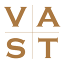

# AI in Medisch Dossier

Captured: 2026-10-09T08:14:10.907Z

Source: https://www.google.com/search?sca_esv=afb89ae158309890&sxsrf=APpeQnukJyhscj9KdL4AJ-FND_hbXWaKkA%3A1791529679109&udm=50&vsint=&ntc=1&cs=0&sa=X&ved=0CBkQ2_wOahgKEwj4yfaTvayXAxUAAAAAHQAAAAAQikM&biw=1707&bih=898&dpr=1.5&atvm=2&mstk=AUtExfAzuMss8XfXuXZWLUTbOGursZ06opx9tKuoxPF9z9eBz-iTNMldD7ANygzFEq2YtjYfX_zWbMvZK2wA_QHdzchYtJHMuilV3dCxq6uNaFmn9cA-NBRWS8dsuLIaBAOUPHLwd2te6tC-GRQi_nYWQ4KGUopAt-FkEK8&mtid=e73FaqbNBMvr7_UPgZr7mAg&csuir=1&aep=26&q=ai+gebruik+medische+rapportage+in+medisch+dossier+en+rechtszaak

## Prompt 1 — You

ai gebruik medische rapportage in medisch dossier en rechtszaak

## Response 1 — Google AI Mode

Het gebruik van **Artificial Intelligence (AI)** voor medische rapportage in het medisch dossier en de rol daarvan in een rechtszaak is een actueel en complex juridisch domein. Sinds de invoering van de Europese **AI-Act** en aangescherpte richtlijnen van artsenfederatie **KNMG**, gelden er strenge eisen voor de inzet van deze technologie. 

Artsenfederatie | KNMG +1

Hieronder staat hoe AI wordt gebruikt en wat de juridische impact is bij een eventuele rechtszaak.

---

### 1. AI in het Medisch Dossier: Gebruik en Verplichtingen

In de dagelijkse medische praktijk wordt AI (zoals een *ambient AI scribe* of virtuele notulist) ingezet om patiëntgesprekken live te transcriberen, medische gegevens samen te vatten en direct te verwerken in het Elektronisch Patiëntendossier (EPD).

Bij dit gebruik gelden harde juridische randvoorwaarden:

* **Eindverantwoordelijkheid arts (Human-in-the-loop):** De AI-software is slechts een hulpmiddel. De zorgverlener blijft te allen tijde wettelijk en tuchtrechtelijk verantwoordelijk voor de inhoud van het dossier (conform de [WGBO / art. 7:453 BW](https://pure.uva.nl/ws/files/180498396/NJB23_Diagnosticeren_met_AI_en_de_aansprakelijkheid_van_hulpverleners.pdf)). De arts moet de gegenereerde rapportages altijd controleren op fouten en 'hallucinaties' (door de AI verzonnen data) alvorens te accorderen. 

  VAST | Verzekeringsrecht, aansprakelijkheid, schade en toezicht +4
* **Toestemming en Privacy (AVG):** Het opnemen van een gesprek met AI vereist expliciete en geïnformeerde toestemming van de patiënt. Het gebruik van publieke AI-chatbots (zoals de gratis versie van ChatGPT) is streng verboden wegens schending van het medisch beroepsgeheim; er moeten systemen worden gebruikt met een afgesloten verwerkersovereenkomst. 

  Dirkzwager legal & tax +3
* **Kwalificatie als Medisch Hulpmiddel:** Zodra een AI-systeem niet alleen administratief is, maar ook data analyseert voor triage of diagnoses, valt het onder de strenge regels van de **Medical Device Regulation (MDR)**. 

  Law & More +1

### 2. AI-Rapportages in een Rechtszaak

Wanneer een patiënt een rechtszaak aanspant wegens een vermoedelijke medische fout, speelt het medisch dossier de hoofdrol. De inzet van AI heeft hierin grote implicaties:

#### A. Bewijslast en Dossieranalyse

Voor advocaten in medische aansprakelijkheidszaken is AI een krachtig middel geworden om medische dossiers razendsnel door te lichten. Het algoritme kan inconsistenties of potentiële behandeltekortkomingen in het dossier filteren, wat als basis dient voor de juridische argumentatie of een verzoek tot onafhankelijke expertise.

#### B. De "Black Box" en Bewijsnood

Als een AI-systeem een (foutieve) diagnose of behandeladvies heeft gegenereerd dat door de arts is overgenomen, ontstaat er een juridisch probleem: de *black box*. Het is vaak onduidelijk *hoe* het algoritme tot zijn conclusie is gekomen. De Nederlandse rechter kan in zo'n geval de bewijslast verlichten voor de patiënt en van het ziekenhuis eisen dat zij openheid van zaken geven over de werking en geschiktheid van het gebruikte AI-systeem (art. 22 en 194 Rv). 

Universiteit van Amsterdam

#### C. Wie is er aansprakelijk bij een foutieve AI-rapportage?

| Situatie | Juridische Aansprakelijkheid | Grondslag |
| --- | --- | --- |
| **Arts neemt foutief AI-verslag klakkeloos over** | **De arts / het ziekenhuis** is aansprakelijk. De arts heeft zijn zorgplicht geschonden door de AI-output niet kritisch te verifiëren. | Wanprestatie / Behandelingsovereenkomst (art. 7:453 BW). |
| **Het AI-systeem vertoont een technisch mankement** | **Het ziekenhuis** is in eerste instantie aansprakelijk jegens de patiënt, omdat zij gebruikmaakt van een gebrekkige hulpzaak. Het ziekenhuis kan de schade daarna eventueel verhalen op de **AI-fabrikant**. | Risicoaansprakelijkheid voor hulpzaken (art. 6:77 BW) en Productaansprakelijkheid. |

### Recente jurisprudentie

Het juridische risico is niet hypothetisch. Zo lopen er inmiddels ook rechtszaken (onder andere in de VS tegen zorgorganisaties zoals [Sharp HealthCare](https://www.icthealth.nl/nieuws/rechtszaak-vs-over-mogelijke-privacy-schending-ai-verslaglegging)) waarin patiënten zorginstellingen aanklagen omdat hun medische gegevens zonder de juiste privacywaarborgen door AI-verslagleggingstools zijn verwerkt. 

ICT&health

Om u gericht verder te helpen, kunt u aangeven vanuit welk perspectief u dit vraagt:

* Bent u een **zorgverlener** die de juridische risico's van AI-verslaglegging in de praktijk wil afdekken?
* Bent u een **jurist of advocaat** die te maken heeft met een specifieke aansprakelijkheidszaak?
* Of bent u een **patiënt** die vermoedt dat er AI-fouten in uw dossier staan?

### Source links

- [Artsenfederatie | KNMG](https://www.knmg.nl/ik-ben-arts/praktijkdilemmas-1/praktijkdilemma/waar-moet-ik-aan-denken-als-ik-ai-wil-gebruiken-voor-de-verslaglegging-van-patientgesprekken)
- [Universiteit van Amsterdam](https://pure.uva.nl/ws/files/180498396/NJB23_Diagnosticeren_met_AI_en_de_aansprakelijkheid_van_hulpverleners.pdf)
- [VAST | Verzekeringsrecht, aansprakelijkheid, schade en toezicht](https://www.vast-online.nl/art/5056/medische-aansprakelijkheid-en-artificiele-intelligentie)
- [Dirkzwager legal & tax](https://www.dirkzwager.nl/kennis/artikelen/artificial-intelligence-in-de-zorg-juridische-aandachtspunten)
- [Law & More](https://lawandmore.nl/de-juridische-implicaties-van-ai-in-de-gezondheidszorg/)
- [ICT&health](https://www.icthealth.nl/nieuws/rechtszaak-vs-over-mogelijke-privacy-schending-ai-verslaglegging)
