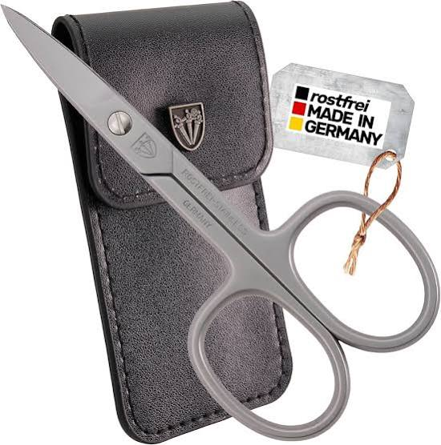
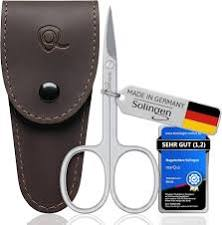
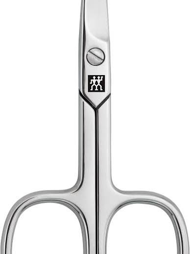
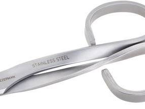

# Gebogen Nagelschaartje Gebruiken

Captured: 2026-10-09T08:25:36.567Z

Source: https://www.google.com/search?sca_esv=afb89ae158309890&sxsrf=APpeQnukJyhscj9KdL4AJ-FND_hbXWaKkA%3A1791529679109&udm=50&vsint=&ntc=1&cs=0&sa=X&ved=0CDcQ2_wOahgKEwj4usPzv6yXAxUAAAAAHQAAAAAQgyM&biw=1707&bih=898&dpr=1.5&atvm=2&sei=VaPIasitPNi3i-gPgdDLsAs&mstk=AUtExfDw2U-MmgKTLE0lju-vD1QRLRViKycYENSBtUbI5Ti1Ved_MM5XyDlNeiJqVPrHPTDk-stwc4LpIXt61LGQqNX4AJKZu0caxMPrNGGXgwfaXI-oP0HbZxWYuOcXytCFsBBdJjhaEi1mHgec0zBhFlfHIfsUkplNalbI_7AxH83eqRk8dD9buatlpdlaHxWFFIpFbTyikk4CEJiKFpebX_ApkcFEXTnuYUwW74_h_1r08pDE1pPvFUtfcOvZFC6npqHQ-X1LblbTja9HZ2lczW3BqxrUeeT-TTw8A4ip3oamwTxp8K6j3X3i_am2Mj0PEbP-PGH4W2_YVQ&mtid=8Ja_atblNICbi-gPw_yF-Qk&csuir=1&aep=26&q=klein+nagelschaartje+met+gebogen+lemmet

## Prompt 1 — You

klein nagelschaartje met gebogen lemmet

## Response 1 — Google AI Mode

Een **klein nagelschaartje met een gebogen lemmet** (schaarblad) is de ideale tool om vingernagels nauwkeurig te knippen. De subtiele buiging in de snijbladen volgt automatisch de natuurlijke, ronde vorm van de nagel. Hierdoor voorkom je dat de nagel splijt of dat er scherpe hoekjes achterblijven.

Voor extra fijne werkzaamheden, zoals het knippen van losse nagelriemen, kies je het beste voor een specifiek *nagelriemschaartje* (huidschaartje); deze heeft een nog dunner en spitser gebogen lemmet.

### Belangrijke eigenschappen om op te letten

* **Materiaal (RVS):** Kies altijd voor **roestvrij staal (RVS of inox)**. Dit materiaal blijft langdurig scherp, hygiënisch en kan probleemloos in een vochtige badkamer worden bewaard.
* **Formaat:** Een standaard klein nagelschaartje heeft meestal een totale lengte van **9 tot 9,5 centimeter**. Dit ligt compact in de hand en biedt maximale controle bij het secuur knippen van kleine nagelranden.
* **Verbinding:** Hoogwaardige schaartjes zijn voorzien van een **echte schroefverbinding** in plaats van een klinknagel. Hierdoor kan het schaartje na verloop van tijd eventueel strakker worden afgesteld of geslepen.

Zoek je een nagelschaartje voor **normale vingernagels**, of specifiek een extra fijn schaartje voor de **nagelriemen**? Als je een **bepaald merk** (zoals Zwilling of Solingen) op het oog hebt, laat het me gerust weten!
