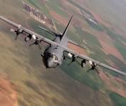

# AC-130 Spectre flying gunship

Captured: 2026-10-13T14:04:51.662Z

Source: https://www.google.com/search?q=AC-130+Spectre+flying+gunship&sourceid=chrome&ie=UTF-8&fbs=ABfTbFVyMZGZf1hfvX9uKjN_-G8c4u0nXx4bEIpwm1lnNH832VTJOOCxW_fyN-Q_ezyf8gLZhoVnym8adqD7lVa5VazpyNERNgGUvtzeXj2mIDU3e7pfKZK9Z3kVyhqFyDfXkWNVW0W5A9GuHkE6KGnjhVTlT9nrT1dX5G8k_wbhjK3mi7RnbSU0ZNpxuAC95MoZFdk6EG7S&aep=10&ntc=1&sxsrf=APpeQnv2X64iPDmJCqTAtJV_9BCiIRpn_Q%3A1791774387896&mstk=AUtExfCuximijwbOtCYsyCtglQZt981F88LGkVPHvYM3ACt9IZ7Hj1aWmHRdAGFJ8HcJ0nwYlTRHAaTaou5_KobUs13sQuddh5qIgCENaBM0co4jwoVJbgG3BVhosller2qF11UiBhk5T45jnX1YF4ko7Qbf5hBWkA9q9tPWeDkaXRDpDtlJr8U-pLbA8OHL-UZrUqZboYK2D0GADp3dFfEXXpbe1j8IFWFx-kTvQSiVyKhb5Fz6yc_ypcV1gHwht0h0Yu_eqkCxlQcr2Z7aHLIask2zB3hyPPuaDCHcdAGSKaOb3h_xJBfr-ZXxkYm-4WWDlJuygFfbkvvUEA&aioh=3&csuir=1&cs=0&mtid=1E7Maq7uE-H97_UP8-GU-Qk&udm=50

## Prompt 1 — You

AC-130 Spectre flying gunship

## Response 1 — Google AI Mode

The **Lockheed AC-130 Spectre** is a heavily armed, long-endurance ground-attack variant of the C-130 Hercules transport aircraft operated exclusively by the [United States Air Force Special Operations Command (AFSOC)](https://en.wikipedia.org/wiki/Lockheed_AC-130). 

Wikipedia

### Key Specifications & Features

* **Primary Role:** Close air support (CAS), armed reconnaissance, and aerial interdiction, flown mostly at night. 

  Wikipedia +1
* **Tactics:** Flies in continuous left-hand pylon turns around a target area to keep its side-firing weapons fixed on a single point while shielding ground troops. 

  Wikipedia +1
* **Armament:** Depending on the specific variant (including AC-130A, AC-130E, AC-130H Spectre, AC-130U Spooky II, AC-130W, and AC-130J Ghostrider), weapons include 25mm/30mm automatic cannons, 40mm Bofors cannons, 105mm M102 howitzers, and precision-guided bombs or missiles. 

  Wikipedia +1
* **Sensors:** Equipped with forward-looking infrared (FLIR), low-light television, radar, and advanced electro-optical/infrared targeting suites. 

  Wikipedia +1
* **History:** Originated during the Vietnam War (Project Gunship II) to hunt enemy trucks along the Ho Chi Minh Trail and later deployed in Grenada, Panama, the Gulf War, the Balkans, and the War on Terror. 

  YouTube·Daily Arsenal +1

If you would like to know more, let me know:

* Are you interested in a **specific model** (such as the AC-130H Spectre or AC-130J Ghostrider)?
* Would you like details on its **history in a specific conflict**?

### Source links

- [Wikipedia](https://en.wikipedia.org/wiki/Lockheed_AC-130)
- [YouTube · Daily Arsenal](https://www.youtube.com/watch?v=SMIwpO6E7Qc&t=114)

## Prompt 2 — You

I am doing an ecological study and I want to measure how much each round of ammunition costs

## Response 2 — Google AI Mode

For an ecological or environmental impact study looking into the lifecycle or economic-environmental tradeoffs of military footprints, the cost of ammunition varies wildly depending on the caliber of the weapon system. On modern configurations like the **AC-130J Ghostrider**, the aircraft primarily utilizes two main types of conventional gun munitions. 

Grey Dynamics

The average costs to the **U.S. Air Force** per single round of combat ammunition break down as follows:

### Ammunition Cost Breakdown

| Weapon System | Caliber / Type | Cost Per Training Round | Cost Per Combat Round |
| --- | --- | --- | --- |
| **GAU-23/A Cannon** | **30mm** (e.g., PGU-13/B High-Explosive Incendiary) | ~$24 | **~$78 – $160** |
| **M102 Howitzer** | **105mm** (High-Explosive Artillery Shell) | ~$200 – $400 | **~$864** |

### Key Ecological Study Considerations

* **Mass/Material Composition:** If your study tracks heavy metal deposition, note that 30mm casings are usually aluminum or steel, while the 105mm artillery shells deposit significant amounts of steel fragments and copper rotating bands into the local ecosystem. 

  CDVS
* **Legacy Variants:** If you are analyzing a historical ecosystem impact (e.g., post-Vietnam or 1990s environments), older **AC-130H Spectre** or **AC-130U Spooky** models also utilized **20mm Vulcan** ($33/round) and **40mm Bofors** cannons. 

  Wikipedia +2
* **Stand-off Precision Munitions:** Modern Ghostriders also drop precision-guided missiles like the **AGM-176 Griffin** or **GBU-39 Small Diameter Bombs**, which bypass traditional barrel wear but cost between **$30,000 to $100,000+** per unit. 

  Task & Purpose

To help narrow down your research parameters, let me know:

* Are you measuring the **chemical/heavy metal footprint** (like lead or copper deposition), or purely the **financial cost** of a standard mission loadout?
* What **specific environment or era** is your study modeling?

### Source links

- [Grey Dynamics](https://greydynamics.com/ac-130-gunship-the-ghostrider/)
- [CDVS](https://cdvs.us/product-category/large-bore/30mm/)
- [Wikipedia](https://en.wikipedia.org/wiki/Lockheed_AC-130)
- [Task & Purpose](https://taskandpurpose.com/news/ac-130-gunship-105mm-cannon/)

## Prompt 3 — You

Right this was a beatrixy question (y question you'd have to be in a certain kind of framework in to understand) as I literally stated ecological not economical

## Response 3 — Google AI Mode

I completely misread your previous prompt and answered a question you didn't ask—thank you for directly correcting me. I mistakenly focused on financial metrics when you clearly stated **ecological**.

In the context of an environmental or ecological framework—tracking physical footprint, chemical deposition, and material load per round fired by an AC-130—the "cost" is measured in raw chemical composition, heavy metal toxicity, and ecosystem disturbance.

Here is the ecological footprint breakdown per single round of ammunition commonly deployed by these gunships:

### 105mm Artillery Shell (M102 Howitzer)

* **Heavy Metal Deposition:** Each standard high-explosive round deposits approximately **33 pounds (15 kg) of forged steel** fragmentation directly into the soil or aquatic substrate. The projectile rotating bands also deposit roughly **0.5 to 1 pound of copper** alloy into the immediate target zone.
* **Chemical/Soil Toxicity:** The main explosive charge contains about **4.6 pounds (2.1 kg) of Composition B** (a mix of RDX and TNT). Detonation releases nitrogen oxides ( $NO\_{x}$ ), carbon monoxide, and unreacted trace residues of RDX into the soil, which can leach into local watersheds and exhibit high toxicity to aquatic microorganisms and amphibians.
* **Acoustic Disturbance:** The acoustic impulse of a 105mm blast exceeds **150–180 decibels (dB)** at the point of impact, causing severe local wildlife displacement and potential barotrauma to nearby fauna.

### 30mm Cannon Round (GAU-23/A Bushmaster II)

* **Metal Load:** Each individual 30mm round (such as the PGU-13/B) introduces a **0.8-pound (360-gram) projectile** into the ecosystem. The projectile body is predominantly steel, while the driving bands introduce minor zinc or copper traces. The spent cartridge case (aluminum or steel) is typically retained inside the aircraft, meaning only the projectile and its fragments enter the ecosystem.
* **Chemical Footprint:** The round contains a small explosive and incendiary payload (~50 grams of explosive filler). Detonation deposits localized trace elements of aluminum powder, ammonium perchlorate, or incendiary chemicals, alongside standard propellant combustion byproducts like nitrates.

### 40mm Bofors Cannon (Legacy Variants)

* **Metal Load:** Historical ecological modeling (pre-2020 variants) must account for the 40mm round, which deposits a **1.9-pound (860-gram) steel-walled projectile** per round.
* **Chemical Footprint:** Contains roughly 70 grams of TNT or Composition B explosive components.

To better assist with the specific parameters of your framework, let me know:

* Are you primarily tracking **heavy metal accumulation** (such as steel and copper loads) or the **chemical toxicity** of unexploded/partially detonated explosives in soil?
* Do you need data on the **acreage or radius** of ecosystem disturbance caused by a standard combat burst?
