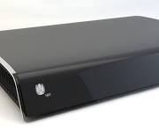

# Horizon Hackathon Medibox

Captured: 2026-10-13T14:30:10.926Z

Source: https://www.google.com/search?sca_esv=7a9d3f4fa3fac4b8&sxsrf=APpeQnva1oMf5ABjD6URKKzStL8CsItD6w%3A1791888079650&udm=50&vsint=&ntc=1&cs=1&sa=X&ved=0CCUQ2_wOahcKEwjg386l57aXAxUAAAAAHQAAAAAQSA&biw=1707&bih=898&dpr=1.5&atvm=2&mstk=AUtExfAoxSTv39-EiNU-ZSRAt53gt4dlIUHEAq-ya0h_G5eALB7jX-DXdU38g0k7uG0-5ep7bZBtQc6295U8DE0LC7L_-vC0LmAOvDIQwsT4gKXwdtO9WQHHjoK_yXaxLVe8D7grgzVE24geMi2VBPX3CykD-aXfYUcNQCDweiq2hOupsTonTnuVnG6Bkp5ySHjhjQx5QhzAekqSvgPC79LN3ByxEEEzla2T4pvKR--jyC5SXRCXUcqHSk6yIzT9jBPG2J5Ejb_-MJH0kLKpxvQ1IRM_LYjgdEne-ShDrFUUCV9eaQOfCsdeZnlcGKk8vMd88n3gQ2vNmdSepw&mtid=CAvNasvmBeS4-d8P0uqGiAY&csuir=1&aep=26&q=horizon+hackathon+mediabox

## Prompt 1 — You

horizon hackathon mediabox

## Response 1 — Google AI Mode

The **Horizon Box** (often called the UPC Horizon TV Box or Liberty Global Horizon Box) is a legacy set-top box and media gateway. 

GitHub

* **Hardware Specs:** Powered by an Intel Atom CE media processor, a Celeno Wi-Fi chip (running Linux 2.6.21), Entropic MoCA coax, and a Samsung console port. 

  GitHub
* **Software & UI:** Features Nagravision conditional access and NDS MediaHighway/Snowflake UI. 

  GitHub
* **Community & Hacking:** The open-source project on [GitHub - mrquincle/horizon](https://github.com/mrquincle/horizon) focuses on reverse-engineering the set-top box hardware to build custom Android, Raspberry Pi, and home automation control software without bypassing content DRM. 

  GitHub

Are you looking for specific information on **flashing firmware**, **setting up home automation**, or troubleshooting an older **UPC/Ziggo Horizon box**?

### Source links

- [GitHub](https://github.com/mrquincle/horizon)

## Prompt 2 — You

hackathon Stayfan only van der feest

## Response 2 — Google AI Mode

It appears you are combining references to tech events, a specific party DJ, and Dutch festive music:

* **Stayfan (Stefan van Bergen):** He is a well-known Dutch **Feest DJ and entertainer** who regularly performs at festivals like the Zomerspektakel. He is known for Dutch party mixes, carnival tracks, and collaborations such as *"Wat Doe Je Mien"* with Feest DJ Maarten. 

  SoundCloud +5
* **"Van der feest":** This closely translates to "of the party," heavily tying into the Dutch *feestmuziek* or *après-ski* culture. 

  Partyflock +1
* **Hackathon:** There are no official "hackathons" organized by DJ Stayfan. If you are looking for tech building events in the Netherlands, upcoming events include the TechEx Amsterdam Hackathon or localized AI and developer events. 

  Eventbrite

Are you looking for a **specific music track** by DJ Stayfan, details on his **upcoming festival performances**, or did you mean a different type of **hackathon event**?

### Source links

- [SoundCloud](https://soundcloud.com/bridgewayrecords/bridgeway-records-presents-dj-stayfan-partydj-nederlandstalig-feest-zanger-4k)
- [Partyflock](https://partyflock.nl/artist/118842:Stayfan)
- [Eventbrite](https://www.eventbrite.nl/d/netherlands--amsterdam/hackathon/)
