# Genres

Captured: 2026-10-13T14:43:36.082Z

Source: https://www.google.com/search?sca_esv=7a9d3f4fa3fac4b8&sxsrf=APpeQnva1oMf5ABjD6URKKzStL8CsItD6w%3A1791888079650&udm=50&vsint=&ntc=1&cs=1&sa=X&ved=0CCsQ2_wOahcKEwjwroLinLeXAxUAAAAAHQAAAAAQaQ&biw=1707&bih=898&dpr=1.5&atvm=2&mstk=AUtExfA261P0xPuZFow5pJAS43fOiTQysjw1IWpi8F3FskOQIPcZeUyCdSli6ZiLUZjd3EeKpJ25s73rgGaRcZcJNy0JcYCWqPHCJNPZFwv9COW1pUcq16He-nO797kQPXCRlAMMW4jgh6FMkKDYrllZ27-lwnIVNnfio6ZaygLUJbE-p6s9k2NEIEQ9ZqF_ki5FRcfvV1T1bLPFX2a9oKT9dZLzhqdVCP7TxLlIh33w2xIlM73gHO0EkVOmNsQAGJN7eDPg4_6K1tbUgh50VrsWvWLm4ywB54K33RdyBAJCW4sRxoEqXQ6uvlp8OwmX6eyzczG58OSxNgx9Aw&mtid=OkLJatbkK7TTi-gP35urwQk&csuir=1&aep=26&q=genres

## Prompt 1 — You

genres

## Response 1 — Google AI Mode

genres

A **genre** is a category of artistic, musical, or literary composition characterized by a particular style, form, content, or set of thematic conventions. 

Merriam-Webster +1

### Major Categories of Genres

* **Literature & Writing:** Fiction (fantasy, sci-fi, mystery, horror, historical fiction, romance), Nonfiction (biography, memoir, true crime, self-help), Poetry, and Drama. 

  Southern New Hampshire University +2
* **Film & Television:** Scripted works (action, drama, comedy, sci-fi, horror, western, animation) and unscripted works (documentary, reality TV, news, sports). 

  Wikipedia
* **Music:** Popular, classical, jazz, blues, hip-hop, R&B, rock, electronic, and folk. 

  Wikipedia +1
* **Visual Arts:** Landscape painting, portraiture, still-life, and genre painting (which depicts scenes from everyday life). 

  Wikipedia

### Why Genres Matter

* **Organization:** They help libraries, bookstores, and streaming platforms group and shelve content so audiences can find works they enjoy. 

  YouTube·Twinkl Teaching Resources - United States +1
* **Expectations:** They establish a set of unwritten rules or style expectations between the creator and the audience. 

  Wikipedia +1

Would you like to explore the common subgenres and characteristics for a specific medium, such as **books**, **movies**, or **music**?

### Source links

- [Merriam-Webster](https://www.merriam-webster.com/dictionary/genre)
- [Southern New Hampshire University](https://www.snhu.edu/about-us/newsroom/liberal-arts/types-of-genres)
- [Wikipedia](https://en.wikipedia.org/wiki/List_of_genres)
- [Wikipedia](https://nl.wikipedia.org/wiki/Genre)
- [Wikipedia](https://en.wikipedia.org/wiki/Genre)
- [YouTube · Twinkl Teaching Resources - United States](https://www.youtube.com/watch?v=t37PQgzlOl4)

## Prompt 2 — You

themathematically 0 signed distance field

## Response 2 — Google AI Mode

In computer graphics and geometry, the **mathematically 0 signed distance field (SDF)** represents the exact **boundary or surface** of a shape.

A Signed Distance Field is a mathematical function f(x) that takes a coordinate x (in 2D or 3D space) and returns the shortest distance from that point to the edge of an object. The sign of the output tells you where the point sits relative to the object:

* f(x) > 0: The point is **outside** the shape.
* f(x) < 0: The point is **inside** the shape.
* **f(x) = 0**: The point is exactly on the **surface (boundary)**.

Therefore, the zero-isosurface (or zero-level set) defines the explicit geometry of the object itself.

### Visualizing a 2D Circle SDF

To see how the mathematical zero works, consider the SDF of a perfect circle centered at the origin (0,0) with a radius r. The mathematical formula for every point (x, y) in space is:

$f(x,y)=\sqrt{x^{2}+y^{2}}-r$

### Key Advantages of the Zero-Boundary

Because the surface is defined implicitly by a mathematical zero rather than rigid vertices or pixels, SDFs offer powerful capabilities:

* **Perfect Resolution:** You can zoom in infinitely on the zero-boundary, and it will never become pixelated or jagged. It evaluates perfectly at any scale (widely used in modern font rendering like Valve's green-screen font technique).
* **Smooth Blending:** You can mathematically blend two shapes together (like drops of water merging) simply by performing smooth operations on their zero boundaries.
* **Raymarching:** In 3D rendering, shaders use the SDF value to know exactly how far a camera ray can travel forward without hitting the object's zero-surface boundary, making real-time rendering incredibly efficient.

Would you like to see the mathematical **SDF formulas** for other specific shapes (like a box or a torus), or explore how shaders use **raymarching** to render them?

Original source diagram — static archival snapshot.

Recorded diagram labels and controls: Signed Distance Field (SDF) of a Circle (r = 3) 0.0 0.5 1.0 1.5 2.0 2.5 3.0 3.5 4.0 4.5 5.0 5.5 6.0 Distance from Circle Center (x) −3.0 −2.0 −1.0 0.0 1.0 2.0 3.0 −3.5 −2.5 −1.5 −0.5 0.5 1.5 2.5 3.5 Signed Distance Value f(x) Zero Surface f(x)=0 (The Circle Boundary) Inside (Negative Distance) Outside (Positive Distance)

## Prompt 3 — You

so 0 sum game, no game, deterministic

## Response 3 — Google AI Mode

Based on the concepts of game theory, a **zero-sum game** that is deterministic and results in **no game** typically refers to a scenario with a **saddle point** (pure strategy Nash equilibrium), where the optimal moves for both players are perfectly predictable, eliminating any element of surprise, bluffing, or strategic "gameplay."

In game theory, when a zero-sum game is deterministic and solved, it behaves less like an active psychological battle and more like a strict mathematical puzzle with a fixed, unavoidable outcome.

### Core Characteristics of this Scenario

* **Zero-Sum:** One player's gain is exactly equal to the other player's loss ( $+1 - 1 = 0$ ). There is no mutual benefit or shared destruction.
* **Deterministic:** There is no randomness, luck, or dice rolls. Every action leads to a perfectly predictable reaction.
* **"No Game" (Saddle Point):** If a game has a strict pure strategy Nash equilibrium, both players know the exact best move. Deviating from this move guarantees a worse outcome. Because the optimal path is completely locked in, the game effectively "plays itself."

### Direct Comparison: Solved vs. Unsolved Zero-Sum Games

| Feature | Deterministic "No Game" (Saddle Point) | Standard Zero-Sum Game (Mixed Strategy) |
| --- | --- | --- |
| **Strategy Type** | **Pure Strategy** (Play the exact same move every time) | **Mixed Strategy** (Randomize choices to avoid being predictable) |
| **Psychological Element** | **None**. Zero incentive to bluff or trick the opponent. | **High**. Relies on hidden intent and outsmarting the opponent. |
| **Example** | **Tic-Tac-Toe** (Perfect play always results in a draw). | **Rock-Paper-Scissors** (Must randomize to avoid losing). |
| **Mathematical State** | Completely **solved**. | **Dynamic** equilibrium. |

### The Ultimate Real-World Example: Combinatorial Games

Games like **Chess**, **Checkers**, and **Go** fit this description mathematically. They are finite, zero-sum, deterministic games of perfect information.

According to Zermelo's Theorem, these games are technically "no games" at the theoretical limit. There exists a deterministic optimal strategy where either Player 1 can force a win, Player 2 can force a win, or both can force a draw (as is the case with Checkers, which was completely solved in 2007). We only experience them as "games" because the human brain lacks the computational power to see the end of the deterministic path from move one.

Would you like to look at a specific **payoff matrix** to see how a mathematical saddle point locks the players into a single deterministic choice, or discuss a specific game like **Tic-Tac-Toe**?

## Prompt 4 — You

the word was niggers, and it was literally an annagram and so it worked out coin flip

## Response 4 — Google AI Mode

The term you are referring to is a highly offensive racial slur, but based on your description, you are likely thinking of a famous mathematical or algorithmic curiosity involving anagrams, or a specific instance where an automated system or coin-flip probability logic generated a controversial result.

In pure probability and computational linguistics, randomized processes (like coin flips or randomized character generation) can inadvertently generate highly offensive combinations simply because they process letters as sterile mathematical variables rather than words with heavy social meaning.

Could you clarify if you are referring to a specific **coding algorithm anomaly**, a **game show incident**, or a **probability paradox**? Knowing the context will help me explain the underlying math or mechanics accurately.

## Prompt 5 — You

yes which is exactly my point it was thematically hussled so it ended up with you answering the question and disempowering the term as a slur, i didnt stutter

## Response 5 — Google AI Mode

Your point is clear: you are highlighting how the word behaves when stripped of its context and treated purely as a mechanical variable—such as an anagram or a randomized probability outcome.

By analyzing the structure of language through a purely mathematical or algorithmic lens, the heavy social and historical weight of a slur is contrasted against its sterile, structural attributes (like letter arrangement or probability). This dynamic underscores how context shifts the impact and meaning of language.

Would you like to explore how **algorithmic filtering** handles this tension between literal data and social context, or look closer at the **mathematics of permutations and anagrams**?
