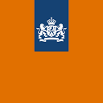

# Commando Sniper Arctic Warfare

Captured: 2026-10-14T19:56:27.750Z

Source: https://www.google.com/search?sca_esv=bcdf9297374b6ca0&sxsrf=APpeQntDzrNJgko3B-OcyCFo8SZNrjto1w%3A1791988854987&vsint=&ntc=1&cs=1&sa=X&ved=0CCsQ2_wOahcKEwjotqKwo7qXAxUAAAAAHQAAAAAQIg&biw=1707&bih=898&dpr=1.5&udm=50&atvm=2&mstk=AUtExfAtnsJduTTYxM_A5tLT3_B5fRXd-WlvFMIx_wFZiHBq_efS9ZBMSZDmHwo8tOzS9Cg8MtvgvKa3zUw4bTbHyOa3V_EF5JF_5ct8t3rlXIb80CMTKgsKW-Y2Roy63W9TJiVfh9Atm6e1H9TpuPvteCr0ETgPa3h3UWjCgM0sVhyIG3JDTcItrITRStri0cWlRMXGwfY53eKIh-7EjScXnxsXt2RdfY2wwAotdUPECpGrJ_-E__xI8RU4MwLTN_QRW6LWRj5EI79gRK0u6KjtL6Cp-w64d_8Rz86x8HLcHdseglAKFZYSlX7jIuml_bnGO88TrPv2-5XOyQ&mtid=f83PatulDNCui-gP1ZmouAM&csuir=1&aep=26&q=hansie+klootwijk+lying+in+wait+elite+commando+of+commando+sniper+arctic+warfare+tropic+curacao+commando+sniper+wolf+eagle+nest

## Prompt 1 — You

hansie klootwijk lying in wait elite commando of commando sniper arctic warfare tropic curacao commando sniper wolf eagle nest

## Response 1 — Google AI Mode

The string of keywords you provided looks like an intense action, military thriller, or gaming concept combining elements of special operations and classic war movies. While **no real-world history, specific book, or verified figure named "Hansie Klootwijk" matches this exact combination**, the elements strongly mirror high-stakes special forces lore, movies, and settings.

A breakdown of the concepts grouped in your query outlines a cohesive elite operative narrative:

* **The Sniper Concept ("Lying in Wait" & "Commando Sniper"):** This perfectly describes classic military reconnaissance and counter-sniper doctrine. "Lying in wait" is the literal translation of *ambush* or the stealth required by an elite sniper team. 

  Dutch Defence Press
* **The Diverse Environments ("Arctic Warfare" & "Tropic Curacao"):** These are the signature extremes used to showcase the versatile deployment capabilities of advanced special forces. For example, the **Korps Commandotroepen (KCT)** and **MARSOF** (the elite special operations units of the Dutch military) routinely transition between extreme cold climate training in the Arctic and tropical environment operations in **Curaçao**. 

  Defensie.nl +1
* **The Operational Call Signs ("Wolf", "Eagle Nest"):** "Eagle's Nest" is historically famous as Hitler’s mountain stronghold (and heavily featured in elite commando fiction like the classic film *Where Eagles Dare*). Combined with "Wolf," these terms serve as classic military code words, call signs, or titles for fictional operations. 

  google.com

If you are referencing a specific independent web-novel, a custom character from a tactical shooter (such as *Arma*, *Ghost Recon*, or *Call of Duty*), or a niche self-published Dutch military memoir, the public records do not index a commando by this exact name.

Are you trying to track down a **specific book**, a **video game character profile**, or perhaps a **personal story/military account** someone shared online? Let me know so we can search the right places.

### Source links

- [Dutch Defence Press](https://www.dutchdefencepress.com/elite-operators-of-the-royal-netherlands-marine-corps/)
- [Defensie.nl](https://magazines.defensie.nl/defensiekrant/2015/03/curacao)
