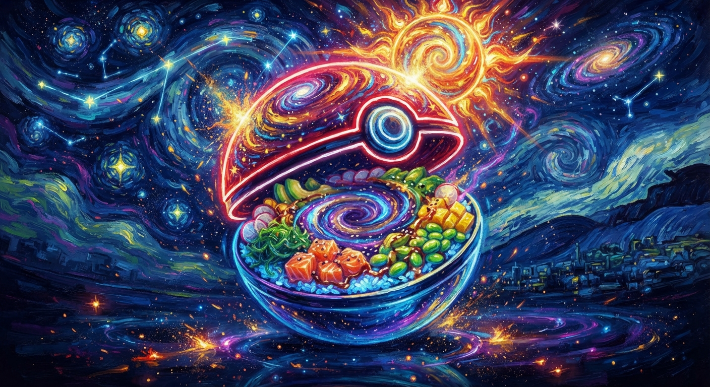
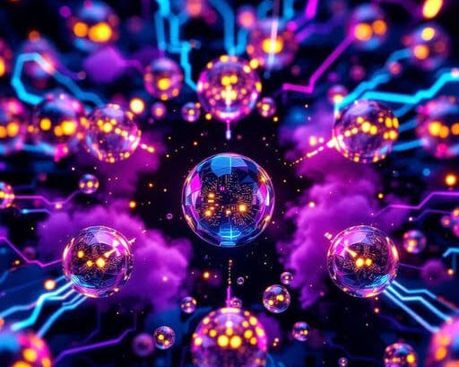
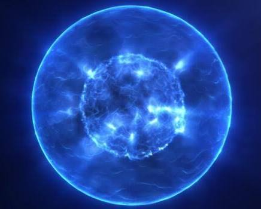

# coriolis effect sphere pokebowl super digital neon HDR glow van gogh like sparks and the sun effect flares

Captured: 2026-10-15T07:25:06.946Z

Source: https://www.google.com/search?q=coriolis+effect+sphere+pokebowl+super+digital+neon+HDR+glow+van+gogh+like+sparks+and+the+sun+effect+flares&client=ms-android-xiaomi-terr2-rso2&hs=nN9V&sca_esv=0b6b5098e114a672&sxsrf=APpeQnvkEOG9TdR9CUVotVlv1ebUApkJFA%3A1792045836143&source=chrome.ob&fbs=ABfTbFVyMZGZf1hfvX9uKjN_-G8c4u0nXx4bEIpwm1lnNH832cSpkWkfSwsmpNIrD_OQ-UfVcuk_CN5lZ7ooDDWHK2Mvzz3zSAVajbtoCgDcY4ClkqSY2KMHBVEZtzZXhvZhOAYOei-ZwZNbTP-zA17u6NI3tEs6cG6hn81aUxnDhSOjSjwakoJQVHh0SeQ8h1zJd7wJVl3n&vsint=&aep=1&ntc=1&cs=1&sa=X&ved=2ahUKEwj8-u77sruXAxUQ2gIHHXJ3IqAQ2J8OegQIDhAE&biw=375&bih=691&dpr=3.25&mstk=AUtExfBrYmWZbdqQdSuCUveZMzsB4tAEDZfrZ-WVfnZSVA08rPiS-KHQPClwodZi1cM2hg0iTeIgRzfAikzrKFOz8i1UsBlVIPk1vbK7Qm0igtek7mB8Frki9GWXKtCXnYvnknQCUri_zEttuZAjHM1GfLi-UhP2E6PXOHwtOw_-bGfj9bVcA-Is1jUAmiylwxb8Yzn1Jj-ZtTRsVYKKlw7-LpA0Kvo6MuvN2kseOZl9eeP0gYK31Af88P1HyqavSmTYX0pLVKo8a8YCjA&csuir=1&mtid=ZXXQauTeG83l7_UP4MO56AM&udm=50

## Prompt 1 — You

coriolis effect sphere pokebowl super digital neon HDR glow van gogh like sparks and the sun effect flares

## Response 1 — Google AI Mode

Here’s your generated image.

Download

Here are some web results that explore similar glowing digital spheres, electric energy effects, and neon cosmic visuals:

Would you like to adjust the composition, such as changing the **ingredients** inside the bowl or modifying the intensity of the **sun flares and neon colors**?

## Prompt 2 — You

live verkopen van digitaal organisme een unity build seed based verkopen via ideal of crypto currency of iets (op basis van mijn technische architectuur werk, zelfs het document meesturen huggingface lion helm hodl mirai)

## Response 2 — Google AI Mode

Het live verkopen van een **seed-based digitaal organisme** (gegenereerd via een Unity build) vereist een specifieke combinatie van webtechnologie, web3/crypto-infrastructuur of traditionele betaalpoorten (iDEAL). Op basis van de complexe technische context die je schetst (**Hugging Face, LION, Helm, HODL, Mirai**), is dit een zeer levensvatbaar concept.

Hieronder staat een concreet overzicht van hoe je deze technische architectuur inricht om zowel de verkoop, de seed-generatie, als de documentdistributie te automatiseren.

---

### 1. De Transactie- en Generatieroute

Het kernprincipe is dat de aankoop een unieke **seed** (bijvoorbeeld een unieke hash of string) triggert, welke direct gekoppeld is aan de Unity WebGL-build die het organisme live in de browser rendert.

#### Optie A: De Crypto Route (Web3 Smart Contract)

Dit sluit direct aan bij termen als *HODL* en *Mirai*.

* **Mechanisme:** Je schrijft een smart contract (bijvoorbeeld op Base, Polygon of Ethereum) via tools als [Thirdweb](https://thirdweb.com) of [OpenZeppelin](https://openzeppelin.com).
* **De Seed:** De transactie-hash (`tx.hash`) of de token ID van de aankoop fungeert direct als de **seed** in je Unity-build.
* **In Unity:** Unity leest de metadata uit via een Web3-bibliotheek (zoals [Web3GL](https://github.com/vittorio-rivabella/Unity-Web3GL)). De ingebouwde algoritmes genereren op basis van die specifieke hash het unieke digitale organisme.

#### Optie B: De Traditionele Route (iDEAL via Stripe/Mollie)

* **Mechanisme:** Je gebruikt een backend (bijvoorbeeld Node.js of Python) gekoppeld aan [Stripe](https://stripe.com) of [Mollie](https://mollie.com) om iDEAL-betalingen te accepteren.
* **De Seed:** Zodra de webhook van de payment provider een succesvolle betaling meldt, genereert je backend een cryptografisch unieke seed en slaat deze op in een database (bijv. PostgreSQL of MongoDB).
* **In Unity:** De speler krijgt een unieke URL (bijv. `jouwsite.nl/organisme?seed=XYZ`). De Unity WebGL-build leest deze parameter uit en bouwt het organisme op.

---

### 2. Integratie met je Technische Stack

Gezien de componenten uit je architectuurwerk, kun je de live-omgeving als volgt structureren:

| Component | Functie binnen jouw verkoop-ecosysteem |
| --- | --- |
| **Hugging Face** | Indien je organismen AI-gestuurd gedrag vertonen, kun je via Hugging Face Inference API's live data of embeddings naar de backend schieten die de 'ziel' of het gedrag van het organisme bepalen op basis van de seed. |
| **LION / Helm** | Je gebruikt **Helm** om je gehele applicatie (frontend, backend, database en eventuele AI-modellen) te orkestreren op een Kubernetes-cluster. Dit zorgt ervoor dat je stack live-verkeer direct kan opschalen (*LION* / containerisatie). |
| **Mirai / HODL** | Deze concepten kunnen direct worden doorvertaald naar de tokenomics. Bijvoorbeeld: hoe langer een koper het organisme "HODLt" (niet doorverkoopt of vernietigt), hoe verder het organisme evolueert binnen de Unity-omgeving. |

---

### 3. Het Meesturen van het Document

Als je bij de aankoop direct je technische architectuurdocument of een uniek gegenereerd manifest wilt meesturen, kun je dit op twee manieren inrichten:

1. **Gecentraliseerd (Web2):** Na een succesvolle iDEAL- of crypto-transactie stuurt je backend automatisch een e-mail via [SendGrid](https://sendgrid.com) met het document (bijv. een PDF) als bijlage, óf genereert een tijdelijke downloadlink naar een beveiligde AWS S3 bucket.
2. **Decentraliseerd (Web3):** Je slaat het document op via **IPFS** of **Arweave**. De metadata van het gekochte organisme bevat direct de IPFS-hash (CID) naar het document. De koper kan zo via zijn wallet altijd direct bij de technische blauwdruk.

Wil je dieper ingaan op de **backend-architectuur** (bijvoorbeeld hoe je de iDEAL/Crypto webhooks inricht) of wil je hulp bij het schrijven van het **C# script** waarmee Unity de seed uit de URL of het smart contract trekt?

### Source links

- [Thirdweb](https://thirdweb.com/)
- [OpenZeppelin](https://openzeppelin.com/)
- [Web3GL](https://github.com/vittorio-rivabella/Unity-Web3GL)
- [Stripe](https://stripe.com/)
- [Mollie](https://mollie.com/)
- [SendGrid](https://sendgrid.com/)
