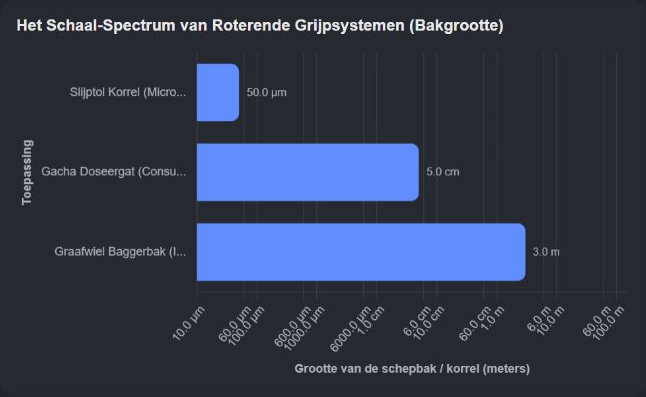

# van die schep bakjes aan een puntje en dan draaien

Captured: 2026-10-15T18:40:32.594Z

Source: https://www.google.com/search?q=van+die+schep+bakjes+aan+een+puntje+en+dan+draaien&gs_lcrp=EgZjaHJvbWUyBggAEEUYOdIBCTE1NDgyajBqN6gCALACAA&sourceid=chrome&ie=UTF-8&fbs=ABfTbFVyMZGZf1hfvX9uKjN_-G8c4u0nXx4bEIpwm1lnNH832cSpkWkfSwsmpNIrD_OQ-UdFAe4qAwsQWVbrtprjzBSpnJQOWUbUFy0AZP2fc5_e7wQK9SpSaccWZEM8174slgzA7lL9Jp-FedBms3jKtDYRkzLfYMnDYMy5pBIIBgIQaS46ps0&aep=10&ntc=1&sxsrf=APpeQntpAXPAYDe3pwz-M31TS0ImbzlwSw%3A1792073308678&mstk=AUtExfADLWUVqDPl5CgMFw5Jm1yEomgxQ-zPfEoSIrNE-SnkQj6KxPrC-AuxUqH-A6qjuT28Hd4xV5qkeeiM5T6unry-m8pg2kC55NvRzK6PTscT2PIIBHlg4bZ3-dAXTFDjlsWOAc4Z4CmSYD6QtgdtKWRlGbf1vtx4cRXi4yDMBLG6zqnqIioWYL1_2298eC3Kkinn1keXM60rb3PKHoEw9NcKukQoTERak0gO-amJyG8N_ELPLs0WR58kT8N70xhbTUFSgxt-kgkxUWZDhmxGLWo1i8arUwIPykTIL3SZu_FtqgiFQwCpxVBPHF8E6rSzYDOb9tFhL6vJdA&aioh=3&csuir=1&cs=1&mtid=Xd7Qaq7VAb6D9u8P_bfYkAM&udm=50

## Prompt 1 — You

van die schep bakjes aan een puntje en dan draaien

## Response 1 — Google AI Mode

Bedoel je toevallig zo'n **carrousel met snoepschepbakken** die schuin/puntsgewijs naar voren lopen, of de iconische **snoepdispensers/snoepsilo's** waar je aan een knop moet draaien om het snoep er aan de onderkant uit te laten vallen?

Mocht je iets heel anders in gedachten hebben (zoals een draaiende snack-spinner voor kinderen of een specifiek keukenhulpje), laat het dan gerust weten!

Als je wilt, kan ik voor je op zoek gaan naar:

* De officiële **naam of leveranciers** van dit soort winkeldisplays.
* Waar je zo'n **mini-snoepdispenser** met draaiknop voor thuis kunt kopen.

## Prompt 2 — You

nee van die gachaa en een van die tiefus grote graaf machines en gok machines

## Response 2 — Google AI Mode

Ah, je bedoelt die gigantische industriële machines en automaten die allemaal werken met zo'n ronddraaiend systeem! Dat verklaart een hoop.

Dit zijn de specifieke namen van de machines die je omschrijft:

* **De "Gachaa" machines:** Dit zijn inderdaad [Gashapon](https://en.wikipedia.org/wiki/Gashapon) (of Gacha) automaten. Je stopt er geld in, **draait aan de grote ronde knop**, en er rolt een plastic capsule uit met een verrassing of poppetje erin. 

  Wikipedia +1
* **De "tiefus grote graafmachines":** Dit is een **graafwielbagger** (in het Engels een *Bucket Wheel Excavator*, zoals de wereldberoemde [Bagger 293](https://www.miningdoc.tech/question/how-does-a-bucket-wheel-excavator-operate/)). Dit zijn de allergrootste landvoertuigen ter wereld. Ze hebben aan het uiteinde van een gigantische arm een **enorm ronddraaiend wiel waar allemaal schepbakken (buckets) aan zitten**. Terwijl dat wiel ronddraait, scheppen de bakken continu tonnen aarde op en gooien het op een lopende band. 

  Wikipedia +2
* **De gokmachines:** Hierbij doel je waarschijnlijk op de klassieke **gokkasten / fruitautomaten** (slot machines). Vroeger moest je hierbij aan een grote hendel aan de zijkant trekken (de *one-armed bandit*) om de rollen met symbolen te laten **draaien** in de hoop op een winnende combinatie. 

  Reddit·r/Aniimo

Het mechanisme is dus in de basis telkens hetzelfde: een grote draaiende beweging met bakjes, rollen of een mechanisme om iets te sorteren of te verplaatsen!

### Source links

- [Wikipedia](https://en.wikipedia.org/wiki/Gashapon)
- [Bagger 293](https://www.miningdoc.tech/question/how-does-a-bucket-wheel-excavator-operate/)
- [Wikipedia](https://en.wikipedia.org/wiki/Bucket-wheel_excavator)
- [Reddit · r/Aniimo](https://www.reddit.com/r/Aniimo/comments/1wpp9av/anyone_actually_play_this_big_slot_machine_and/)

## Prompt 3 — You

graaien als in draaien en afpakken, maar ff serieus het mechanisms

## Response 3 — Google AI Mode

**Grijpen en draaien** (of "draaien en afpakken") is inderdaad de absolute kern van deze systemen. Of het nu gaat om een muntje uit je zak kloppen of miljoenen tonnen aarde verzetten: mechanisch gezien praten we over **roterende schep-, doseer- en grijpsystemen**.

Hier is hoe dat mechanisme (de *physics* en de techniek) achter de schermen werkt bij deze drie machines:

### 1. De Graafwielbagger: Continu mechanisch graaien

Bij een normale graafmachine moet de arm telkens heen en weer bewegen (scheppen, draaien, leeggooien, terugdraaien). Dat kost te veel tijd. Het mechanisme van een gigantische **graafwielbagger** lost dit op door rotatie:

* **Het principe:** Een gigantisch verticaal wiel met **schepbakken aan de buitenrand** draait continu rond tegen een bergwand of grondlaag aan.
* **Het "afpakken":** Zodra een bakje de grond raakt, snijdt de stalen rand door de aarde (graaien). Door de opwaartse rotatie van het wiel wordt de grond mee omhoog genomen.
* **De truc (Zwaartekracht):** Zodra het bakje het hoogste punt van de cirkel passeert en over de kop draait, valt de grond er door de zwaartekracht aan de achterkant automatisch uit. Het valt precies op een interne lopende band die de grond direct afvoert. Het wiel kan hierdoor *non-stop* blijven draaien en graaien.

### 2. De Gacha-automaat: Het doseerwiel (Rotary Metering)

Als je aan de knop van een Gachapon draait, grijpt het mechanisme precies één capsule en "pakt" deze af van de rest.

* **Het principe:** Onderin de silo met ballen zit een horizontaal **draaiend wiel (een rotor) met uitgespaarde gaten of 'bakjes'** die precies groot genoeg zijn voor één capsule.
* **Het "afpakken":** De capsules liggen los bovenop dit wiel. Door de zwaartekracht valt er altijd automatisch één capsule in een open gat van het wiel.
* **De blokkade en drop:** Wanneer je de knop 360 graden draait, draait het wiel mee. Een fysieke barrière (een afdekplaat) zorgt ervoor dat de rest van de ballen wordt tegengehouden. Zodra jouw gevulde bakje boven het afvoergat (de *chute*) positioneert, valt de capsule naar beneden in de opvangbak.

### 3. De Gokkast: Van mechanische schijven naar stappenmotoren

De klassieke gokkast (de *Fruit Machine*) gebruikt een heel ander type roterend mechanisme, ontworpen om puur mechanisch te "bepalen" of je wint of verliest.

* **Het mechanisme:** In de kast zitten drie of meer fysieke rollen (trommels) op een centrale as. Elke rol heeft inkepingen (stops) aan de binnenkant die corresponderen met de symbolen op de buitenkant.
* **De hendel:** Als je aan de hendel trekt, span je een zware veer. Bij het loslaten geeft deze veer een harde mechanische klap tegen de rollen, waardoor ze met hoge snelheid gaan spinnen.
* **Het "afpakken" (De Rem):** Elke rol is verbonden met een mechanische rem (*stop pawl*). Een getimed mechanisme laat deze remmen één voor één in de inkepingen van de rollen vallen. Waar de rem de rol "grijpt" en stopzet, bepaalt welk symbool je ziet. *Moderne gokkasten doen dit digitaal via een computer (RNG) en stappenmotoren, maar bootsen exact dit mechanische gevoel na.*

---

### Het mechanische patroon

Als we dit versimpelen tot een cyclus, zie je hoe efficiënt rotatie is voor dit soort taken:

Wil je dieper ingaan op de **berekeningen** (hoeveel ton aarde zo'n graafwiel per seconde verzet) of ben je benieuwd naar het exacte **interne tandwielsysteem** van een specifieke automaat? Laat maar weten waar we het mes in moeten zetten!

Original source diagram - static archival snapshot.

Recorded diagram labels and controls: Continuous Mechanical Cycle of a Rotating Bucket System 1. Gravity Feed 2. Rotation & Capture 3. Mechanical Block 4. Gravity Release/Drop Item enters open slot at the top Wheel turns, trapping/scooping item System isolates the item Item falls out at output point

## Prompt 4 — You

Doe eens een rond wiel, niet vierkant

## Response 4 — Google AI Mode

Een **rond wiel** is inderdaad de enige manier om dit mechanisme soepel te laten draaien! Vierkante wielen zouden vastlopen en schokken, terwijl een perfecte cirkel zorgt voor een continue, vloeiende cyclus zonder stopmomenten.

Hierboven zie je het mechanisme uitgetekend in een zuivere cirkel: de bakjes bewegen in een perfecte baan rondom de centrale as om achter elkaar spullen op te pakken, mee te voeren en weer los te laten.

Wil je dat ik het **interne tandwielmechanisme** (hoe de centrale as wordt aangedreven) verder uitwerk, of wil je een specifiek onderdeel van de **graafmachine of gacha-automaat** bekijken? Let me know!

Original source diagram - static archival snapshot.

Recorded diagram labels and controls: Roterend mechanisme: Continue cirkelvormige beweging van de schepbakken −1.4 −1.2 −1.0 −0.8 −0.6 −0.4 −0.2 0.0 0.2 0.4 0.6 0.8 1.0 1.2 1.4 X Coördinaat −1.0 0.0 1.0 −0.5 0.5 Y Coördinaat → ↑ ← ↓ 1. Inloop / Zwaartekrachtvoeding 2. Rotatie & Opscheppen 3. Lossen / Uitloopgat Operationele Fasen

## Prompt 5 — You

Een slijptol doet toch ook zoiets? maar dan met kanker vonken

## Response 5 — Google AI Mode

Ja, een **slijptol** (haakse slijper) werkt inderdaad volgens exact hetzelfde basisprincipe: **een rond wiel dat keihard ronddraait en materiaal "afpakt"**. Alleen is de schaal hier microscopisch klein en gaat het zo snel dat er een enorme berg vonken vanaf vliegt.

Dit is hoe dat mechanisme precies werkt bij een slijptol:

### Het mechanisme: Microscopisch graaien

Waar een graafmachine grote happen aarde neemt, doet een slijpschijf hetzelfde op nanoschaal.

* **Miljoenen mini-bakjes:** Een slijpschijf bestaat uit geperste, keiharde slijpkorrels (vaak aluminiumoxide of siliciumcarbide). Elke losse korrel werkt eigenlijk als een piepklein schepbakje met een scherpe rand.
* **Het "afpakken":** De schijf draait met zo'n **10.000 tot 11.000 toeren per minuut (RPM)**. Zodra die korrels het metaal raken, schrapen (graaien) ze met brute kracht flintertjes metaal weg.

### Waar komen die intense vonken vandaan?

Die vonkenregen is pure natuurkunde (wrijving en verbranding):

1. **Extreme wrijving:** Door de gigantische snelheid en de weerstand van het metaal ontstaat er in een fractie van een milliseconde een extreme hitte op het raakvlak.
2. **Smeltend metaal:** De flintertjes metaal die worden "afgepakt", worden zo heet dat ze ter plekke smelten en vloeibaar worden.
3. **Verbranding in de lucht:** Zodra die gloeiend hete metaaldeeltjes door de rotatie met een rotgang worden weggeslingerd, komen ze in aanraking met de zuurstof in de lucht. Ze ontbranden letterlijk. Wat jij ziet als een vonk, is dus eigenlijk een **wegvliegend, brandend stukje vloeibaar metaal**.

Het is dus inderdaad exact hetzelfde roterende "grijp-en-draai"-systeem, maar dan versneld naar een moordend tempo waardoor het materiaal letterlijk in vuur en vlam komt te staan!

Moeten we eens kijken naar de **veiligheid** en waarom die beschermkap in een bepaalde hoek moet staan om die vonkenstroom te sturen, of wil je weten waarom verschillende schijven (doorslijpen vs. afbramen) anders reageren?

## Prompt 6 — You

microscoop en macroscoop (of alles wat het bekijkt) in deze totale context

## Response 6 — Google AI Mode

Om deze hele "draaien-en-graaien"-familie in één keer te overzien, kunnen we ze perfect indelen op basis van hun **schaal**. Het mechanische principe blijft overal exact hetzelfde (rotatie + materiaalverplaatsing), maar de wereld waarin ze opereren verschilt van microscopisch klein tot buitenaards groot.

Hier is hoe de **microscopische** wereld (de slijptol) zich verhoudt tot de **macroscopische** wereld (de gacha en de graafmachine):

| Machine | Schaalniveau | Wat bekijkt / verwerkt het? | De "Schepbak" | Het Effect |
| --- | --- | --- | --- | --- |
| **Slijptol** | 🔬 **Microscopisch**  (Micro-meters / Nanoschaal) | **Metaalmoleculen & atomen**  (Wrijving en versplintering) | Individuele, microscopische **slijpkorrels** op de schijf. | Extreme hitte, vloeibaar gemaakte metaaldeeltjes en **intense vonken**. |
| **Gacha-automaat** | 🛒 **Mesoscopisch**  (Centimeters / Menselijke schaal) | **Plastic capsules / Ballen**  (Consumptiegoederen) | Voorgevormde **gaten of kamers** in het doseerwiel. | Precies **één capsule** die wordt geïsoleerd en uitgegeven. |
| **Graafwielbagger** | 🏗️ **Macroscopisch**  (Meters / Megastructuren) | **Geologische lagen**  (Tonnen aarde, zand en bruinkool) | Gigantische stalen **schepbakken (buckets)** met tanden. | Het **verzetten van complete landschappen** en bergen per minuut. |

### Het Mechanische Spectrum

Als we kijken naar de fysieke grootte van de "schepbakken" en het materiaal dat ze afpakken, zie je een gigantische lijn die loopt van micrometer-niveau tot tientallen meters:

### Waarom dit mechanisme alles overwint

Of je nu door een microscoop of een telescoop naar deze systemen kijkt, de reden dat ingenieurs (en casino-ontwerpers) hiervoor kiezen is altijd hetzelfde: **efficiëntie door continuïteit**.

Bij een lineaire beweging (zoals een heftruck, een normale schep of een injectienaald) moet je stoppen, terugbewegen en opnieuw beginnen. Rotatie heft dat op. Door simpelweg de schaal van het wiel en de bakjes aan te passen, kun je met exact dezelfde natuurkundige wetten moleculen van een stalen buis afslijpen óf een complete berg in Duitsland verplaatsen.

Wil je dat we de **natuurkunde achter de slijpsnelheid** (waarom een slijptol zo snel moet draaien om microscopisch te graaien) vergelijken met de brute kracht van de graafmachine, of wil je ergens anders op inzoomen?

Original source diagram - static archival snapshot.

Recorded diagram labels and controls: Het Schaal-Spectrum van Roterende Grijpsystemen (Bakgrootte)

## Prompt 7 — You

"ingenieurs (en casino-ontwerpers)"

## Response 7 — Google AI Mode

Het lijkt een vreemde combinatie, maar **ingenieurs** en **casino-ontwerpers** zijn op mechanisch vlak elkaars perfecte gelijken. Ze gebruiken exact dezelfde wiskunde en rotatietechniek, maar met een compleet ander doel: de ingenieur wil **maximale fysieke opbrengst**, de casino-ontwerper wil **maximale psychologische spanning**.

De overlap tussen de twee werelden is bizar groot als je naar het mechanisme kijkt:

### 1. Dezelfde wiskunde: Fracties en Slijtage

* **De Ingenieur:** Moet berekenen hoeveel millimeter staal een slijptolkorrel per rotatie wegslijpt, of hoeveel kuub aarde een graafwiel per omwenteling opschept. Als de bak te vol zit, loopt de machine vast.
* **De Casino-ontwerper:** Moet berekenen hoeveel millimeter een fysieke rol van een gokkast draait per tik. Elk symbool (de "bak") moet een exacte kansberekening hebben. Als het mechanisme niet perfect soepel ronddraait, is de kast onbetrouwbaar en verliest het casino geld.

### 2. De Psychologie van het "Bijna-Grijpen" (*Near-Miss*)

Casino-ontwerpers hebben het mechanische principe van "draaien en afpakken" psychologisch geperfectioneerd:

* Bij een graafmachine zie je de bak in de grond happen en gevuld bovenkomen. Succes is direct zichtbaar.
* Bij een gokkast of Gacha-automaat is het wiel zo ontworpen dat je de "bakjes" (de symbolen of de hoofdprijs-capsules) **ziet langskomen**. Het mechanisme is doelbewust zó afgesteld dat een rol net náást de hoofdprijs stopt. Je hersenen registreren dit mechanisch als "ik had hem bijna gegrepen", wat een enorme dopamine-stoot geeft waardoor je wéér aan die knop wilt draaien.

### 3. De Uitvinder: Charles Fey

Het ultieme bewijs dat deze twee werelden één zijn, is de uitvinder van de moderne gokkast (de *Liberty Bell* in 1895): **Charles Fey**. Hij was geen gokker of psycholoog, hij was een **werktuigbouwkundig ingenieur**. hij gebruikte simpelweg zijn kennis van tandwielen, remmen en roterende schijven uit de zware industrie om een automaat te bouwen die volautomatisch muntjes kon "grijpen" en uitspugen.

Wil je dat we eens kijken naar hoe zo'n **mechanische gokkast-ingreep** (de *stop pawl*) de rollen exact op het juiste milliseconde-moment grijpt, of wil je een ander raakvlak tussen techniek en psychologie induiken?
