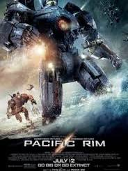
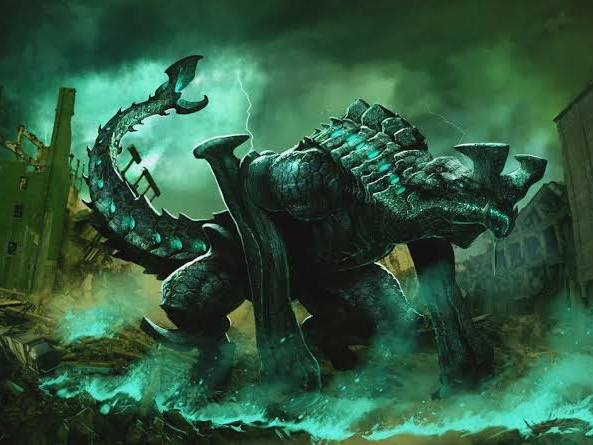
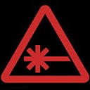

# kaiju pacific rim dual soul bound mech control

Captured: 2026-10-08T05:03:40.714Z

Source: https://www.google.com/search?q=kaiju+pacific+rim+dual+soul+bound+mech+control&sca_esv=936417aed4b7c340&sxsrf=APpeQnuSvNkC51DbBz9wVztNSVRV_9djKQ%3A1791089377877&udm=50&source=chrome.ob&fbs=ABfTbFVyMZGZf1hfvX9uKjN_-G8c4u0nXx4bEIpwm1lnNH832cY0rzciwbWdjW1sV3VNzLzR4RIindJxFrmQWQ1WCYgKdh4SxzhRaOVvt3n87StoAMoDgDvBnjZ4Njf4yAaLs3QhOmFAyDpw9_i3qcRrE3hq_HfYRuhUIW2IGakVmpMJ6tRNQeh__uTkxGdva2OaNUe00HhT&vsint=&aep=1&ntc=1&cs=0&sa=X&ved=2ahUKEwjthYTxx5-XAxVUhf0HHbaKKuYQ2J8OegQIFxAD&biw=1707&bih=898&dpr=1.5&mstk=AUtExfBhXgLFqa7Hsz6If-pvMeil9hUcLI47XVDoOiNEXyVm8QS_3E74CfGkJFY4c14RfxOIWJ3FkdwcU62qb0HkiOeTDjerzia4REe2WIulBujSAfqVeWhDdyTVt4oGGFwiyxKW8a0-CdnW0sFmc60Jey9mzLi2tn0RQBTI-hW17xTv0sYD4FauscpflVjwPiJsXHcE4aCvcBWnYwap_fgI-AjZC0pUNxJ3Z7MY000fTl7ModMryjGGUbuVUg5LMef7N0I4dhYO-IBQZuvkZTXUKCm9dbx3XqG-qC1b-MJH0rD8oppN7sa_cvV9ZB4E5ZSkDZpJIbVZuAxJSA&csuir=1&mtid=5drBapiFIcGL9u8P9IPE8AQ

## Prompt 1 — You

kaiju pacific rim dual soul bound mech control

## Response 1 — Google AI Mode

In the ***Pacific Rim* franchise**, the concepts of dual-piloting, Kaiju anatomy, and soul-bounding/neural mechanics revolve around **The Drift** and **secondary biological brains**. 

Reddit·r/AskScienceFiction +2

### 1. Dual Mech Control (The Drift)

Because of the immense neural load and mental stress required to move a massive titan, **Jaegers require two human pilots**. A single human brain cannot handle the psychological and physical feedback of piloting a mech alone without suffering severe trauma or death. 

Wikipedia +1

* **The Neural Bridge:** Through a technology called the Drift, two pilots merge their minds, memories, and consciousness, essentially acting as **two halves of a single brain**.
* **The Bound:** They share "procedural automaticity"—acting perfectly in sync with expert muscle memory without having to speak. 

  Nerdist +2

### 2. The Kaiju Dual Brains

Fascinatingly, the alien **Kaiju are biological mirrors to the Jaegers**. Due to their massive physical proportions, colossal Kaiju are genetically engineered with **two brains**—a primary central brain and secondary hind brains. This biological layout allows their nervous system to bypass processing delays and split the immense biological load of controlling their massive bodies. 

Pacific Rim Wiki | Fandom +2

### 3. The Kaiju-Mech Fusion (The Hybrid Uprising)

The ultimate crossover of these two dual-control mechanics occurs in *Pacific Rim: Uprising*, where the franchise introduces **Kaiju-Jaeger Hybrids**. 

Pacific Rim Wiki | Fandom

* **The Bio-Mechanical Control:** Instead of human pilots in a Drift, unmanned Drone Jaegers are secretly grown with **cloned Kaiju tissue and secondary Kaiju brains** hidden inside the mechanical chassis. 

  Pacific Rim Wiki | Fandom +1
* **Hive Mind Control:** These mechs are then controlled via a localized **hive-mind linkage** directed by the Precursors (the alien creators), completely subverting the traditional two-human pilot system with a bio-alien network. 

  Pacific Rim Wiki | Fandom +1

Are you exploring this for a **fan fiction project**, a **tabletop RPG mechanic**, or just looking to dive deeper into the **lore** of a specific mech like *Obsidian Fury* or *Apex*? Let me know so I can give you exactly what you need!

### Source links

- [Reddit · r/AskScienceFiction](https://www.reddit.com/r/AskScienceFiction/comments/9ttq6k/pacific_rim_why_do_they_need_two_pilots_when_they/)
- [Wikipedia](https://en.wikipedia.org/wiki/Pacific_Rim_(film))
- [Nerdist](https://archive.nerdist.com/pacific-rim-jaeger-2-brains-because-science/)
- [Pacific Rim Wiki | Fandom](https://pacificrim.fandom.com/wiki/Kaiju)
- [Pacific Rim Wiki | Fandom](https://pacificrim.fandom.com/wiki/Kaiju-Jaeger_Hybrid)
- [Pacific Rim Wiki | Fandom](https://pacificrim.fandom.com/wiki/Drone_Jaeger)
