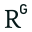

# Poker Tells High Stakes

Captured: 2026-10-17T04:47:41.987Z

Source: https://www.google.com/search?q=poker+high+stakes+TELLS+physiological+and+face+expressions+and+manureisms+and+schisms+and+personality+traits&sca_esv=c3317ccdb9da3ca9&sxsrf=APpeQnuu1zL2gBmGsEG3e9qSIgDdiaZx7A%3A1792211981920&source=chrome.ob&fbs=ABfTbFVyMZGZf1hfvX9uKjN_-G8cxpBkeIeqYwoCbfNVc4vKE7plZzta63Pe5DpJ3XFR9XzxI1gxDxLun-GtPKavu3kE6dTvtimD_9oi6BCfI-FjR-rw06fcxybvUkzqLTFjSuewStPl7szXa9TwDoW1yJuhw9NArqerVonRndf0c2SnTHfxwIXDcyqObE2ciSHvgjfwe4DZ&vsint=&aep=1&ntc=1&cs=1&sa=X&ved=2ahUKEwi-l630ncCXAxV4gv0HHamnHdgQ2J8OegQIFBAD&biw=1707&bih=898&dpr=1.5&mstk=AUtExfDBLNRvzDqjIAZ36NZz76biOueUooDCaZAZGbVNJLqNRfj7M0HAFRVvWfam6RWmTZ5o9FESLwU7ke1IHSQX1kDOwYjaf37DOzF6tX_clDN4WloZ9TZskKYGkvTDlwquqKknLzPSyuyVpAen4Ha_JlvUPpERIXR_MhSFnl6j6cQUReoqI8f6cxRY_EEIEFN6K5x__GlGX2wnlH47go8aaXdkLG3vkjcrdhhHKGN9dA3WtRKxgiKN6emxMhKg-RaQTuVZgB5rZBZf9iNK07-PrLOiZ7WonIUhbG3y_T_hWvv73kMpmEKOExiknaKggNkhB-1InD7x2_LT5w&csuir=1&mtid=E_zSarf4IIqP9u8PyKz68A0&udm=50

## Prompt 1 — You

poker high stakes TELLS physiological and face expressions and manureisms and schisms and personality traits

## Response 1 — Google AI Mode

In live high-stakes poker, uncovering behavioral signals—collectively called **poker tells**—requires a deep understanding of human biology, psychology, and behavioral patterns. Because high-stakes players are experts at masking their emotions, the most reliable tells are involuntary physiological spikes or subtle deviations from a player's established baseline. 

Glide Magazine +3

The structural breakdown of high-stakes poker tells covers physiology, microexpressions, physical mannerisms, behavioral "schisms," and personality traits.

---

### 1. Physiological Tells (Involuntary Autonomic Responses)

High stakes trigger the sympathetic nervous system, releasing neurotransmitters like **adrenaline and cortisol**. Because these are involuntary, they are the hardest for professional players to fake. 

YouTube·Best Documentary

* **Carotid Artery Pulsing:** Visible pulsing in the neck vein or the side of the throat is a clear sign of a skyrocketing heart rate. It usually indicates a massive bluff or an incredibly strong hand (intense excitement vs. intense fear). 

  Poker Power +1
* **Heavy Breathing / Shallow Respiration:** When players are involved in a massive pot, their breathing patterns often shift. Shallow or holding breath often points to a bluff (trying to minimize physical presence), while heavy chest-heaving can point to adrenaline from a monster hand. 

  Poker Power +1
* **The Sternal Notch Flush:** Visible redness spreading up the neck or chest due to capillary dilation. This indicates acute stress or an adrenaline surge.
* **Dry Mouth / Hard Swallowing:** Excess adrenaline suppresses saliva production. Sudden throat clearing, reaching for water only when a big bet is placed, or a heavy, visible gulp are major stress indicators. 

  Great.com

### 2. Facial Expressions & Microexpressions

High-stakes pros train to maintain a rigid **poker face**, but emotional leakage frequently slips through via microexpressions lasting only a fraction of a second. 

MentalHealth.com +2

* **Lip Compression & Pursed Lips:** Tucking the lips tightly inward until they form a thin line is a universal sign of discomfort or annoyance. It usually leaks out when a player doesn't like a newly dealt community card or feels vulnerable.
* **Eye Contact Deviation:** The adage that "staring down means strength" is inverted at high levels. Pros often use intense, forced eye contact to overcompensate for a weak bluff. Conversely, looking away or glancing down at their own chips immediately after a card drops usually indicates they hit a strong hand and are planning a bet.
* **Pupil Dilation:** While light levels dictate pupil size, a sudden dilation when looking down at hole cards can be a subconscious reaction to seeing premium cards.
* **Asymmetric Smirks:** A slight, one-sided pull of the mouth often represents contempt or overconfidence. If done subtly while betting, it may signal they believe they have successfully trapped you. 

  888Poker +3

### 3. Mannerisms & Motor Controls

While pros can control their faces, stress often leaks down into the fine motor skills of their hands and limbs. 

YouTube·UT Liberal Arts +1

* **Fluidity vs. Jerkiness:** Neurological research shows that players with a genuine, strong hand push chips forward in a **smooth, fluid motion**. Conversely, players who are bluffing or feeling internal conflict display more **hesitant, jagged, or shaky movements**.
* **The "Shaky Hand" Illusion:** A slight tremor when placing a bet can mean two things. If it is genuine adrenaline, it ironically indicates a *monster hand* (the player's body is bursting with excitement). If the shake looks theatrical or overly deliberate, it is likely a fake tell meant to project weakness.
* **Soothing / Pacifying Gestures:** When under pressure, humans instinctively engage in self-soothing behaviors to lower their heart rate. This includes rubbing the neck, touching the suprasternal notch (base of the throat), massaging the earlobes, or rubbing the thighs under the table.
* **Card-Protecting Mannerisms:** The way a player guards their cards reveals a lot. Cupping hands over cards tightly like a shield indicates a desire to protect something valuable (a strong hand). Placing a chip carelessly on top of cards often signals indifference or weakness. 

  Blue Lake Casino Hotel +3

### 4. Behavioral "Schisms" (Contradictions & Timing)

A "schism" in poker refers to a cognitive disconnect—where a player's physical actions do not align with their betting behavior, or where they deviate aggressively from their baseline. 

Poker Power +1

* **"Weak is Strong / Strong is Weak":** The golden rule of poker psychology. Players who act overly confident, sigh heavily, stare you down, or aggressively throw chips forward are usually overcompensating for weakness. Players who genuinely have an unbeatable hand will try to look small, passive, hesitant, or quiet to avoid scaring you away. 

  Poker Power +2
* **Timing Asymmetry:** Quick, instantaneous bets or raises usually indicate a **polarized hand**. A sudden, lightning-fast call on the flop often means a "drawing hand" (they already know they want to see the next card and don't need to think). A calculated, prolonged "tank" (thinking for a long time) followed by a massive raise is designed to feign weakness and simulate a tough decision. 

  Poker Power +2

### 5. High-Stakes Personality Traits

Psychological mapping of successful high-stakes players reveals unique, highly calibrated personality profiles that set them apart from amateurs. 

ResearchGate +2

| Personality Dimension | High-Stakes Pro Trait | Psychological Mechanism |
| --- | --- | --- |
| **Emotional Stability (Neuroticism)** | **Exceptionally Low** | High tolerance for financial risk and extreme pressure. Their reward circuits are less reactive to wins or losses, enabling pure logical execution. |
| **Social Information Processing** | **Exceptionally High** | Mastery in reading macro/micro-behavioral changes in others while filtering out irrelevant background distractions. |
| **Openness to Experience** | **Low (Aesthetics) / High (Live Play)** | Low openness to fantasy/aesthetics correlates with ruthless, data-driven rationality. However, pros who prefer *live* play score higher on social extroversion to leverage psychological warfare. |
| **Cognitive Flexibility** | **Optimized for Uncertainty** | High-stakes minds do not try to "predict the future." Instead, they process decision-making via **expected value maximization**, decoupling the quality of a choice from its immediate financial outcome. |

Would you like to focus on **how to orchestrate fake tells (reverse tells)** to trick opponents, or would you prefer a deeper dive into **how to systematically establish a baseline** on a specific player at the table?

### Source links

- [Glide Magazine](https://glidemagazine.com/294616/the-biomechanics-of-poker-tells/)
- [YouTube · Best Documentary](https://www.youtube.com/watch?v=AoFqocOa4po&t=33)
- [Poker Power](https://www.pokerpower.com/blog/7-poker-tells-and-how-to-use-everyday-life)
- [Great.com](https://great.com/gambling/20-poker-tells-and-what-they-tell-you-about-your-opponents/)
- [MentalHealth.com](https://www.mentalhealth.com/library/the-anatomy-of-a-poker-face)
- [888Poker](https://www.888poker.com/magazine/strategy/body-language-in-poker)
- [YouTube · UT Liberal Arts](https://www.youtube.com/watch?v=LVR7-G8to08&t=81)
- [Blue Lake Casino Hotel](https://www.bluelakecasino.com/common-poker-tells/)
- [Poker Power](https://www.pokerpower.com/blog/the-psychology-of-poker-how-to-read-people-and-improve-your-social-skills)
- [ResearchGate](https://www.researchgate.net/publication/40870502_Social_and_Psychological_Challenges_of_Poker)

## Prompt 2 — You

the biomechanics and biochemical

## Response 2 — Google AI Mode

To understand why these tells happen at the highest stakes, we have to look beneath the skin. In a high-stakes arena, a single decision can involve hundreds of thousands of dollars. This environment shifts the human body into a state of acute survival, triggering specific **biochemical cascades** and **biomechanical micro-movements** that are nearly impossible to consciously suppress.

---

### I. The Biochemical Cascade (The Brain and Bloodstream)

When a player enters a massive pot, particularly when bluffing or holding an absolute monster hand, the brain processes this as a high-survival situation.

#### 1. The HPA Axis and the Adrenaline Spike

The **Hypothalamus-Pituitary-Adrenal (HPA) axis** is instantly activated. The amygdala registers risk, signaling the hypothalamus to release Corticotropin-Releasing Hormone (CRH), which ultimately triggers the adrenal glands to flood the bloodstream with **epinephrine (adrenaline), norepinephrine, and cortisol**.

* **The Resulting Tell:** This sudden rush binds to beta-adrenergic receptors, instantly increasing cardiac output. This causes the **carotid artery pulse** in the neck to throb violently. Because the skin on the neck is thin, the mechanical force of the blood rushing through the carotid artery becomes visible to an observant opponent.

#### 2. Vasoconstriction vs. Vasodilation (Skin Flushing and Temperature)

The sympathetic nervous system dynamically shifts blood flow based on the exact nature of the stress.

* **The "Bluff" Vasoconstriction:** When a player is pulling a massive bluff, fear of detection dominates. Norepinephrine binds to alpha-receptors, causing **peripheral vasoconstriction**—blood is shunted *away* from the skin and extremities toward the major muscle groups (preparing to fight or flee). The player's face may turn slightly pale, and their fingers become physically colder. If they touch their chips with cold, clammy hands, it is a biochemical marker of fear.
* **The "Value Bet" Vasodilation:** Conversely, when a player holds the winning hand, intense excitement and anticipation dominate. This can cause **localized vasodilation** in the face and neck (the sternal notch flush). Histamines and nitric oxide relax the blood vessels, causing a visible red or pink flush to crawl up the chest and throat.

#### 3. Autonomic Salivary Suppression (The "Gulp")

The flood of adrenaline instantly shifts the body out of "rest and digest" mode.

* **The Biochemical Mechanism:** Sympathetic stimulation constricts the blood vessels supplying the salivary glands (specifically the submandibular and parotid glands). Saliva production instantly dries up, becoming thick and scarce.
* **The Resulting Tell:** The player experiences acute dry mouth. Biomechanically, this forces a **hard swallow (the visible gulp)** or a sudden need to clear the throat or take a sip of water before they can physically speak to announce a bet.

---

### II. The Biomechanics of Tells (Muscle Control and Motor Circuits)

While a high-stakes player can easily control their macro-movements (like sitting still), they cannot easily control the micro-movements dictated by deep brain structures like the **basal ganglia** and the **limbic system**.

```
[Limbic System (Raw Emotion)]  ──> Fast, Involuntary Pathway  ──> Micro-tremors / Jagged Bets
                                                                      │ (Conflict)
[Motor Cortex (Conscious Will)] ──> Slow, Voluntary Pathway  ──> Rigid, Forced Poker Face
```

#### 1. Fine Motor Tremors (The Shaky Hand)

When a player's hands shake while putting chips into the pot, it is a battle between two neurological pathways: the **corticospinal tract** (conscious control) and the **extrapyramidal system** (involuntary emotional motor control).

* **The Biomechanical Reality:** High levels of circulating adrenaline attach to beta-2 receptors in skeletal muscle tissue. This increases the firing rate of muscle spindles, causing a microscopic muscle twitching known as an **enhanced physiological tremor**.
* **How to Decode It:** If a player has a monster hand, the tremor is pure, unadulterated excitement, and their hand will shake slightly as they effortlessly drop the chips. If they are bluffing, they will consciously try to *fight* the tremor, resulting in an unnaturally stiff, locked wrist and a rigid, robotic chip placement.

#### 2. Oculomotor Biomechanics (The Eyes)

The eyes are a direct extension of the central nervous system, controlled by cranial nerves (III, IV, and VI) and the autonomic nervous system.

* **Pupillary Mydriasis (Dilation):** The pupillary dilator muscle is controlled strictly by sympathetic pathways. When a player looks at their cards and sees an absolute powerhouse (like pocket Aces), the sudden spike in neurological arousal and dopamine causes the pupils to involuntarily dilate (**mydriasis**), even in a brightly lit casino.
* **Blink Rate Acceleration:** Under normal circumstances, a human blinks 15–20 times per minute. When cognitive load and stress skyrocket (such as calculating a massive bluff and worrying about getting called), dopamine spikes in the basal ganglia, biomechanically accelerating the blink rate to double or triple its normal baseline. Alternatively, a player may rigidly stare at the board without blinking at all, forcing a conscious override that results in a glassy-eyed look.

#### 3. Microexpressions and Facial Asymmetry

Conscious facial expressions are driven by the brain's **motor cortex**, while spontaneous, emotional expressions are driven by subcortical **limbic structures**.

* **The Biomechanical Split:** When a high-stakes player tries to fake a facial expression (e.g., trying to look disappointed when they actually flopped a full house), the conscious signal travels down the facial nerve (Cranial Nerve VII). However, because the limbic system is simultaneously firing the *true* emotion, a "schism" occurs.
* **The Resulting Tell:** This creates **facial asymmetry**. Genuine emotions are almost perfectly symmetrical across both sides of the face. A forced, fake smile or a manufactured look of worry will often lag on one side of the face or appear slightly twisted, revealing that the expression is entirely manufactured.

#### 4. Respiratory Biomechanics (The Freeze Response)

When a player is executing a massive bluff, their body instinctively triggers an evolutionary **freeze response** to avoid detection by predators (their opponents).

* **The Biomechanical Mechanism:** The intercostal muscles of the ribs and the diaphragm lock into place. The player's breathing becomes incredibly shallow, or they may hold their breath entirely. They are trying to minimize their physical footprint.
* **How to Decode It:** An opponent holding a strong hand will have deep, diaphragmatic breathing because they are comfortable. A bluffing player will keep their chest perfectly still, resulting in a sudden, deep exhale only *after* their opponent folds and the threat passes.
