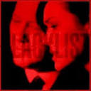

# Scikkikorschki Files Context

Captured: 2026-10-18T11:36:03.455Z

Source: https://www.google.com/search?client=ms-android-xiaomi-terr2-rso2&hs=3spq&sca_esv=c5052353f6356764&sxsrf=APpeQnteAbzGWTRL3FuwK7dUHORT4RJcJg%3A1792315971600&vsint=&ntc=1&cs=1&sa=X&ved=0CB8Q2_wOahgKEwjAt_n6u8OXAxUAAAAAHQAAAAAQ1AI&biw=375&bih=691&dpr=3.25&udm=50&atvm=2&mstk=AUtExfDPoOlJ9E3obL7U805QuvgqO0OBdvkAi3-MRjW9K03n6Z82BWQ8SiAtJkIV0NKedRYC8F0jEq-fgiXv2XyoHEqmFv5ZWpijz0LFaBKGmYJec-hJ7V5gJw6vZIMKN1x_WLvBzs7ziWSYK6_S-gm9tPvCP-V5Lv0xVPrXBTF_L6yBJo9g--Fj0jKCvweCLcSR8mgk88H4DP1LEluoeu3Fw1nc9ap4nZh2gYESTUwGt7jKj9YzSdzz3yez4zK7vtrLRsVMgmkQWP4kuWNKBhhcgKQikbV35FTF4ByYMOt9x9pFvnzPG0LhkNo8QFg4lIHV0vAT7PBWOfcOOA&mtid=DAnUao7nGbnoi-gP17Wc4QU&csuir=1&aep=26&q=scikkikorschki+files

## Prompt 1 — You

scikkikorschki files

## Response 1 — Google AI Mode

It sounds like you might be thinking of a slightly different spelling, as **"scikkikorschki files"** is not a standard technical term or known file type. Depending on the context of what you are looking for, you are likely referring to one of the following:

### 1. Cyber Security: Malicious "SYLK" Files

If you are looking into cybersecurity, macros, or old-school document exploits, you might be thinking of **SYLK (.slk)** files. 

Outflank +1

* **What they are:** SYLK stands for **SYmbolic LinK**. It is an ancient spreadsheet data format introduced by Microsoft in the 1980s. 

  zvelo.com +1
* **Why they are in the news:** Threat actors sometimes abuse `.slk` files to bypass Microsoft Office security features. Because they are older formats, Excel sometimes bypasses "Protected View" sandboxing when opening them, allowing malicious macros to run automatically if configured by an attacker. 

  Outflank

### 2. Retro Computing: SideKick (.SK) Files

If you are trying to open an old file from a vintage operating system, you might be looking for Borland **SideKick (.sk)** files. 

YouTube

* **What they are:** SideKick was a popular personal information manager (PIM) application in the MS-DOS era used for notes and calendars. 

  YouTube
* **How to open them:** They can usually be read using a modern text editor like Notepad++, or run natively using a DOS emulator like DOSBox. 

  YouTube

### 3. Art & Animation: Kiszkiloszki

If you heard the name phonetically and it sounded like "Keesh-kee-losh-kee," you might be searching for the digital artist and animator **[Kiszkiloszki](https://kiszkiloszki.com/)**. He creates darkly humorous, net-native animations, GIFs, and digital art files distributed across various blockchains. 

Kiszkiloszki +1

---

To help point you in the exact right direction, could you share a bit more context?

* Where did you **see or hear** this term?
* Is this a **file extension** on your computer, or part of a **cybersecurity tutorial**?

### Source links

- [www.outflank.nl](https://www.outflank.nl/blog/2019/10/30/abusing-the-sylk-file-format/)
- [zvelo.com](https://zvelo.com/malicious-office-documents-going-old-school-with-symbolic-link-files/)
- [www.youtube.com](https://www.youtube.com/watch?v=4ODyoUKjJV0)
- [kiszkiloszki.com](https://kiszkiloszki.com/)

## Prompt 2 — You

blacklist

## Response 2 — Google AI Mode

It looks like you are referring to the **Sikorsky Archive** from the hit television series ***[The Blacklist](https://the-blacklist.fandom.com/wiki/The_Blacklist_Wiki)***. 

The Blacklist Declassified +2

The **Sikorsky Archive** is a massive, highly classified digital intelligence file that serves as a central plot device in the later seasons of the show (primarily Seasons 7 and 8). 

Reddit +1

### Key Facts About the Sikorsky Archive:

* **What it contains:** It is a blackmail file containing compromising intelligence stolen from the KGB after the collapse of the Soviet Union. It is the ultimate source of power and leverage for Raymond Reddington. 

  The Blacklist Declassified +1
* **The "N-13" Connection:** The archive was originally stolen by a deep-cover Soviet mole known only as **N-13**. For decades, global intelligence agencies and criminals alike hunted for the identity of N-13 to find the files. 

  The Blacklist Wiki
* **The Conflict:** A major storyline involves the criminal mastermind Neville Townsend, who believes Katarina Rostova was N-13 and holds her responsible for the murder of his family. It is later revealed that the archive was used as a "seed" to build the sprawling criminal intelligence network that Reddington uses to construct his "Blacklist". 

  The Blacklist Declassified +2

### Source links

- [The Blacklist](https://the-blacklist.fandom.com/wiki/The_Blacklist_Wiki)
- [blacklistdcd.com](https://blacklistdcd.com/tag/archive-sikorsky/)
- [www.reddit.com](https://www.reddit.com/r/TheBlackList/comments/ntpmtq/the_sikorsky_archive/)
- [the-blacklist.fandom.com](https://the-blacklist.fandom.com/f/p/4400000000000017643)
