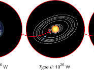
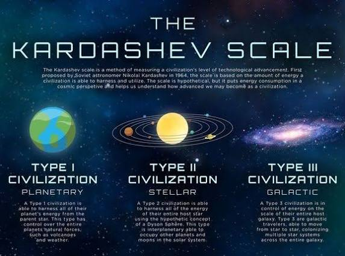

# Current Civilization Type

Captured: 2026-10-18T11:46:50.463Z

Source: https://www.google.com/search?client=ms-android-xiaomi-terr2-rso2&hs=3spq&sca_esv=c5052353f6356764&sxsrf=APpeQnteAbzGWTRL3FuwK7dUHORT4RJcJg%3A1792315971600&vsint=&ntc=1&cs=1&sa=X&ved=0CA0Q2_wOahcKEwjA7ancvsOXAxUAAAAAHQAAAAAQHg&biw=375&bih=691&dpr=3.25&udm=50&atvm=2&mstk=AUtExfAxTkTZFyBsPa3BjGPzyQmWPCyX3D324F7P5WXseXpryWw7GJ0D5tL0r3L2ui0QG26agBOa7Vr15WchZPj3RDBp5S55AOxNEfscCH_VQhFeN1lHO-XFj2phIotEjS4-p-xvPWsHrK0CFYlTI6V3PM58zUzf01bRxye2vZdM94iV2EVYti4o4lk3O8bbq34X4uNgdKE9c63NAlgRrBhqODcCVli1un0I_vvmsmqm-vq_M5dK3U5IQ9LNZv7YXzvv5mvWPRkmReWZfYPs9g_mPk-axjTkEANbDa9ZMkw2fZ5pgXY6ps2-YHD7ES39O74RD8GO4asTzkb4iA&mtid=KqLUarbhEJeli-gPkNi7iQk&csuir=1&aep=26&q=current+civilization+type

## Prompt 1 — You

current civilization type

## Response 1 — Google AI Mode

According to the [Kardashev scale](https://en.wikipedia.org/wiki/Kardashev_scale), human civilization is currently classified as a **Type 0 civilization**, specifically sitting at roughly **Type 0.73**. 

Wikipedia +1

The scale, proposed by astrophysicist Nikolai Kardashev in 1964, ranks technological civilizations based entirely on the total amount of energy they can harness and control. Because we still rely primarily on crude, finite energy sources like fossil fuels and cannot fully capture or control our planet's total energy budget, we haven't yet achieved Type I status. 

Wikipedia +3






The three core tiers of the Kardashev scale, alongside humanity's current standing, include:

### Type 0: Sub-Planetary (Humanity ~0.73)

A Type 0 civilization extracts energy, information, and materials from unrefined organic or finite chemical sources (like oil, coal, and early renewables). We are aware of the cosmos but remain highly vulnerable to planetary-scale disasters and resource depletion. 

YouTube·Aperture +2

### Type I: Planetary Civilization

A Type I civilization achieves full mastery over all available energy on its home planet. This includes harnessing the entirety of its parent star's incoming sunlight, along with total control over wind, oceanic, geothermal, and atmospheric forces (roughly 10¹⁶ to 10¹⁷ watts). Scientists estimate humanity could reach Type I in a couple of centuries. 

YouTube·Future Business Tech +3

### Type II: Stellar Civilization

A Type II civilization controls the total energy output of its host star. This would likely require constructing astronomical megastructures, such as a Dyson Sphere, to trap and distribute the star's entire radiation output (roughly 10²⁶ watts). 

Wikipedia +3

### Type III: Galactic Civilization

A Type III civilization commands the energy of an entire galaxy. It would possess the capacity to manipulate billions of star systems, navigate via wormholes or near-light-speed travel, and utilize the power of supermassive black holes (roughly 10³⁶ watts). 

Medium +3

If you're interested, I can provide more details on:

* **How Carl Sagan calculated** our specific 0.73 score
* What technologies humanity needs to **transition to a Type I civilization**
* Alternative frameworks like the **Barrow scale**, which measures advancement by microscopic control rather than energy consumption

Which of these would you like to explore next?

### Source links

- [en.wikipedia.org](https://en.wikipedia.org/wiki/Kardashev_scale)
- [www.youtube.com](https://www.youtube.com/watch?v=LJVY7_v_c08&vl=en&t=72)
- [www.youtube.com](https://www.youtube.com/watch?v=OB6Vzgwt7ac)
- [medium.com](https://medium.com/predict/kardashev-scale-our-guide-for-the-future-and-how-close-are-we-to-type-1-civilization-9c9620a317a6)

## Prompt 2 — You

so it's less than 1 what ratio is that scaling wise

## Response 2 — Google AI Mode

The Kardashev scale uses a **logarithmic scale**, not a linear one, meaning that a score of 0.73 does *not* mean we are 73% of the way to Type I. Energy-wise, we are actually at about **0.2% (1/500th) of the way** to becoming a Type I civilization.

Carl Sagan created the continuous formula to calculate these fractional values:

$K=\frac{\log \_{10}(P)-6}{10}$

*(Where  $P$  is the total power a civilization controls in Watts.)*

### How the Scaling Works

Because it is logarithmic, the scale advances by factors of 10:

* **Every 0.1 increase** represents a **10-times (tenfold) increase** in energy consumption.
* **Every 1.0 full step** represents a **10-billion-times ( $10^{10}$ )** increase in energy consumption.

### The Direct Comparison

To see exactly how far we have to go, we can look at the raw wattage difference:

| Civilization Status | Kardashev Score | Power Consumption (Watts) | Real-World Scale |
| --- | --- | --- | --- |
| **Humanity Today** | **0.73** | **~20 Terawatts** ( $2 \times 10^{13}$  W) | Total global energy used by all humans combined. |
| **Type I (Planetary)** | **1.00** | **10,000 Terawatts** ( $10^{16}$  W) | Harnessing all solar, wind, and geothermal energy hitting Earth. |

To bridge the gap between 0.73 and 1.0, humanity doesn't just need to increase its energy output by 27%—we need to scale up our total energy production **500 times over**.

Would you like to see **which energy sources** (like nuclear fusion or space-based solar power) scientists think could realistically scale us up by that factor of 500?

python

```
import math

# Carl Sagan's formula: K = (log10(P) - 6) / 10
# For a Type 1 civilization, P = 10^16 watts.
# Let's see what P gives K = 0.73
P_073 = 10**(0.73 * 10 + 6)
print(f"Power for 0.73: {P_073:.2e} Watts")

# Type 1 = 10^16 W
# Let's find the ratio of P_073 to Type 1
ratio = P_073 / 10**16
print(f"Ratio of power: {ratio:.5f}")
```

Use code with caution.
