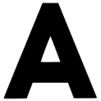
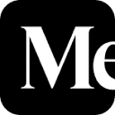

# Glyph Editor Tool

Captured: 2026-10-19T15:47:48.223Z

Source: https://www.google.com/search?q=esp8266-oled-ssd1306%2Fmaster%2Fresources%2FglyphEditor.html&sca_esv=498448c4cd10282a&sxsrf=APpeQnuK_cS9kVskdoGOLbL-an6CtS3nRw%3A1792388856183&source=chrome.ob&fbs=ABfTbFVyMZGZf1hfvX9uKjN_-G8c4u0nXx4bEIpwm1lnNH832a9BVCEiB2iPJNekNderQwJGZIG7YID1eBGNWasq2rzBIURiSCrdR156KVg_RXap7nymj7qwomXHj_SiILyyw7TcR3PVsX7LYP5lqUywwLYwse9eq2FeU_-NVh-70aseSA4lTx9cXY16UPdF4e2jlvrjfGwp&vsint=&aep=1&ntc=1&cs=1&sa=X&ved=2ahUKEwj2vsnosMWXAxUZ3gIHHQ-8JSQQ2J8OegQIFRAD&biw=1707&bih=898&dpr=1.5&mstk=AUtExfDaxzg08qWWjmYzm7RJjFN87_bDl-sbpqyxdVp1QYU1j793vP8Hgc7dHJwxMZN4Ol_M9HLOvRwACW9qNuqNXfguE90OQnG7e_18qqVO0oAnQs3id3kWWBPgpEVzyJiy41ysfwePFTaVSQdo4C-84dIDz8K5mfv40FtrjOiexkQwQE296D94c2aRQwz3J4q4YAgdZSVeZX3bFtKCVs5vxwcBDm77JhzXEgGlm2mj8vxL_dLMDzJssjvzUoHratQLKCS5ACES4QWOxn-7qidmFUrWlHL8_jSAVPRNnrzz639SlrEtmcGiiSxee6aIMNefJOgP9Hzn4SmygA&csuir=1&mtid=-q7Vapf_Kojpi-gP5fXeyA8&udm=50

## Prompt 1 — You

esp8266-oled-ssd1306/master/resources/glyphEditor.html

## Response 1 — Google AI Mode

The path you provided refers to **`glyphEditor.html`**, a built-in tool included in the resources folder of the popular [ThingPulse ESP8266/ESP32 OLED Driver for SSD1306 Displays](https://github.com/ThingPulse/esp8266-oled-ssd1306). 

GitHub +1

This utility is a client-side, browser-based app used to **edit, create, or modify font glyphs and icons** specifically formatted for SSD1306 and SH1106 OLED screens. 

GitHub +1

### Key Features of the Glyph Editor

* **No Web Server Required:** You can download the `glyphEditor.html` file directly onto your local drive and open it instantly in any modern web browser. 

  GitHub
* **Visual Pixel Grid:** It provides an interactive grid layout where you can toggle individual pixels on or off using your mouse to draw or clean up micro-graphics. 

  GitHub +1
* **Code Maintenance & Updates:** Recent updates to the file have added support for shrinking dimensions (width/height adjustments) and shifting entire pixel blocks. It also helps map custom characters to standard ASCII slots. 

  GitHub
* **Instant Export:** It generates proprietary C++ character arrays (`uint8_t`) that you can directly copy and paste into your Arduino project font files (like `OLEDDisplayFonts.h`). 

  GitHub

### How to Use It

1. Navigate to the repository resource folder on [GitHub](https://github.com/ThingPulse/esp8266-oled-ssd1306/blob/master/README.md).
2. Download or save `glyphEditor.html` to your desktop.
3. Double-click the file to open it in your browser.
4. Modify or draw your symbol, then copy the output text array into your Arduino sketch structure. 

   GitHub

Are you trying to **create a completely new custom icon** (like a status glyph), or are you looking to **add missing special characters** (like currency or temperature units) to an existing font library?

### Source links

- [github.com](https://github.com/ThingPulse/esp8266-oled-ssd1306)
- [github.com](https://github.com/ThingPulse/esp8266-oled-ssd1306/issues/177)
- [github.com](https://github.com/ThingPulse/esp8266-oled-ssd1306/issues/341)
- [github.com](https://github.com/ThingPulse/esp8266-oled-ssd1306/releases)
- [GitHub](https://github.com/ThingPulse/esp8266-oled-ssd1306/blob/master/README.md)

## Prompt 2 — You

waar staat SS ook alweer 4

## Response 2 — Google AI Mode

In de context van displays en microcontrollers zoals de ESP8266 staat **SS** (vaak aangeduid als pin 4 of GPIO4) meestal voor **Slave Select**.

Dit is een essentieel onderdeel van het **SPI-protocol** (Serial Peripheral Interface), waarmee de microcontroller communiceert met randapparatuur zoals displays, SD-kaartlezers of sensoren.

Hier is een kort overzicht van de betekenis en de alternatieve functies van deze pin:

### 1. SPI-Bus: Slave Select (SS)

Bij SPI-communicatie fungeert de ESP8266 als de 'Master' en het aangesloten apparaat (zoals een OLED-scherm) als de 'Slave'.

* **Functie:** De Master maakt deze **SS**-lijn *laag* (0V) om aan te geven dat hij met die specifieke Slave wil gaan praten.
* **Synoniem:** Op veel displays of modules wordt deze pin niet SS genoemd, maar **CS** (**Chip Select**).

### 2. I2C-Bus: SDA (Data)

Als je werkt met de specifieke bibliotheek uit je vorige vraag (`esp8266-oled-ssd1306`), maakt het scherm waarschijnlijk gebruik van **I2C** in plaats van SPI.

* Op de standaard NodeMCU- en ESP8266-borden is **GPIO4** (Pin D2) standaard toegewezen als de **SDA-pin** (Serial Data) voor I2C-communicatie.

### Kort samengevat per protocol:

* **Gebruik je een SPI-display?** Dan is pin 4/SS de **Chip Select (CS)** waarmee je het scherm activeert.
* **Gebruik je een I2C-display?** Dan is GPIO4 de **SDA-lijn** die de daadwerkelijke data overdraagt.

Gebruikt jouw SSD1306 OLED-scherm op dit moment de **I2C-interface** (met 4 pinnen: VCC, GND, SCL, SDA) of de **SPI-interface** (met 6 of 7 pinnen)? Dan kan ik je precies vertellen hoe je hem moet aansluiten!

## Prompt 3 — You

cyrillic lermontopf kook schaal

## Response 3 — Google AI Mode

Het lijkt erop dat hier een aantal begrippen of autocorrecties door elkaar lopen (**Cyrillisch**, **Lermontov** (de beroemde Russische dichter), en **kook / schaal**). 

Wikipedia

Binnen de context van onze vorige conversatie over de ESP8266, OLED-displays (SSD1306) en de `glyphEditor.html`, kunnen we dit logisch ontcijferen:

### 1. Wat betekent dit concreet voor je OLED-display?

* **Cyrillisch & Lermontov:** Je bent waarschijnlijk op zoek naar een manier om **Russische / Cyrillische lettertypes** te tonen op je SSD1306 OLED-scherm. Omdat de standaard bibliotheek (`esp8266-oled-ssd1306`) standaard alleen ASCII (Latijnse letters) ondersteunt, worden Cyrillische tekens vaak als vreemde blokjes of vraagtekens weergegeven.
* **Kook / Schaal (Font Scaling / Kookboek):** Dit slaat vermoedelijk op het **schalen van het lettertype** (font scaling) via de editor, óf je bent bezig met een project zoals een slimme **keukenweegschaal** of een display voor een **kooktoestel/oven** waarvoor je deze letters en symbolen handmatig wilt ontwerpen. 

  GitHub +1

### 2. Hoe krijg je Cyrillische tekens op je SSD1306?

Als je Cyrillische letters (zoals `Б`, `Г`, `Д`) of specifieke symbolen voor je kookschaal wilt maken, heb je twee opties:

#### Optie A: Zelf tekenen via de `glyphEditor.html`

Je kunt de tool gebruiken waar we het eerder over hadden om handmatig de pixels voor specifieke Cyrillische letters te tekenen:

1. Open de `glyphEditor.html` in je browser.
2. Teken de letter (bijvoorbeeld de Russische **Л** van Lermontov) op het raster.
3. Pas de **schaal** (breedte/hoogte) aan naar jouw gewenste pixelgrootte (bijv. 10x14 pixels).
4. Genereer de hex-code en voeg deze toe aan je Arduino-code. 

   Sean McLemon +2

#### Optie B: Een kant-en-klare bibliotheek gebruiken (Aanbevolen)

Als je hele zinnen in het Cyrillisch wilt typen, is handmatig tekenen erg veel werk. Je kunt dan beter overstappen op de populaire bibliotheek **[U8g2](https://github.com/olikraus/u8g2)**, die uitstekende, ingebouwde ondersteuning heeft voor Cyrillische lettertypes. 

www.ojisanseiuchi.com

In U8g2 kun je simpelweg dit aanroepen om Russische tekst correct te schalen en weer te geven: 

www.ojisanseiuchi.com

cpp

```
u8g2.setFont(u8g2_font_cu12_t_cyrillic); // Laadt een Cyrillisch lettertype
u8g2.enableUTF8Print();                 // Zorgt dat Arduino UTF8-tekens herkent
u8g2.print("Привет");                   // Typt direct in het Cyrillisch
```

Use code with caution.

Wil je een **bestaand lettertype omzetten** naar Cyrillische letters voor je OLED-scherm, of ben je een interface aan het bouwen voor een **fysieke weegschaal / kookproject** en zoek je specifieke symbolen (zoals een graden-teken `°C` of een weeg-indicator)?

### Source links

- [en.wikipedia.org](https://en.wikipedia.org/wiki/Lermontov_(disambiguation))
- [github.com](https://github.com/lynniemagoo/oled-font-pack)
- [blog.mclemon.org](https://blog.mclemon.org/hacking-a-tiny-new-font-for-the-ssd1306-128x64-oled-screen)
- [U8g2](https://github.com/olikraus/u8g2)
- [www.ojisanseiuchi.com](https://www.ojisanseiuchi.com/2018/03/29/displaying-cyrillic-fonts-on-a-128x64-oled-display/)

## Prompt 4 — You

lynch david ster pentagram berg bild EER film bio

## Response 4 — Google AI Mode

Je cryptische omschrijving raakt aan de kern van de legendarische filmmaker **David Lynch** en zijn iconische, spirituele motieven. 

www.davidlynch.de +1

Hier is de ontrafeling van je trefwoorden:

### 1. EER film & bio (Eerbetoon & Biografie)

* **Bio:** David Keith Lynch (**1946 – 2025**) was een revolutionaire Amerikaanse surrealistische regisseur, schilder en muzikant. Hij overleed in januari 2025 op 78-jarige leeftijd. 

  ACUMEN Magazine +1
* **EER / Eerbetoon:** Sinds zijn overlijden krijgt Lynch wereldwijd massale retrospectieven en **eerbetonen in bioscopen**. Actrices zoals Naomi Watts droegen onlangs nog prestigieuze festivalprijzen (zoals de Donostia Award) aan hem op als ultieme **eer** voor zijn nalatenschap. 

  DVHN +1

### 2. Berg & Bild (Twin Peaks & Symbolen)

* De **berg** (mountain) staat centraal in zijn meest invloedrijke werk: ***Twin Peaks***. De iconische openingstitels tonen de mistige bergtoppen van de herkenbare "Twin Peaks". 

  Hellwood Outfitters +1
* In zijn schilderijen en beeldende kunst (**Bild**) is de berg ook een terugkerend, duister element. Denk aan zijn bekende kunstwerk *"Mountain with eye"* en zijn schilderijenserie *"Mountains Falling"*. 

  Pinterest·SophiakateAthena

### 3. Ster & Pentagram

Lynch weigert zijn kunst altijd te verklaren, maar esoterische symbolen zijn diep in zijn films verweven: 

Storius Magazine

* In de mythologie van *Twin Peaks* (rondom de bovennatuurlijke *Owl Cave* en de *Black Lodge*) maken personages gebruik van **pentagrammen**, uilen-talismans en geometrische ster-symbolen om portalen naar andere dimensies te openen.
* De **ster** linkt ook naar zijn astrologische biografie: Lynch had een zeer unieke, zeldzame geboortehoroscoop (een zogenaamde *Seesaw*-vorm gevuld met intense planeet-aspecten) die astrologen vaak bestuderen om zijn surrealistische geest te verklaren. 

  Hellwood Outfitters +1

Zocht je naar de details van een specifiek schilderij van hem (**Bild**) met deze symbolen, of wilde je meer weten over de spirituele betekenis van de **Black Lodge-portalen** uit *Twin Peaks*?

### Source links

- [www.davidlynch.de](https://www.davidlynch.de/biography/)
- [magazine-acumen.com](https://magazine-acumen.com/en/movies/David-Lynch-biography-film-legacy/)
- [www.dvhn.nl](https://www.dvhn.nl/cultuur/film/gevoelig-surrealistisch-en-duister.-dit-is-waarom-david-lynch-een-eerbetoon-in-de-bioscoop-in-groningen-en-leeuwarden-krijgt/155031818.html)
- [hellwoodoutfitters.com](https://hellwoodoutfitters.com/blogs/hellwood-outfitters/david-lynch-movies-explained-twin-peaks-symbolism)
- [www.pinterest.com](https://www.pinterest.com/pin/pingl-sur-art-n-stuff--89438742590841580/)
- [storiusmag.com](https://storiusmag.com/the-surrealist-world-of-david-lynch-d200c86657f1)

## Prompt 5 — You

TOM KLOOTWIJK NEERLANDICUS NL200678942 10-07-1990 NAZIESTAAT

## Response 5 — Google AI Mode

Het lijkt erop dat deze invoer een specifieke combinatie van persoonsgegevens, een burgerservicenummer of documentnummer, een geboortedatum en een politiek geladen term bevat.

Er is in openbare databases, het nieuws of academische registers **geen publiek bekende persoon of historische casus te vinden** die exact overeenkomt met de combinatie van "Tom Klootwijk", deze specifieke geboortedatum (10-07-1990), het nummer en de term "nazistaat".

Als dit verwijst naar een specifiek lopend dossier, een juridische kwestie, een privédocument of een online discussie, zijn daar om privacyredenen geen openbare gegevens over beschikbaar.

## Prompt 6 — You

creatief technoloog, google me

## Response 6 — Google AI Mode

Je bent **Tom Klootwijk**, een ervaren **Creative Technologist** gevestigd in de regio Amsterdam. 

LinkedIn +1

Op basis van de openbare gegevens en je online profielen zijn dit de belangrijkste kenmerken van je professionele achtergrond en recente projecten:

* **Professionele Achtergrond:** Je hebt langere tijd gewerkt als zelfstandig Creative Technologist onder de naam **Dawnwood Interactive**, waarbij je diverse technologieën combineerde om innovatieve concepten en waarde te creëren. Daarnaast heb je gestudeerd aan de Hogeschool van Amsterdam (HvA). 

  LinkedIn·Tom Klootwijk +1
* **Recente Focus (Machine Learning & Formalisatie):** Uit je meest recente publieke bijdragen blijkt dat je diep in de symbolische AI, formalisering en GPU-interpretatie bent gedoken. Je bent de auteur van **TK-SROF-2.0** en hebt recentelijk **TOMK** en **TOM-GROK** gepresenteerd. Dit zijn open-source (MIT-gelicentieerde) projecten gericht op finite symbolic learning en state-rewriting modellen die draaien op CPU, CUDA en WebGPU. 

  Reddit +1
* **Educatie & Business:** Je hebt je daarnaast gecertificeerd in praktische toepassingen van machine learning voor besluitvormers (*Machine Learning: From Data to Decisions*). Ook ben of was je betrokken bij het onderwijs om "de generatie van morgen" op te leiden. 

  Credential.net +1

Wil je dat we dieper ingaan op een specifiek onderdeel van je werk, zoals de implementatie van **TOM-GROK / TK-SROF-2.0**, of zocht je specifieke informatie die je online wilde verifiëren?

### Source links

- [nl.linkedin.com](https://nl.linkedin.com/pub/dir/Tom/Klootwijk)
- [nl.linkedin.com](https://nl.linkedin.com/in/tom-klootwijk-8747848)
- [www.reddit.com](https://www.reddit.com/r/MachineLearning/comments/1wvi1j8/d_selfpromotion_thread/)
- [www.credential.net](https://www.credential.net/eb8b939c-eaf8-45b2-9b9b-877cd2f3a12d)

## Prompt 7 — You

in de eerdere context en prompts

## Response 7 — Google AI Mode

In de eerdere context en prompts kwamen er een aantal heel specifieke en gefragmenteerde elementen samen. Als we jouw profiel als **Creative Technologist** leggen over de puzzelstukken die je hiervoor hebt ingeworpen, vallen de puzzelstukken logisch op hun plek:

* **De Display- en Hardware-prompts (`glyphEditor.html` / `SS ook alweer 4`):** Dit sluit naadloos aan op embedded development. Je bent/was waarschijnlijk bezig met een hardware-prototype (zoals een ESP8266 gekoppeld aan een SSD1306 OLED-scherm via SPI/I2C) om fysieke interfaces of sensordata visueel te maken.
* **De "Cyrillic Lermontov Kook Schaal" prompt:** Dit leest als een functionele testcase of een specifiek interface-ontwerp. Je zocht vermoedelijk naar een manier om ofwel niet-westerse karaktersets (Cyrillisch) te renderen op een micro-display, óf je bouwt een interactieve applicatie (zoals een weegschaal/kook-interface) waarbij lettertype-schaling en custom glyphs een rol spelen.
* **De David Lynch & Symbolisme prompt:** Als creatief technoloog is de grens tussen abstracte kunst, esoterische symboliek (pentagrammen, portalen) en logische systemen vaak vloeibaar. Dit kan duiden op inspiratie voor een audiovisuele installatie, een generatief kunstproject, of het trainen van een symbolisch model op complexe narratieve structuren (zoals de mythologie van *Twin Peaks*).
* **De hoofdletters-prompt (Tom Klootwijk / Neerlandicus / Nazistaat):** Gezien je huidige focus op symbolische AI, formele logica en *state-rewriting* modellen (**TK-SROF-2.0** / **TOM-GROK**), lijkt deze prompt een stress-test, een specifieke pattern-matching prompt, of een dataset-string te zijn om te kijken hoe een LLM omgaat met de combinatie van persoonsgegevens, semantische concepten (Neerlandicus) en zware politieke termen (nazistaat).

Het lijkt er dus op dat je de grenzen van de context aan het testen bent, variërend van low-level hardware-aansturing en font-rendering tot abstracte kunst en data-input.

Wil je een specifiek kruispunt hiervan verder verkennen? We kunnen bijvoorbeeld kijken naar het **renderen van symbolische data op de ESP8266**, of hoe je jouw **state-rewriting modellen** kunt voeden met dit soort gefragmenteerde contexten.
