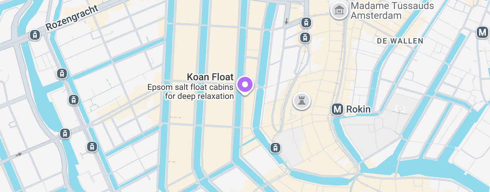

# Misophonia Sound Sensitivity

Captured: 2026-10-09T08:24:11.819Z

Source: https://www.google.com/search?q=that+styrofoam+squeek+and+flower+plastic+foil+sound+frequency+makes+me+feel+bad+inside&gs_lcrp=EgZjaHJvbWUyBggAEEUYOdIBCTI2NzA3ajBqN6gCALACAA&sourceid=chrome&ie=UTF-8&fbs=ABfTbFVyMZGZf1hfvX9uKjN_-G8c4u0nXx4bEIpwm1lnNH832cY0rzciwbWdjW1sV3VNzLzR4RIindJxFrmQWQ1WCYgKz-fVa4QKWHA2SIXwumHXdsgWSwSRthiGglnOkse4JRc34j7qjIs9Sy84JN3GFvDnekCLzlbxtIC9CtCm-BfUlFK6x6EsqZJ8yUCyZqK5nLpHfuCj&aep=10&ntc=1&sxsrf=APpeQnu3X4wCZNCb6--o_yQvVDgBpz2aMw%3A1790997335546&mstk=AUtExfBKqpr4OXe5CFqGw3kSuRV_ydcGR7WwExemhciRT6gKE0A2jNMtHPkJuySQ9HuIX3YIT8vQV-ynlmaw06pGS_NPR1updSkG8Ay5fJt6Ee8IEDxADlvtY3AIqXU1VksRr6jv85RdRmog7pTyl3VTU0G85eOjWdhaJsXYYvxZsGpcvt0zzXG9GQ89tCgcouQXkpr2GPjxIKIYd0F76cPxU98n34HNhQY_opzHVB-I2Q53WF6QFtUn1yCxAf0_kpB4HMi5DPrRAu6sNknymqS1B0cgbSa4bl1z31B6rdRmhWyZBgVn0gHJ8G0wrFjdup0ylIYjdN51FWEI7g&aioh=3&csuir=1&cs=0&udm=50&mtid=sHPAas_GF6WF9u8P6OGUgAQ

## Prompt 1 — You

that styrofoam squeek and flower plastic foil sound frequency makes me feel bad inside

## Response 1 — Google AI Mode

That highly uncomfortable feeling is a completely natural physical reaction called **misophonia** or **hyperacusis**, often triggered by high-pitched, friction-based sounds like Styrofoam squeaking or plastic crinkling.

When you hear these specific frequencies, your brain’s **amygdala** (the fight-or-flight center) misinterprets the sound as an immediate threat. This can instantly trigger:

* A physical "chill" or visceral shudder down your spine
* An unpleasant knot or dropping sensation in your stomach
* A sudden spike in irritation, anxiety, or the urge to escape the room

The frequency of Styrofoam scraping is actually very close to the pitch of a human scream or a baby crying, which is why our nervous systems are evolutionary hardwired to react to it so strongly.

To help you feel better right now, you can try to:

* **Change the acoustic environment:** Put on headphones with brown noise or heavy bass music to mask those piercing high frequencies.
* **Ground your body:** Take three slow, deep belly breaths to signal to your nervous system that you are actually safe.
* **Create a barrier:** If you have to handle these items, wearing gloves can change the texture and significantly muffle the sound vibrations.

To help you shake off that uncomfortable feeling, would you like me to recommend some **soothing soundscapes** (like brown or green noise), or would you prefer a quick **breathing exercise** to calm your nervous system?

## Prompt 2 — You

soothing mid theta meditation booth float koan amsterdam saltpeter or whatever that salt is called, good for muscle relaxation

## Response 2 — Google AI Mode

You are thinking of **Epsom salt** (scientifically known as **magnesium sulfate**)! It definitely isn't saltpeter (which is potassium nitrate, used for fireworks and curing meats). Magnesium sulfate is highly absorbed through the skin during a float session, making it incredibly effective for blocking those pesky high-pitched sound triggers, relieving muscle tension, and calming the nervous system. 

Floatbar +1

The place you are thinking of is **Koan Float**, a fantastic, highly-rated wellness oasis located right on the canals in Amsterdam. 

Koan Float

Map data ©2026 GoogleMap DataTerms

200 m

Click to toggle between metric and imperial units

Expand map

Zoom in

Zoom out

### Why it works for resetting your brain and muscles

* **The "Mid-Theta" Brainwave State:** By completely sealing you away from sensory input (light, gravity, and sound), floating prompts your brain to switch from high-alert Beta waves down to **Theta brainwaves**. This is the elusive boundary state between waking and sleeping usually achieved during deep meditation—perfect for washing away the mental residue of unpleasant auditory triggers. 

  Counseling Amsterdam
* **The Cabin Design:** At Koan Float, you float in large, private, specially engineered float cabins rather than small pods. You have full control over the internal light switch and can choose complete silence or soothing, low-frequency music. 

  Tripadvisor +3
* **Muscle Relief:** The water is saturated with hundreds of kilograms of magnesium sulfate. This creates a weightless, Dead Sea-like buoyancy that instantly decompresses your spine, shuts off postural muscle strain, and delivers a localized relaxation effect to tense muscle groups. 

  Floatbar +2

If you plan to check them out, you can easily view availability and book a session directly through the Koan Float Booking Page. They are open daily from 9:00 AM to 10:00 PM at Herengracht 321. 

Koan Float

Would you like me to look into **other float centers in Amsterdam** to compare amenities, or help you find **guided meditation audio** that utilizes theta frequencies to listen to at home right now?

### Source links

- [Floatbar](https://floatbar.nl/en/welcome-to-floatbar/)
- [Koan Float](https://koanfloat.nl/en/)
- [Terms](https://www.google.com/intl/en-NL/help/terms_maps/)
- [www.koanfloat.nl](https://www.koanfloat.nl/)
- [Counseling Amsterdam](https://counselingamsterdam.nl/en/about-us/friends/koan-float.html)
- [Tripadvisor](https://www.tripadvisor.com/Attraction_Review-g188590-d3703596-Reviews-or10-Koan_Float-Amsterdam_North_Holland_Province.html)
