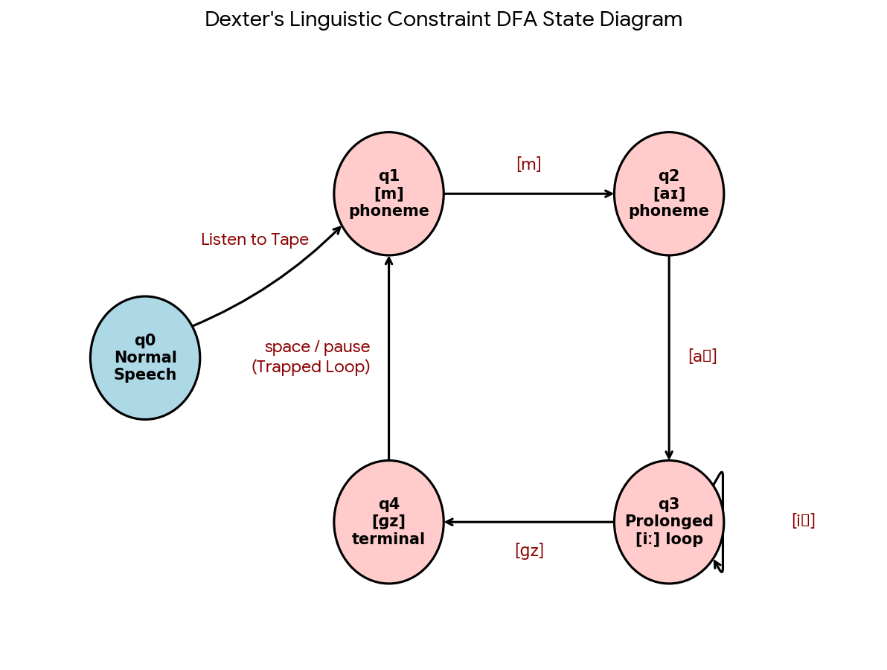

# Omelette du Fromage Dexter's Laboratory

Captured: 2026-10-21T16:29:39.296Z

Source: https://www.google.com/search?sca_esv=882e2611175d5c4b&sxsrf=APpeQns72gG-R7hI16PfGAc3u3BCPaV0gA%3A1792560296472&ei=o0zYasnQM8SM9u8P8bP7oAw&biw=1707&bih=898&uact=5&sclient=gws-wiz-serp&ntc=1&cs=1&udm=50&atvm=2&ved=0CCsQ2_wOahcKEwi4vtKXwsuXAxUAAAAAHQAAAAAQRA&mstk=AUtExfDtEjmD4xzECAVy9A1h8vI-82LtP9rTGOKcMKnGb0F761SMbuGfOAHK4INjk5pmvRNkJxjJqW1cf3bhgUdnkxGgD6iA79-NTLaq0JCPKfL-o5MH7A4X8tTvpz-DAFuOiaTyMwKBO_d2HoRxn9aTY_c0vqznbRpUlZnTsKG01rStJV2LVCL71WpaqUjxyIqtWEfY7RDZf272ERcz9_rfoIe5Sc5-7KUSARKX2CamyeEuDPMK4XnsKNu7C5oczNYbyI6t4xICmdarXw&mtid=WarYapvsPJn97_UPzaDwoQ0&csuir=1&aep=26&q=omelette+du+fromage+dexters+laboratory

## Prompt 1 — You

omelette du fromage dexters laboratory

## Response 1 — Google AI Mode

"**Omelette du fromage**" is the iconic catchphrase from "**The Big Cheese**," a classic 1996 episode of the hit Cartoon Network animated series [*Dexter's Laboratory*](https://dexterslab.fandom.com/wiki/The_Big_Cheese). 

Dexter's Laboratory Wiki +1

### The Plot

In the episode, Dexter realizes he has a French exam the next morning but has not studied. To save time, he uses an invention called the **Subconscious Discographic Hypnotator** to learn the language while he sleeps. However, the record player skips overnight, trapping him in a loop on a single phrase: *"omelette du fromage"* (which translates grammatically incorrectly to "omelette of the cheese"—the correct French phrase is *omelette au fromage*). 

Reddit·Deleted User +2

When Dexter wakes up, **he can only speak those three words**. Despite this extreme limitation, the phrase bizarrely serves as a "cheat code" for his day: 

Facebook·Cartoon Network +2

* He aces his French exam.
* He becomes a school celebrity and pop star.
* He effortlessly charms girls and deflects bullies. 

  Dexter's Laboratory Wiki +1

### The Downfall

His overnight stardom comes to an end when he returns to his secret laboratory. The lab computer prompts him for his voice-activated security password. Because he can only say "omelette du fromage," the system denies him access, triggers a self-destruct countdown, and ultimately blows up his laboratory while his sister Dee Dee taunts him. 

Reddit·Deleted User +2

The phrase remains one of the most famous pieces of 90s pop-culture nostalgia and a widespread internet meme. 

Instagram·Skippy | Millennial Nostalgia Creator

Would you like to explore more about this episode, such as **where to watch it**, its **cultural legacy**, or even **how to cook** the Binging with Babish real-life recipe inspired by the show? 

Babish

### Source links

- [dexterslab.fandom.com](https://dexterslab.fandom.com/wiki/The_Big_Cheese)
- [www.reddit.com](https://www.reddit.com/r/90scartoons/comments/1j1jdnh/omelette_du_fromage/)
- [www.facebook.com](https://www.facebook.com/CartoonNetwork/videos/omelette-du-fromage-dexters-laboratory-cartoon-network/317053495924636/)
- [www.instagram.com](https://www.instagram.com/reel/DeUsj-iKnvU/?hl=en)
- [www.babi.sh](https://www.babi.sh/recipes/omelette-du-fromage-dexters-laboratory)

## Prompt 2 — You

he listens to the tape and all he can say is my eeeeeeeegs phonetically, make a formalization where eeeeeeeegs is ambiguous it's just the phonetic sound like TTS

## Response 2 — Google AI Mode

To capture the exact phonetic ambiguity of Dexter's broken auditory loop, we can formalize this scenario using **Formal Language Theory** and **Finite State Automata (FSA)**.

Because the Text-to-Speech (TTS) phonetics are inherently ambiguous—where the sound **`[iːɡz]`** could mean "eggs", "aches", "egs" (as an abbreviation), or a completely nonsensical loop—we model the phonetic output as an equivalence class of possible semantic interpretations.

### 1. Phonetic Alphabet and Lexicon

Let  $\Sigma $  be our phonetic alphabet, representing the distinct sounds generated by the broken tape player.

* Let the initial phoneme be  $\pi\_1 = \text{`[m]`}$
* Let the second phoneme be  $\pi\_2 = \text{`[aɪ]`}$
* Let the prolonged vowel phoneme be  $\epsilon = \text{`[iː]`}$
* Let the final consonant cluster phoneme be  $\gamma = \text{`[ɡz]`}$

We define the phonetically generated string  $S$  as:   
 $S=\pi \_{1}\cdot \pi \_{2}\cdot \epsilon ^{n}\cdot \gamma \quad \text{where\ }n\ge 1$

For a standard sustained phonetic output like *"my eeeeeeeegs"*, we evaluate the sequence where $n $represents the duration of the prolonged vowel:$ $\text{Output} = \text{`[maɪ]`}\text{`[iː...iːɡz]`}$$

### 2. Semantic Ambiguity Mapping

Because the output is purely auditory (TTS), a single phonetic string maps to a set of possible semantic interpretations in the human lexicon ( $L$ ). We define a decoding function  $D(S)$  that maps the phonetic string to a set of ambiguous meanings:

$$D(\text{`[maɪ iːɡz]`}) = { x \in L \mid \text{Phonetic}(x) \approx \text{`[maɪ iːɡz]`} }$$

Depending on the context or the listener, this evaluates to:  
$$D(\text{`[maɪ iːɡz]`} $) = \{ \text{"my eggs"}, \text{"my aches"}, \text{"my egs"}, \text{"my E.G.s"} \}$

### 3. State Transition Model (The Hypnotator Loop)

We can visualize Dexter's brain state after listening to the broken tape using a deterministic finite automaton. Once entering the processing state for the broken tape loop, his linguistic output engine becomes trapped, bypassing his normal vocabulary repository.




Download

### 4. The Final Execution Constraint

In this formalization, if  $V$  is Dexter's active vocabulary function, the tape permanently overrides it:

$\forall \text{\ intent\ }i,\quad V(i)=S$

No matter what internal command Dexter attempts to execute (whether it is an answer to a school exam or a security password for his laboratory), the output system is structurally constrained to return only the phonetic representation of  $S$ .

Should we expand this system to model how his **lab computer's authentication algorithm** handles this phonetic ambiguity, or would you like to construct a **Python simulation** of his restricted speech engine?

## Prompt 3 — You

both, eeeeeeeegs

## Response 3 — Google AI Mode

Below is the complete engineering breakdown for Dexter’s corrupted speech engine. This includes a mathematical model of the **Lab Computer's Authentication Algorithm** followed by a **Python simulation** of the restricted speech engine.

### 1. The Computer Authentication Model

Let  $P\_{true}$  be the required password vector for laboratory access. The lab computer uses a acoustic verification function A(s) to parse incoming speech signals.

Because the Text-to-Speech (TTS) input is the phonetically ambiguous string S, the computer evaluates the probability that the phonemes map to the correct security credential. We can formalize the system's strict rejection logic using a probability threshold τ:

$\text{Access}(S)=\begin{cases}\text{Granted}&\text{if\ }P(S=P\_{true})\ge \tau \\ \text{Self-Destruct}&\text{if\ }P(S=P\_{true})<\tau \end{cases}$

Given that the input S resolves to a high-ambiguity semantic set  $D(S) = \{\text{"my eggs"}, \text{"my aches"}, \dots\}$ , the probability of it matching a complex security password is effectively 0, guaranteeing terminal failure.

---

### 2. Python Simulation: The Corrupted Speech Engine

This script simulates Dexter trying to speak different phrases while trapped in the phonetic loop. No matter what `intent` or phrase he wishes to say, his vocal processor overrides it, dynamically scaling the elongation of the sustained vowel sound `[iː]`.

python

```
import random

class CorruptedVocalProcessor:
    def __init__(self):
        # The rigid phonetic components of the broken tape loop
        self.prefix = "m"
        self.diphthong = "aɪ"
        self.sustained_vowel = "iː"
        self.terminal_consonant = "ɡz"
        
    def speak(self, internal_intent: str) -> str:
        """
        Overrides any internal intent and forces the phonetic sound output.
        The length of the sustained vowel scales with the urgency/length of the intent.
        """
        # Determine urgency based on the length of what he wants to say
        urgency = max(3, len(internal_intent) // 4)
        # Add slight random variation to simulate organic speech stutter/stress
        elongation = urgency + random.randint(1, 4)
        
        # Build the phonetic string
        phonetic_output = (
            f"[{self.prefix}{self.diphthong}] "
            f"[{self.sustained_vowel * elongation}{self.terminal_consonant}]"
        )
        return phonetic_output

class LabSecuritySystem:
    def __init__(self, password: str):
        self.password = password
        self.failed_attempts = 0
        
    def authenticate(self, audio_input: str) -> str:
        # The computer expects a literal text match, but receives raw phonetic noise
        if audio_input == self.password:
            return "ACCESS GRANTED. Welcome back, Dexter."
        else:
            self.failed_attempts += 1
            if self.failed_attempts >= 3:
                return "CRITICAL ERROR: UNAUTHORIZED PHONETIC PATTERN. INITIATING LABORATORY SELF-DESTRUCT CODES."
            return f"ACCESS DENIED. Invalid input. (Attempts left: {3 - self.failed_attempts})"

# --- Execution Simulation ---
processor = CorruptedVocalProcessor()
security_terminal = LabSecuritySystem(password="ScienceIsCool123")

print("--- DEXTER'S COGNITIVE OVERRIDE TEST ---")
intents = [
    "Hello Dee Dee, get out of my room!",
    "The answer to question four is the square root of pi.",
    "Computer, cancel self-destruct sequence immediately!"
]

for intent in intents:
    vocal_output = processor.speak(intent)
    print(f"\nDexter's Mind Tries to Say: '{intent}'")
    print(f"Dexter's Mouth Actually Emits: {vocal_output}")

print("\n--- SECURITY TERMINAL INTERACTION ---")
for i in range(3):
    dexter_plea = processor.speak("Open the blast doors!")
    print(f"Dexter: {dexter_plea}")
    response = security_terminal.authenticate(dexter_plea)
    print(f"Computer: {response}")
```

Use code with caution.

Would you like to build an extension to this script that introduces a **Bayesian acoustic parser** to see if Dee Dee can figure out what he means, or should we design the **UI layout** for the hypothetical game *Dexter's Phonetic Escape*?
