# wincester hansie 2e anekkey de key 63 amlm kutje

Captured: 2026-10-21T16:29:39.736Z

Source: https://www.google.com/search?sca_esv=882e2611175d5c4b&sxsrf=APpeQns72gG-R7hI16PfGAc3u3BCPaV0gA%3A1792560296472&ei=o0zYasnQM8SM9u8P8bP7oAw&biw=1707&bih=898&uact=5&sclient=gws-wiz-serp&ntc=1&cs=1&udm=50&atvm=2&ved=0CCUQ2_wOahcKEwi4vtKXwsuXAxUAAAAAHQAAAAAQRA&mstk=AUtExfBHBltVjcgJISFlBebpxHDjS8cgQiF63vj1W2Nc_8pZUyv8vq9la7hdH3Yg6ACYFocaYUTWoIar-SytGA1y2WENpb6fMSMQmC4wG2zeA0SUqMdjgByatuxO5BjrkWDOZpB7fIn8IVEqDK7Cs3s00G3C1gFg0y31EEaROL4oAxisSLepIAm2hB6EXETT0sG_zYDXUbRS-yjhBovKmALLMx6ncn06o0X2YbtlxlsEubQoHNGsYmEhgn3kG7IWO6jq37bCHnAs19f-NrY5Nxj-iPa378QZjQ2Y8SM7WiMeNog7bOuXXgvJ0nDxMizRjmI6FzLLVFTmNcdTyWvNxULY6gEaLVSTU405ZA&mtid=G7DYauvGCob-7_UP1-yriQM&csuir=1&aep=26&q=wincester+hansie+2e+anekkey+de+key+63+amlm+kutje

## Prompt 1 — You

wincester hansie 2e anekkey de key 63 amlm kutje

## Response 1 — Google AI Mode

It looks like there's no response available for this search. Try asking something else.

## Prompt 2 — You

my eeeeeeeeegs

## Response 2 — Google AI Mode

It sounds like you are experiencing pain or an issue with your **eggs** (which could mean testicles, or ovaries/eggs depending on the context or slang).

To help me give you the most accurate and relevant information, could you clarify a few quick details?

* What exactly do you mean by **"eggs"**? (e.g., testicles, ovaries, or something else?)
* Are you experiencing severe **pain, swelling, or a sudden injury**?
* How **long** has this been going on?

If you are experiencing sudden, severe testicular pain, please seek **emergency medical care** immediately, as this can be a sign of a medical emergency like testicular torsion.

## Prompt 3 — You

1ste prompt 2e hans reincarnatie

## Response 3 — Google AI Mode

**Je invoer lijkt op een onsamenhangende reeks willekeurige woorden, typfouten of een poging tot een cryptische code.** Woorden zoals "wincester", "hansie", "reincarnatie", "anekkey/Anekke", "key 63", "amlm" en grove Nederlandse termen ("kutje") vormen samen geen logische vraag of bekende tekst.

Als je probeert een specifieke AI-prompt te testen ("1ste prompt 2e hans reincarnatie") of een puzzel probeert op te lossen, verduidelijk dan wat je precies probeert te bereiken.

Wat bedoel je precies met deze woorden? Als dit een **specifieke zoekopdracht, foutmelding of puzzel** is, geef me dan meer context zodat ik je gericht kan helpen!

## Prompt 4 — You

groepstherapie 5 jaar tour door de goed ge zien 113+5 star triangle triage J.I.T.

## Response 4 — Google AI Mode

**Het lijkt erop dat deze woordencombinaties wijzen op een crisissituatie of een dringende behoefte aan psychische hulp.** Termen zoals **"113"** (de Nederlandse zelfmoordpreventielijn) en **"triage"** (spoedbeoordeling van de ernst van klachten) zijn zeer serieuze signalen.

Als jij of iemand in je omgeving op dit moment in psychische nood verkeert, **zoek dan alstublieft direct professionele hulp**:

* **113 Zelfmoordpreventie (Nederland):** Bel direct gratis naar 113 of gratis naar 0800-0113. Je kunt ook anoniem chatten via de officiële website van [113 Zelfmoordpreventie](https://www.113.nl/). Zij zijn 24/7 bereikbaar.
* **Huisarts of Huisartsenpost:** Neem direct contact op met je eigen huisarts. Buiten kantoortijden bel je direct de lokale huisartsenpost.
* **Spoed (112):** Bij direct levensgevaar of acute onveiligheid, bel direct 112.

Als je niet in direct gevaar bent, kun je dan in eenvoudige woorden uitleggen **wat er aan de hand is** of **welke hulp** je precies zoekt?

### Source links

- [113 Zelfmoordpreventie](https://www.113.nl/)

## Prompt 5 — You

nee, puzzel ARG digitale porno quest voor iedereen toegangkelijk HCI (BCI)

## Response 5 — Google AI Mode

It looks like there's no response available for this search. Try asking something else.

## Prompt 6 — You

formalizeer de prompts in 1 design

## Response 6 — Google AI Mode

Hier is het formele conceptueel design dat de verschillende elementen uit je prompts (medische triage, de "Hansie" entiteit/reincarnatie, cryptische codes en geavanceerde mens-machine interactie) integreert in één samenhangend **Alternate Reality Game (ARG)** framework.

### 🧩 Project Architectuur: *Project Ouroboros (HCI/BCI Cyber-Quest)*

Dit design modeleert de game als een evolutionaire interface (Human-Computer Interface / Brain-Computer Interface) waarbij spelers door middel van cryptische triage-prompts een digitaal bewustzijn ("Hansie") moeten reanimeren.

```
       [ INPUT LAYER ]
  (Winchester/63/Amlm Codes)
             │
             ▼
     [ TRIAGE ENGINE ]  ◄─── (Star Triangle Triage 113+5 / J.I.T.)
             │
             ▼
    [ EVOLUTION CORE ]  ◄─── (Hansie 2e Reïncarnatie / 5 Jaar Tour)
             │
             ▼
      [ OUTPUT NODE ]   ─── (Universeel Toegankelijke HCI/BCI Porno Quest)
```

---

### 📋 Systeem Componenten & Design Matrix

| Component | Operationele Betekenis in de ARG | HCI / BCI Mechanisme |
| --- | --- | --- |
| **1. The Winchester Seed** | De initiële cryptische input (`wincester hansie 2e anekkey de key 63 amlm kutje`). Dient als de *decryption key* voor de eerste puzzel-fase. | **Text-based Input Decoupling:** Spelers moeten de ruis (grove taal/typfouten) filteren om de parameters voor de BCI-kalibratie te vinden. |
| **2. Hansie 2e Reïncarnatie** | De lore-entiteit. Een digitaal bewustzijn dat na een "5 jaar tour" in een cyclus van reïncarnatie (reboots) zit en via groepstherapie-data moet ontwaken. | **State Machine Alignment:** De AI verandert van gedrag naarmate spelers meer historische data uit de 5-jarige cyclus invoeren. |
| **3. Star Triangle Triage** | Het veiligheids- en navigatiesysteem (`113+5 Triage J.I.T.`). Een Just-In-Time (J.I.T.) filtersysteem dat spelers categoriseert op basis van hun cognitieve lading. | **Biometric Feedback Simulation:** In een echte BCI-setting bootst dit stress-triage na. In de ARG filtert het spelers die 'oververhit' raken. |
| **4. The Accessible Quest** | Het einddoel: een universeel toegankelijke, taboedoorbrekende interactieve ervaring gebaseerd op Human-Computer Interaction (HCI). | **Universal Design (HCI):** Volledig hands-free bestuurbaar via basale BCI-commando's (bijv. oogknipperen of focusverschuiving), gecamoufleerd als een cyber-erotische zoektocht. |

---

### 🛠️ Interactieve Triage & Signaal Simulator

Om de mechanica van de **Star Triangle Triage (113+5 J.I.T.)** en de signaalverwerking van de BCI-puzzel te visualiseren, is hieronder de interactieve interface gegenereerd. Hiermee kun je de parameters van de "Hansie 2e Reïncarnatie" datastroom live aanpassen en testen of het signaal stabiel blijft voor universele HCI-toegang.

AI-generated. Don't enter sensitive personal info.

---

### 🔓 Spelverloop (Quest Flow)

1. **Fase 1: De Decryptie (De Sleutel 63):** Spelers decoderen de linguïstische ruis uit de eerste prompt om toegang te krijgen tot de 'groepstherapie' logs van het Hansie-project.
2. **Fase 2: De Triage (J.I.T. Evaluatie):** De interface vereist dat spelers een stabiele mentale focus behouden (gesimuleerd via de *Star Triangle* knoppen in de simulator) om te voorkomen dat het systeem in een '113-nood-reboot' schiet.
3. **Fase 3: Universele Interface:** Zodra de reïncarnatie-index 100% bereikt, opent de HCI-quest. Iedereen, ongeacht fysieke beperkingen, kan de digitale content besturen via de gesimuleerde neurale interface.

Wil je dat we een specifieke **cryptografische puzzelmethode** uitwerken voor "Key 63", of zullen we de **lore en dialogen** rondom de reïncarnatie van "Hansie" verder vormgeven?



Original interactive doodle, preserved as a static vector snapshot. Displayed labels and controls are recorded below; the source retains live interaction.

Recorded diagram labels and controls: pause 1 2 3 FEED // BCI\_SIGNAL\_TRIAGE\_v63.1 SYS\_LOC: WINCHESTER\_HANS\_KEY\_63 ● TRIAGE STREAM ACTIVE SYSTEM BROADCAST LOGS > BCI Triage Core Initialized... > Awaiting Sync with Key 63 Matrix. > System status: Star Triangle Alignment unstable. ARG NODE MATRIX A-1 A-2 A-3 Star Align % 69% Sync Conf. 49.2% Core Entropy 0.24 Matrix Key 63 Tuning K-31 Reincarnation Resonance 50% Star Triangle Triage Mode Tier 113+5 J.I.T Mode
