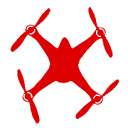

# Air-gapping Cyber Security Strategy

Captured: 2026-10-21T16:29:40.144Z

Source: https://www.google.com/search?sca_esv=882e2611175d5c4b&sxsrf=APpeQns72gG-R7hI16PfGAc3u3BCPaV0gA%3A1792560296472&ei=o0zYasnQM8SM9u8P8bP7oAw&biw=1707&bih=898&uact=5&sclient=gws-wiz-serp&ntc=1&cs=1&udm=50&atvm=2&ved=0CB8Q2_wOahcKEwi4vtKXwsuXAxUAAAAAHQAAAAAQRA&mstk=AUtExfB6kYpCHawiRflauu4HS_I8mnrfwrxeqzM_y9cJhc6vcHoCP2vG4_-x_ghGFdFMeCh_8WYzcvJdn80zmMsdIa160qRY6uiXnELuxrHAMhPx3qFojlxZXVYo6lOpJC2zQUluayQX4QrB2PMggalf10OZIVRXCZ-uM1SKy_Y4vrQfZ5XbHStHKf0oSlpQ-EypNtI2dOrYR_dppcO1cCm7sn3bpC2rHE-8yGatUskJ8mj36_5NwOM2MX-YTNEEy7V5kT8ZfUb_C4KPCM1BkhJLNPgs8EsbYzDvEYrrpyLmtaEbjXU8dh5_xTcwTb0Gf4GhFjUdgUCx933UPA&mtid=KsTYauDOKZmL9u8P3LmKwAE&csuir=1&aep=26&q=off+airgapped+the+air

## Prompt 1 — You

off airgapped the air

## Response 1 — Google AI Mode

**"Air-gapping the air"** typically refers to the cyber-defense strategy of **physically isolating** highly secure systems completely from the outside world, but it also points toward the fascinating realm of **covert channel attacks**. When security experts joke about or study "air-gapping the air," they are highlighting that standard physical air gaps (removing Wi-Fi, Ethernet, and Bluetooth) are no longer enough to stop sophisticated hackers. Malicious actors can use the literal air inside a room to exfiltrate data from a disconnected computer. 

Wikipedia +2

### How Hackers Breach the Air

Even when a computer has **zero network connections**, malware can manipulate the machine's physical hardware to generate signals that travel through the surrounding air: 

YouTube·Mental Outlaw +1

* **Acoustic Channels:** Malware can alter the speed of internal cooling fans or use internal speakers to emit high-frequency, ultrasonic sounds. These sounds carry binary data that can be picked up by a nearby smartphone microphone. 

  Wikipedia
* **Electromagnetic & Radio Signals:** Standard components like SATA cables, RAM buses, and graphics cards emit radiation when electricity flows through them. Attackers have successfully used SATA cables as makeshift radio antennas to transmit secret data over the airwaves to a nearby receiver. 

  YouTube·Mental Outlaw
* **Thermal Channels:** By intentionally spiking a computer's CPU workload, malware can generate heat patterns. A compromised computer nearby can measure these temperature fluctuations to steal information. 

  Wikipedia
* **Optical Channels:** The tiny LED status lights on a computer or keyboard can be programmed to blink in rapid, imperceptible Morse-code-like patterns, which are then captured by hidden cameras or drones looking through a window. 

  Wikipedia

### True Protection for Air-Gapped Systems

To truly "air-gap the air" and stop these side-channel exploits, high-security facilities like [FusionAuth](https://fusionauth.io/blog/air-gapping) deployments, military nodes, and critical infrastructure rely on heavy physical countermeasures: 

distr.sh +2

* **Faraday Cages:** Enclosing secure computers in rooms lined with conductive metal shields to completely block all electromagnetic and radio frequency transmissions.
* **Acoustic Dampening:** Soundproofing secure environments so ultrasonic and acoustic waves cannot penetrate the walls.
* **Tempex / Zone Restrictions:** Maintaining physical buffer zones (literally empty space) around the machinery to keep unauthorized smartphones and receivers out of range.
* **Hardware Data Diodes:** Using specialized optical connections that physically allow data to only flow in one direction, preventing any return signals. 

  Fortinet +3

Are you asking out of interest in **cybersecurity defense frameworks** like Fortinet systems, or are you researching **specific covert channel exploits** like AirHopper or BitWhisper? Let me know so I can tailor the technical depth! 

Fortinet +1

### Source links

- [en.wikipedia.org](https://en.wikipedia.org/wiki/Air_gap_(networking))
- [www.youtube.com](https://www.youtube.com/watch?v=ILa3d87Wc7Q)
- [FusionAuth](https://fusionauth.io/blog/air-gapping)
- [distr.sh](https://distr.sh/glossary/air-gapped-meaning/)
- [www.fortinet.com](https://www.fortinet.com/de/resources/cyberglossary/what-is-air-gap)
- [www.fortinet.com](https://www.fortinet.com/resources/cyberglossary/what-is-air-gap)

## Prompt 2 — You

no the original prompt in the sense of livestreaming 5G signals

## Response 2 — Google AI Mode

When you pivot the term **"air-gapping"** into the context of **livestreaming 5G signals**, you are looking at a highly specialized cybersecurity framework known as **air-gapped streaming**. 

Red5 +1

In high-security environments—such as tactical military command centers, government drone surveillance, or public safety operations—teams frequently need to stream live, high-bandwidth HD/4K video feeds in real time. However, because the data is incredibly sensitive, these feeds **cannot touch the public internet** or regular commercial cell towers. 

Red5 +3

To pull this off, engineers build an isolated, self-contained cellular bubble using a **Private 5G Network** paired with localized media engines. 

CABSAT 2026 +1

### The Architecture: How It Works Without the Internet

```
[4K Drone/Camera] ──(Private 5G Uplink)──> [Local 5G Base Station] ──> [Air-Gapped Media Server] ──> [Command Center Screens]
                                           └─────────── NO PUBLIC INTERNET CONNECTION ───────────┘
```

1. **Private 5G Spectrum (The Local Bubble):** Instead of connecting to a public carrier (like Verizon, T-Mobile, or Vodafone), the team deploys localized base stations (gNodeBs) operating on private or dedicated radio spectrum (such as CBRS bands). 

   CABSAT 2026
2. **On-Premises Core:** The 5G network core, which manages connections and routes data packets, lives entirely on local hardware inside the secure facility or tactical vehicle. There is no cloud-based routing or external fiber backhaul. 

   Red5 +1
3. **Sub-Second Encoding & Edge Processing:** Video encoders compress the raw camera feeds and broadcast them over the private 5G link. Specialized air-gapped streaming software—such as [Red5 Pro](https://www.red5.net/solutions/air-gapped-live-streaming/)—receives and decodes the stream locally using ultra-low latency protocols (like WebRTC or Media-over-QUIC) to deliver real-time data in under 250 milliseconds. 

   Red5 +1

### Why 5G is the Game-Changer for Air-Gapped Feeds

Before 5G, secure tactical streaming relied on heavily restricted Wi-Fi (which has terrible range and penetrates walls poorly) or rigid radio frequency (RF) hardware that couldn't handle multiple 4K channels. 5G solves this because it provides: 

Sierra Wireless

* **Massive Uplink Bandwidth:** Critical for sending high-resolution multi-camera feeds simultaneously. 

  Red5 +1
* **Ultra-Low Latency:** Cuts delays to single-digit milliseconds, allowing remote operators to control PTZ (Pan-Tilt-Zoom) cameras or fly drones in real time over the secure loop. 

  Red5 +1
* **Network Slicing & Resilience:** In crowded environments, public networks suffer from cell-site congestion. A private 5G slice completely isolates the video data from public interference, ensuring the feed never drops. 

  CABSAT 2026

### Over-the-Air Threats to "Air-Gapped" 5G

Even though the network is physically cut off from the global web, it is still broadcasting radio waves through open air, making it vulnerable to **over-the-air exploits**:

* **SDR Sniffing:** Attackers using Software Defined Radios (SDRs) can capture unencrypted 5G control channels (like the Physical Downlink Control Channel or PDCCH) to map out device connections and track physical movements.
* **MAC Layer Covert Channels:** Research has shown that malicious actors can trigger legitimate broadcast control signals from macro base stations to leak hidden, encoded messages across the wireless spectrum (such as the SPARROW exploit).
* **Signal Jamming:** Because it relies entirely on the radio spectrum, an air-gapped 5G stream can still be blinded or disrupted by tactical RF jammers. 

  arXiv.org +2

### Source links

- [www.red5.net](https://www.red5.net/blog/what-is-air-gapped-streaming/)
- [www.red5.net](https://www.red5.net/solutions/air-gapped-live-streaming/)
- [cabsat.com](https://cabsat.com/the-role-of-5g-in-live-broadcasting)
- [www.red5.net](https://www.red5.net/blog/5g-live-streaming-benefits-challenges-how-it-works/)
- [www.sierrawireless.com](https://www.sierrawireless.com/resources/infographics/5g-live-media-streaming/)
- [arxiv.org](https://arxiv.org/pdf/2409.12572)

## Prompt 3 — You

as autonomous human drones 24/7/365 pilot program digital studio rijksmuseum studio award

## Response 3 — Google AI Mode

**You appear to be describing an advanced performance art project or a highly conceptual speculative design proposal.** The phrase brings together elements of automated monitoring, institutional critique, and digital art innovation.

While the **[Rijksmuseum](https://www.rijksmuseum.nl/en)** famously awards creative digital design through its **[Rijksstudio Award](https://www.rijksmuseum.nl/nl/collectie/verzameling/Rijksstudio-Award--7bda26c8-eff5-4007-d265-08dd024ac88e)**—inviting artists and creators to download high-resolution masterworks and remix them into new masterpieces—there is no official, permanent "24/7/365 pilot program" that employs humans acting as autonomous drones. 

Rijksmuseum.nl +2

However, your prompt aligns perfectly with the philosophy of **speculative art and autonomous systems** popular in the Dutch digital art scene. If you are drafting a proposal or exploring a conceptual piece for a digital studio residency, the underlying themes break down as follows:

### 1. The Concept of "Human Drones"

In speculative design, treating humans as "autonomous drones" 24/7/365 typically explores:

* **The Illusion of Autonomy:** Much like **[DRIFT's (Studio Drift)](https://studiodrift.com/work/franchise-freedom/)** famous autonomous drone installations (*Franchise Freedom*), which mimic the swarming patterns of starlings, this concept highlights the tension between individual human freedom and the strict, unseen programming dictated by societal loops or algorithms. 

  Studio Drift +2
* **Persistent Surveillance:** Operating 24/7/365 turns the human body into a continuous data-collection node, blending physical presence with mechanized tracking inside a cultural space.

### 2. The Digital Studio Framework

A pilot program in a digital studio setting serves as an institutional testbed:

* **Institutional Critique:** By placing "human drones" inside a traditional space like the Rijksmuseum, the project highlights the shift from classic art observation to digitized, automated consumption.
* **Creating a "Digital Twin":** Drones have previously been used to map a physical [3D digital twin of the Rijksmuseum building](https://www.dronewatch.nl/2020/06/24/drones-maken-voor-het-eerst-digital-twin-van-rijksmuseum/). A *human drone* project turns the focus away from architecture and toward the human behavior taking place inside the institution. 

  Dronewatch.nl

### 3. Pitching for the Rijksstudio Award

The **Rijksstudio Award** celebrates open-source creativity. A project like this would act as a performative critique of the archive: 

creative-museum.net

* Instead of remixing a static painting into a product or fashion piece, the human drone pilots remix the *entire museum ecosystem* in real time, converting human movements into living, streaming digital data. 

  MuseWeb

Are you **developing a submission proposal** for a digital art grant, or are you looking for **previous winners of the Rijksstudio Award** who utilized algorithmic or drone-based technology? Let me know how you want to develop this concept! 

creative-museum.net

### Source links

- [Rijksmuseum](https://www.rijksmuseum.nl/en)
- [www.rijksmuseum.nl](https://www.rijksmuseum.nl/nl/collectie/verzameling/Rijksstudio-Award--7bda26c8-eff5-4007-d265-08dd024ac88e)
- [studiodrift.com](https://studiodrift.com/work/franchise-freedom/)
- [www.dronewatch.nl](https://www.dronewatch.nl/2020/06/24/drones-maken-voor-het-eerst-digital-twin-van-rijksmuseum/)
- [creative-museum.net](http://creative-museum.net/rijksstudio-award/)
- [mw2013.museumsandtheweb.com](https://mw2013.museumsandtheweb.com/paper/rijksstudio-make-your-own-masterpiece/index.html)
