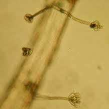
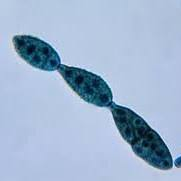
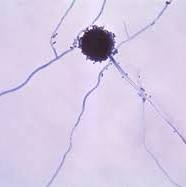
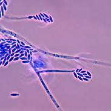

# meneba clausbrug wormerveer

Captured: 2026-10-08T04:22:14.713Z

Source: https://www.google.com/search?q=meneba+clausbrug+wormerveer&sca_esv=59f40870b1987660&sxsrf=APpeQntwpskl3zwf842TBeD3UTYXw4yVsA%3A1791015520107&source=chrome.ob&fbs=ABfTbFVyMZGZf1hfvX9uKjN_-G8c4u0nXx4bEIpwm1lnNH832VTJOOCxW_fyN-Q_ezyf8gLZhoVnym8adqD7lVa5VazpDyhqhJz-EL1EohYDSUG6u_7TBQFaykKSCI8ECDH-29gr0f9f3cZ1Yql2oc9vrmnG89ZnGbRsEj4xcaVT1fZIuaEb_qM&vsint=&aep=1&ntc=1&cs=0&sa=X&ved=2ahUKEwjDufPetJ2XAxUX8QIHHVryKoMQ2J8OegQIFxAD&biw=1707&bih=898&dpr=1.5&mstk=AUtExfDIq0wYJJ-Z8zVKsV4jnC_vWVaRa9ZXIK-hWMoXdzxPAZvl7BgUZZnepqGC-ThxaAYu6beQ90HD3bc1pU2rSpS32RsXu3Y88aBXCVtnLlQwI9H05zDJCYJlht8RYn6y8gG6EmduFVovn-HuYV7LcvSU5a3SYaj636PcC3fUMCJ9pPsADEecyVskSlMiOYpstBPgxtaGgKRDqHaBjqAMO-Dy26VoXTzKPzNg79J3KsV36PRyWxWxeuy4SiKC2RX9wD8IRm7XSrOCGO0OPZlX5mv1dAXgOv4T_kc945UdNtx8hSWJ00jUEhmR9JNOYr4cNLwCJhXs5gX59Q&csuir=1&mtid=Y7rAapy_B9Dpi-gPvqbeuQw&udm=50

## Prompt 1 — You

meneba clausbrug wormerveer

## Response 1 — Google AI Mode

**Het voormalige Meneba-complex en de Prins Clausbrug in Wormerveer vormen de kern van een grootschalig transformatieproject genaamd het [Zaankwartier](https://www.zaankwartier.nl/)**. De Prins Clausbrug, geopend in 1993, werd destijds pal naast de historische meelfabriek (die sinds 1858 bestond) gebouwd om het verkeer tussen Wormer en Wormerveer beter te ontsluiten. 

Noordhollands Dagblad +3

Nadat de industriële activiteiten van de Meneba-fabriek definitief stopten, is het terrein aangekocht voor herontwikkeling. De huidige status en belangrijkste ontwikkelingen rond deze locatie zijn: 

Zaankwartier

* **Transformatie naar woonwijk:** Het oude fabrieksterrein langs de Zaan wordt herontwikkeld tot een duurzame, levendige woon- en werkwijk. Er komen in totaal circa **700 tot 800 energiezuinige woningen**. Het aanbod varieert van sociale huurwoningen en middeldure huur tot vrije sector koopappartementen. 

  Rebelgroup +4
* **Start van de bouw:** Na periodes van vertraging en overname van het project door vastgoedontwikkelaar Van Wijnen, is op **4 juni 2026 officieel de bouw gestart**. Een belangrijk deel van de appartementen wordt modulair (in de fabriek) geproduceerd, waardoor de opbouw op locatie relatief snel verloopt. 

  Gemeente Zaanstad +2
* **Behoud industrieel erfgoed:** Om het historische karakter van de Zaanstreek te waarborgen, blijven markante monumentale onderdelen van het Meneba-complex behouden. Dit geldt onder andere voor de **karakteristieke witte graansilo** en de historische fabrieksgebouwen *De Oude Vlijt* (1898) en *De Nieuwe Vlijt* (1911). 

  Van Wijnen +3
* **Voorzieningen:** Naast woningen biedt het ontwerp van [Mecanoo Architecten](https://www.mecanoo.nl/Projects/project/260/Zaankwartier) ruimte voor commerciële ruimten, horecagelegenheden, zorgvoorzieningen en een hotel aan het water. 

  Zaankwartier +1

Bent u op zoek naar specifieke informatie over de **woningbouw en verkoop/verhuur** in het Zaankwartier, de **geschiedenis** van de meelfabriek, of actuele **verkeersmaatregelen** rondom de Prins Clausbrug?

### Source links

- [Zaankwartier](https://www.zaankwartier.nl/)
- [Noordhollands Dagblad](https://www.noordhollandsdagblad.nl/regio/zaanstreek-waterland/zaankwartier-een-ambitieus-plan-wonen-in-een-meelfabriek-luchtfoto/11277857.html)
- [Zaankwartier](https://www.zaankwartier.nl/zaankwartier/historie/)
- [Rebelgroup](https://rebelgroup.com/en/projects/meneba/)
- [Gemeente Zaanstad](https://www.zaanstad.nl/actueel/bouw-zaankwartier-wormerveer-gestart/)
- [Van Wijnen](https://www.vanwijnen.nl/nieuws/start-bouw-zaankwartier)
- [Mecanoo Architecten](https://www.mecanoo.nl/Projects/project/260/Zaankwartier)

## Prompt 2 — You

mold in silo storage (black mold and...)

## Response 2 — Google AI Mode

**Mold in silo storage occurs primarily due to moisture accumulation and poor ventilation, with toxic "black mold" (*****Stachybotrys chartarum*) and several highly dangerous storage fungi dominating compromised silos.** When day-to-day temperature fluctuations cause "sweating" or internal condensation on silo walls, the stored grain or flour clumps together, creating an optimal breeding ground for hazardous molds. 

Voermeesters +3

The primary types of mold found in industrial or agricultural silo storage include:

### 1. Black Mold & Dark Fungi

---

**Stachybotrys chartarum (Toxic Black Mold):** While it typically favors high-cellulose building materials, it can emerge in heavily water-damaged, uncleaned, or abandoned silos containing stagnant organic dust. It produces potent airborne mycotoxins (macrocyclic trichothecenes) that pose severe respiratory risks to site workers.

---

**Alternaria & Cladosporium:** These present as dark green, gray, or velvety black patches. They thrive around poorly sealed silo vents, inspection hatches, and structural welds. 

YouTube·Dr. Janine Bowring, ND +6

### 2. The Primary "Storage Molds"

---

**Aspergillus (Yellow, Green, or Black):** This is one of the most critical threats to grain and flour silos. *Aspergillus* species grow rapidly in humid, poorly aerated silos. They consume nutrients in the product and produce highly dangerous **aflatoxins**—which are regulated carcinogens that can ruin entire commercial shipments.

---

**Penicillium (Blue-Eye Mold or Blue-Green Fuzz):** Notoriously known in the agricultural industry for causing "blue-eye" damage in stored corn and wheat kernels. It can grow at lower moisture levels than other fungi and survives in tightly packed, low-oxygen boundaries. It leaves behind toxic metabolites like ochratoxin and patulin.

---

**Fusarium (Field to Storage Mold):** Though it often infects crops before harvest, bad silo management allows it to break dormancy. It generates vomitoxins (DON), rendering grain unusable for livestock or food processing. 

Ag Proud +6

---

### ⚠️ The Dangerous Side Effects of Silo Mold

Beyond ruining the raw commodity, mold buildup inside a silo triggers broader cascading hazards:

1. **Mycotoxin Contamination:** Even if the mold is chemically treated or dies off, the toxic chemical byproducts (mycotoxins) remain permanently embedded in the product and cannot be easily destroyed. 

   All about toxins +1
2. **Silo Fires:** Active mold growth causes biological degradation, releasing intense localized heat. These expanding "hot spots" can raise internal temperatures until spontaneous combustion triggers a catastrophic dust or grain fire. 

   Pneumat Systems, Inc. +2
3. **Caking and Structural Damage:** Mold creates an inch-thick crusted slime layer along the interior walls. This causes product bridging, blockages, or mechanical failures during empty cycles. 

   Action Duct Cleaning +1

### Prevention & Remediation

Preventing silo spoilage requires dropping grain moisture levels below **13% to 14%** and using regular mechanical aeration fans to keep internal temperatures consistently low. In industrial conversions or redevelopments (such as repurposing historic concrete or steel flour silos), professional remediation teams must use specialized whip flails, high-pressure carbon dioxide systems, and strict protective gear (N95 masks/respirators) to safely clear away old toxic residues. 

SpareFoot +4

Are you asking out of interest for **industrial farm management**, or are you looking into the **safety and remediation** of the historic concrete silos at the **Meneba (Zaankwartier) site**?

### Source links

- [Voermeesters](https://www.voermeesters.nl/en/services-enquiries/silo-maintenance/)
- [YouTube · Dr. Janine Bowring, ND](https://www.youtube.com/watch?v=SqGA69kKvI4&t=92)
- [Ag Proud](https://www.agproud.com/articles/34042-diversity-of-silage-molds-produces-harmful-mycotoxins)
- [All about toxins](https://allabouttoxins.com/management/grain-management/)
- [Pneumat Systems, Inc.](https://pneumat.com/grain-decay-mold-prevention/)
- [Action Duct Cleaning](https://actionduct.com/silos-need-cleaning/)
- [SpareFoot](https://www.sparefoot.com/blog/what-to-do-when-storage-unit-has-mold)

## Prompt 3 — You

can I catch 'm all? like pokemon cards?!

## Response 3 — Google AI Mode

**No, you absolutely should not try to "catch 'm all" when it comes to silo molds.** While the idea of collecting them like Pokémon cards is a funny image, treating these highly toxic fungi like a collection is incredibly dangerous to your health.

Unlike Pokémon, exposure to these molds can cause severe health issues rather than winning you a badge. If you enter an old silo like the ones at Meneba or handle moldy grain to inspect them, you risk serious medical conditions:

* **"Farmer's Lung" (Hypersensitivity Pneumonitis):** This is a severe allergic reaction in your lungs caused by inhaling dust from moldy grain, hay, or flour. It can cause permanent lung scarring and breathing difficulties.
* **Mycotoxin Poisoning:** Fungi like *Aspergillus* and *Stachybotrys* produce invisible toxic chemicals called mycotoxins. Breathing them in or touching them can cause chronic fatigue, severe headaches, neurological issues, and respiratory damage.
* **Organic Dust Toxic Syndrome (ODTS):** Inhaling high concentrations of moldy dust can trigger an immediate, severe flu-like illness with high fever, shaking chills, and a heavy cough within just a few hours.

### 🛡️ How to "Explore" Safely

If you are fascinated by the industrial history or biology of these sites, leave the actual "catching" (sampling and cleaning) to professional environmental remediation teams. They use heavy-duty industrial vacuums, chemical treatments, and full-body hazmat suits with **HEPA-filtered respirators** to safely clear out these hazardous spores.

If you are exploring old buildings or keeping an eye on the Zaankwartier redevelopment, the best way to stay safe is to admire the architecture from a distance and stay out of un-remediated, dusty interiors!

Are you asking because you are exploring **urban decay/abandoned sites**, or are you working on a project related to **agricultural biology**? Let me know so I can give you the right safety or research tips!
