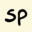

# Square-Cube Law for Spheres

Captured: 2026-10-22T04:32:45.009Z

Source: https://www.google.com/search?q=spheres+are+square+cubed+because...&client=ms-android-xiaomi-terr2-rso2&hs=VcWB&sca_esv=87b8da2d8dff4785&sxsrf=APpeQnuNIo09Rj9ank4yeHMxpqU6f3S7ww%3A1792638640753&source=chrome.ob&fbs=ABfTbFVyMZGZf1hfvX9uKjN_-G8c4u0nXx4bEIpwm1lnNH832a9BVCEiB2iPJNekNderQwJGZIG7YID1eBGNWasq2rzBIURiSCrdR156KVg_RXap7nymj7qwomXHj_SiILyyw7TcR3PVsX7LYP5lqUywwLYwse9eq2FeU_-NVh-70aseSA4lTx9cXY16UPdF4e2jlvrjfGwp&vsint=&aep=1&ntc=1&cs=1&sa=X&ved=2ahUKEwjO55Gr08yXAxWX8bsIHV9qBrwQ2J8OegQIEBAE&biw=375&bih=691&dpr=3.25&mstk=AUtExfDgyg2pQFNuzbFOYSzHR8IRbIkZuq-waZVGn3D2giKNPtjj7D4IloGD2KrX_-ExpGzgPVpJVjIPFmKjBniDPNUJ5dGINeC9V1UHZgKaiFN0E6S-Buq2y4arNHvF_bpOjMOBzOSuGScVh0xrjMxt3-0cXHinw9V9jpre0VhLlLzLJ3WQHc7v2VsLhKNXih1khXQ-kB3FcTGsGC6QHId52dGvEFvIyxdPx98qDkYGcENtEtsw4KY_tcyLriKaDL7N1fGWOhtn527Svw&csuir=1&mtid=zn_Zara8JNmF9u8P3L_7uAY&udm=50

## Prompt 1 — You

spheres are square cubed because...

## Response 1 — Google AI Mode

It sounds like you are referring to the **Square-Cube Law** and how it applies to spheres! 

Sketchplanations

Spheres perfectly demonstrate the square-cube principle because of how their two-dimensional surface area and three-dimensional volume scale in relation to their radius ( $r$ ): 

University of Colorado Boulder

### 1. The "Square" (Surface Area)

The surface area of a sphere relies on the radius **squared** ( $r^{2}$ ):  
 $\text{Surface\ Area}=4\pi r^{2}$   
Because area is a two-dimensional measurement, if you double the radius of a sphere, its surface area increases by a factor of  $2^{2}$ , or **4 times**. 

YouTube·Math and Science +1

### 2. The "Cube" (Volume)

The volume of a sphere relies on the radius **cubed** ( $r^{3}$ ):  
 $\text{Volume}=\frac{4}{3}\pi r^{3}$   
Because volume is a three-dimensional measurement of space, if you double the radius of a sphere, its total volume increases by a factor of  $2^{3}$ , or **8 times**. 

YouTube +2

### Why this matters (The Square-Cube Law)

As a sphere grows larger, its **volume grows much faster than its surface area**. This mathematical reality dictates why biological cells stay tiny (to maximize surface area for absorbing nutrients) and why giant spherical structures hold heat much better than small ones. 

Khan Academy +2

Are you studying the **Square-Cube Law** for biology, physics, or geometry? I can show you how this applies to **animal sizes** or help you solve a specific math problem if you have one!

### Source links

- [sketchplanations.com](https://sketchplanations.com/the-square-cube-law)
- [casa.colorado.edu](https://casa.colorado.edu/~hornstei/math/math4.html)
- [www.youtube.com](https://www.youtube.com/watch?v=976rKThFF-A)
- [www.youtube.com](https://www.youtube.com/watch?v=HmUeFEog3pM)
- [www.khanacademy.org](https://www.khanacademy.org/science/ap-biology/cell-structure-and-function/cell-size/v/volume-of-a-sphere)
