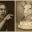

# Grift and Graft Botany

Captured: 2026-10-22T04:44:41.032Z

Source: https://www.google.com/search?sca_esv=882e2611175d5c4b&sxsrf=APpeQns72gG-R7hI16PfGAc3u3BCPaV0gA%3A1792560296472&ei=o0zYasnQM8SM9u8P8bP7oAw&biw=1707&bih=898&uact=5&sclient=gws-wiz-serp&ntc=1&cs=1&udm=50&atvm=2&ved=0CA0Q2_wOahcKEwiA_q-b6MyXAxUAAAAAHQAAAAAQNg&mstk=AUtExfAa6wvHiCV-hdhL-gqJF9RscoN9YRFD02cw2vdb0GIAAUVlfk29oua12qHs50-pAcl_o1v1Krc5vdu_cN3LwL0kuAHfYma-bAeYOGMZU-HRjrcSDSudksgYhMXv6wsw-neuMGeh8XNgVFBEU5ULvbRSS8wir8aG5nmjTHTnTfdJycDDrPXcxY4dETL8E_jAr8fi_RxoaknysRcc9mwTE7avDlVYuiZrAUdRsVlBKZt2lkgOo5EZCkLawM4NsHhV-2mDupu7tHSh9jIXILfz9xg2ZHslfKpy-4uSp4oWIQDqjB57IbyiHe3_2LDyDZYtEYgQnUFjGRRPZA&mtid=X5DZar23N5rN-d8PoJGF6QY&csuir=1&aep=26&q=grift+graft+in+regards+to+botany+and+the+gay

## Prompt 1 — You

grift graft in regards to botany and the gay

## Response 1 — Google AI Mode

While **"grift"** and **"graft"** are primarily known today as slang for scams or corruption, their relationship to botany and the queer community involves a mix of literal linguistic roots and modern eco-queer philosophy.

### 1. The Botanical Root: Grafting

In botany, **grafting** is the centuries-old horticultural practice of cutting a piece of one plant (the scion) and fusing it onto the root system of another plant (the rootstock) so they regenerate tissue and grow together as one. 

Wikipedia +1

* **The Slang Evolution:** In late 19th-century America, the botanical concept of inserting an outside branch into a tree to pull nutrients from it became a metaphor for corrupt political operators inserting themselves into public institutions to pocket money—hence, political **"graft"**. 

  Goatfury Writes +1
* **The Birth of "Grift":** By the early 20th century, criminal underworld slang twisted the word "graft" into **"grift"** to specifically mean petty swindles, confidence games, and scams. 

  YouTube·iswearenglish +1

### 2. The Queer Connection: "Queer Botany" and Bodily Porosity

In modern academic and queer cultural spaces, the concept of botanical **grafting** has been heavily reclaimed as a metaphor for trans and queer experiences. This field is often explored under the lens of **Queer Botany** or queer ecology.

* **Deconstructing "Natural" Binaries:** Traditional views often claim that nature relies strictly on binary, heterosexual reproduction (seed and egg). Queer ecology uses botany to challenge this. Plants regularly reproduce via asexual cloning, self-pollination, and horizontal gene transfer. 

  National Institutes of Health (NIH) | (.gov) +2
* **Grafting as Queer Assemblage:** In essays like Elvia Wilk’s [*This Compost: Erotics of Rot* on Granta](https://granta.com/erotics-of-rot/), scholars discuss how botanical grafting represents a "porous body" that dissolves the boundaries of fixed identity. Grafting creates a single organism out of completely different individuals, mirroring how queer communities construct "chosen families" or how transgender individuals utilize medical procedures (like skin grafts or tissue modifications) to align their physical bodies with their internal identities. 

  YouTube·iswearenglish +2
* **The "Sexual Preference Grift":** In internet socio-political commentary, you will occasionally see the word **grift** used contentiously regarding queer identity. For instance, certain essays or cultural critics use the phrase "the sexual preference grift" to describe online discourse or dating politics where individuals claim that establishing personal sexual boundaries is a form of moral or political failing. 

  Medium

**Summary:**  
The linguistic pipeline traveled from **botanical fusion (graft)** to **criminal scamming (grift)**. Today, queer theorists flip the script, pointing back to botanical grafting as proof that nature isn't strictly binary, but rather a fluid space of modification, adaptation, and shared survival. 

Botany One +2

### Source links

- [en.wikipedia.org](https://en.wikipedia.org/wiki/Grafting)
- [goatfury.substack.com](https://goatfury.substack.com/p/grift-and-graft)
- [www.youtube.com](https://www.youtube.com/watch?v=EzikPv6gfAU&t=1)
- [pubmed.ncbi.nlm.nih.gov](https://pubmed.ncbi.nlm.nih.gov/40200023/)
- [This Compost: Erotics of Rot on Granta](https://granta.com/erotics-of-rot/)
- [www.youtube.com](https://www.youtube.com/watch?v=S-9lga135NU&t=278)
- [medium.com](https://medium.com/@denoiser/the-sexual-preference-grift-how-collective-guilt-became-bedroom-politics-13a2933d30cb)
- [www.botany.one](https://www.botany.one/the-queer-side-of-botany/)
