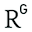

# Knop Topologische Geometrische Switch

Captured: 2026-10-22T12:14:51.792Z

Source: https://www.google.com/search?client=ms-android-xiaomi-terr2-rso2&hs=10BW&sca_esv=07633221db169b35&sxsrf=APpeQntuaRtRzD00AqwBFI6YSldhi9AeDw%3A1792653057586&vsint=&ntc=1&cs=1&sa=X&ved=0CDEQ2_wOahcKEwj4_LLFzM2XAxUAAAAAHQAAAAAQGg&biw=375&bih=691&dpr=3.25&udm=50&atvm=2&mstk=AUtExfABcDV_deWIpyailS-ZyU3FN9bWINf_ZkxU7TXmbCO_l9tea44Lhzwhxy9FDulzD9L-jbQ6EO6LTPGhFxLfHvISPKEbw6t5-MGjzPHxOM4BFePrZOpop9QuRHD2ZR35OtQTRLq7SFT7ho_8NjZxrLp26_XdxsgrQUa8nh1a-e8KdTGXX3QIhDoobg2iPZApTnH7zpAvqFwOpl2rmiYA21E8pEc_n5f3pj8PirEXfyMwhSk6r0DqM3DBgfUPf5ewpP-GUJpqJOmXSDt7QOW5xFbZK1A8ItNdviAgEdEh3n-QwG4NnhZNWZKTbiYWMWv6K6i_QmtOTrjxmg&mtid=PJ7ZaquxJ6vsi-gP8onMsAg&csuir=1&aep=26&q=y+knoop+topologisch+geometrisch+switch

## Prompt 1 — You

y knoop topologisch geometrisch switch

## Response 1 — Google AI Mode

In de context van computernetwerken, data-infrastructuur en netwerktopologie verwijst de combinatie van een **Y-knoop, een topologische/geometrische switch** naar het fundamentele verschil tussen hoe een netwerk **logisch verbonden is** (topologisch) versus hoe het **fysiek is ingericht** (geometrisch). 

downloads.rijkswaterstaatdata.nl +1

Een **Y-knoop** (vaak een *Y-junction* of *Y-branch* genoemd) functioneert hierin als een splitsingstype of elektronische/optische switch die data of signalen van één invoerpad naar twee verschillende outputkanalen kan sturen. 

IOPscience

### Het verschil tussen Topologisch en Geometrisch

Bij het ontwerpen en beheren van switches en knooppunten (nodes) wordt er strikt onderscheid gemaakt tussen deze twee benaderingen:

* **Topologische Switch (Logisch):** Dit kijkt puur naar de *relaties* en verbindingen tussen de netwerkcomponenten, ongeacht de afstand of fysieke locatie. Topologisch gezien is een Y-knoop een splitsing waar 1 datastroom switcht naar 2 paden (een 1×2 switch). Zolang de kabel niet wordt doorgeknipt, blijft deze logische Y-structuur exact hetzelfde, of de kabels nu in een knoop liggen, meters lang zijn of door een muur lopen. 

  ResearchGate +2
* **Geometrische Switch (Fysiek/Ruimtelijk):** Dit kijkt naar de *werkelijke fysieke vorm, coördinaten en hardware-eigenschappen* van de switch en de knoop. In micro-elektronica of fotonica (optische switches) bepaalt de exacte geometrie (de hoek van de 'Y'-splitsing, de dikte van de banen en de materiaallagen) hoe efficiënt het signaal switcht en hoeveel signaalverlies optreedt. 

  SCIA Engineer +3

### Toepassingen van de Y-Knoop Switch

Afhankelijk van het vakgebied waarin je deze termen tegenkomt, heeft de Y-knoop switch een specifieke betekenis:

1. **Geografische Netwerken & GIS (Wegen/Kabels):** In infrastructurele netwerktopologie is een *junctie-ID* (knoop) het punt waar wegen of datalijnen splitsen. De topologie bepaalt de logische route, terwijl de geometrie de exacte X- en Y-coördinaten op de kaart definieert. 

   downloads.rijkswaterstaatdata.nl
2. **Quantummechanica & Geavanceerde Elektronica:** In moderne quantumcomponenten (zoals *topological insulators*) worden Y-junctions gebruikt om elektronenstromen te schakelen. Hierbij zorgt de *band-topologie* (een theoretische 'knoop' in de energieniveaus van het materiaal) ervoor dat de switch extreem energiezuinig werkt, omdat het signaal beschermd is tegen geometrische imperfecties. 

   arXiv.org +1
3. **Optische Switches:** Bij glasvezelnetwerken splitst een geometrische Y-branch het lichtsignaal fysiek op in twee kanalen om als een snelle switch te fungeren. 

   ResearchGate +1

Om je gerichter te helpen, over welk type netwerk of switch gaat je vraag precies? Zoek je bijvoorbeeld informatie over **GIS-kaartensystemen**, **netwerkhardware (zoals Cisco switches)** of de wiskundige achtergrond uit de **quantumfysica/knopentheorie**?

### Source links

- [downloads.rijkswaterstaatdata.nl](https://downloads.rijkswaterstaatdata.nl/nwb-wegen/productinfo/beschrijvende_documentatie/Gebruikershandleiding_NWB_Wegen_v1.1.docx)
- [iopscience.iop.org](https://iopscience.iop.org/article/10.1088/2053-1583/ae5831)
- [www.researchgate.net](https://www.researchgate.net/figure/a-Schematic-of-the-Y-branch-switch-structure-W-800-nm-h-50-nm-L1-500-nm-L2_fig1_327256792)
- [www.scia.net](https://www.scia.net/nl/support/faq/scia-engineer/modelleren/lokaal-coordinatensysteem-knoop)
- [arxiv.org](https://arxiv.org/abs/2506.05051)
