# 3D Printed Choke

Captured: 2026-10-22T12:15:09.445Z

Source: https://www.google.com/search?client=ms-android-xiaomi-terr2-rso2&hs=10BW&sca_esv=07633221db169b35&sxsrf=APpeQntuaRtRzD00AqwBFI6YSldhi9AeDw%3A1792653057586&vsint=&ntc=1&cs=1&sa=X&ved=0CCUQ2_wOahcKEwj4_LLFzM2XAxUAAAAAHQAAAAAQGg&biw=375&bih=691&dpr=3.25&udm=50&atvm=2&mstk=AUtExfB-ap6dJ3OfFNxi3dmiTqMGKFXxjqepehju-MUEeBZn-CqLKGTuf6vzPK6sgNmkwScNbc0_bBm9xAi_oX7Bk2T_hZdQ9ZtalM9O-iWS3JZRqenW074C51aNgm16Tc0NAOxXUEnljzB-CAzT2AjtE3gLqqRtDxG3hurvfld7rjaLssUT7jc78-2LGp-oefUwnaAwgvf41cVLjAUfvrqvRDdZO6CZqJWyht3zXxgTtiGByxTCWH1an5MvLhgTADFLfjFvqUUrvQJAcg&mtid=RqrZauSJEa3Li-gPxZiUkQ4&csuir=1&aep=26&q=3D+printed+choke

## Prompt 1 — You

3D printed choke

## Response 1 — Google AI Mode

The term **"3D printed choke"** can refer to several completely different objects depending on your industry or hobby.

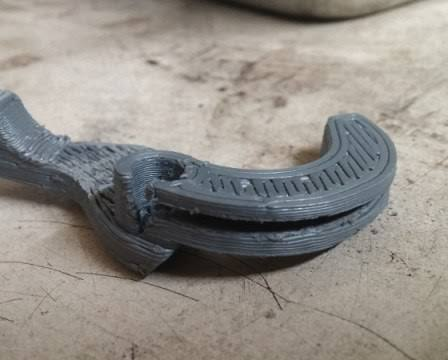

[Printed Motorcycle Choke Lever Goes The Distance | Hackaday

Hackaday](https://hackaday.com/2018/02/15/printed-motorcycle-choke-lever-goes-the-distance/)

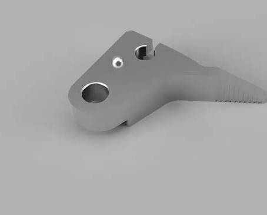

[Carburetor choke lever by NX.Richi | Download free STL model ...

Printables.com](https://www.printables.com/model/411589-carburetor-choke-lever)

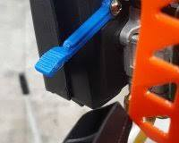

["carburetor choke lever" 3D Models to Print - yeggi

Yeggi](https://www.yeggi.com/q/carburetor+choke+lever/)

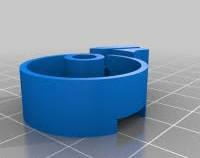

["carburetor choke lever" 3D Models to Print - yeggi

Yeggi](https://www.yeggi.com/q/carburetor+choke+lever/)

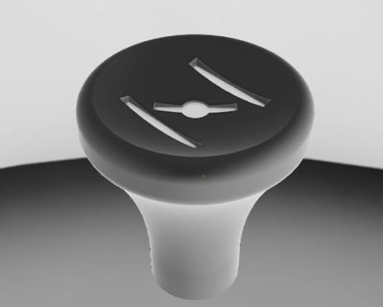

[UNIVERSAL CARBURETOR CHOKE KNOB – COLD START PULL ...

Printables.com](https://www.printables.com/model/1637218-universal-carburetor-choke-knob-cold-start-pull-kn)

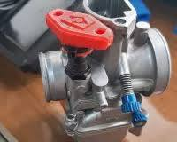

["carburetor choke lever" 3D Models to Print - yeggi

Yeggi](https://www.yeggi.com/q/carburetor+choke+lever/)

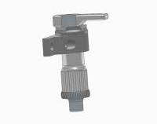

["carburetor choke" 3D Models to Print - yeggi

Yeggi](https://www.yeggi.com/q/carburetor+choke/)

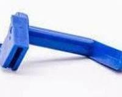

["carburetor choke lever" 3D Models to Print - yeggi

Yeggi](https://www.yeggi.com/q/carburetor+choke+lever/)

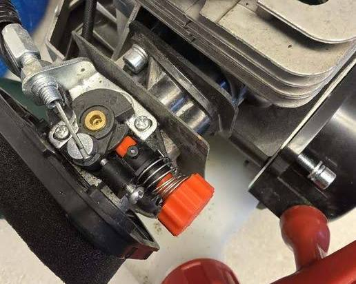

[Parkside PBS 2 C3 IAN 351633\_2007 choke knob・Free 3D File for ...

Cults 3D](https://cults3d.com/en/3d-model/tool/parkside-pbs-2-c3-ian-351633_2007-choke-knob)

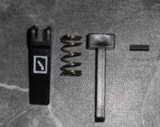

["choke lever" 3D Models to Print - yeggi

Yeggi](https://www.yeggi.com/q/choke+lever/)

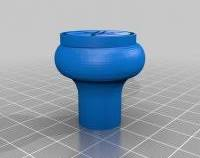

["choke lever" 3D Models to Print - yeggi - page 3

Yeggi](https://www.yeggi.com/q/choke+lever/3/)

### 1. Small Engine & Carburetor Chokes

In automotive, motorcycle, and lawncare repairs, 3D printing is widely used to fabricate replacement mechanical components. This is highly popular because factory plastic pieces brittle and snap over time. 

Yeggi +1

* **Common Prints:** Choke levers, knobs, control arms, and cable adapters.
* **Best Materials:** **PETG**, **ABS**, or **Nylon**. Standard PLA will distort or melt under a hot engine bay or if exposed to gas and UV rays.
* **Where to find files:** You can find exact-fit replacements for brands like Yamaha, Honda, Stihl, and Toro on platforms like [Printables](https://www.printables.com/tag/choke) and [Yeggi](https://www.yeggi.com/q/choke+lever/). 

  Printables.com +3

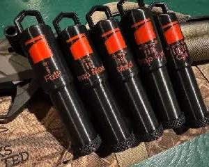

[Choke Tube Case by Colton | Download free STL model ...

Printables.com](https://www.printables.com/model/547525-choke-tube-case)

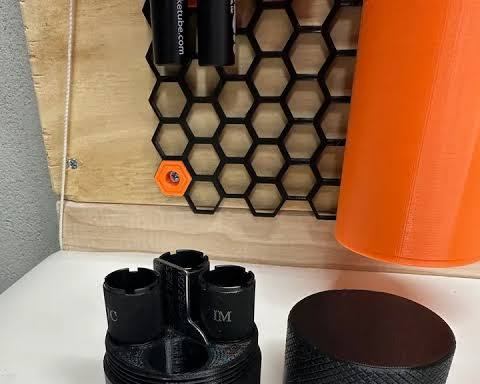

[Shotgun Choke Organizer by Octantis | Download free STL model ...

Printables.com](https://www.printables.com/model/822849-shotgun-choke-organizer)

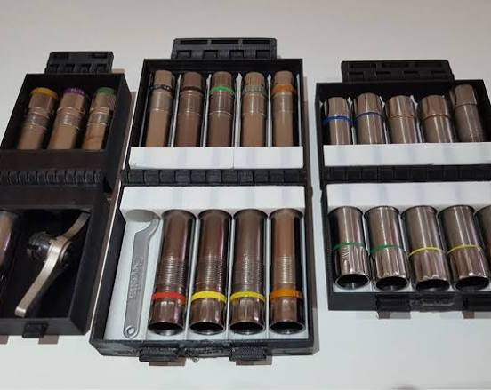

[12G 20G Shotgun choke boxes by Les Kaye | Download free STL ...

Printables.com](https://www.printables.com/model/76535-12g-20g-shotgun-choke-boxes/related)


[Shotgun Choke Organizer by Octantis | Download free STL model ...

Printables.com](https://www.printables.com/model/822849-shotgun-choke-organizer)

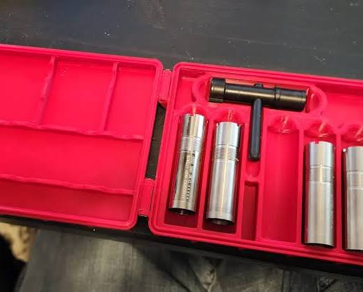

[Choke Tube Storage Box by CadeyzDad | Download free STL ...

Printables.com](https://www.printables.com/model/358023-choke-tube-storage-box)

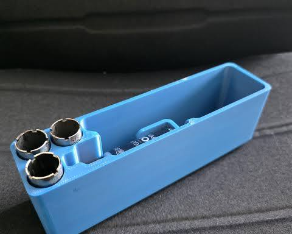

[3D Printed Choke Tube Holder for Beretta 686 Silver Pigeon I | Fits ...

Etsy](https://www.etsy.com/listing/4315141529/3d-printed-choke-tube-holder-for-beretta)

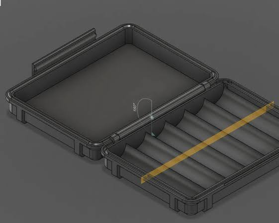

[Choke Tube Case by Colton | Download free STL model | Printables ...

Printables.com](https://www.printables.com/model/547525-choke-tube-case)

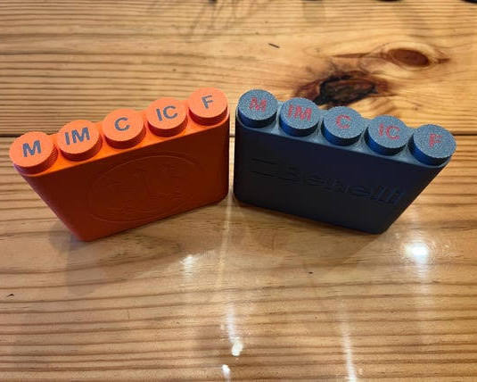

[5x Extended Shotgun Choke Case - Etsy

Etsy](https://www.etsy.com/listing/1885830935/5x-extended-shotgun-choke-case)

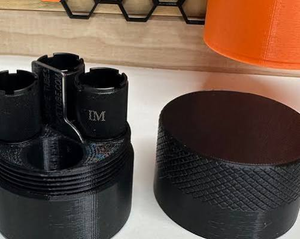

[Shotgun Choke Organizer by Octantis | Download free STL model ...

Printables.com](https://www.printables.com/model/822849-shotgun-choke-organizer)

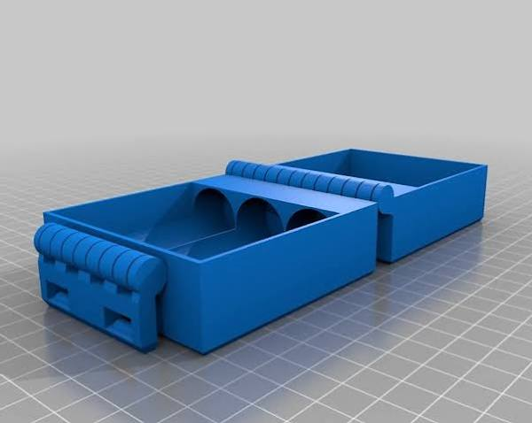

[12G 20G Shotgun choke boxes by Les Kaye | Download free STL ...

Printables.com](https://www.printables.com/model/76535-12g-20g-shotgun-choke-boxes/related)


[Benelli Advanced Impact (A.I.) 12GA Choke Tube Case by ...

Printables.com](https://www.printables.com/model/1358477-benelli-advanced-impact-ai-12ga-choke-tube-case)

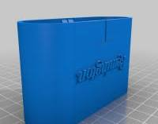

["choke tube case" 3D Models to Print - yeggi

Yeggi](https://www.yeggi.com/q/choke+tube+case/)

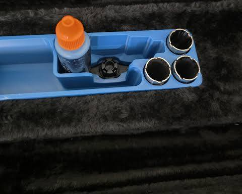

[3D Printed Choke Tube Holder for Beretta 686 Silver Pigeon I | Fits ...

Etsy](https://www.etsy.com/listing/4315141529/3d-printed-choke-tube-holder-for-beretta)

### 2. Shotgun Choke Accessories

**Do not 3D print actual choke tubes for real firearms.** The extreme pressure and friction of a real shotgun shell firing will immediately destroy a 3D-printed plastic choke, risking catastrophic failure and severe injury.

* **Safe Applications:** 3D printing is heavily utilized for firearm organization, such as custom **choke tube storage boxes**, snap-fit range bag organizers, and choke wrenches. 

  Printables.com +1
* **Airsoft Exception:** Players frequently print custom cosmetic chokes or muzzle brakes for airsoft shotguns where pressure is not a hazard. 

  Yeggi
* **Where to find files:** Look up the [Compact Shotgun Choke Holder on MakerWorld](https://makerworld.com/en/models/1250025-compact-shotgun-choke-holder) or various multi-gauge cases on [Thingiverse](https://www.thingiverse.com/thing:3652790/files). 

  Thingiverse +1

### 3. Electronics & RF Common-Mode Chokes

In amateur radio (Ham radio) and electronics, a choke is an inductor used to block high-frequency alternating current.

* **Common Prints:** Enclosures, weather-proof boxes, and mounting brackets for toroid cores and baluns.
* **Best Materials:** **PETG** or **ASA** to withstand long-term outdoor weather and UV exposure.
* **Where to find files:** Check out community tutorials like the [RF Choke Box Design on YouTube](https://www.youtube.com/watch?v=D2d_DFWVaeo). 

  Printables.com +2

### 4. Child Safety Tools (Choke Testers)

Pediatric and safety organizations use 3D printers to make **small parts choke testers**. These are specially sized cylinders designed to mimic an infant's airway to verify if a toy or object poses a choking hazard. 

Printables.com +1

---

**Which specific type of choke project are you looking to build or print?** If you provide the application (e.g., a specific motorcycle model or a shotgun gauge), I can guide you to the exact materials and files you need.

### Source links

- [Printed Motorcycle Choke Lever Goes The Distance | Hackaday
Hackaday](https://hackaday.com/2018/02/15/printed-motorcycle-choke-lever-goes-the-distance/)
- [Carburetor choke lever by NX.Richi | Download free STL model ...
Printables.com](https://www.printables.com/model/411589-carburetor-choke-lever)
- ["carburetor choke lever" 3D Models to Print - yeggi
Yeggi](https://www.yeggi.com/q/carburetor+choke+lever/)
- [UNIVERSAL CARBURETOR CHOKE KNOB – COLD START PULL ...
Printables.com](https://www.printables.com/model/1637218-universal-carburetor-choke-knob-cold-start-pull-kn)
- ["carburetor choke" 3D Models to Print - yeggi
Yeggi](https://www.yeggi.com/q/carburetor+choke/)
- [Parkside PBS 2 C3 IAN 351633_2007 choke knob・Free 3D File for ...
Cults 3D](https://cults3d.com/en/3d-model/tool/parkside-pbs-2-c3-ian-351633_2007-choke-knob)
- [Yeggi](https://www.yeggi.com/q/choke+lever/)
- ["choke lever" 3D Models to Print - yeggi - page 3
Yeggi](https://www.yeggi.com/q/choke+lever/3/)
- [www.yeggi.com](https://www.yeggi.com/q/choke/)
- [www.printables.com](https://www.printables.com/tag/choke)
- [Choke Tube Case by Colton | Download free STL model | Printables ...
Printables.com](https://www.printables.com/model/547525-choke-tube-case)
- [Shotgun Choke Organizer by Octantis | Download free STL model ...
Printables.com](https://www.printables.com/model/822849-shotgun-choke-organizer)
- [12G 20G Shotgun choke boxes by Les Kaye | Download free STL ...
Printables.com](https://www.printables.com/model/76535-12g-20g-shotgun-choke-boxes/related)
- [Choke Tube Storage Box by CadeyzDad | Download free STL ...
Printables.com](https://www.printables.com/model/358023-choke-tube-storage-box)
- [3D Printed Choke Tube Holder for Beretta 686 Silver Pigeon I | Fits ...
Etsy](https://www.etsy.com/listing/4315141529/3d-printed-choke-tube-holder-for-beretta)
- [5x Extended Shotgun Choke Case - Etsy
Etsy](https://www.etsy.com/listing/1885830935/5x-extended-shotgun-choke-case)
- [Benelli Advanced Impact (A.I.) 12GA Choke Tube Case by ...
Printables.com](https://www.printables.com/model/1358477-benelli-advanced-impact-ai-12ga-choke-tube-case)
- ["choke tube case" 3D Models to Print - yeggi
Yeggi](https://www.yeggi.com/q/choke+tube+case/)
- [www.yeggi.com](https://www.yeggi.com/q/shotgun+choke/)
- [Compact Shotgun Choke Holder on MakerWorld](https://makerworld.com/en/models/1250025-compact-shotgun-choke-holder)
- [www.thingiverse.com](https://www.thingiverse.com/thing:3652790/files)
- [RF Choke Box Design on YouTube](https://www.youtube.com/watch?v=D2d_DFWVaeo)
- [www.printables.com](https://www.printables.com/tag/choking)

## Prompt 2 — You

You sent: 1 tab and said: https://www.google.com/search?q=bernoulli+principle+apply+two+points&client=ms-android-xiaomi-terr2-rso2&hs=GfWB&sca_esv=45d061d4175d1694&sxsrf=APpeQntAayXReJR2TLHl_wthfMs1tIlIWw%3A1792648895899&source=chrome.ob&fbs=ABfTbFVyMZGZf1hfvX9uKjN_-G8c4u0nXx4bEIpwm1lnNH832a9BVCEiB2iPJNekNderQwJGZIG7YID1eBGNWasq2rzBIURiSCrdR156KVg_RXap7nymj7qwomXHj_SiILyyw7TcR3PVsX7LYP5lqUywwLYwse9eq2FeU_-NVh-70aseSA4lTx9cXY16UPdF4e2jlvrjfGwp&vsint=&aep=1&ntc=1&cs=1&sa=X&ved=2ahUKEwj3l5bF-cyXAxXG_7sIHY0OJTgQ2J8OegQIERAE&biw=375&bih=691&dpr=3.25&mstk=AUtExfBkamdlHqcmmNjyRWxIXxoCLp2LrLNAsmfVdiXq38Z5f4PsCJdrU4IwSUP7YHDBvMsJKCX2LFp3_j7yx8KAt8WWvszfD2o5W9NRKoFxUEe0Aq0-gtgRNEtpRljdTN-gfeY7gyj3f6y7TbsrEllz2-gJV6uwKlbIP0q7bOmq181wiXLbX9E1mKO4DgII1LlSZd97K4WVxy2BVjBCmL3iqvIYyjCJ6TE_tvqqeABpOzsIoGkaKjKB4fFuKJsTT_t02Rzw3vsaFnqkLw&csuir=1&mtid=y6bZau27E7b87_UPjYvU6QY&udm=50

Attachment availability: The shared-tab label and visible source references are preserved.

## Response 2 — Google AI Mode

To apply **Bernoulli's principle between two points** in a fluid flow, the total energy per unit mass must be conserved between them. 

YouTube·Derek Elsworth

```
   Point 1                                                   Point 2
  ┌───────┐                                                 ┌───────┐
  │ P₁    │ ───►  Static Pressure                           │ P₂    │
  │ ½ρv₁² │ ───►  Kinetic Energy Density (Velocity)         │ ½ρv₂² │
  │ ρgh₁  │ ───►  Potential Energy Density (Elevation)      │ ρgh₂  │
  └───────┘                                                 └───────┘
      └─────────────────── Total Sum is Equal ──────────────────┘
```

The fundamental equation is written as: 

Khan Academy +1

  
 $\mathbf{P}\_{\mathbf{1}}\mathbf{+}\frac{\mathbf{1}}{\mathbf{2}}\mathbf{\rho v}\_{\mathbf{1}}^{\mathbf{2}}\mathbf{+\rho gh}\_{\mathbf{1}}\mathbf{=P}\_{\mathbf{2}}\mathbf{+}\frac{\mathbf{1}}{\mathbf{2}}\mathbf{\rho v}\_{\mathbf{2}}^{\mathbf{2}}\mathbf{+\rho gh}\_{\mathbf{2}}$

Where:

* P = Static pressure at the point
* ρ (rho) = Fluid density
* v = Fluid velocity
* g = Acceleration due to gravity
* h = Height relative to a chosen reference level 

  YouTube·Ancient Brains MCAT

---

### 📋 4 Strict Conditions Required for Application

For the sum of these energies to remain identical between Point 1 and Point 2, the fluid flow must satisfy these criteria: 

YouTube·Derek Elsworth

1. **Along the Same Streamline:** Strictly speaking, the two points must lie on the exact same pathway traveled by a fluid particle. *(Exception: If the flow is completely **irrotational**—meaning there are no vortices or swirling—the constant is the same everywhere, and you can pick any two points in the fluid).* 

   Physics Stack Exchange +3
2. **Steady Flow:** The fluid velocity and pressure at any fixed location cannot change over time. 

   Cadence +1
3. **Incompressible Fluid:** The density (ρ) must remain constant throughout the flow (typically true for liquids like water, and gases at low speeds). 

   YouTube·Andrey K +1
4. **Inviscid (Frictionless) Flow:** There must be no viscous drag, internal friction, or mechanical energy lost as heat within the fluid. 

   sharif.ir +1

---

### 🛠️ Step-by-Step Application Guide

#### Step 1: Establish Your Reference Line (Datum)

Pick a horizontal baseline where h = 0. Measure your heights h₁ and h₂ vertically up from this line. If the points are at the exact same elevation (like a horizontal pipe), h₁ = h₂, and both ρ g h terms cancel out entirely. 

Turn2engineering +3

#### Step 2: Identify Stagnation or Exposed Points

Look for locations that drastically simplify the math: 

YouTube·Ancient Brains MCAT

* **Open to Atmosphere:** If a point is open to the air (like the top of a tank or a nozzle exit), its static pressure equals atmospheric pressure (P = 0 if using gauge pressure). 

  YouTube +1
* **Stagnation Points / Large Reservoirs:** If Point 1 is at the surface of a massive tank, the fluid surface drops so slowly that its velocity is effectively zero (v₁ ≈ 0). 

  Physics Stack Exchange +1

#### Step 3: Pair with the Continuity Equation

If you have a pipe with changing cross-sectional areas (A₁ and A₂), use the [Continuity Equation](https://physicsfundamentals.org/blog/bernoullis-principle) to relate the two velocities before solving Bernoulli's equation: 

Physics Fundamentals +1

  
 $A\_{1}v\_{1}=A\_{2}v\_{2}$

Are you trying to solve a **specific physics problem** or analyze a **real-world system** (like a venturi meter, siphon, or draining tank)?

If you share the **known variables** (pressures, velocities, or heights) or the **shape of the pipe/container**, I can walk you through the exact algebraic steps to solve it.

### Source links

- [www.youtube.com](https://www.youtube.com/watch?v=Du1vPWs1NXw&t=741)
- [www.khanacademy.org](https://www.khanacademy.org/science/ap-college-physics-1/xf557a762645cccc5:fluids/xf557a762645cccc5:fluid-flow/a/what-is-bernoullis-equation)
- [www.youtube.com](https://www.youtube.com/watch?v=UKXmHHv1qUE&t=262)
- [www.youtube.com](https://www.youtube.com/watch?v=yacGXdNYVSk&t=744)
- [physics.stackexchange.com](https://physics.stackexchange.com/questions/345947/why-can-bernoullis-equation-be-applied-along-two-different-streamlines-for-an-i)
- [resources.system-analysis.cadence.com](https://resources.system-analysis.cadence.com/blog/msa2022-how-to-apply-bernoullis-theorem-in-fluid-mechanics)
- [www.youtube.com](https://www.youtube.com/watch?v=wJFhu3LGoAQ&t=133)
- [sina.sharif.edu](https://sina.sharif.edu/~ataie/FluidMechanics_Course_Web/FM_BAA_03.pdf)
- [turn2engineering.com](https://turn2engineering.com/equations/bernoullis-equation)
- [www.youtube.com](https://www.youtube.com/watch?v=UZQj79ktGBU)
- [physics.stackexchange.com](https://physics.stackexchange.com/questions/852910/how-do-people-verify-if-two-points-are-on-same-streamline-when-applying-bernoull)
- [physicsfundamentals.org](https://physicsfundamentals.org/blog/bernoullis-principle)
