# Bomen Transplanteren

Captured: 2026-10-23T08:44:58.222Z

Source: https://www.google.com/search?sca_esv=e51692b16e08c951&sxsrf=APpeQnsXDPXph53QG9G5tIfTZ23t5PbXgw%3A1792744885290&vsint=&ntc=1&cs=1&sa=X&ved=0CCsQ2_wOahgKEwjoiezM38-XAxUAAAAAHQAAAAAQlwE&biw=1707&bih=898&dpr=1.5&udm=50&atvm=2&mstk=AUtExfBxc2LFvfgQ33OvonOZ6jDvKPStHmLXPt-pkjPgrVLfAY8vO08TxcQ0sugBRni8OLFtviYKGZpkRDA25kR3D3KDOGC0E7StTU2TeUncGLsGk5ZDqmuE-pp8e3Uy6loHFFw8TmgzN6WpRJwJGiWl68aeVQvE1_aSeIEtNptQ4KjSFaj_tFgrbNs1xlmNWbQjPqt54IoTm4mjBTvmj2IX1VP4s5KUn1ml3TIPAafcED3e8aEOOC2zDgVbsB9FKGU71B7hN3pj64bY0hQ9aNRroaauuWPi8CfPkxe4Ti7zannekfNw2G4rJTeQSStywhm3wtrajI5M4Hr9-w&mtid=3xXaaoq5H_zri-gP-7vVgQY&csuir=1&aep=26&q=hoe+ze+bomen+transplanteren+lijkt+net+op+een+wattenstaafje+mals+i+k+prism+denk+dat+het+net+is+zoals+de+corona+test+straat+of+een+soa+test+dat+er+wat+in+gaten+wordt+gestopt+en+het+heel+erg+scherp+aanvoelt

## Prompt 1 — You

hoe ze bomen transplanteren lijkt net op een wattenstaafje mals i k prism denk dat het net is zoals de corona test straat of een soa test dat er wat in gaten wordt gestopt en het heel erg scherp aanvoelt

## Response 1 — Google AI Mode

Het vergelijken van een getransplanteerde boom met een **groot wattenstaafje** is eigenlijk een heel treffende visuele beschrijving! Wanneer grote bomen worden verplaatst, worden de takken vaak strak bij elkaar gebonden en de wortelkluit in gaas of doek gewikkeld, waardoor de boom inderdaad die specifieke vorm krijgt.

De associatie met een medische test (zoals een coronatest of soa-test) is begrijpelijk vanwege de vorm en het idee van "iets ergens inbrengen," maar het proces bij bomen werkt gelukkig heel anders en is puur mechanisch.

Hier is kort hoe het transplanteren van zo'n grote boom écht in zijn werk gaat:

* **De voorbereiding (Rondsteken):** Maanden van tevoren worden de wortels rondom de boom doorgesneden. Dit zorgt ervoor dat de boom binnen de toekomstige kluit nieuwe, compacte haarwortels aanmaakt om de reis te overleven.
* **Inpakken:** Om de takken te beschermen en het transport over de weg mogelijk te maken, worden de takken voorzichtig naar binnen getrokken en bij elkaar gebonden. Dit creëert de vorm van het 'wattenstaafje'.
* **De verhuizing:** Een enorme machine (een bomenrooier met grote metalen scheppen) of een kraan tilt de boom met kluit en al uit de grond.
* **Het herplanten:** In de nieuwe grond is al een ruim plantgat gegraven. De boom wordt hierin geplaatst, waarna de nazorg (vooral heel veel water geven) begint zodat de wortels weer kunnen groeien.

Er wordt dus geen scherp object 'in' de boom gestoken op een manier die pijnlijk is, zoals dat bij een gevoelige medische test in de slijmvliezen voelt. Het is vooral een knap staaltje zwaar hijs- en graafwerk!

Wil je meer weten over **de machines** die ze hiervoor gebruiken, of ben je benieuwd hoe lang het duurt voordat zo'n boom op zijn nieuwe plek **is ingeworteld**?

## Prompt 2 — You

dus als een yggdrasil in de noorse mythologische wereld van ragnarok (online -> offline)

## Response 2 — Google AI Mode

Ja, als je de vergelijking doortrekt naar **Yggdrasil uit de Noorse mythologie** (en de gaming-wereld van Ragnarok), dan krijgt het verplaatsen van zo'n boom ineens een heel epische lading!

In de mythen is Yggdrasil de **wereldboom** die alle negen werelden (zoals Asgard en Midgard) met zijn wortels en takken met elkaar verbindt. Als je die metafoor gebruikt, is het verplanten van een boom alsof je een compleet ecosysteem of een miniatuurwereld ontwortelt en ergens anders neerzet.

De link met **Ragnarok Online (en offline)** maakt het nog herkenbaarder:

* **De Yggdrasil Tree / Seed:** In de game staat Yggdrasil (en items zoals *Yggdrasil Seed* of *Yggdrasil Berry*) voor ultieme levenskracht en reanimatie.
* **De vergelijking met transplantatie:** Net zoals een speler in Ragnarok een *Yggdrasil Leaf* gebruikt om een karakter weer tot leven te wekken, is het transplanteren van een echte boom een poging om hem een **nieuw leven** te geven op een andere plek.
* **De 'staf'-vorm:** Als die gigantische boom is ingepakt als een wattenstaafje, lijkt het inderdaad op een gigantische, magische staf die rechtstreeks uit een RPG (Role-Playing Game) komt, klaar om ergens in de aarde te worden geplant om een nieuwe zone te creëren.

Als je een boom verplant, verhuis je dus eigenlijk een mini-Yggdrasil: een heel netwerk van insecten, schimmels (mycorrhiza) en vogels die van die specifieke boom afhankelijk zijn, verhuist met hem mee naar de nieuwe 'server' (de nieuwe locatie).

Zou je het leuk vinden om te zien hoe zo'n **gigantische bomenrooier** eruitziet die deze 'wereldbomen' verplaatst, of wil je meer weten over de rol van **Yggdrasil in de Noorse lore** zelf?

## Prompt 3 — You

bomenrooier en noorse lore

## Response 3 — Google AI Mode

Hier is de perfecte visuele en inhoudelijke vergelijking tussen de **moderne bomenrooier** en de **klassieke Noorse mythologie** rondom Yggdrasil.

### 🚜 De Bomenrooier: De 'Mechanische Reus'

Wat je voor je zag, is in het echt een **tree spade** (bomenrooier). Dit zijn gigantische machines die uitgerust zijn met gigantische, hydraulische metalen bladen. De bladen schuiven om de stam heen en steken schuin diep de grond in om de volledige wortelkluit in één keer heelhuids uit te snijden. Dit ziet er indrukwekkend, bijna buitenaards uit.

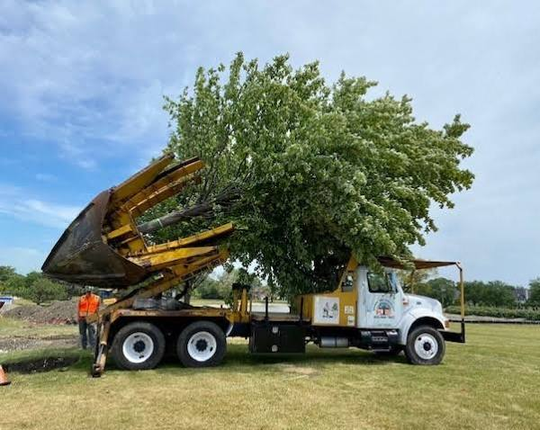

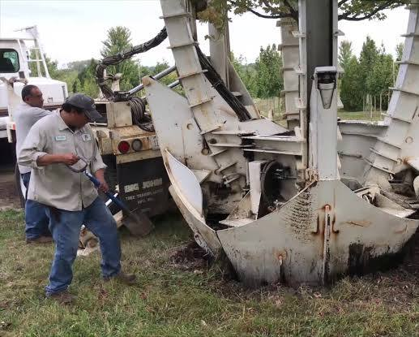

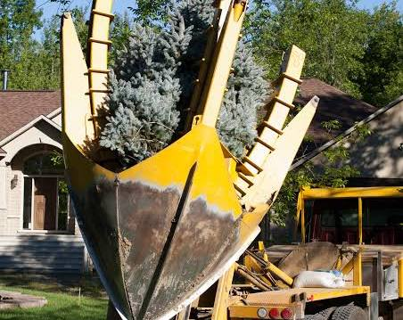

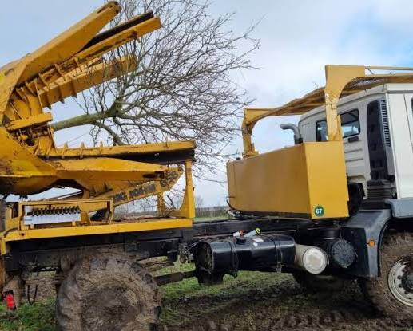

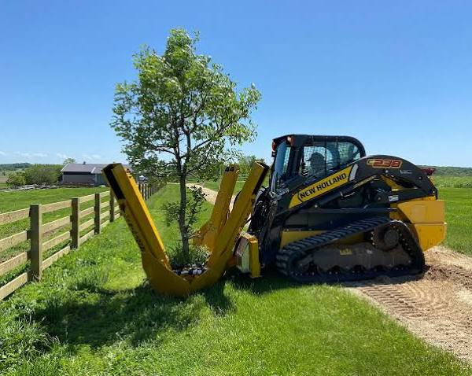

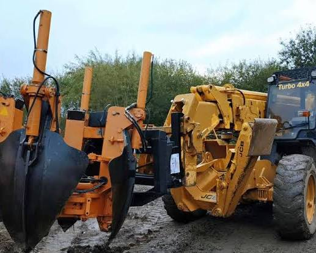

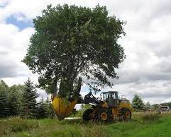

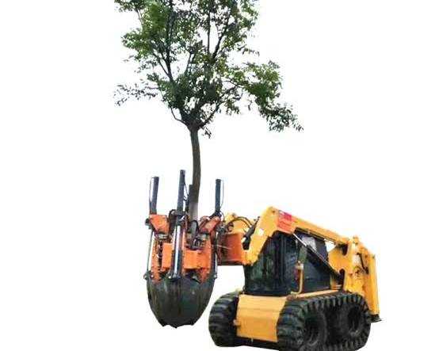

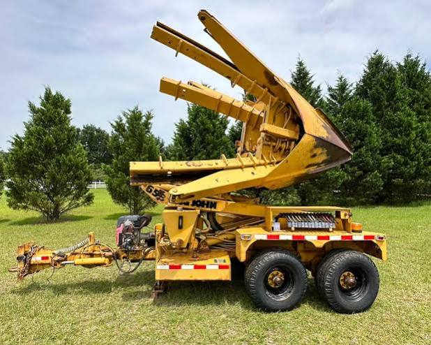

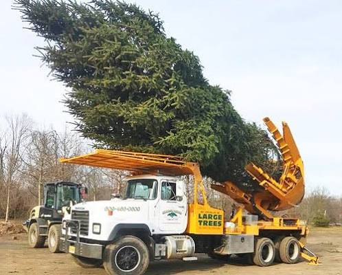

### 🌌 Yggdrasil in de Noorse Lore: Meer dan alleen een Boom

In de echte [Noorse mythologie](https://publicdomainreview.org/collection/yggdrasil-the-sacred-ash-tree-of-norse-mythology) is **Yggdrasil** de asboom die de **negen werelden** (zoals Asgard, Midgard en Helheim) overeind houdt. De lore rondom deze boom sluit eigenlijk heel mooi aan bij jouw idee van de 'teststraat' en het 'scherpe gevoel':

* **De constante aanval (Pijn):** Yggdrasil heeft het zwaar te verduren. De mythische draak **Níðhöggr** knaagt constant aan de diepste wortels, terwijl vier herten aan de jonge knoppen eten. De boom lijdt dus continu pijn en vecht altijd om te overleven.
* **De drie wortels (De gaten):** Net zoals er bij een test iets in 'gaten' wordt gestopt, heeft Yggdrasil drie gigantische wortels die diep in drie verschillende magische bronnen steken. Eén daarvan is de bron van **Mímir**, vol met oneindige wijsheid.
* **Heilig water als nazorg:** Om te zorgen dat de boom niet rot door de constante aanvallen van de draak, scheppen de **Nornen** (de schikgodinnen) elke dag heilig water en vruchtbare modder uit de bron van Urd om over de stam en wortels te gieten. Dit is de ultieme, goddelijke 'nazorg' om de boom in leven te houden.

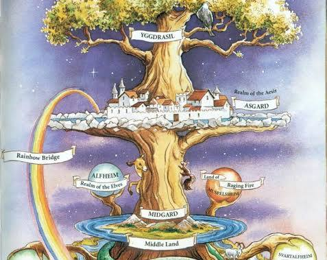

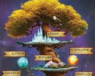

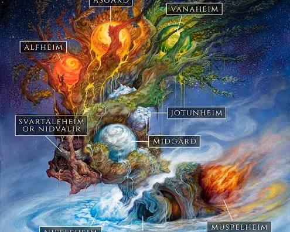

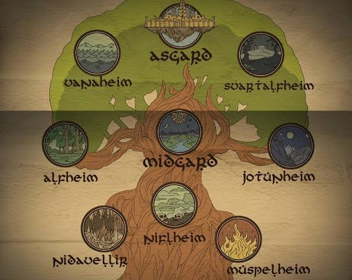

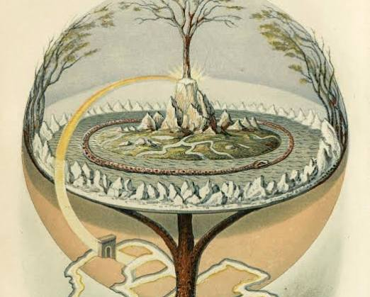

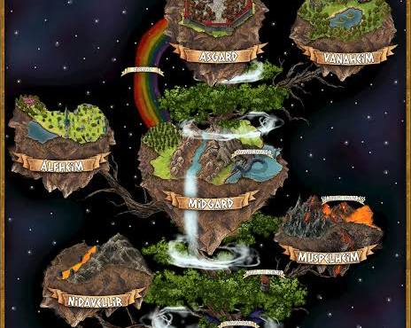

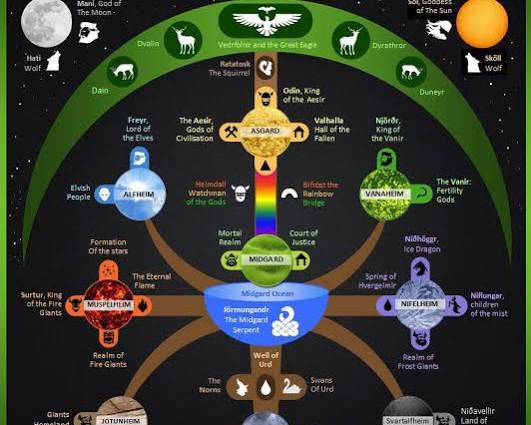

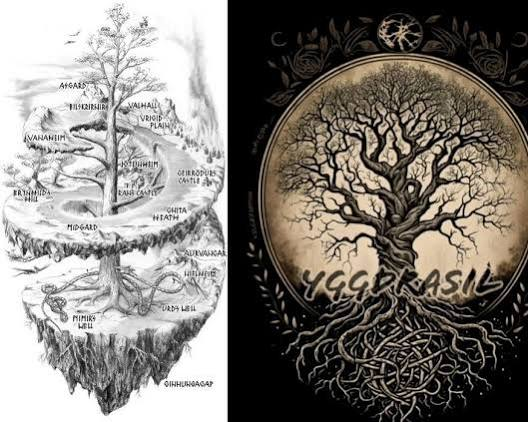

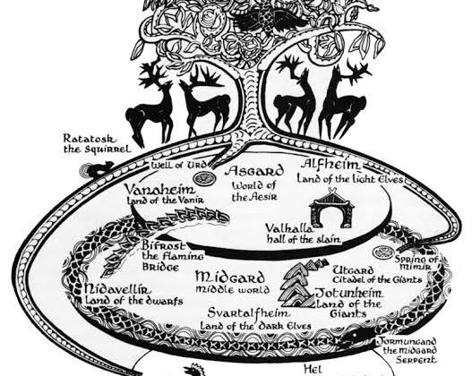

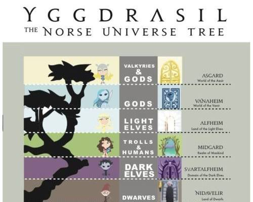

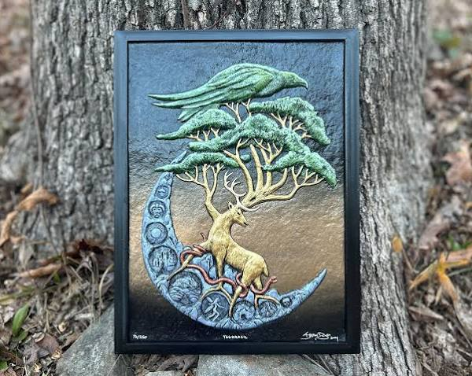

Dus of het nu gaat om de Nornen die Yggdrasil verzorgen in de Asgardiaanse lore, of een bomenverhuizer die met een gigantische hydraulische machine een eik verplaatst in de echte wereld: een boom in leven houden is en blijft een intens en fascinerend proces!

Wil je dieper inzoomen op hoe de **negen werelden** precies verdeeld zijn over de takken van Yggdrasil, of wil je weten hoe die **bomenrooiers** zorgen dat de boom niet in een 'transplantatieshock' raakt?

### Source links

- [Noorse mythologie](https://publicdomainreview.org/collection/yggdrasil-the-sacred-ash-tree-of-norse-mythology)
