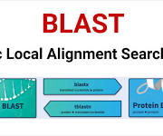

# blast sequencing

Captured: 2026-10-08T04:22:18.003Z

Source: https://www.google.com/search?q=blast+sequencing&gs_lcrp=EgZjaHJvbWUyBggAEEUYOdIBCDQ5NTZqMGo3qAIAsAIA&sourceid=chrome&ie=UTF-8&fbs=ABfTbFVyMZGZf1hfvX9uKjN_-G8c4u0nXx4bEIpwm1lnNH832a9BVCEiB2iPJNekNderQwJGZIG7YID1eBGNWasq2rzBIURiSCrdR156KVg_RXap7vnQU6QWmnWBznGVLK1G8Rykll-s04_elOQbRleKreNqN6HKk20ZyZ-d8SXGwXAN8EIvObbF33JhfJkDoGbxHTj31od_&aep=10&ntc=1&sxsrf=APpeQnvHfbexePLa5Jqv8r8CVuAqgsLyQQ%3A1791004232535&mstk=AUtExfCkugWHwtWXi8n94CI-hTUg0gLCCTi6qO34ZmbLtctntJ8ixdvbyy6ZG3UcrxeLfz_2vhN2rPbRhJDzgzKcxbochAaRwqBPLQAq-REJHhg_T9fxNT-VTS4dRNoEiyE5ggo9D1btP0XJsGHmMVtPvTzKiXaI_TOUHXNm2ZMMd2vOgmGjI3a6f7OG3S1fvrZKlbv4I5bDtf7ekpwW12Vwzy-82-yuSqjdl3VfX4X_3dDOUQBEEHz3GiM-fqCpO1m3N1jZaIRmXCupw3D2yTheGqqzWbkyUIgL4DSbF2Bko5Bn4Sv-hyT7Ha9x3KLE4z2uxmKi05GuBT6jkg&aioh=3&csuir=1&cs=0&udm=50&mtid=c47AarKDDrHti-gP9qOqSA

## Prompt 1 — You

blast sequencing

## Response 1 — Google AI Mode

**BLAST (Basic Local Alignment Search Tool)** compares a query biological sequence (DNA, RNA, or protein) against a database of known sequences to find regional similarities and identify functional or evolutionary relationships. 

National Institutes of Health (NIH) | (.gov) +2

### How BLAST Works

* **Seeding:** The algorithm breaks your query sequence into short words of length *W* and finds exact or high-scoring neighborhood word matches in the database. 

  QIAGEN Digital Insights
* **Extension:** It extends these initial matches in both directions to build a local alignment, stopping when the alignment score drops below a set threshold. 

  QIAGEN Digital Insights
* **Evaluation:** It calculates an **E-value (Expect value)** to show the statistical significance of each match; lower E-values mean the match is less likely to occur by random chance.

### Common Types of BLAST

* **BLASTn:** Compares a nucleotide (DNA/RNA) query against a nucleotide database. 

  National Institutes of Health (NIH) | (.gov)
* **BLASTp:** Compares a protein (amino acid) query against a protein database. 

  National Institutes of Health (NIH) | (.gov)
* **BLASTx:** Translates a nucleotide query in all six reading frames and compares it against a protein database. 

  National Library of Medicine (.gov)
* **tBLASTn:** Compares a protein query against a nucleotide database translated in all six reading frames. 

  Wikipedia

### Main Uses

* Finding the species or gene identity of an unknown sequence.
* Tracing evolutionary history and building phylogenetic trees.
* Locating homologous genes across different organisms. 

  National Institutes of Health (NIH) | (.gov) +3

Would you like help running a specific sequence through the NCBI BLAST Tool, or do you need assistance choosing the right **program parameters** and **database** for your research?

### Source links

- [National Institutes of Health (NIH) | (.gov)](https://blast.ncbi.nlm.nih.gov/Blast.cgi)
- [QIAGEN Digital Insights](https://resources.qiagenbioinformatics.com/manuals/clcgenomicsworkbench/2100/index.php?manual=How_does_BLAST_work.html)
- [National Institutes of Health (NIH) | (.gov)](https://blast.ncbi.nlm.nih.gov/Blast.cgi?PAGE_TYPE=BlastSearch)
- [National Institutes of Health (NIH) | (.gov)](https://blast.ncbi.nlm.nih.gov/Blast.cgi?PAGE=Proteins)
- [National Library of Medicine (.gov)](https://www.nlm.nih.gov/ncbi/workshops/2023-08_BLAST_evol/first_search.html)
- [Wikipedia](https://en.wikipedia.org/wiki/BLAST_(biotechnology))

## Prompt 2 — You

DNA testing heriditary diseases like bone malforming etc.

## Response 2 — Google AI Mode

**Genetic testing for hereditary bone diseases** identifies mutations in DNA that cause skeletal dysplasia, abnormal bone density, and structural malformations. These tests help confirm clinical diagnoses, guide orthopedic treatments, and assess risks for family planning.

### Common Hereditary Bone Conditions Tested

* **Osteogenesis Imperfecta (Brittle Bone Disease):** Caused primarily by mutations in the `COL1A1` or `COL1A2` genes, leading to fragile bones that fracture easily.
* **Achondroplasia:** The most common form of short-limb dwarfism, caused by specific mutations in the `FGFR3` gene affecting cartilage-to-bone conversion.
* **Fibrodysplasia Ossificans Progressiva (FOP):** A rare condition where muscle and connective tissue progressively turn into bone, typically linked to the `ACVR1` gene.
* **Osteopetrosis:** A group of rare disorders characterized by abnormally dense bones that are paradoxically prone to fractures, caused by impaired bone resorption.

### Types of Genetic Testing Methods

* **Targeted Variant Analysis:** Looks for a specific, known mutation previously identified in a family member.
* **Single-Gene Testing:** Analyzes one specific gene when physical symptoms strongly point to a distinct condition (like achondroplasia).
* **Multi-Gene Panels:** Simultaneously sequences dozens of genes known to cause skeletal malformations. This is often the most efficient route since different bone disorders can present with overlapping features.
* **Whole Exome/Genome Sequencing (WES/WGS):** Decodes all protein-coding regions or the entire DNA sequence. Doctors use this when standard gene panels fail to yield a definitive answer for complex skeletal dysplasia.

### Next Steps for Families

If you or a family member are experiencing unexplained bone fractures, joint deformities, or unusual stature, a clinical evaluation by a medical geneticist or pediatric orthopedist is recommended. A diagnostic workup typically combines physical exams, skeletal X-ray surveys, and targeted genetic panels.

To help point you toward the most relevant resources, could you share:

* If this testing is for an **infant, child, or adult**?
* What **specific symptoms** or physical findings (like short stature, frequent fractures, or joint stiffness) have been observed?
* Whether there is a known **family history** of a specific skeletal disorder?
