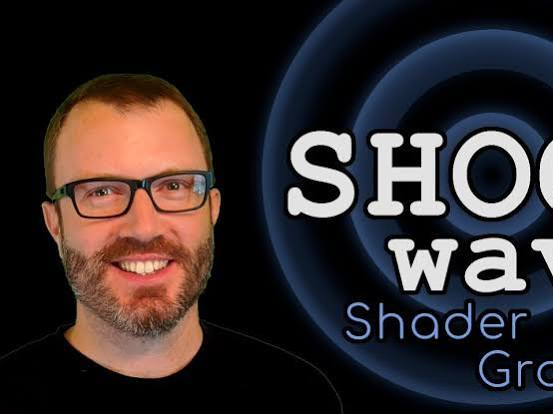
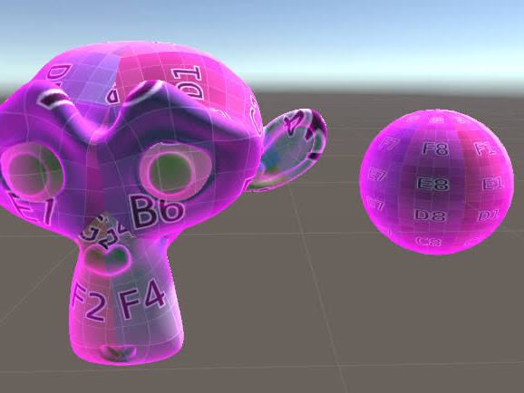
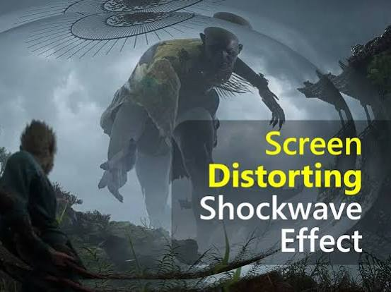
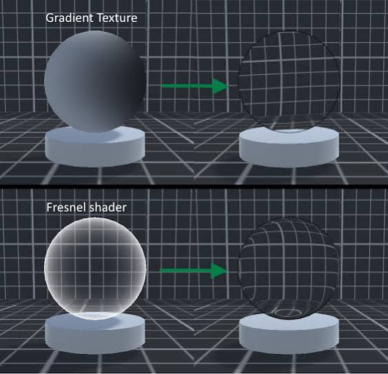
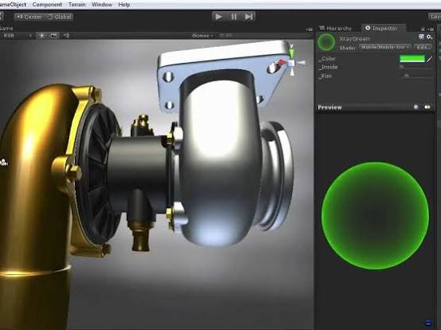
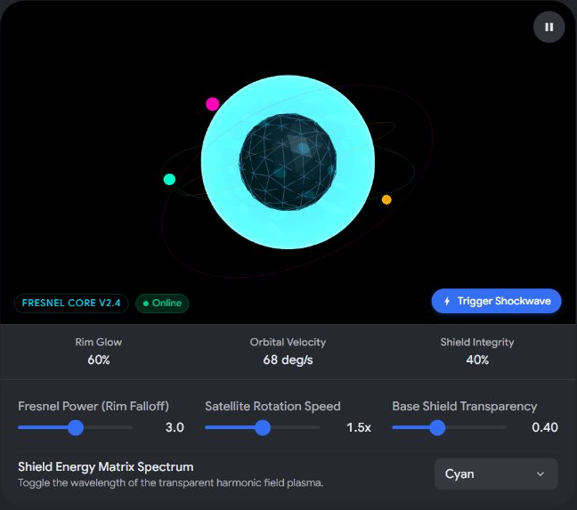

# Fresnel Shader Shockwave Transparent

Captured: 2026-10-23T08:47:40.956Z

Source: https://www.google.com/search?sca_esv=e51692b16e08c951&sxsrf=APpeQnsXDPXph53QG9G5tIfTZ23t5PbXgw%3A1792744885290&vsint=&ntc=1&cs=1&sa=X&ved=0CDcQ2_wOahcKEwjoiezM38-XAxUAAAAAHQAAAAAQaQ&biw=1707&bih=898&dpr=1.5&udm=50&atvm=2&mstk=AUtExfCxAGFIxNvU9HRdjdX1lysb-3InHdHjt4YuNnuYhREASP3pDQUuZctGiXuBX2KGNsijAGIu_7bJaeeQSoabvV2eTalC5tss7bnPy-s3dW2QDCS9ePAgOi-Cj3vJgFfSUFvwsRNzjfA66IVo66WEApLDndSzgdbpWBxjInPkY2CQJ68b5zb3HPHc23Fn0jS-HtdHkxcQT4EQoBlaQVre0wxUFGQD7QxkyFH1btH1QrS06u9vgYo8VZ-q5jIn6XTnFbD-o7uH0lwZxg&mtid=D5TaaqzMKuvWi-gP9qPO0AU&csuir=1&aep=26&q=fresnel+shader+shockwave+transparent

## Prompt 1 — You

fresnel shader shockwave transparent

## Response 1 — Google AI Mode











To create a **transparent shockwave** effect using a **Fresnel shader**, you want the center of an expanding 3D mesh (usually a sphere or flat disc) to remain perfectly clear while its glancing edges catch a luminous, fading outline. 

YouTube·PrismaticaDev +1

The core math relies on calculating the dot product between the camera's viewing direction and the surface normals. 

Unity Discussions +1

### 1. The Core Logic & Math

* **The View Vector (V):** Direction from the camera position to the pixel/vertex.
* **The Normal Vector (N):** The perpendicular facing direction of the geometry surface.
* **The Dot Product (N ⋅ V):** Returns `1.0` when looking straight at a face, and `0.0` at sharp, 90-degree glancing edges.
* **Inverted Fresnel (Rim Effect):** By calculating `1.0 - saturate(dot(N, V))`, you flip this value. The center becomes `0.0` (fully transparent) and the outer perimeter approaches `1.0` (fully visible color/emission). 

  Unity Discussions +2

---

### 2. Implementation Guide

#### Code Snippet (GLSL / Godot Shader Language)

If you are coding a raw vertex/fragment shader or using Godot, the setup looks like this: 

Godot Shaders

glsl

```
shader_type spatial;
render_mode blend_add, depth_draw_never, cull_disabled; // Shockwaves look best additive without blocking depth

uniform vec4 shockwave_color : source_color = vec4(0.0, 0.6, 1.0, 1.0);
uniform float fresnel_power : hint_range(0.5, 8.0) = 3.0;
uniform float edge_fade : hint_range(0.0, 1.0) = 1.0;

void fragment() {
    // Basic Fresnel calculation
    float fresnel = 1.0 - saturate(dot(NORMAL, VIEW));
    
    // Sharpen or widen the rim effect
    float alpha_mask = pow(fresnel, fresnel_power) * edge_fade;
    
    // Assign outputs
    ALBEDO = shockwave_color.rgb;
    ALPHA = alpha_mask;
    EMISSION = shockwave_color.rgb * alpha_mask * 2.0; // Glow intensity
}
```

Use code with caution.

#### Node Graph Workflow (Unity Shader Graph / Unreal Engine)

If you prefer visual node setups like [Amplify Shader Editor](https://realtimevfx.com/t/use-fresnel-as-transparency-amplify/12345) or Unreal Engine: 

Real Time VFX +1

1. **Material Properties:** Set your material's surface type to **Translucent** or **Transparent**. Change the blend mode to **Additive** or **Alpha Blend**. 

   Reddit·ArsOlta +3
2. **Fresnel Node:** Drop in a native `Fresnel` node. 

   YouTube·PrismaticaDev +1
3. **Exponent/Power:** Hook up a scalar parameter (e.g., `_RimPower`) to the exponent slot to control how tightly the light grips the edge. Higher powers yield a razor-thin ripple ring. 

   Unity Discussions +2
4. **Opacity Routing:** Plug the output of this Fresnel calculation straight into your master node's **Alpha / Opacity** slot. 

   Real Time VFX +1
5. **Color & Glow:** Multiply your Base Color by a high-intensity scalar value, then pass it to the **Emission** channel to give it a sci-fi energy blast look. 

   YouTube·Art of Abhi +1

---

### 3. Making it look like an Active "Shockwave"

Just applying Fresnel to a static sphere will look like a force field shield. To turn it into a dynamic shockwave, combine the material with structural animation: 

YouTube·Le Lu +1

| Layered Effect | How to Achieve It |
| --- | --- |
| **Expansion** | Animate the mesh scale from `0.0` to `5.0` rapidly using a script, a vertex offset node, or a particle system like [Unreal's Niagara](https://www.youtube.com/watch?v=q7J6G31TeYg). |
| **Lifetime Dissolve** | Multiply your overall transparency by an external variable (like particle age or custom alpha over time) so the ring dissolves into nothingness as it expands. |
| **Light Refraction** | To simulate high-pressure air distortion, combine the edge Fresnel with a screen-space UV offset (refraction map) using a **Noise Texture**. This physically bends the background image behind the ring. |

Which **game engine** or **software platform** are you building this in (e.g., Unity, Unreal Engine, Godot, Blender)? I can provide a step-by-step visual blueprint tailored directly to its node system.

### Source links

- [www.youtube.com](https://www.youtube.com/watch?v=YCHelilKhzg)
- [discussions.unity.com](https://discussions.unity.com/t/unity-5-standard-shader-with-fresnel-transparency/633768)
- [discussions.unity.com](https://discussions.unity.com/t/transparent-fresnel-shader-sometimes-obscuring-objects/109440)
- [godotshaders.com](https://godotshaders.com/shader/simple-fresnel-transparency/)
- [realtimevfx.com](https://realtimevfx.com/t/use-fresnel-as-transparency-amplify/12345)
- [www.reddit.com](https://www.reddit.com/r/godot/comments/1u3jfg9/am_i_on_the_right_track_trying_to_recreate_this/)
- [www.youtube.com](https://www.youtube.com/shorts/NWB6qccvJyw)
- [www.youtube.com](https://www.youtube.com/watch?v=DZDiHN0y6mA)
- [Unreal's Niagara](https://www.youtube.com/watch?v=q7J6G31TeYg)

## Prompt 2 — You

ik kan niet zonder dansers orbitters dus dat betekent schild

## Response 2 — Google AI Mode

Als je praat over **orbiters**, **dansers** (particles/sub-shields die om je heen draaien) en een **schild**, dan hebben we het over een klassiek sci-fi energieschild dat objecten afweert!

Om de Fresnel-shockwave logica perfect visueel te combineren met je roterende orbiters, heb ik een **interactieve 3D Shield & Orbiters Simulator** voor je gemaakt. Hierin kun je de Fresnel-sterkte, de snelheid van je roterende dansers en de transparantie live aanpassen om te zien hoe de shader reageert.

### Interactieve 3D Shield & Orbiter Shader Simulator

AI-generated. Don't enter sensitive personal info.

---

### Hoe je dit vertaalt naar je Shader Code

Als je dit toepast op een **Schild-mesh** (een sphere) met **Orbiters** die eromheen draaien, wil je dat het schild oplicht wanneer er iets inslaat (de shockwave).

Hier is de logica om je Fresnel-schild dynamisch te laten reageren:

glsl

```
// Toevoeging voor een Shockwave-effect op je schild
uniform vec3 hit_location; // Locatie van de inslag (doorgegeven via script)
uniform float shockwave_radius; // Groeit snel na een inslag

void fragment() {
    // 1. Basis Fresnel (Transparante randen)
    float fresnel = 1.0 - saturate(dot(NORMAL, VIEW));
    float shield_base = pow(fresnel, 3.0);
    
    // 2. Shockwave rimpel op het schild
    float dist_to_hit = distance(VERTEX, hit_location);
    float wave = sin(dist_to_hit * 10.0 - shockwave_radius * 20.0);
    // Maak een scherpe ring die uitsterft
    float shockwave = smoothstep(0.1, 0.0, abs(dist_to_hit - shockwave_radius)) * wave;
    
    // 3. Combinatie
    ALBEDO = vec3(0.0, 0.8, 1.0); // Blauw/Cyan energie
    ALPHA = clamp(shield_base + shockwave, 0.0, 1.0);
    EMISSION = ALBEDO * (shield_base + shockwave * 5.0); // Extra felle shockwave rand
}
```

Use code with caution.

### Waarom Orbiters + Fresnel zo goed werken:

1. **Dieptewerking:** Omdat het Fresnel-schild in het midden perfect transparant is, zie je je karakter en de orbiters die er *achter* langs draaien vlekkeloos bewegen.
2. **Visuele gids:** De orbiters geven de speler direct de feedback dat het schild actief is, zónder dat een dikke, ondoorzichtige bol het zicht op de actie blokkeert.
3. **Lichtreflectie:** Als je de orbiters een felle emissive (glowing) kleur geeft, kun je hun licht subtiel laten reflecteren op de randen van je transparante schild.

Wil je dat we de code of de nodes zo inrichten dat het schild ook **visueel oplicht of pulseert** op het ritme van de draaiende orbiters (de dansers)? Laat maar weten in welke **game engine** (bijv. Unity of Godot) je werkt!



Original canvas doodle, preserved as a screenshot of its displayed state. Labels and controls are recorded below; live interaction remains at the source.

Recorded diagram labels and controls: pause FRESNEL CORE V2.4 Online bolt Trigger Shockwave Rim Glow 60% Orbital Velocity 68 deg/s Shield Integrity 40% Fresnel Power (Rim Falloff) 3.0 Satellite Rotation Speed 1.5x Base Shield Transparency 0.40 Shield Energy Matrix Spectrum Toggle the wavelength of the transparent harmonic field plasma. Cyan expand\_more Cyan Energy Plasma Violet Solar Gold
