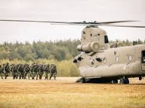
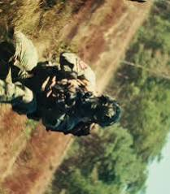
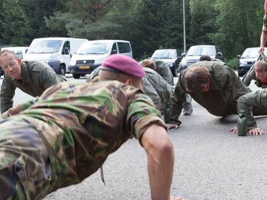
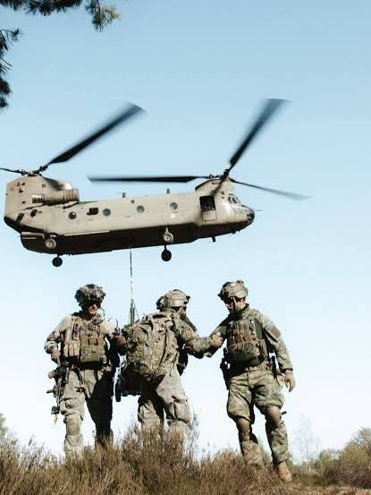
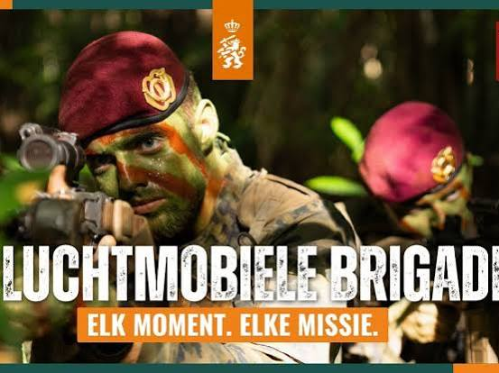
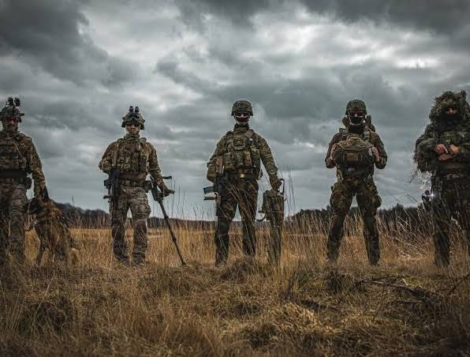
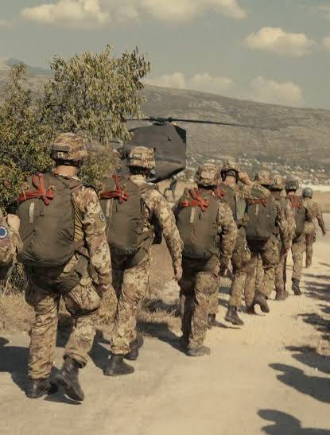
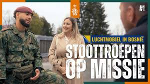

# Kikvorsmannen Korps Mariniers

Captured: 2026-10-23T08:48:36.407Z

Source: https://www.google.com/search?sca_esv=e51692b16e08c951&sxsrf=APpeQnsXDPXph53QG9G5tIfTZ23t5PbXgw%3A1792744885290&vsint=&ntc=1&cs=1&sa=X&ved=0CBkQ2_wOahcKEwjoiezM38-XAxUAAAAAHQAAAAAQaQ&biw=1707&bih=898&dpr=1.5&udm=50&atvm=2&mstk=AUtExfCOTzU-XtKbWrsUAvHFWJeRbI-dUPG5JuXxfqo6S_Nujdk6wUJMP6Ph2O6J7k6YIU8Ikg1ShxdR6w3y-i-UYsdKQr1Zv-bLCDkc9J1fos62pvFEgUHFVzcKS4EgipB9kDcWHtZG_h-8wf3QSghZF-CGL7aPgnMs67NPCO6oeNblo-wIaEFb_uU6AFej5Z-AOVf2v5IaKJw561ZR7SV0QbnI0g32_Vo-pcn99j4Qav4i7CVe6VThJVlhfnIwQEcgrnsfj8VOeYjsrOqxPu10_y2nl6bOzhDV25iEN_5sOhz2h_r3B9pQZ47RK_q6xy67K_5oGROkvWlv-Q&mtid=ZunaapLoEt-z-d8PjabyyAQ&csuir=1&aep=26&q=kikforce+man+field+marine+commando+frogman+heette+het+vroeger+nederlandse+KLTC+toch

## Prompt 1 — You

kikforce man field marine commando frogman heette het vroeger nederlandse KLTC toch

## Response 1 — Google AI Mode

**Nee, dat klopt niet helemaal; er is sprake van een spraakverwarring en een mix van verschillende termen.** De Nederlandse militaire duikers en special forces die jij bedoelt heten van oudsher **kikvorsmannen** (of simpelweg "kikkers") en zij vallen onder het [Korps Mariniers](https://www.defensie.nl/defensieonderdelen/koninklijke-marine/eenheden/korps-mariniers). 

Instagram +1

De afkorting **KLTC** en de term "Kikforce" bestaan niet binnen de Nederlandse krijgsmacht. Waarschijnlijk doel je op een van de volgende historische of actuele termen:

### 1. Kikvorsmannen / Frogmen

De Nederlandse "commando frogmen" heten officieel **kikvorsmannen**. Vroeger stonden de operationele teams bekend onder namen als de **Vaste Kikkerploeg (VKP)** (opgericht in 1963) en later het **Amfibisch Verkenningspeloton (AMFVERKPEL)**. Tegenwoordig zijn zij als *Special Forces Underwater Operators* volledig geïntegreerd binnen NLMARSOF, de elite-eenheid van de marine. 

Uitgeverij Klus op Dek +3

### 2. De verwarring met KLTC / KCT

De afkorting **KLTC** is vermoedelijk een husseling van twee bestaande termen:

* **KCT ([Korps Commandotroepen](https://www.defensie.nl/defensieonderdelen/koninklijke-landmacht/eenheden/kct)):** Dit is de Special Forces-eenheid van de Koninklijke *Landmacht*. Hoewel het KCT ook een specialisatie heeft voor wateroperaties, zijn de échte, traditionele kikvorsmannen van oudsher mariniers van de *Marine*.
* **KL (Koninklijke Landmacht):** De "KL" staat voor de landmacht, terwijl kikvorsmannen bij de KM (Koninklijke Marine) horen. 

  Werken bij Defensie +3

### 3. Kikforce / Kick Force

De term "**Kikforce**" is waarschijnlijk een fonetische verbastering van hoe men in de wandelgangen spreekt over de "*kikvorsmannen-force*" of een YouTube-video/publieke term (zoals "Kickforman"). Internationaal worden ze aangeduid als *Combat Divers* of *Commando Frogmen*. 

YouTube +2

Wil je meer weten over de **loodzware opleiding** tot kikvorsman, of zocht je specifiek naar de geschiedenis van het **Korps Commandotroepen (KCT)**? 

Wikipedia +2

### Source links

- [Korps Mariniers](https://www.defensie.nl/defensieonderdelen/koninklijke-marine/eenheden/korps-mariniers)
- [www.instagram.com](https://www.instagram.com/p/DFudAR7sOG6/)
- [klusopdek.nl](https://klusopdek.nl/product/kikvorsmannen-korps-mariniers-65-jaar-op-systeem-en-onder-druk/)
- [Korps Commandotroepen](https://www.defensie.nl/defensieonderdelen/koninklijke-landmacht/eenheden/kct)
- [werkenbijdefensie.nl](https://werkenbijdefensie.nl/commando)
- [www.youtube.com](https://www.youtube.com/watch?v=UGopyYP2BBs)
- [nl.wikipedia.org](https://nl.wikipedia.org/wiki/Korps_Commandotroepen)

## Prompt 2 — You

KLTC LUCHTMOBIEL

## Response 2 — Google AI Mode

**De combinatie "KLTC LUCHTMOBIEL" is een husseling van verschillende militaire termen.** Binnen de Nederlandse krijgsmacht bestaat de afkorting KLTC niet. Waarschijnlijk bedoel je de **11 Luchtmobiele Brigade** (onderdeel van de Koninklijke Landmacht) in combinatie met een andere operationele afkorting.

Hier is de uitleg hoe deze puzzelstukken waarschijnlijk in elkaar vallen:

### 1. 11 Luchtmobiele Brigade (LUMBL)

Dit is de snel inzetbare, lichte infanteriegevechtseenheid van de **Koninklijke Landmacht (KL)**. Zij staan bekend om hun **rode baretten** en trainen intensief met de transporthelikopters (zoals Chinooks en Apaches) van de luchtmacht. Hun officiële militaire afkorting is **11 LMB** of **11 LUMBL**. 

Defensie +2

### 2. Waar komt "KLTC" dan vandaan?

Het is zeer aannemelijk dat je een van de volgende termen in gedachten hebt:

* **KCT ([Korps Commandotroepen](https://www.defensie.nl/defensieonderdelen/koninklijke-landmacht/eenheden/kct)):** De échte commando's van de Landmacht. Soms halen mensen de letters van de **KL** (Koninklijke Landmacht) en het **KCT** door elkaar, wat fonetisch zoiets als "KLTC" kan worden. 

  Defensie
* **LTC (Landelijk Tactisch Commando):** Dit is het operationele hoofdkwartier van de Koninklijke Marechaussee. Dit heeft echter niets met Luchtmobiel of kikvorsmannen te maken. 

  Defensie

### De link tussen Luchtmobiel en Kikvorsmannen

Om terug te komen op je vorige vraag over de kikvorsmannen (maritime commando frogmen):  
11 Luchtmobiele Brigade heeft *geen* kikvorsmannen. Kikvorsmannen horen puur bij de marine (NLMARSOF) en in mindere mate bij speciale water-infiltratieteams van het KCT. Wel beschikt de Luchtmobiele Brigade over **Pathfinders** en **Verkenners** die via de lucht of het water landingsplaatsen verkennen, maar dit zijn geen kikvorsmannen. 

Werken bij Defensie +1

In deze video van de Koninklijke Landmacht zie je militairen van de Luchtmobiele Brigade in actie tijdens een recente missie:

10:48

🪖🔥 LUCHTMOBIEL IN BOSNIË | Stoottroepen op missie

34K views · 4 days ago

YouTube · Koninklijke Landmacht

Bedoelde je met de 'C' in KLTC wellicht de **C-compagnie (Charlie-compagnie)** van de Luchtmobiele Brigade, of wilde je specifiek de link weten tussen de **rode baretten (Luchtmobiel)** en de **groene baretten (KCT)**? 

ZuidWest TV +1

### Source links

- [www.defensie.nl](https://www.defensie.nl/defensieonderdelen/koninklijke-landmacht/eenheden/11-luchtmobiele-brigade)
- [www.defensie.nl](https://www.defensie.nl/defensieonderdelen/koninklijke-landmacht/eenheden/kct)
- [www.defensie.nl](https://www.defensie.nl/defensieonderdelen/koninklijke-marechaussee/eenheden/landelijk-tactisch-commando)
- [werkenbijdefensie.nl](https://werkenbijdefensie.nl/commando)
- [www.youtube.com](https://www.youtube.com/watch?v=5UWPXzKn2ms)
- [www.zuidwestupdate.nl](https://www.zuidwestupdate.nl/nieuws/groene-baretten-zoeken-nieuwe-kazerne-kct-is-postzegel-in-woonwijk/)

## Prompt 3 — You

LUCHTMOBIEL Pathfinder APEX LEGENDS TOM KLOOTWIJK EN KICKINFORSEFIELDMANUAL FORCEFIELD VR VARADADA CAGE

## Response 3 — Google AI Mode

Het lijkt erop dat je een stroom van associaties deelt waarin **militaire termen**, **gaming (Apex Legends)**, **Virtual Reality (VR)**, **popcultuur** en mogelijk **specifieke namen** kriskras door elkaar lopen.

Laten we deze ketting aan begrippen stap voor stap ontwarren:

### 1. Luchtmobiel Pathfinder & Apex Legends

Je legt hier een heel logische link tussen de echte wereld en gaming:

* **Luchtmobiel Pathfinder:** Dit is een échte, elite verkenningseenheid binnen de [11 Luchtmobiele Brigade](https://nl.linkedin.com/in/tom-klootwijk-8747848). De Pathfinders (gidsen) springen vaak als allereerste ver achter vijandelijke linies per parachute uit het vliegtuig om landingszones voor helikopters te verkennen en te beveiligen.
* **Apex Legends (Pathfinder):** In het populaire schietspel *Apex Legends* is **Pathfinder** een van de bekendste personages (een vriendelijke robot). Zijn vaardigheden — zoals het schieten van een grijphaak (*grappling hook*) en het uitzetten van een tokkelbaan (*zipline*) om zijn team snel te verplaatsen — weerspiegelen precies de tactische, mobiele rol die echte militaire Pathfinders ook hebben.

### 2. "Tom Klootwijk"

Binnen de Nederlandse krijgskrachten is er een bekende operationele commandant genaamd **Theo Klootwijk** (Kapitein-ter-zee bij de Marine), maar de exacte naam "Tom Klootwijk" in combinatie met Luchtmobiel of Apex Legends lijkt een specifieke persoonlijke referentie (bijvoorbeeld een gamertag, een herinnering aan een bekende, of een specifieke content creator/militair). 

LinkedIn

### 3. "Kickinforcefieldmanual Forcefield"

Dit is de fonetische evolutie van de termen uit je vorige vragen ("Kikforce man field marine"). Je bent hier waarschijnlijk concepten aan het mixen:

* **Field Manual:** De officiële term voor een militair handboek (bijvoorbeeld een *Tactical Field Manual*).
* **Forcefield:** Dit verschuift het gesprek direct naar **Sci-Fi en gaming**. In games (zoals *Apex Legends* met het personage Gibraltar of Wattson) speel je vaak met *forcefields* (krachtvelden) om binnenkomende kogels en granaten te blokkeren.

### 4. "VR Varadada Cage"

Dit brengt het hele verhaal samen in de wereld van **Virtual Reality**:

* Dit klinkt als de omschrijving van een **VR Cage** of een **VR Omni-directional Treadmill** (zoals de *Virtuix Omni* of *Cyberith Virtualizer*). Dit zijn speciale ronde kooien of platformen waarin je vastgesnoerd zit, zodat je fysiek 360 graden rond kunt rennen, bukken en springen in een VR-game zonder tegen je echte huiskamermuur aan te botsen.

Bedoel je hiermee dat je een **VR-simulatie** of game aan het spelen bent waarin je als een futuristische **Luchtmobiel / Pathfinder** door een arena rent met krachtvelden?

### Source links

- [11 Luchtmobiele Brigade](https://nl.linkedin.com/in/tom-klootwijk-8747848)
- [nl.linkedin.com](https://nl.linkedin.com/in/theo-klootwijk-1512424)
