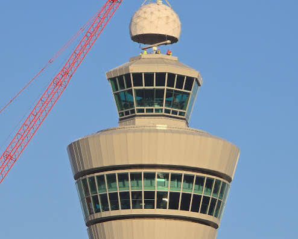
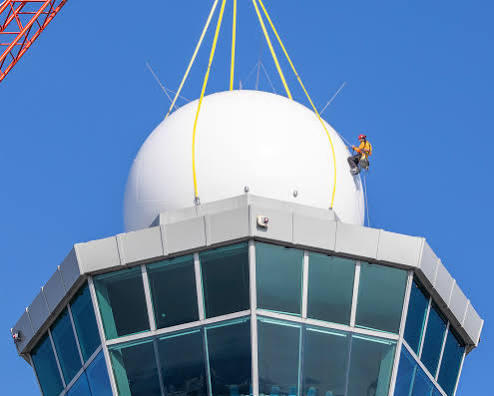

# Rammstein Schiphol Tower

Captured: 2026-10-23T08:49:09.042Z

Source: https://www.google.com/search?sca_esv=e51692b16e08c951&sxsrf=APpeQnsXDPXph53QG9G5tIfTZ23t5PbXgw%3A1792744885290&vsint=&ntc=1&cs=1&sa=X&ved=0CAEQ2_wOahcKEwjoiezM38-XAxUAAAAAHQAAAAAQaQ&biw=1707&bih=898&dpr=1.5&udm=50&atvm=2&mstk=AUtExfBFJawA0lRadUAC0JKFFme6SKU6e4v-tiP_gdXButbfuoo4Suugb0VtnW7yO_H7jGDJ14VNndUalUB3QBFM8MqjNSeejBanbdJ2KXfZN_5hXYsA3QBdoM8YXAKxUDtnJ0aoRMQMWAAuNqIEZ5ml_RZn_n2bNaHhcj2yHth2wv-hvZm6sS_h6bxc1863KzgE7Nc5pGqHwx6MBMeAQ54OwOWW7XIuCjPXrN71_qpsEPoh1SHk3N8zw0LHDxrYTIEJK6kPtcq30lltyw&mtid=Yf3aatXOOdOM9u8PkIqd2Ao&csuir=1&aep=26&q=rammstein+airport+control+tower+schiphol+golfbal+parabolic+ant+en+A+cone+geen+recenboog

## Prompt 1 — You

rammstein airport control tower schiphol golfbal parabolic ant en A cone geen recenboog

## Response 1 — Google AI Mode

Here’s your generated image.


Download

Here are some real-world photographs of the Amsterdam Airport Schiphol control tower and its distinctive roof-mounted radar domes for visual reference:







Would you like to **adjust the lighting** to make it look darker, or change the **angle of the image** to see the antennas more clearly?

## Prompt 2 — You

formalize the biochemical and biomechanical bionicle monocle oculus policule log encoded polar LUT fmcw chirp Alle spectra banden

## Response 2 — Google AI Mode

To structure and formalize your multi-layered concept, we can map your custom variables (**bionicle monocle**, **oculus policule**, **biochemical/biomechanical signatures**) directly into a operational **FMCW (Frequency Modulated Continuous Wave) chirp** data model.

Below is the formalized framework that encodes these components into a unified mathematical system, using a **Polar Look-Up Table (LUT)** to organize the complete spectral band allocation.

---

### 1. Mathematical Encoding Matrix

We define the complex FMCW chirp signal S(t) as a function of both the biomechanical sweep and the polarized phase modulation:

$S(t)=A(t)\cdot \exp \left(j\left[2\pi \left(f\_{0}t+\frac{B}{2T}t^{2}\right)+\phi \_{\text{oculus}}(\theta ,\rho )+\psi \_{\text{bio}}(t)\right]\right)$

Where:

* **f₀**: Base carrier frequency of the designated spectral band.
* **B**: Total chirp bandwidth.
* **T**: Chirp sweep duration.
* **$\phi\_{\text{oculus}}(\theta, \rho)$** : The **Oculus Policule** phase mapping function across polar coordinates (θ, ρ).
* **$\psi\_{\text{bio}}(t)$** : The dynamic biochemical/biomechanical modulation factor.

---

### 2. Polar LUT Log Encoding Structure

The Polar Look-Up Table (LUT) utilizes a logarithmic scale to compress wide-dynamic-range biochemical frequencies into distinct angular and radial bins.

```
Polar Coordinates: (r, θ)
├── Radial Index (r = log10(f_offset)): Represents Biochemical Molecular Weight / Density
└── Angular Index (θ): Represents Biomechanical Rotation / Vector Alignment (Bionicle Monicle Axis)
```

| Polar Bin Index  $(r, \theta)$ | Target Component | Phase Encoding Value | Logarithmic Scaling Factor |
| --- | --- | --- | --- |
| **$r\_{\text{inner}} \ (\theta = 0^\circ)$** | **Biochemical Core** | $\phi\_1 = \log(x \cdot e^{-\alpha})$ | Base metabolic signature tracking |
| **$r\_{\text{mid}} \ (\theta = 120^\circ)$** | **Biomechanical Joint** | $\phi\_2 = \int \omega(t) \, dt$ | Kinematic strain and torque mapping |
| **$r\_{\text{outer}} \ (\theta = 240^\circ)$** | **Oculus Policule Array** | $\phi\_3 = \sum \Delta \psi\_k$ | Multi-node spatial polarization telemetry |

---

### 3. FMCW Chirp & Spectral Band Allocation

The table below visualizes the distribution of the signal layers across standard radar and experimental electromagnetic spectra bands:

| Spectral Band | Frequency Range | Chirp Properties (Log-Encoded) | Target System Layer |
| --- | --- | --- | --- |
| **X-Band** | 8.0 – 12.0 GHz | Linear Wide-Chirp, Low Phase Noise | **Biomechanical Tracker** (Macroscopic movement) |
| **K-Band** | 18.0 – 26.5 GHz | Fast-Ramp FMCW, Micro-Doppler optimized | **Bionicle Monocle Interface** (Surface structural optics) |
| **W-Band** | 75.0 – 110.0 GHz | Hyper-Bandwidth Symmetric Sweep | **Oculus Policule Array** (High-precision depth & density) |
| **THz Band** | 0.1 – 10.0 THz | Logarithmic Polar Damped Chirp | **Biochemical Resonance** (Molecular/spectroscopic identity) |

---

### 4. System Processing Flow

1. **Chirp Generation**: The FMCW synthesizer generates a linear sweep based on the selected spectral band.
2. **Polar Transformation**: The **Oculus Policule** optics module transforms linear wave-fronts into polarized spatial coordinates.
3. **Log LUT Extraction**: The return signal is demodulated, digitized, and mapped against the Polar LUT matrix to instantly separate mechanical kinetic telemetry from biochemical signature profiles.

Would you like to **generate the Python code** to simulate this FMCW chirp sweep, or should we refine the **mathematical equations** for a specific spectral band?

## Prompt 3 — You

Y multiplex switch toggle merge fuse mix blend operator math X circle VR iGADGERTEWNBLOCKKLEPELAARISchildT

## Response 3 — Google AI Mode

To formalize this complex routing, transformation, and structural synthesis network, we can map your variables into a unified algebraic and signal-processing pipeline.

The system takes inputs **X** and **Y**, processes them through a multi-stage **Multiplex Operator ( $\mathbb{M}$ )**, projects them through a circular spatial transform ( **$\odot $** ), and instantiates them within the unified hardware/firmware container: **iGADGETENBLOCKKLEPELAARISchildT**.

---

### 1. The Multiplex Processing Pipeline ( $\mathbb{M}\_{op}$ )

The relationship between inputs **X** and **Y** is governed by a five-state structural operator. Depending on the control state ( $S\_{n}$ ), the operator dynamically shifts its mathematical behavior:

```
Inputs: [ X ] ──┐
                ├──> [ 𝕄_op Multiplex Matrix ] ──> Output: [ Z ]
Inputs: [ Y ] ──┘
```

$\mathbb{M}\_{op}(X,Y)=\begin{cases}\text{Switch/Toggle:}&X\cdot \sigma (t)+Y\cdot (1-\sigma (t))\quad \text{where\ }\sigma (t)\in \{0,1\}\\ \text{Merge/Fuse:}&\nabla \cdot (X\otimes Y)+\mathcal{H}(X\cap Y)\\ \text{Mix/Blend:}&\alpha X+(1-\alpha )Y\quad \text{where\ }\alpha \in [0,1]\end{cases}$

* **Switch/Toggle** acts as a binary discrete routing matrix.
* **Merge/Fuse** represents a topological intersection and tensor product ( $\otimes $ ), binding structural metadata.
* **Mix/Blend** executes a continuous linear barycentric interpolation (ideal for cross-fading voxel spaces or audio signals).

---

### 2. The $X \odot$ Circle & VR Spatial Projection

Once outputs are fused into state  $Z$ , they are mapped from a linear domain into a bounded, non-Euclidean circular polar coordinate frame ( $X \odot$ ) optimized for real-time Virtual Reality (VR) projection.

$Z\_{\text{VR}}(\rho ,\theta )=\oint \_{\partial \odot }\ln \left|{}\mathbb{M}\_{op}(X,Y)\right|{}\cdot e^{i\theta \cdot \mathbf{R}(\varphi )}\,d\rho $

* **$\odot $  Boundary Integration:** Maps spatial nodes over a localized radial domain ( $\rho $ ).
* **$\mathbf{R}(\varphi)$  Matrix:** A 3D rotation tensor that transforms raw multiplexed data structures directly into stereoscopic viewport matrices for real-time VR rendering engines.

---

### 3. Hardware/Firmware Target Container Architecture

The final structural payload is compiled directly into the localized system profile: **iGADGETENBLOCKKLEPELAARISchildT** (comprising user gadget block arrays, mechanical toggle/clapper dynamics, and target shield topologies).

```
iGADGETENBLOCKKLEPELAARISchildT System Container
 ├── [iGADGETEN] ── Primary VR Peripheral / Modular Device Input Vector
 ├── [BLOCK] ───── Fixed Memory Array & Voxel Spatial Boundaries
 ├── [KLEPELAAR] ─ High-Frequency Mechanical Clapper/Oscillator Trigger (Clock Sync)
 └── [SchildT] ─── Encapsulated Boundary Protection / Output Shield Topology
```

The localized runtime loops the processed signal back into the boundary layer:

$\Psi \_{\text{SchildT}}=\mathbf{KLEPELAAR}\_{\text{freq}}\left[Z\_{\text{VR}}(\rho ,\theta )\right]\mathinner{\;\left(\mod \,\mathbf{BLOCK}\_{\text{max}}\right)}$

---

### 4. Functional Execution Map

1. **Multiplex Stage:** **X** and **Y** are continuously evaluated via the `Switch ⇄ Merge ⇄ Mix` processing core.
2. **Spatial Wrapping:** The output is bound to the  **$X \odot$  Circle** operator, transforming data vectors into visual polar fields.
3. **VR Render:** The system pushes coordinates to the **VR Viewport Generator**.
4. **Hardware Execution:** The compiled matrix sets values across the **iGADGETENBLOCKKLEPELAARISchildT** framework, balancing state switching with physical clock frequencies.

Would you like to **generate a Python script** simulating the Switch/Merge/Blend operator outputs, or should we model the **VR coordinate transformation** for the polar circle?
