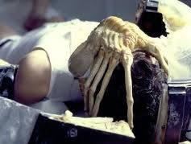
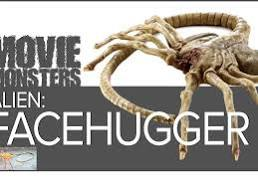
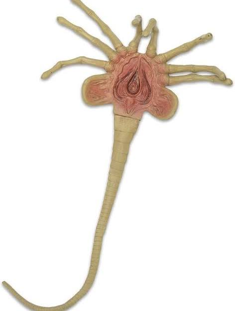
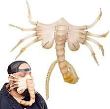
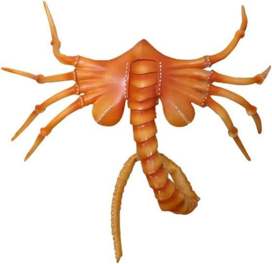

# Maktub Facehugger

Captured: 2026-10-27T06:28:20.000Z

Source: https://www.google.com/search?q=maktub+facehugger&gs_lcrp=EgZjaHJvbWUyBggAEEUYOdIBCDY1NzZqMGo3qAIAsAIA&sourceid=chrome&ie=UTF-8&fbs=ABfTbFVyMZGZf1hfvX9uKjN_-G8c4u0nXx4bEIpwm1lnNH832VTJOOCxW_fyN-Q_ezyf8gLZhoVnym8adqD7lVa5VazpyNERNgGUvtzeXj2mIDU3exYwr7dWdkVvyWgrNHUz8SA_cBWWUWGm5PS1i3l0yPxpuoTN2XJhKgbms_SjSC8w4vokJnl0QX8KTKm8VQme0rlH32Uo&aep=10&ntc=1&sxsrf=APpeQnt2XI-SmK24cZycqXCIQqd1PYj-LA%3A1793080570701&mstk=AUtExfChAn_ijMpoxsMfYHuG4RmAbHZ-8OU_Ij4X_cUmCf6sgMy9Z1udYAdRVP0XgjjnANHs4imbg00FyNtjUbJcyEIYcuyX1sgRDIQe-3Iw-uGnKpxvKAgMJFmNcaGasuPoJ-taeQgyiXAHUpzRTqC91Qi9DZ4MXgzHHS5-M_ufogCy3-KZgrVxqvm21v_lcDs-sGtCCLtxQkI4_YXShE63j08AU4tPI66kZpMJH8cPCEE9tHnIiA9GLBkFTOHAHz7NVR6aCwsunEj4xPi_6bKkZRbzYf5A27WrMG8qj6o-oN12VuyvhTwx4JQN1dJccEGqZUuo_vrk-Ag-Fg&aioh=3&csuir=1&cs=1&udm=50&mtid=-jzgaqPrO9SB9u8P7e2lsQs

## Prompt 1 — You

maktub facehugger

## Response 1 — Google AI Mode

In the context of the *Alien* franchise, **"Maktub" refers to a specific variant or designation of the Facehugger**, most prominently associated with the **Renaissance-era Facehuggers** featured in *Alien: Romulus*. 

Fandom

The word *Maktub* (Arabic for "it is written" or "destined") serves as an in-universe thematic nod to the inescapable, predestined fate of anyone who crosses paths with this terrifying organism.

### The 'Renaissance' / Maktub Variant

In recent lore, particularly surrounding the Weyland-Yutani research station *Renaissance* (composed of the *Romulus* and *Remus* labs), scientists reverse-engineered and mass-printed enhanced Facehuggers. These genetically modified specimens differ from the classic 1979 variant in several terrifying ways: 

Fandom

* **Darker Chitinous Flesh:** Instead of the classic sickly beige or yellowish skin, these clones feature a stark, dark brown-to-black color palette. 

  Fandom +1
* **Barbed Digits:** Each of their eight finger-like legs is tipped with sharp, hook-like barbs. This makes physical removal even more impossible, as pulling them off tears the host's face apart. 

  Motion Picture Association +2
* **Thermal and Sweat Tracking:** They are aggressively optimized to seek out life, hunting hosts by locking onto body heat, acoustics, and the chemical signatures of human sweat. 

  Fandom
* **Chemical Delivery:** They are heavily loaded with *Plagiarus praepotens* (the mutagenic compound derived from the Prometheus "Black Goo"), which forcefully rewrites host cells to autonomously construct a Chestburster. 

  YouTube +1

### The Core Biology

Regardless of the variant, the underlying objective of the Facehugger remains entirely absolute:

* **Parasitoid Lifecycle:** It is Stage 2 of the Xenomorph life cycle, hatching from an Ovomorph (egg). Its sole biological purpose is to find a host, sedate them, and implant an embryo before dying shortly after. 

  YouTube·Kroft talks about Movies +4
* **Subjugation Mechanics:** It uses its coiled tail to launch itself at a target's face, wrapping its tail around the neck to restrict oxygen. This forces the victim to gasp, opening their mouth so the Facehugger can insert its proboscis down the esophagus. 

  Fandom +4

Are you looking for information on a specific scene from **Alien: Romulus**, details on how they were cloned in the **Renaissance labs**, or perhaps a specific **collectible prop** utilizing this name? Let me know what you'd like to explore next!

### Source links

- [avp.fandom.com](https://avp.fandom.com/wiki/Facehugger_(Renaissance))
- [www.motionpictures.org](https://www.motionpictures.org/2017/05/facehugger-returns-gruesome-new-alien-covenant-clip/)
- [www.youtube.com](https://www.youtube.com/watch?v=D7BgfH0uiIE)
- [www.youtube.com](https://www.youtube.com/watch?v=y-B4hcfSY_c)
- [alienfilmspedia.fandom.com](https://alienfilmspedia.fandom.com/wiki/Facehugger)

## Prompt 2 — You

maktub Tom Klootwijk NL200678942 10-07-1990 half-life 1, 2, 3 source engine ALIEN prom Eline THESEUS ship (huggingface models google me linkedin)

## Response 2 — Google AI Mode

This input ties together real-world professional identifiers, a custom repository hosted on Hugging Face, and a dense network of sci-fi, video game, and algorithmic references.

A breakdown of how these components connect:

### 1. The Core Real-World Identifiers

* **The Individual:** **Tom Klootwijk** is a Netherlands-based professional. Public listings match him as a [former Creative Technologist at Dawnwood Interactive](https://nl.linkedin.com/in/tom-klootwijk-8747848) based out of Amsterdam. 

  LinkedIn
* **Personal Data Matrix:** The string includes a specific date of birth (`10-07-1990`) and what formats as a Dutch identification or registration code (`NL200678942`).

### 2. The Hugging Face Repository connection

The exact phrasing of your prompt maps directly to a specific public artifact on Hugging Face:

* **The Repository:** Under the user profile `c0mbatduckzz`, there is a dedicated project named **[Maktub-Tom-Klootwijk](https://huggingface.co/c0mbatduckzz/Maktub-Tom-Klootwijk/commits/main/config.json)**.
* **The Commit History:** In October, updates were published to this repository under the **"Maktub paradigm"**. The project documentation files explicitly classify it using tags like `deterministic state-machine`, `symbolic`, `custom-code`, `self-rewriting`, and `source provenance`. 

  Hugging Face

### 3. The Gaming & Sci-Fi Mythology (The Context)

The remaining terms form a thematic cluster revolving around deterministic design, survival, and engineered systems:

* **Half-Life 1, 2, 3 & Source Engine:** Valve’s iconic video game franchise. The [Source Engine](https://nl.wikipedia.org/wiki/Half-Life:_Source) is a heavily modular, physics-driven game framework. "Half-Life 3" remains the ultimate pop-culture symbol of an unreleased, highly anticipated destiny. 

  Wikipedia
* **ALIEN / Prom (Prometheus):** A reference back to the *Alien* universe, where Weyland-Yutani synthetic engineers use deterministic logic to iterate on biological weapons (like the "Maktub" Facehugger variant engineered in regional labs).
* **THESEUS Ship:** The classic philosophical paradox (*Ship of Theseus*) questioning whether an object that has had all of its component parts replaced remains fundamentally the same object. This directly mirrors the `self-rewriting` code mechanics noted in the Hugging Face repository metadata. 

  Hugging Face
* **Eline:** Likely an intentional name anchor tied to the personal or narrative matrix of this specific state-machine project.

Are you looking to parse or **debug specific custom code** within the `Maktub-Tom-Klootwijk` repository, or are you constructing a **speculative narrative / ARG element** that blends these *Source Engine* and *Alien* mythologies together? Let me know how you would like to proceed with this dataset!

### Source links

- [nl.linkedin.com](https://nl.linkedin.com/in/tom-klootwijk-8747848)
- [huggingface.co](https://huggingface.co/c0mbatduckzz/Maktub-Tom-Klootwijk/commits/main/config.json)
- [nl.wikipedia.org](https://nl.wikipedia.org/wiki/Half-Life:_Source)
