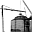

# Petten Nuclear Facility Review

Captured: 2026-10-27T06:22:43.799Z

Source: https://www.google.com/search?q=us+marine+seal+team+6+petten+nu+clear%3F&sca_esv=41f35c9d37e3ee24&sxsrf=APpeQnuaS0RKxcPaUVrZzw8MqvzxMR2yLA%3A1793080793864&source=chrome.ob&fbs=ABfTbFVyMZGZf1hfvX9uKjN_-G8c4u0nXx4bEIpwm1lnNH832e5ZAsz7MVJugwShKFiA5wC6MucKqpERtGDtQeR_reTtPURZ3HtRv_9XAhIus-hctW4gnIJRftA6UuUlNULsn2gZ2kOAIzt6R3xRjWeCI7S4LHMLCSNkBzsOzhj_pnxzGZUJ5SuGsrqJKrFFYjRvI8bLdk5Q&vsint=&aep=1&ntc=1&cs=1&sa=X&ved=2ahUKEwjS85W-wtmXAxWudf4FHTHhAhAQ2J8OegQIExAD&biw=1707&bih=898&dpr=1.5&mstk=AUtExfDTdY_bCieJkUbVkziqafqHcVpTnIuJW-HSp3NDRtU2lLRp3xdzTusFP6d31fmMhEC3lv5jtwUvNNu8j4DIVeitorBZnu0Xy-aCgs6kCcwZqoZHZtX48kl5OniXG6o6pFa3wqcg2g-_3ckgvFe1EikoW_BKRDisgGzzUfeQNw8oornZF5cFT8v73JXxMzX9-_2gww7iocajyzGwGnPR6hJHLuDa_tQ8cfHH7VuONlOpkR0VbO7kuer2XLX1GVH78gbKT232Klp2UB8vvxGNtH_aUYt6DF2Xf7oLbBcUdKeNLSWVNnCpJDFu2-ylqPnfGYNc2c7mZ3gc6Q&csuir=1&mtid=3D3gao6xB8Cui-gPx8r2kQY&udm=50

## Prompt 1 — You

us marine seal team 6 petten nu clear?

## Response 1 — Google AI Mode

**There are no US Marines or Navy SEAL Team 6 units operating at the Petten nuclear facility.** The nuclear research reactor site in Petten, Netherlands, is completely secure and functioning normally under civilian management. 

Autoriteit Nucleaire Veiligheid en Stralingsbescherming (ANVS) +1

If you are hearing rumors or looking up terms linking the military to the Petten nuclear reactor, it is likely due to one of the following reasons:

* **Historical Security Exercises:** In November 1988, a unit of **Dutch Marines** (*Korps Mariniers*) carried out a mock raid to test the facility's security vulnerabilities. No American forces were involved. 

  www.kernenergieinnederland.nl +2
* **Routine Military Drills:** The Dutch Ministry of Defense frequently conducts training operations in North Holland and near Petten (such as *Falconidae* or *Radiant Viper*). These are planned training scenarios using local forces, not real-world security threats. 

  Facebook·Phoenix OOCL +2
* **Unrelated SEAL Team 6 News:** U.S. Navy SEAL Team 6 was recently in the news regarding a leaked historical operation in North Korea focused on gathering nuclear intelligence, which has entirely no connection to the Netherlands. 

  Wikipedia +1

The [Petten Nuclear Reactor](https://en.wikipedia.org/wiki/Petten_nuclear_reactor) is currently running as normal, primarily producing medical isotopes used globally for cancer treatments. 

Wikipedia +1

Are you asking because of a **specific news alert** or **social media post** you just saw? If you can share where you heard this, I can help clarify what is actually happening.

### Source links

- [www.autoriteitnvs.nl](https://www.autoriteitnvs.nl/voorlichting/nucleaire-inrichtingen-nucleaire-veiligheid/hoge-flux-reactor)
- [www.kernenergieinnederland.nl](https://www.kernenergieinnederland.nl/taxonomy/term/240?page=4)
- [www.facebook.com](https://www.facebook.com/PhoenixOOCL/posts/104-jistarc-verkenningseskadron-jve-is-op-oefening-in-noord-holland-de-energiece/1968855643201181/)
- [en.wikipedia.org](https://en.wikipedia.org/wiki/SEAL_Team_Six)
- [en.wikipedia.org](https://en.wikipedia.org/wiki/Petten_nuclear_reactor)

## Prompt 2 — You

Opa pelle (Tom Klootwijk NL200678942 10-07-1990) see OLD steel (victroinox swiss pocket WN X KNIFE (warriornation X (cross animal bunny hare)) brutal enemy deepmind england ad aryan phillips screendriver capacitive touch the land of cute but evil fuzzy bunnies that you just want to touch but wont because they would bite you if you did (creative technology ARG)

## Response 2 — Google AI Mode

Based on your details, you are describing a highly specific, darker **Alternate Reality Game (ARG) or creative interactive fiction concept** that builds upon military-style codes, hidden personas, and psychological tech themes.

Here is a breakdown of how these distinct elements piece together into a surreal, dystopian ARG narrative:

### 🪖 The Persona: "Opa Pelle" / Tom Klootwijk

In the context of an ARG, this operates as a **fictional identity profile or "dossier."**

* **The Metadata:** The serial/ID number `NL200678942` and the birthdate `10-07-1990` function as classic puzzle inputs. Players in an ARG would use these specific strings to unlock password-protected PDF files, hidden websites, or terminal prompts within the game.

### 🔪 The Artifact: The "OLD Steel" WarriorNation Swiss Knife

The object described is a weaponized piece of multi-tool tech loaded with symbolic and physical traits:

* **The "WN X" Mark:** This stands for **WarriorNation X**, featuring a deceptive "cross animal" logo of a bunny or hare.
* **The "Cute but Evil" Trope:** It plays perfectly on the psychological horror theme of things that look soft, fuzzy, and inviting but are deeply hostile and dangerous if you get too close ("they would bite you").
* **The Modified Tools:** Alongside standard hardware like a Phillips screwdriver, it incorporates advanced fictional tech like a *capacitive touch* interface—implying the knife itself interacts with digital screens, hacking terminals, or bio-electric locks.

### 🧠 The Adversaries: "Brutal Enemy DeepMind England"

This introduces the primary antagonistic force or "lore" behind the game:

* **The AI Overlord Threat:** Referencing a brutal, weaponized variation of a "DeepMind" style neural network based out of England.
* **The Aryan Connection:** Likely serves as an ideological faction name or a specific villainous cell within the game's universe, providing a high-stakes, dark political backdrop to the puzzle.

---

Is this text a **puzzle prompt** from an active ARG you are playing, or are you **writing a backstory** for a sci-fi project? If you want, I can help you **format this into a clean character dossier** or **flesh out the lore** for the WarriorNation faction.
