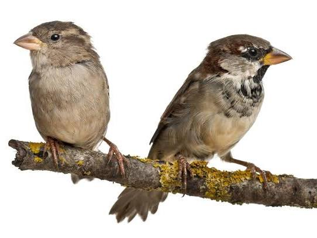
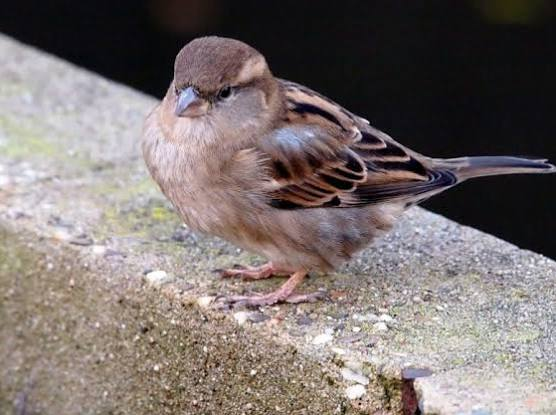
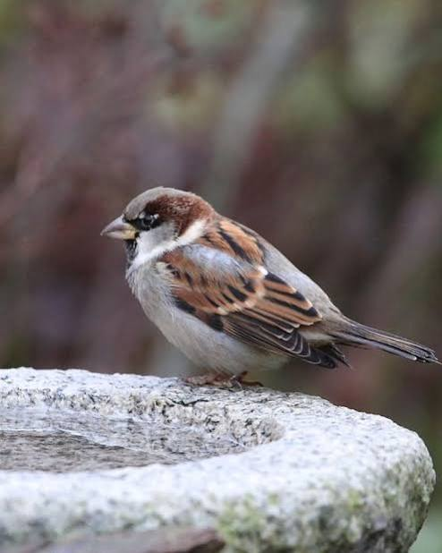
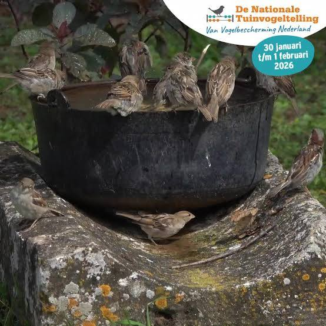
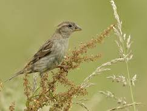
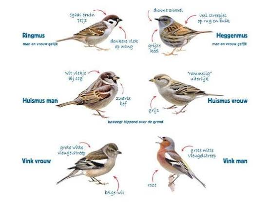
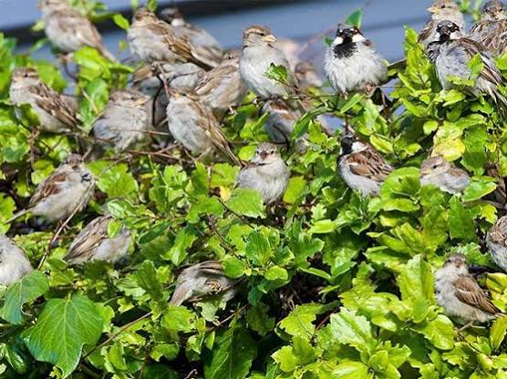
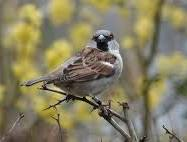
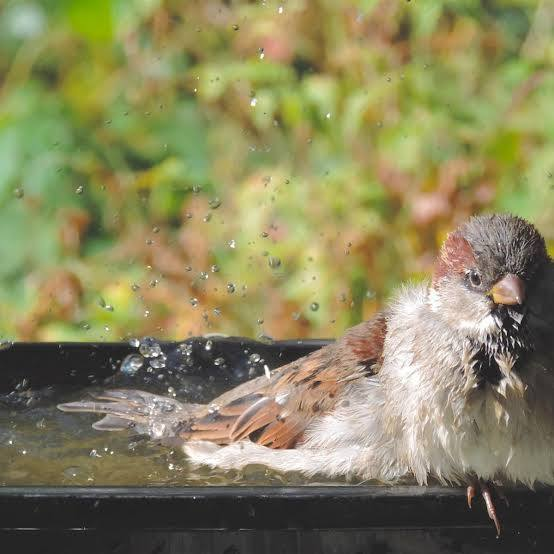
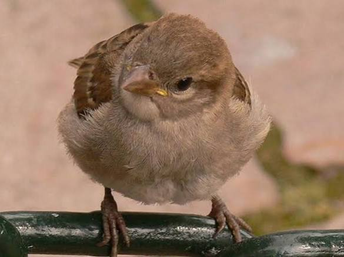

# Mus in IJburg

Captured: 2026-10-31T06:29:39.379Z

Source: https://www.google.com/search?sourceid=chrome&ie=UTF-8&ntc=1&sxsrf=AKL5yDgu7cEpD7nr59KkDzUxCYRZ89owaw%3A1793389024447&cs=1&udm=50&elids=CLz28-Waz_eynQEQARgBIhCk7qXo9YBesuJU-WwHjE7DMoEBIgJyYSgzQnMKLmxmZS1kdW1teTpmNDMyMzg0Zi0yOWM0LTQ1MGMtYjg3Yi00NGRkMjRiOGIyMzISQQo_L2Jucy9yYS9ib3JnL3JhL2Jucy9sZW5zLWZyb250ZW5kLWFwaS9wcm9kLmxlbnMtZnJvbnRlbmQtYXBpLzk4WgQKAnJhOMD5o9rR4pcDUABqCWltYWdlL3BuZw%2CCPKzr7rL1uCmggEQARgBIhADvpwQPa7d1dlSeJcYIRCPMoEBIgJyYSg6QnMKLmxmZS1kdW1teToxNTk3MzcxZC0zMTdjLTRhZjAtYTI1MC1kYTgyYTZlMTE2NDASQQo_L2Jucy9yYS9ib3JnL3JhL2Jucy9sZW5zLWZyb250ZW5kLWFwaS9wcm9kLmxlbnMtZnJvbnRlbmQtYXBpLzkzWgQKAnJhOJDZrqbV4pcDUABqCWltYWdlL3BuZw&atvm=2&ved=0CCsQ2_wOahgKEwiIi4yS0OOXAxUAAAAAHQAAAAAQ2gY&mstk=AUtExfB7uosSQ93MVdMKXLwz756Ar6nMkhXsoJyzqoouSRk6IgksvLjTXhlSu6sLGXhW9kYXXRlUnBb1NtlvYHs5RyCikg9V6kpxtn1N6I-XwxEOy7_S8js2Dh0-AUWlxXdItuTzXxCvdEu8wTfNPW60vUByuVs169MmJV3rieHI7i9dAlCr_UZ1P79VqUbEkH5sqeQAMFUr4d11QbNhncyw2caGpQSeKHggIdu37U6YKO5FaWNpuR6OwllseW1fgXj5xnJ17rLCj5JdDQ&mtid=E__kas_OK_6I9u8Ph5HR6Qg&csuir=1&aep=26&q=hoe+lang+is+de+mus+niet+meer+gezien+in+ijburg

## Prompt 1 — You

hoe lang is de mus niet meer gezien in ijburg

## Response 1 — Google AI Mode

Het klopt niet dat de mus niet meer gezien is in IJburg; in feite is **IJburg juist een van de belangrijkste plekken in Amsterdam waar de huismus succesvol leeft**.

Bij de bouw van de wijk is direct rekening gehouden met 'natuurinclusief bouwen'. Dit betekent dat er speciale nestholtes en vide-voorzieningen in de muren en daken zijn verwerkt waar mussenparen gretig gebruik van maken. 

Het Parool +2

Hoewel de huismus in grote delen van de Amsterdamse binnenstad met wel 90% is afgenomen door de toenemende verstening, wordt IJburg door stadsecologen en de [Vogelbescherming](https://www.vogelbescherming.nl/) omschreven als een echt 'mussenparadijs'. De vogels zijn er dus nog doorlopend te zien en te horen. 

Oost-Online - Amsterdam +3

Ben je benieuwd naar **specifieke locaties** in de stad waar het wél slecht gaat met de mus, of wil je weten hoe je jouw eigen tuin of balkon **mussenvriendelijk** kunt inrichten?

### Source links

- [www.parool.nl](https://www.parool.nl/nieuws/de-amsterdamse-huismus-maakt-een-comeback~bf8f26b4/)
- [Vogelbescherming](https://www.vogelbescherming.nl/)
- [oost-online.nl](https://oost-online.nl/mussen-in-oost/)

## Prompt 2 — You

Een paar jaar niet meer

## Response 2 — Google AI Mode

Als je de mussen op een specifieke plek op IJburg al een paar jaar niet meer hebt gehoord of gezien, klopt je waarneming lokaal waarschijnlijk heel goed. Huismussen hebben een heel klein leefgebied: ze verplaatsen zich gedurende hun hele leven vaak **niet verder dan 200 tot 300 meter** van hun nest. 

Omroep West

Hoewel IJburg als wijk nog steeds bekendstaat als een succesvol mussenparadijs, kan een kolonie in een specifieke straat of rondom één huizenblok binnen een paar jaar volledig instorten of verhuizen door lokale veranderingen: 

Oost-Online - Amsterdam

* **Snoeien of verdwijnen van hagen:** Mussen hebben dichte, stekelige struiken (zoals klimop, liguster of meidoorn) nodig om in te schuilen voor katten en sperwers. Als buurtgenoten een heg weghalen of strak terugsnoeien, verhuist de kolonie noodgedwongen. 

  Nature Today +2
* **Versteende tuinen:** Als tuinen in de directe omgeving zijn betegeld, verdwijnen de insecten. Vooral in het broedseizoen (voorjaar en zomer) hebben de jonge mussen absoluut insecten en meelwormen nodig om te overleven. Zonder dit voedsel sterft een kolonie lokaal uit. 

  Vogelbescherming +3
* **Verstoorde nestplaatsen:** Hoewel IJburg veel ingebouwde nestkasten heeft, kunnen deze geblokkeerd raken door renovaties, schilderwerk, of simpelweg overgenomen worden door andere vogels (zoals koolmezen of spreeuwen). 

  Vogelbescherming +2
* **Kat in de buurt:** Omdat huismussen veel op de grond scharrelen, kan de komst van één actieve jachtkat in de straat een lokale kolonie compleet verjagen of decimeren. 

  Nature Today

Het kan dus heel goed zijn dat de mussen uit jouw directe straatbeeld zijn verdwenen en nu een paar honderd meter verderop zitten waar op dit moment meer beschutting of voedsel te vinden is. 

Omroep West

Wil je weten wat de beste manieren zijn om de mussen weer terug te lokken naar jouw specifieke straat of binnentuin?

### Source links

- [www.omroepwest.nl](https://www.omroepwest.nl/natuur/5116130/waar-is-nou-toch-die-huismus-gebleven-primair-hebben-mussen-beschutting-en-voedsel-nodig)
- [oost-online.nl](https://oost-online.nl/mussen-in-oost/)
- [www.naturetoday.com](https://www.naturetoday.com/intl/nl/nature-reports/message/?msg=34418)
- [www.vogelbescherming.nl](https://www.vogelbescherming.nl/actueel/bericht/waarom-het-slechter-gaat-met-de-mus)
- [www.vogelbescherming.nl](https://www.vogelbescherming.nl/actueel/bericht/nationale-tuinvogeltelling-2026-huismus-verliest-koppositie-aan-koolmees)
