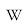
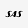
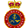
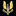

# Cloak and Dagger Clandestine Activities

Captured: 2026-10-31T22:35:40.781Z

Source: https://www.google.com/search?sca_esv=e9991be60d889d2d&sxsrf=AKL5yDh26C-Ra7LeZ38NpbtY_NP3B32g7w%3A1793483899704&vsint=&ntc=1&cs=1&sa=X&ved=0CDEQ2_wOahcKEwiI_brfp-WXAxUAAAAAHQAAAAAQVQ&biw=1707&bih=898&dpr=1.5&udm=50&arv=3&atvm=2&mstk=AUtExfAx73rTADRRcwxdX1QBlOGJ3cEjrbB5ij7hZ_K0Tvew78SQG8PJF0rIDtFfpW5fcr2z6Nzykuv4U6SlRdbSzYahDlPgr4MqKiFINRmMCtkHXOGwruHsh-ZBhXG-UUMmlbnLuHGNFL1wgJbCIyy85wT79SUdm8XvoClGnH1Z6SmsclzcGX9VpXCT6VVFRw_WriK5qqSUfZx0btBPfXmsfM0a8y6owQqfFqO6D2ziGanZYXOLuTuCjz5eKCikrIUjUkqG5ynYocAHAw&mtid=AC_mar2BDLaO9u8P-aiL2Qs&csuir=1&aep=26&q=cloak+and+dagger+clandestine

## Prompt 1 — You

cloak and dagger clandestine

## Response 1 — Google AI Mode

10 sites

### Here are top web results for exploring this topic:

X-Men Wiki | Fandom·https://x-men.fandom.com

**Cloak and Dagger** - X-Men Wiki | Fandom

Secret Invasion. Luke Cage calls Cloak, who drops off the New Avengers at the top of Stark Tower to steal one of Tony Stark's quinjets. When Cage offers to take him with them to find the downed Skrull

Facebook·https://www.facebook.com

What Does It Mean to Be **Cloak and Dagger** - Facebook

Being "cloak and dagger" means acting in a secretive, covert way, often tied to espionage and deception. The phrase comes from spies using cloaks to hide...

CIA (.gov)·https://www.cia.gov

**Cloak and Dagger**: The Unexpected Beginnings of CIA

Almost 70 years ago, in the blistering cold of a January winter, President Truman hosted a small, secret ceremony at the White House to establish the new Central Intelligence Group (CIG)—the CIA's ins

TV Tropes·https://tvtropes.org

**Cloak and Dagger** - TV Tropes

Cloak-and-dagger groups are those that have no real relationship to existing organizations but exist to conduct this kind of clandestine fun. When portrayed in a negative light, they are often filled

Wikipedia·https://en.wikipedia.org

**Cloak and dagger** - Wikipedia

"Cloak and dagger" was a fighting style common by the time of the Renaissance involving a knife hidden beneath a cloak. The term later came into use as a metaphor, referring to situations involving in

Reddit·https://www.reddit.com

**Cloak and Dagger** explained? : r/marvelstudios - Reddit

The two became fast friends until they were abducted by Doctor Simon Marshall , who used them as Guinea Pigs for a Synthetic Heroin . However, the drug killed ninety percent of the "volunteers" but im

YourDictionary·https://www.yourdictionary.com

**Cloak-and-dagger** Definition & Meaning - YourDictionary

Cloak-and-dagger Definition. klōkən-dăgər. Meanings · Synonyms. Source. All sources. Webster's New World. American Heritage. Wiktionary. Origin Adjective. Filter (0). adjective. Of or characteristic o

YouTube·https://www.youtube.com

From Runaways to Vigilantes: The Origin of **Cloak and Dagger**!

Join us in this intriguing exploration of the origins of Cloak and Dagger, two teenagers whose paths converged at a bus station in New York after running away from home. Their adventure quickly turned

The Free Dictionary·https://www.thefreedictionary.com

**Cloak-and-dagger** - The Free Dictionary

Define cloak-and-dagger. cloak-and-dagger synonyms, cloak-and-dagger pronunciation, cloak-and-dagger translation, English dictionary definition of cloak-and-dagger. adj. Marked by melodramatic intrigu

Amazon.com.au·https://www.amazon.com.au

No **Cloak**, No **Dagger**: A Professor's **Secret** Life Inside the CIA ...

No Cloak, No Dagger: A Professor's Secret Life Inside the CIA eBook : Paldy, Lester: Amazon.com.au: Kindle Store.

### Source links

- [x-men.fandom.com](https://x-men.fandom.com/wiki/Cloak_and_Dagger)
- [www.facebook.com](https://www.facebook.com/fb-answers/what-does-it-mean-to-be-cloak-and-dagger/)
- [www.cia.gov](https://www.cia.gov/stories/story/cloak-and-dagger-the-unexpected-beginnings-of-cia/)
- [tvtropes.org](https://tvtropes.org/pmwiki/pmwiki.php/Main/CloakAndDagger)
- [en.wikipedia.org](https://en.wikipedia.org/wiki/Cloak_and_dagger)
- [www.reddit.com](https://www.reddit.com/r/marvelstudios/comments/4quyu1/cloak_and_dagger_explained/)
- [www.yourdictionary.com](https://www.yourdictionary.com/cloak-and-dagger)
- [www.youtube.com](https://www.youtube.com/watch?v=GAHsgC-NUIg)
- [www.thefreedictionary.com](https://www.thefreedictionary.com/cloak-and-dagger)
- [www.amazon.com.au](https://www.amazon.com.au/No-Cloak-Dagger-Professors-Secret-ebook/dp/B0CFZCZ2F6)

## Prompt 2 — You

Sas

## Response 2 — Google AI Mode

### Quick results from the web:

Flysas.com - Scandinavian Airlines Official Website | **SAS**

Welcome to Scandinavian Airlines Official Website. Select your country/language, your preferred currency, and book your next flight among +130 destinations.

Scandinavian Airlines·https://www.flysas.com

**SAS**: Data and AI Solutions | **SAS**

SAS is the leader in analytics. Through innovative Analytics, Artificial Intelligence and Data Management software and services, SAS helps turn your data into better decisions.

SAS: Data and AI Solutions·https://www.sas.com

Following your previous mention of "cloak and dagger clandestine" operations, **SAS** most likely refers to the **Special Air Service**, the elite special forces unit of the British Army. 

Wikipedia

However, depending on the context, the acronym can mean several completely different things:

### 1. Military & Covert Operations

* **Special Air Service (SAS):** Founded in 1941 during World War II, this highly secretive regiment specializes in counter-terrorism, hostage rescue, direct action, and covert strategic reconnaissance. Operating under the famous motto **"Who Dares Wins,"** it serves as the blueprint for many of the world's premier special forces units. 

  Wikipedia +1

### 2. Tech & Data Science

* **SAS (Software):** A powerful, widely used statistical software suite developed by the [SAS Institute](https://www.sas.com/nl_nl/home.html). It is a foundational tool in advanced business intelligence, data analytics, predictive modeling, and AI engineering. 

  SAS: Data and AI Solutions +1

### 3. Commercial Aviation

* **Scandinavian Airlines:** The multi-national flag carrier airline for Denmark, Norway, and Sweden. Commonly known simply as SAS, it operates a massive network across Europe and global destinations. 

  Wikipedia

---

Which of these versions of **SAS** were you looking to explore? If it's the military unit, I can give you details on their **brutal selection process**, historic operations (like the **1980 Iranian Embassy siege**), or their **specialized squadron branches**.

### Source links

- [www.flysas.com](https://www.flysas.com/)
- [www.sas.com](https://www.sas.com/nl_nl/home.html)
- [en.wikipedia.org](https://en.wikipedia.org/wiki/Special_Air_Service)
- [en.wikipedia.org](https://en.wikipedia.org/wiki/Scandinavian_Airlines)

## Prompt 3 — You

In the context of the first prompt

## Response 3 — Google AI Mode

In the true spirit of **cloak and dagger clandestine operations**, the Special Air Service (SAS) is built entirely around making the impossible look invisible. 

The Regimental Store Ltd +1

When executing deniable, high-risk missions behind enemy lines, the regular **22 SAS Regiment** relies on a highly structured, hyper-specialized anatomy. They do not operate as a massive army, but rather break down into tiny, surgical cells. 

Britannica +2

### The Anatomy of the Sabre Squadrons

The backbone of the SAS consists of four operational **"Sabre" Squadrons: A, B, D, and G**. Each squadron is composed of roughly 60 operators and is divided into four highly specialized **Troops** (approx. 16 men each), defined by how they infiltrate a target: 

Grey Dynamics +2

* **Air Troop:** Experts in free-fall parachuting, utilizing **HALO** (High Altitude Low Opening) and **HAHO** (High Altitude High Opening) techniques to slip across borders undetected at night. 

  Quora +1
* **Boat Troop:** Amphibious specialists trained in diving, Klepper canoeing, kayak insertion, and underwater demolitions to infiltrate from the sea or river networks. 

  Quora
* **Mountain Troop:** Elite alpine and arctic combatants trained to survive and fight in brutal, high-altitude environments, utilizing terrain that conventional forces deem impassable. 

  Quora +1
* **Mobility Troop:** Master navigators and mechanics who weaponize heavily armed, lightweight vehicles to wage deep-penetration desert or long-range reconnaissance operations. 

  Elite UK Forces +1

At the absolute granular level of a clandestine operation is the **four-man patrol**. Every trooper in that patrol brings a vital, distinct skill: a linguist/intelligence expert, a combat medic, a demolitions specialist, and a signals/communications expert. 

Grey Dynamics +1

### The Clandestine Partners: UKSF & E Squadron

The SAS rarely acts completely alone in the shadows. They are part of the **United Kingdom Special Forces (UKSF)**, which functions alongside other deeply secretive units: 

Britannica

* **The Special Reconnaissance Regiment (SRR):** While the SAS handles direct action and counter-terrorism, the SRR consists of the absolute masters of tradecraft. Operating primarily in plain clothes and unarmed, they specialize in deep undercover tracking, close-quarters surveillance, and architectural penetration. 

  YouTube·Grid 88 +2
* **E Squadron:** Arguably the most "cloak and dagger" unit in the entire British establishment. It is a hyper-classified joint cell where tier-one operators (from the SAS and SBS) are directly seconded to **MI6** (the Secret Intelligence Service). They operate in civilian clothing with fake identities, carrying out deniable, black-budget operations globally where British military presence can never be officially acknowledged. 

  YouTube·Grid 88 +1

---

If you want to look deeper into their dark history, would you like to explore how they operated as **"Stay-Behind" sleeper cells** during the Cold War, or how they collaborated in Iraq and Syria under the joint US/UK counter-terror unit known as **Task Force Black**?

### Source links

- [www.regimentalstore.co.uk](https://www.regimentalstore.co.uk/blogs/news/history-of-the-sas-british-forces)
- [www.britannica.com](https://www.britannica.com/topic/Special-Air-Service)
- [greydynamics.com](https://greydynamics.com/sas-the-uk-army-special-air-service-2/)
- [www.quora.com](https://www.quora.com/Can-you-explain-the-hierarchy-within-the-British-SAS-Special-Air-Service)
- [www.eliteukforces.info](https://www.eliteukforces.info/special-air-service/)
- [www.youtube.com](https://www.youtube.com/watch?v=JFDZH-L1RfU&t=43)
