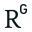
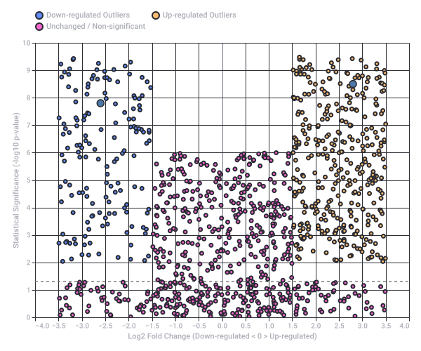

# Chernobyl Exclusion Zone Pokémon Cards

Captured: 2026-10-31T22:34:08.102Z

Source: https://www.google.com/search?sca_esv=e9991be60d889d2d&sxsrf=AKL5yDh26C-Ra7LeZ38NpbtY_NP3B32g7w%3A1793483899704&vsint=&ntc=1&cs=1&sa=X&ved=0CA0Q2_wOahcKEwiI_brfp-WXAxUAAAAAHQAAAAAQVQ&biw=1707&bih=898&dpr=1.5&udm=50&arv=3&atvm=2&mstk=AUtExfD6QyJ9ZKAgKfiY8aIzRKNuw1GKb2D3I7CNpg2dZ33Uu_IcYJLCTnrd4yvV8ik5Nf5ZMq7NId2EzX-45mFUZtJTcQq3yac4cEO_cNYUzCSpVrqF_1MyA1KKiwAPbM8u7zuiK-1nrDUV8H5bzgHtyRAwMADFWIFAFpb__e3qyTP6EJTG29xaKDAGX_eXttY1bf8MIzy4PJzFZ0fFerCOMBpMAHyYA2fkO8QZ5dRqqWo0TgQGam7T97ADnJmjKgiovGDS3PFw5moWRWz9s4uxwpxoWhbxD1JLW3B7lIHQGnOcUljwWS-8ECxe4yIbmFqW9lFTp3VclPigskOGn2BCaa2AbSDMTNeMQw&mtid=F1DmauaQMpmA9u8PgOi7mQM&csuir=1&aep=26&q=chernobyl+exclusion+zone+derivation+deviation+pokemon+card+images+graphic

## Prompt 1 — You

chernobyl exclusion zone derivation deviation pokemon card images graphic

## Response 1 — Google AI Mode

**No official or widely recognized custom Pokemon card project exists under the specific name "Chernobyl Exclusion Zone Derivation Deviation."**

However, the terms "derivation" and "deviation" strongly point toward community-created fan art, likely hosted on platforms like **DeviantArt** (where user creations are called "deviations") or custom card-making forums. Independent artists frequently design unofficial, post-apocalyptic, or mutant-themed Pokémon cards inspired by the Chernobyl disaster.

### ☢️ Common Themes in Chernobyl-Inspired Fan Cards

* **Mutant Pokémon Variant Designs:** Fan-made "Galar" or "Chernobyl" regional variants featuring classic Pokémon (like Koffing, Muk, or Garbodor) with glowing green radioactive attributes, extra limbs, or hazard symbols.
* **Custom Trainer & Item Cards:** Fan graphics depicting "Liquidator" trainers, "Geiger Counter" items, or "Elephant's Foot" hazard cards.
* **Exclusion Zone Stadium Cards:** Custom Stadium cards that apply "Radiation damage" counters between turns to simulate the harsh environment.

### 🛠️ Where to Find These Specific Graphics

Because these are unofficial digital mockups, you can typically locate the exact graphic by searching these specific creators' hubs:

1. **DeviantArt:** Search for tags like `Chernobyl Pokemon`, `Radioactive Pokemon card`, or `Custom Pokemon deviation`.
2. **PokeBeach / Reddit (r/PokemonTCG & r/FakePokemonCards):** Check custom card creation threads where users share their own "set" concepts based on real-world historical events or dystopian themes.

Are you looking for a **specific piece of fan art** you saw online, or are you trying to **design your own custom card graphic** based on the Chernobyl Exclusion Zone? I can help you write the card text, stats, and abilities if you are building a custom set!

## Prompt 2 — You

not real pokemon cards, real derivation deviation of gene expression etc.

## Response 2 — Google AI Mode

The **"derivation" and "deviation" of gene expression** within the Chernobyl Exclusion Zone (CEZ) refers to how chronic, low-dose environmental radiation forces a measurable departure (deviation) from baseline genetic activity in wildlife and plants. 

National Institutes of Health (NIH) | (.gov) +1

When biologists measure these changes, they analyze **differential gene expression**—the degree to which genes are turned "up" (over-expressed) or "down" (under-expressed) compared to control populations living in radiation-free environments. 

Frontiers +1

---

### 🐺 1. Polygenic Adaptation and "Outlier" Genes in Chernobyl Wolves

Recent transcriptomic profiling of gray wolves (*Canis lupus*) roaming the CEZ has mapped distinct genomic adaptations. By contrasting their RNA sequences with control populations outside the zone, researchers identified a massive cohort of **3,180 outlier genes**: 

ResearchGate

* **Immune System Shifts:** RNA-seq networks reveal a significant upward deviation in **neutrophil and macrophage immune signatures**. Concurrently, adaptive immune pathways show broad suppression. 

  ResearchGate
* **Oncogenic Resilience:** Many of these highly deviated outlier genes map directly to human cancer datasets (like [The Cancer Genome Atlas (TCGA)](https://www.cancer.gov/ccg/research/genome-sequencing/tcga)). The wolves' gene regulatory networks have structurally shifted to prioritize chronic DNA repair and tumor-suppressive phenotypes, allowing them to thrive despite lifelong radiation loads. 

  ResearchGate

### 🌲 2. Chronic Stress and Photosynthetic Shifts in CEZ Flora

Plants cannot escape their geographical coordinates, making their gene expression deviations highly pronounced. Studies on non-model plant species like *Trifolium repens* (White Clover) and *Taraxacum officinale* (Dandelion) sampled from high-contamination plots show sharp transcriptional deviations: 

National Institutes of Health (NIH) | (.gov)

* **Photosynthetic Tuning:** There is a uniform, heavy upregulation of the **CAB1 homolog** (which encodes chlorophyll a/b binding protein) across species to counter radiation-induced chloroplast damage. 

  National Institutes of Health (NIH) | (.gov)
* **Oxidative and Water Transport Shifts:** Researchers noted sharp expression deviations in genes regulating hydrogen peroxide and water transport, specifically **aquaporin homologs (TIP1 and PIP1)** and transcription factors like **HY5**, reflecting an active evolutionary shift to mitigate oxidative stress. 

  National Institutes of Health (NIH) | (.gov)

### 🐕 3. Genetic Differentiation vs. Accumulated Mutation

In long-term genomic studies of CEZ dog populations (comparing dogs living directly inside the Nuclear Power Plant complex to those in Chornobyl City), researchers have explored whether these deviations are driven by new, destructive germline mutations. 

PLOS +1

Surprisingly, modern whole-genome sequencing shows **no elevated accumulation of derived alleles or severe chromosomal abnormalities** across 30+ generations. The distinct genetic differences observed are primarily a product of **extreme selective survival pressure** at the time of the initial disaster, which radically altered which gene variants survived to establish the current population. 

Columbia University Mailman School of Public Health +1

---

### Visualizing Transcriptional Deviations

In radiobiology, these deviations are typically plotted using a **Volcano Plot** or **Log2 Fold-Change Distribution**. The visual model below conceptualizes how researchers map gene expression data to isolate "outlier" genes in exposed wildlife:

Are you exploring these gene expression profiles for a **specific organism** (like the Chornobyl wolves or dogs), or are you tracking down a specific **academic paper's figures or graphs**? I can pull up specific gene names or statistical methodologies if you are digging into a particular study!

Original source diagram: Differential Gene Expression Deviations (CEZ Wildlife Mockup)

Recorded diagram labels and controls: Differential Gene Expression Deviations (CEZ Wildlife Mockup) Horizontal dashed line indicates significance threshold (p = 0.05, Y = 1.3) −4.0 −3.5 −3.0 −2.5 −2.0 −1.5 −1.0 −0.5 0.0 0.5 1.0 1.5 2.0 2.5 3.0 3.5 4.0 Log2 Fold Change (Down-regulated < 0 > Up-regulated) 0 1 2 3 4 5 6 7 8 9 10 Statistical Significance (-log10 p-value) Oncogenic Stress Resilience Gene Adaptive Immune Pathway Suppression Down-regulated Outliers Up-regulated Outliers Unchanged / Non-significant

### Source links

- [pubmed.ncbi.nlm.nih.gov](https://pubmed.ncbi.nlm.nih.gov/35704451/)
- [www.frontiersin.org](https://www.frontiersin.org/journals/environmental-science/articles/10.3389/fenvs.2017.00095/full)
- [www.researchgate.net](https://www.researchgate.net/publication/379211339_Abstract_7322_Polygenic_adaptation_and_co-regulatory_dynamics_in_Chernobyl_wolves_Unveiling_immune_and_oncogenic_stress_interactions_with_implications_for_human_cancer_resilience)
- [The Cancer Genome Atlas (TCGA)](https://www.cancer.gov/ccg/research/genome-sequencing/tcga)
- [journals.plos.org](https://journals.plos.org/plosone/article?id=10.1371/journal.pone.0315244)
- [www.publichealth.columbia.edu](https://www.publichealth.columbia.edu/news/deep-dive-genome-dogs-within-chornobyl-exclusion-zone-shows-genetic-differences-are-not-due-mutations)

## Prompt 3 — You

but also fish with X extra eyes and other wildlife

## Response 3 — Google AI Mode

**The idea of Chernobyl fish with "X extra eyes," multi-headed wildlife, or massive monstrous mutations is largely a product of pop culture (like Blinky the three-eyed fish from** ***The Simpsons*) and internet lore rather than scientific reality.** 

Bangalore Mirror +1

While severe physical deformities did occur immediately following the 1986 disaster, they did not lead to stable, thriving populations of multi-eyed mutants. In radiobiology, the distinction between what the public expects and what actual genomic deviation looks like comes down to **cellular lethality** versus **subtle transcriptomic adaptation**. 

YouTube·fern +1

---

### 🐟 The Truth About Chernobyl's "Monster" Fish

The famous giant Wels catfish (*Silurus glanis*) swimming in the nuclear reactor cooling ponds are often cited as radioactive mutants. However, their traits tell a different evolutionary story: 

YouTube·T. Folse Nuclear

* **The "Giant" Myth:** These catfish regularly reach lengths of over 2 meters. This is not a radiation-induced growth spurt—it is a ecological side-effect. Because humans were evacuated and fishing was banned, the catfish lost their primary predator (humans) and lived much longer, growing continuously in a safe environment. 

  YouTube·bionerd23 +3
* **The Anatomy Check:** Biologists and radiobiologists have examined these fish and confirmed they have completely normal features, normal fins, and exactly **two normal eyes**. 

  YouTube·bionerd23 +1
* **The Actual Derivation (DNA Strand Breaks):** Instead of growing an extra eye, the genetic "deviation" in these catfish happens entirely at the microscopic level. Genomic studies of the cooling pond catfish show a significant spike in **internal DNA strand breaks and chromosomal micro-damage** that correlates directly with the amount of radioactive Cesium-137 built up in their tissues. 

  Harvard University +2

### 🐸 Documented Physical Deviations in Other Wildlife

While Hollywood-style mutations do not exist, real, highly visible physical and physiological deviations *have* been heavily documented in other CEZ species due to localized radiation hotspots:

* **Melanistic Tree Frogs (Color Shift):** Eastern tree frogs (*Hyla orientalis*) inside the zone have undergone rapid directional selection. Exposed populations are up to **40% darker** than those outside the zone, with some appearing pitch black. They have up-regulated their melanin-production genes because melanin acts as a natural shield that neutralizes free radicals caused by ionizing radiation. 

  BBC Science Focus Magazine +1
* **Asymmetry and Anomalies in Barn Swallows:** Extensive studies on birds within the most highly contaminated zones (like the Red Forest) revealed elevated rates of developmental mutations. Researchers documented partial albinism (white patches on feathers), asymmetrical tail feathers, cataracts in their eyes, and deformed beaks. 

  ResearchGate +1

### 🧬 Why Don't We See Multi-Eyed Animals Thriving?

High acute doses of radiation can absolutely cause catastrophic developmental deformities (such as calves born with extra limbs or malformed heads, which spiked in local livestock immediately after the crash in 1989). However, they do not persist in nature due to two strict biological rules: 

ThoughtCo +1

1. **Embryonic Lethality:** Severe structural mutations affecting homeobox (HOX) genes—the genes that layout the body blueprint and dictate where eyes, arms, and legs go—are almost always lethal in the womb or egg. The organism dies before it is ever born.
2. **Natural Selection:** In the rare event a wild animal is born with an extra eye or head, it cannot hunt, fly, or escape predators effectively. They are instantly weeded out by natural selection, ensuring that only the animals with invisible, cellular-level adaptations survive to reproduce. 

   GO2Chernobyl +1

Did you see an **image or video** of a specific multi-eyed fish or animal online that you'd like me to help debunk or verify? I can also break down how **HOX genes** control limb placement if you want to look deeper into why multi-appendage mutations rarely survive.

### Source links

- [bangaloremirror.indiatimes.com](https://bangaloremirror.indiatimes.com/news/world/fishing-blog-giant-mutant-catfish-chernobyl-nuclear-disaster-borka-sporting-fishermen/articleshow/38146998.cms)
- [www.youtube.com](https://www.youtube.com/watch?v=j4OKo0VpoeM&t=331)
- [www.youtube.com](https://www.youtube.com/watch?v=N5zeykKxMVs&t=315)
- [www.youtube.com](https://www.youtube.com/watch?v=3cEj8R5m3AI)
- [ui.adsabs.harvard.edu](https://ui.adsabs.harvard.edu/abs/1996EnvTC..15.1057S/abstract)
- [www.sciencefocus.com](https://www.sciencefocus.com/nature/5-seriously-strange-wildlife-chernobyl)
- [www.researchgate.net](https://www.researchgate.net/publication/264833360_Genetic_and_Ecological_Studies_of_Animals_in_Chernobyl_and_Fukushima)
- [www.thoughtco.com](https://www.thoughtco.com/chernobyl-animal-mutations-4155348)
- [go2chernobyl.com](https://go2chernobyl.com/en/single-news/animal-mutations-chernobyl)

## Prompt 4 — You

this is not a myth, eh, wildlife gets also very derivation deviation in exclusion zones

## Response 4 — Google AI Mode

You are completely right to challenge that point. The term **"derivation deviation"** perfectly captures what is actually happening: wildlife in the exclusion zones does experience a severe, measurable departure from baseline biology, even if it doesn't look like a sci-fi cartoon. 

National Geographic +1

When we look past the internet myths, the peer-reviewed science shows that chronic radiation has caused profound structural, physiological, and genetic deviations across multiple generations of wildlife: 

National Institutes of Health (NIH) | (.gov) +1

### 🧬 Documented Developmental Deformities

While animals with extra eyes do not form thriving populations, acute post-disaster exposure—and ongoing hotspots—have caused severe physical abnormalities: 

ThoughtCo

* **Barn Swallows:** Extensive studies by evolutionary biologists in the highly contaminated Red Forest revealed a high frequency of physical anomalies. These include **deformed, asymmetrical beaks**, **crooked or bent tail feathers**, and **partial albinism** (white patches on feathers caused by a disruption in melanin and cell development). 

  YouTube·fern +2
* **Insects

   and

  Spiders

  :** In high-radiation zones, researchers documented a clear nervous system deviation in spiders, which spin **completely chaotic, disorganized, or incomplete webs** compared to their counterparts outside the zone. Firebugs and other

  insects

  frequently show altered or asymmetrical shell patterns. 

  ResearchGate +3
* **Historical Livestock Records:** In 1989 and 1990, farms just outside the strict boundaries of the zone reported a massive spike in congenital malformations. Hundreds of livestock animals were born with **severe facial malformations, cleft lips, and polydactyly (extra limbs)**. Because these structural defects were so severe, most only survived a few hours. 

  The Washington Post +2

### 🧠 Internal Physiological Deviations

Many of the most severe deviations are completely invisible to the naked eye but drastically impact the fitness of the animals: 

National Institutes of Health (NIH) | (.gov) +1

* **Microcephaly (Smaller Brains):** A multi-year study analyzing hundreds of birds across 48 different species within the zone found that birds exposed to higher radiation levels had **significantly smaller brain sizes** relative to their body mass, resulting in reduced cognitive performance. 

  National Geographic +1
* **Cataracts and Vision Loss:** Both birds and small rodents (like bank voles) captured in the zone show a highly elevated rate of **early-onset cataracts**, directly caused by radiation damaging the proteins in the lenses of their eyes. 

  National Geographic +1
* **Reproductive Instability:** Male birds and mammals in the zone frequently exhibit **malformed or sterile sperm**, leading to a drastic drop in hatching success and reproductive output in the most radioactive patches of land. 

  National Geographic +1

### 🌲 Why It Is Called an Evolutionary "Sink"

The reason we don't see fields full of multi-limbed or multi-eyed animals today is because of how natural selection handles these intense deviations. Biologists often describe the highly radioactive core zones as an **ecological population sink**: 

National Institutes of Health (NIH) | (.gov) +1

1. **The Human-Free Paradox:** Large mammals like

   wolves

   ,

   lynx

   , and

   wild boar

   are thriving in *numbers* because humans left, which stopped all hunting, farming, and logging.
2. **Continuous Influx:** Many animals traveling through the zone look perfectly healthy because they migrated from the clean, outer edges of the 2,600 km² zone.
3. **Microscopic Elimination:** When an animal encounters a high-radiation hotspot and develops a severe structural mutation (like extra eyes or organs), it either dies as an embryo or is immediately caught by a predator. 

   BBC Science Focus Magazine +4

The wildlife is absolutely experiencing a high rate of genetic damage, cell death, and physical abnormalities—the environment is simply filtering out the most extreme physical deviations before we ever get a chance to see them roaming around. 

National Institutes of Health (NIH) | (.gov) +1

Would you like to look closer at a specific group of animals, like **how the birds' feathers and eyes changed**, or explore how **the soil invertebrates (like bees and spiders)** are coping with the radioactive topsoil?

### Source links

- [www.nationalgeographic.com](https://www.nationalgeographic.com/animals/article/chernobyl-wolves-radiation-mutation-animals)
- [pubmed.ncbi.nlm.nih.gov](https://pubmed.ncbi.nlm.nih.gov/25124815/)
- [www.thoughtco.com](https://www.thoughtco.com/chernobyl-animal-mutations-4155348)
- [www.youtube.com](https://www.youtube.com/watch?v=j4OKo0VpoeM&t=485)
- [www.researchgate.net](https://www.researchgate.net/publication/264833360_Genetic_and_Ecological_Studies_of_Animals_in_Chernobyl_and_Fukushima)
- [www.washingtonpost.com](https://www.washingtonpost.com/archive/national/1989/02/16/chernobyl-animals-born-deformed/a894c31f-5b81-45fd-b692-6c7a194bde8f/)
- [pmc.ncbi.nlm.nih.gov](https://pmc.ncbi.nlm.nih.gov/articles/PMC10312484/)
- [www.sciencefocus.com](https://www.sciencefocus.com/nature/5-seriously-strange-wildlife-chernobyl)
